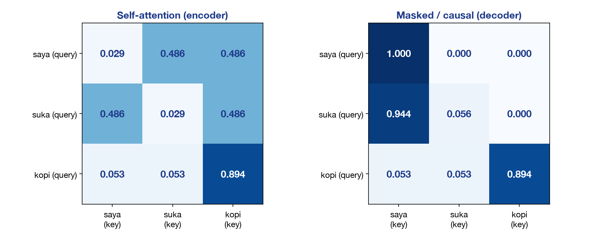
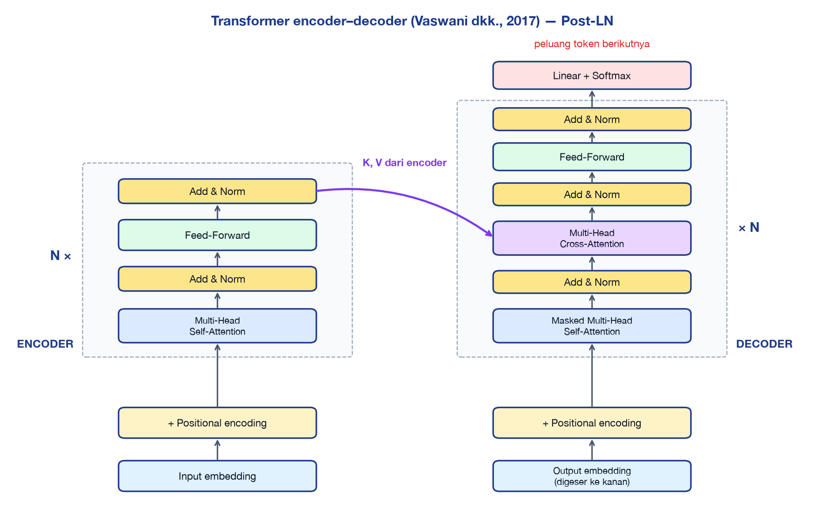
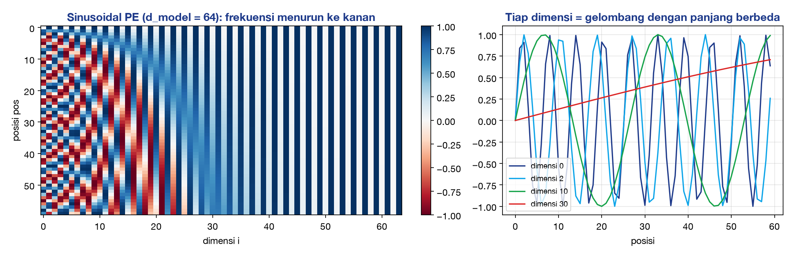
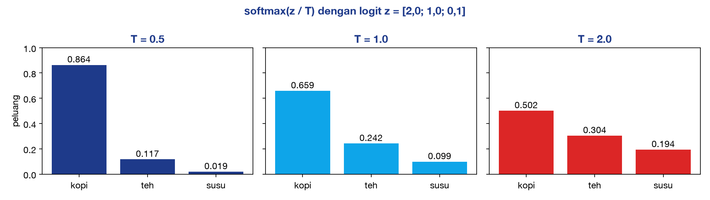
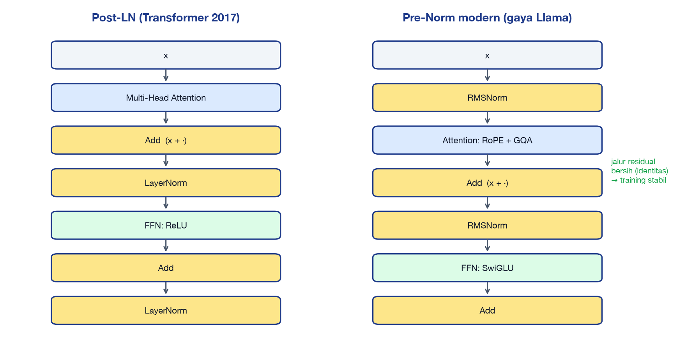

<!-- _class: lead -->
<!-- _paginate: false -->
<!-- _header: '' -->

# Transformer
## Distance & Similarity · Self-Attention · Arsitektur · Aplikasi

### Pertemuan 12 — Deep Learning
**Sains Data ITERA · Ganjil 2026/2025**

---

# Capaian Pembelajaran & Agenda

> Mahasiswa mampu memahami konsep **self-attention** dan arsitektur **Transformer**, menghitungnya secara manual, serta menjelaskan bagaimana Transformer dipakai dan dikembangkan pada NLP, computer vision, dan model bahasa besar (LLM) terkini.

1. **Distance & similarity** — fondasi matematis attention
2. **Self-attention** — Q, K, V, softmax, mask, multi-head (hitung manual)
3. **Arsitektur Transformer** — embedding, positional encoding, encoder, decoder, FFN, Add & Norm
4. **Training & inferensi** — cross-entropy, teacher forcing, decoding (greedy, temperature, top-p)
5. **Keluarga model** — encoder-only, decoder-only, encoder–decoder
6. **Perkembangan terbaru** — Pre-Norm, RMSNorm, SwiGLU, RoPE, GQA, KV cache, FlashAttention, MoE, scaling laws
7. **Aplikasi** — NLP, ViT, CLIP, Whisper, AlphaFold, diffusion · implementasi · latihan

*Prasyarat: materi Minggu 0 — Attention Layers, Embedding Layers, Normalization, Residual.*

---

# Mengapa Transformer?

| Arsitektur | Cara memproses urutan | Kelemahan |
|---|---|---|
| **RNN / LSTM** | Token satu per satu: $h_t = f(h_{t-1}, x_t)$ | Sekuensial → **tidak bisa diparalelkan**; jarak jauh sulit (vanishing gradient) |
| **CNN 1D** | Jendela lokal | Butuh banyak layer untuk relasi jarak jauh |
| **Transformer** | **Semua token sekaligus**, tiap token "melihat" semua token lain lewat attention | Biaya $O(n^2)$ terhadap panjang urutan |

Panjang lintasan informasi antara dua token yang berjarak $n$:

| | RNN | CNN (kernel $k$) | Self-attention |
|---|---|---|---|
| Operasi sekuensial | $O(n)$ | $O(1)$ | $O(1)$ |
| Panjang lintasan maksimum | $O(n)$ | $O(\log_k n)$ | $O(1)$ |

*Sumber: Vaswani dkk. (2017), Tabel 1.*

> "**Attention Is All You Need**" (Vaswani dkk., 2017): tanpa rekurensi dan konvolusi, mencapai BLEU 28,4 pada terjemahan Inggris→Jerman (WMT 2014) dengan biaya training jauh lebih kecil.

---

<!-- _class: divider -->

# Bagian 1 — Distance & Similarity

Bagaimana mengukur "seberapa relevan" satu token terhadap token lain?

---

# Ukuran Jarak & Kemiripan Antar-Vektor

Untuk $\mathbf{a}, \mathbf{b} \in \mathbb{R}^d$:

| Ukuran | Rumus | Sifat |
|---|---|---|
| **Euclidean** ($L_2$) | $\lVert \mathbf{a}-\mathbf{b}\rVert_2 = \sqrt{\sum_i (a_i-b_i)^2}$ | Jarak: kecil = mirip |
| **Manhattan** ($L_1$) | $\lVert \mathbf{a}-\mathbf{b}\rVert_1 = \sum_i \lvert a_i-b_i\rvert$ | Jarak: kecil = mirip |
| **Dot product** | $\mathbf{a}\cdot\mathbf{b} = \sum_i a_i b_i = \lVert\mathbf{a}\rVert\lVert\mathbf{b}\rVert\cos\theta$ | Kemiripan: besar = mirip; dipengaruhi panjang vektor |
| **Cosine** | $\cos\theta = \dfrac{\mathbf{a}\cdot\mathbf{b}}{\lVert\mathbf{a}\rVert\lVert\mathbf{b}\rVert} \in [-1, 1]$ | Kemiripan arah, tidak bergantung panjang |

**Hubungan penting** — jarak Euclidean dan dot product saling terkait:
$$\lVert\mathbf{a}-\mathbf{b}\rVert_2^2 = \lVert\mathbf{a}\rVert^2 + \lVert\mathbf{b}\rVert^2 - 2\,\mathbf{a}\cdot\mathbf{b}$$

Jika semua vektor dinormalisasi ($\lVert\cdot\rVert = 1$): dot product = cosine, dan memaksimalkan dot product ⇔ meminimalkan jarak Euclidean.

---

# Hitung Manual: Tiga Vektor

$\mathbf{a} = (1, 2, 2)$, $\mathbf{b} = (2, 1, 2)$, $\mathbf{c} = (-1, 0, 1)$ → $\lVert\mathbf{a}\rVert = \sqrt{1+4+4} = 3$, $\lVert\mathbf{b}\rVert = 3$, $\lVert\mathbf{c}\rVert = \sqrt{2} = 1{,}414$

| Pasangan | Dot product | Euclidean | Manhattan | Cosine |
|---|---|---|---|---|
| **a, b** | $2+2+4 = \mathbf{8}$ | $\sqrt{1+1+0} = \mathbf{1{,}414}$ | $1+1+0 = \mathbf{2}$ | $8/(3\cdot3) = \mathbf{0{,}889}$ |
| **a, c** | $-1+0+2 = \mathbf{1}$ | $\sqrt{4+4+1} = \mathbf{3{,}000}$ | $2+2+1 = \mathbf{5}$ | $1/(3\cdot1{,}414) = \mathbf{0{,}236}$ |
| **b, c** | $-2+0+2 = \mathbf{0}$ | $\sqrt{9+1+1} = \mathbf{3{,}317}$ | $3+1+1 = \mathbf{5}$ | $\mathbf{0}$ (tegak lurus) |

Cek hubungan: $\lVert\mathbf{a}-\mathbf{b}\rVert^2 = 9 + 9 - 2(8) = 2$ → $\sqrt{2} = 1{,}414$ ✓

> Semua ukuran sepakat: **a paling mirip b**. Attention memakai **dot product** karena murah dihitung untuk banyak pasangan sekaligus lewat **perkalian matriks** $QK^\top$ dan dapat dipelajari lewat proyeksi.

---

# Dari Skor Kemiripan ke Bobot: Softmax

Skor kemiripan $s_1, \ldots, s_n$ diubah menjadi **bobot** non-negatif yang berjumlah 1:
$$\alpha_i = \text{softmax}(\mathbf{s})_i = \frac{e^{s_i}}{\sum_{j=1}^{n} e^{s_j}}$$

**Contoh**: kueri $\mathbf{a}$ terhadap kunci $\mathbf{a}, \mathbf{b}, \mathbf{c}$ → skor dot product $(9, 8, 1)$

| Kunci | Skor $s_i$ | $e^{s_i - 9}$ | $\alpha_i$ |
|---|---|---|---|
| a | 9 | 1,0000 | **0,7309** |
| b | 8 | 0,3679 | **0,2689** |
| c | 1 | 0,0003 | **0,0002** |
| | | Σ = 1,3682 | 1,0000 |

*Trik numerik*: kurangi skor maksimum sebelum `exp` (hasil sama, tidak *overflow*).

> Inilah **soft lookup**: bukan memilih satu kunci, melainkan **campuran berbobot** — kunci yang paling mirip mendapat bobot terbesar.

---

<!-- _class: divider -->

# Bagian 2 — Self-Attention

Setiap token menjadi query, key, dan value sekaligus

---

# Scaled Dot-Product Attention

Input $X \in \mathbb{R}^{n \times d_{model}}$ ($n$ token). Tiga proyeksi yang **dipelajari**:
$$Q = XW^Q, \quad K = XW^K, \quad V = XW^V, \qquad W^Q, W^K \in \mathbb{R}^{d_{model}\times d_k},\; W^V \in \mathbb{R}^{d_{model}\times d_v}$$

$$\boxed{\text{Attention}(Q, K, V) = \text{softmax}\!\left(\frac{QK^\top}{\sqrt{d_k}}\right)V}$$

| Peran | Analogi pencarian | Pertanyaan |
|---|---|---|
| **Query** $\mathbf{q}_i$ | Kata kunci yang diketik | "Informasi apa yang saya cari?" |
| **Key** $\mathbf{k}_j$ | Judul/indeks dokumen | "Informasi apa yang saya tawarkan?" |
| **Value** $\mathbf{v}_j$ | Isi dokumen | "Isi yang diberikan jika dipilih" |

**Mengapa dibagi** $\sqrt{d_k}$? Jika komponen $\mathbf{q}, \mathbf{k}$ independen dengan rata-rata 0 dan varians 1, maka $\text{Var}(\mathbf{q}\cdot\mathbf{k}) = d_k$. Tanpa penskalaan, skor besar → softmax jenuh (*one-hot*) → gradien sangat kecil.

---

# Hitung Manual (1): Input & Proyeksi

Kalimat **"saya suka kopi"**, $n = 3$, $d_{model} = 4$, $d_k = d_v = 2$:

$$X = \begin{bmatrix} 1&0&1&0 \\ 0&1&0&1 \\ 1&1&1&1 \end{bmatrix}
\quad W^Q = \begin{bmatrix} 1&0\\0&1\\1&0\\0&1 \end{bmatrix}
\quad W^K = \begin{bmatrix} 0&1\\1&0\\0&1\\1&0 \end{bmatrix}
\quad W^V = \begin{bmatrix} 1&0\\0&1\\0&0\\1&1 \end{bmatrix}$$

$$Q = XW^Q = \begin{bmatrix} 2&0\\0&2\\2&2 \end{bmatrix}
\qquad K = XW^K = \begin{bmatrix} 0&2\\2&0\\2&2 \end{bmatrix}
\qquad V = XW^V = \begin{bmatrix} 1&0\\1&2\\2&2 \end{bmatrix}$$

Contoh baris 1 ("saya"): $\mathbf{q}_1 = (1\cdot1 + 0 + 1\cdot1 + 0,\; 0 + 0 + 0 + 0) = (2, 0)$; $\mathbf{v}_1 = (1+0+0+0,\; 0+0+0+0) = (1, 0)$.

*(Bobot dipilih bilangan bulat agar mudah dihitung; dalam praktik bobot diinisialisasi acak lalu dipelajari.)*

---

# Hitung Manual (2): Skor, Skala, Softmax

$$QK^\top = \begin{bmatrix} 2&0\\0&2\\2&2 \end{bmatrix}\begin{bmatrix} 0&2&2\\2&0&2 \end{bmatrix} = \begin{bmatrix} 0&4&4\\4&0&4\\4&4&8 \end{bmatrix}
\;\xrightarrow{\;\div\sqrt{2}\;}\;
\begin{bmatrix} 0&2{,}828&2{,}828\\2{,}828&0&2{,}828\\2{,}828&2{,}828&5{,}657 \end{bmatrix}$$

Softmax **per baris**. Baris 1 ("saya"): $e^{0} = 1$, $e^{2{,}828} = 16{,}919$

$$\alpha_{1\cdot} = \left(\tfrac{1}{34{,}838},\; \tfrac{16{,}919}{34{,}838},\; \tfrac{16{,}919}{34{,}838}\right) = (0{,}029;\; 0{,}486;\; 0{,}486)$$

Baris 3 ("kopi"): $e^{2{,}828} = 16{,}919$ (dua kali), $e^{5{,}657} = 286{,}25$; jumlah $= 320{,}09$

$$A = \begin{bmatrix} 0{,}029&0{,}486&0{,}486\\ 0{,}486&0{,}029&0{,}486\\ 0{,}053&0{,}053&0{,}894 \end{bmatrix} \quad (\text{tiap baris berjumlah } 1)$$

---

# Hitung Manual (3): Keluaran $Z = AV$

$$Z = AV = \begin{bmatrix} 0{,}029&0{,}486&0{,}486\\ 0{,}486&0{,}029&0{,}486\\ 0{,}053&0{,}053&0{,}894 \end{bmatrix}\begin{bmatrix} 1&0\\1&2\\2&2 \end{bmatrix} = \begin{bmatrix} 1{,}486&1{,}943\\ 1{,}486&1{,}029\\ 1{,}894&1{,}894 \end{bmatrix}$$

Baris 1: $0{,}029(1,0) + 0{,}486(1,2) + 0{,}486(2,2) = (0{,}029+0{,}486+0{,}971,\; 0{,}971+0{,}971) = (1{,}486;\; 1{,}943)$



---

# Masked (Causal) Self-Attention

Pada **decoder** / model bahasa, token ke-$i$ **tidak boleh melihat masa depan** ($j > i$). Tambahkan mask $M_{ij} = -\infty$ untuk $j > i$ sebelum softmax:

$$\frac{QK^\top}{\sqrt{d_k}} + M = \begin{bmatrix} 0&-\infty&-\infty\\ 2{,}828&0&-\infty\\ 2{,}828&2{,}828&5{,}657 \end{bmatrix}
\xrightarrow{\text{softmax}}
\begin{bmatrix} 1&0&0\\ 0{,}944&0{,}056&0\\ 0{,}053&0{,}053&0{,}894 \end{bmatrix}$$

Baris 2: $e^{2{,}828} = 16{,}919$, $e^{0} = 1$ → $(16{,}919/17{,}919;\; 1/17{,}919) = (0{,}944;\; 0{,}056)$, karena $e^{-\infty} = 0$.

$$Z_{causal} = \begin{bmatrix} 1{,}000&0{,}000\\ 1{,}000&0{,}112\\ 1{,}894&1{,}894 \end{bmatrix}$$

> Baris terakhir **tidak berubah**: token terakhir memang boleh melihat semua token sebelumnya. Mask ini yang memungkinkan model dilatih memprediksi **token berikutnya** untuk semua posisi **secara paralel**.

---

# Multi-Head Attention

Satu head hanya mampu menangkap **satu pola relasi**. Gunakan $h$ head paralel dengan proyeksi berbeda:
$$\text{head}_i = \text{Attention}(XW_i^Q, XW_i^K, XW_i^V), \qquad \text{MHA}(X) = \text{Concat}(\text{head}_1, \ldots, \text{head}_h)\,W^O$$

Umumnya $d_k = d_v = d_{model}/h$ → biaya total ≈ satu head berdimensi penuh.

**Lanjutan contoh** ($h = 2$): head 1 = hasil sebelumnya; head 2 dengan bobot lain menghasilkan

$$Z^{(2)} = \begin{bmatrix} 1{,}807&1{,}807\\ 1{,}504&1{,}504\\ 1{,}894&1{,}894 \end{bmatrix}
\quad\Rightarrow\quad
\text{Concat} = \begin{bmatrix} 1{,}486&1{,}943&1{,}807&1{,}807\\ 1{,}486&1{,}029&1{,}504&1{,}504\\ 1{,}894&1{,}894&1{,}894&1{,}894 \end{bmatrix} \in \mathbb{R}^{3\times 4}$$

lalu dikalikan $W^O \in \mathbb{R}^{4\times4}$ → kembali ke $d_{model} = 4$ agar dapat dijumlahkan dengan residual.

| Model | $d_{model}$ | $h$ | $d_k$ |
|---|---|---|---|
| Transformer base (2017) | 512 | 8 | 64 |
| BERT-base | 768 | 12 | 64 |

---

<!-- _class: small -->

# Bentuk Tensor & Kompleksitas

Untuk *batch* $B$, panjang urutan $n$, $h$ head, $d_k = d_{model}/h$:

| Tahap | Bentuk tensor |
|---|---|
| Input $X$ | $(B, n, d_{model})$ |
| $Q, K, V$ setelah proyeksi & dipecah per head | $(B, h, n, d_k)$ |
| Skor $QK^\top$ | $(B, h, n, n)$ ← **kuadratik** terhadap $n$ |
| Keluaran per head | $(B, h, n, d_k)$ → gabung → $(B, n, d_{model})$ |

| | Waktu | Memori matriks attention |
|---|---|---|
| Self-attention | $O(n^2 \cdot d_{model})$ | $O(h \cdot n^2)$ |
| Feed-forward | $O(n \cdot d_{model} \cdot d_{ff})$ | $O(n \cdot d_{ff})$ |

**Contoh**: $n = 8{.}192$ token, $h = 32$ head, fp16 (2 byte) → matriks skor satu layer = $32 \times 8192^2 \times 2$ byte $= 4$ GiB **per sampel**. Inilah alasan lahirnya **FlashAttention** (dibahas di Bagian 5).

> Self-attention **tidak mengenal urutan** (*permutation-equivariant*): menukar urutan token hanya menukar urutan baris keluaran. Informasi posisi harus ditambahkan secara eksplisit.

---

<!-- _class: divider -->

# Bagian 3 — Arsitektur Transformer

---

# Gambaran Arsitektur (Vaswani dkk., 2017)



---

<!-- _class: small -->

# Langkah 1: Tokenisasi & Embedding

1. **Tokenisasi subword** (BPE — Sennrich dkk., 2016; WordPiece; SentencePiece): teks → potongan kata → ID.
2. **Embedding**: ID → vektor $\mathbf{e} \in \mathbb{R}^{d_{model}}$ (baris ke-ID dari matriks $E \in \mathbb{R}^{|V| \times d_{model}}$).
3. Vaswani dkk. mengalikan embedding dengan $\sqrt{d_{model}}$ sebelum ditambah positional encoding.

| Model | Ukuran vocabulary $\lvert V\rvert$ | $d_{model}$ | Parameter embedding |
|---|---|---|---|
| BERT-base | 30.522 (WordPiece) | 768 | ≈ 23,4 juta |
| GPT-2 | 50.257 (BPE byte-level) | 768 (small) | ≈ 38,6 juta |
| Llama 3 | 128.256 | 4.096 (8B) | ≈ 525 juta |

Contoh hitung: BERT-base $30{.}522 \times 768 = 23{.}440{.}896$ parameter.

> Tokenizer menentukan "satuan berpikir" model. Bahasa yang kurang terwakili (termasuk bahasa daerah) cenderung terpecah menjadi **lebih banyak token** → lebih mahal dan konteks efektif lebih pendek.

---

# Langkah 2: Positional Encoding Sinusoidal

$$PE_{(pos,\,2i)} = \sin\!\left(\frac{pos}{10000^{2i/d_{model}}}\right), \qquad PE_{(pos,\,2i+1)} = \cos\!\left(\frac{pos}{10000^{2i/d_{model}}}\right)$$

**Hitung manual** $d_{model} = 4$ → penyebut $10000^{0} = 1$ (untuk $i = 0$) dan $10000^{2/4} = 100$ (untuk $i = 1$):

| pos | $\sin(pos)$ | $\cos(pos)$ | $\sin(pos/100)$ | $\cos(pos/100)$ |
|---|---|---|---|---|
| 0 ("saya") | 0,000 | 1,000 | 0,000 | 1,000 |
| 1 ("suka") | 0,841 | 0,540 | 0,010 | 1,000 |
| 2 ("kopi") | 0,909 | −0,416 | 0,020 | 1,000 |

Input layer pertama: $\mathbf{x}_{pos} = \mathbf{e}_{token} + PE_{pos}$.



---

# Langkah 3: Blok Encoder

Setiap dari $N$ layer encoder (Post-LN, versi asli):

$$\begin{aligned}
H &= \text{LayerNorm}\big(X + \text{MHA}(X)\big) \\
Y &= \text{LayerNorm}\big(H + \text{FFN}(H)\big)
\end{aligned}$$

**Feed-Forward Network** — diterapkan pada **setiap token secara terpisah** (*position-wise*):
$$\text{FFN}(\mathbf{x}) = \max(0,\; \mathbf{x}W_1 + \mathbf{b}_1)\,W_2 + \mathbf{b}_2, \qquad W_1 \in \mathbb{R}^{d_{model}\times d_{ff}},\; d_{ff} = 4\,d_{model}$$

| Komponen | Fungsi |
|---|---|
| **MHA** | *Mencampur* informasi **antar-token** |
| **FFN** | *Mengolah* informasi **di dalam** setiap token (menyimpan banyak "pengetahuan") |
| **Residual** $X + f(X)$ | Jalur gradien langsung; memungkinkan puluhan layer |
| **LayerNorm** | Menstabilkan skala aktivasi per token |

---

# Hitung Manual: Layer Normalization

Normalisasi **di sepanjang dimensi fitur** untuk **satu token** (tidak bergantung pada batch):
$$\text{LN}(\mathbf{x}) = \gamma \odot \frac{\mathbf{x} - \mu}{\sqrt{\sigma^2 + \epsilon}} + \beta, \qquad \mu = \frac{1}{d}\sum_i x_i, \quad \sigma^2 = \frac{1}{d}\sum_i (x_i - \mu)^2$$

Contoh $\mathbf{x} = (2, 4, 6, 8)$, $\gamma = \mathbf{1}$, $\beta = \mathbf{0}$, $\epsilon = 10^{-5}$:

| Langkah | Hasil |
|---|---|
| $\mu$ | $(2+4+6+8)/4 = 5$ |
| $\sigma^2$ | $(9+1+1+9)/4 = 5$ |
| $\sqrt{\sigma^2+\epsilon}$ | $2{,}2361$ |
| $\text{LN}(\mathbf{x})$ | $(-1{,}342;\; -0{,}447;\; 0{,}447;\; 1{,}342)$ |

**RMSNorm** (Zhang & Sennrich, 2019) — dipakai banyak LLM modern — membuang pengurangan rata-rata dan $\beta$:
$$\text{RMSNorm}(\mathbf{x}) = \gamma \odot \frac{\mathbf{x}}{\sqrt{\tfrac{1}{d}\sum_i x_i^2 + \epsilon}} \;\Rightarrow\; \text{RMS}(2,4,6,8) = \sqrt{30} = 5{,}477 \;\Rightarrow\; (0{,}365;\; 0{,}730;\; 1{,}095;\; 1{,}461)$$

---

# Langkah 4: Blok Decoder & Cross-Attention

Setiap layer decoder memiliki **tiga** sub-layer:

1. **Masked self-attention** — token target hanya melihat token target sebelumnya
2. **Cross-attention** (*encoder–decoder attention*):
$$Q = H_{dec}W^Q, \qquad K = H_{enc}W^K, \qquad V = H_{enc}W^V$$
   Query dari **decoder**, key & value dari **keluaran encoder** → decoder "menengok" kalimat sumber
3. **FFN** — masing-masing diikuti Add & Norm

Keluaran akhir: $P(y_t \mid y_{<t}, \mathbf{x}) = \text{softmax}(\mathbf{h}_t W_{vocab})$

| | Self-attention | Cross-attention |
|---|---|---|
| Sumber Q | urutan yang sama | decoder |
| Sumber K, V | urutan yang sama | encoder |
| Matriks skor | $n \times n$ | $n_{tgt} \times n_{src}$ |

> Pada terjemahan "saya suka kopi" → "I like coffee": saat menghasilkan "coffee", cross-attention idealnya memberi bobot besar pada "kopi".

---

<!-- _class: small -->

# Hitung Manual: Jumlah Parameter Satu Layer Encoder

Transformer **base**: $d_{model} = 512$, $h = 8$, $d_{ff} = 2048$, $N = 6$

| Komponen | Rumus | Jumlah |
|---|---|---|
| MHA: $W^Q, W^K, W^V, W^O$ + bias | $4 \times (512 \times 512 + 512)$ | 1.050.624 |
| FFN: $W_1, \mathbf{b}_1$ | $512 \times 2048 + 2048$ | 1.050.624 |
| FFN: $W_2, \mathbf{b}_2$ | $2048 \times 512 + 512$ | 1.049.088 |
| 2 × LayerNorm ($\gamma, \beta$) | $2 \times 2 \times 512$ | 2.048 |
| **Total per layer** | | **3.152.384** |
| **6 layer encoder** | | **18.914.304** |

- FFN ≈ **2/3** parameter setiap layer — bukan attention!
- Model base total ≈ **65 juta** parameter (termasuk decoder dan embedding bersama); model *big* ≈ 213 juta (Vaswani dkk., 2017, Tabel 3).

| Model | Layer | $d_{model}$ | Head | Parameter |
|---|---|---|---|---|
| Transformer base (2017) | 6 + 6 | 512 | 8 | 65 juta |
| BERT-base (2019) | 12 | 768 | 12 | 110 juta |
| GPT-3 (2020) | 96 | 12.288 | 96 | 175 miliar |

---

<!-- _class: divider -->

# Bagian 4 — Training & Inferensi

---

# Training: Next-Token Prediction & Cross-Entropy

**Teacher forcing**: input decoder = urutan target yang **digeser satu posisi** (`<bos> I like` → target `I like coffee`). Berkat causal mask, semua posisi dilatih **paralel** dalam satu *forward pass*.

$$\mathcal{L} = -\frac{1}{T}\sum_{t=1}^{T} \log P(y_t \mid y_{<t})$$

**Hitung manual** — vocabulary {saya, suka, kopi, teh}, logit $\mathbf{z} = (2{,}0;\; 1{,}0;\; 0{,}1;\; 0{,}5)$, target **"kopi"**:

| Token | $z$ | $e^{z}$ | $p = \text{softmax}$ |
|---|---|---|---|
| saya | 2,0 | 7,389 | 0,5745 |
| suka | 1,0 | 2,718 | 0,2114 |
| **kopi** | 0,1 | 1,105 | **0,0859** |
| teh | 0,5 | 1,649 | 0,1282 |
| | | Σ = 12,861 | |

$\mathcal{L} = -\ln(0{,}0859) = \mathbf{2{,}454}$. Jika target "saya": $-\ln(0{,}5745) = 0{,}554$. Gradien terhadap logit: $\partial\mathcal{L}/\partial z_k = p_k - y_k$ → $(0{,}5745;\; 0{,}2114;\; -0{,}9141;\; 0{,}1282)$.

*Perplexity* $= e^{\mathcal{L}}$ — rata-rata "berapa banyak pilihan" yang dibingungkan model.

---

<!-- _class: small -->

# Resep Training Transformer Asli

| Komponen | Nilai (Vaswani dkk., 2017) |
|---|---|
| Optimizer | Adam, $\beta_1 = 0{,}9$, $\beta_2 = 0{,}98$, $\epsilon = 10^{-9}$ |
| Learning rate | $lr = d_{model}^{-0{,}5} \cdot \min(step^{-0{,}5},\; step \cdot warmup^{-1{,}5})$, $warmup = 4000$ |
| Regularisasi | Dropout $P_{drop} = 0{,}1$; label smoothing $\epsilon_{ls} = 0{,}1$ |
| Data | WMT 2014 EN–DE ≈ 4,5 juta pasangan kalimat |
| Hardware | 8 GPU NVIDIA P100; base: 100 ribu step ≈ 12 jam |

**Hitung manual learning rate** ($d_{model} = 512$ → $512^{-0{,}5} = 0{,}0442$):

| step | $step^{-0{,}5}$ | $step \cdot 4000^{-1{,}5}$ | $lr$ |
|---|---|---|---|
| 1.000 | 0,0316 | 0,0040 | $0{,}0442 \times 0{,}0040 = 1{,}75 \times 10^{-4}$ |
| 4.000 (puncak) | 0,0158 | 0,0158 | $6{,}99 \times 10^{-4}$ |
| 16.000 | 0,0079 | 0,0632 | $3{,}49 \times 10^{-4}$ |

> Pola **warmup lalu decay** tetap dipakai hingga kini (umumnya warmup linear + *cosine decay*, optimizer **AdamW**).

---

# Inferensi: Decoding Autoregresif

Model menghasilkan **satu token per langkah**, lalu token itu dimasukkan kembali sebagai input.

| Strategi | Cara | Karakter |
|---|---|---|
| **Greedy** | Ambil token $\arg\max p$ | Deterministik; mudah berulang-ulang |
| **Beam search** | Simpan $k$ kandidat urutan terbaik | Baik untuk terjemahan/ringkasan |
| **Temperature** | $p = \text{softmax}(\mathbf{z}/T)$ lalu sampling | $T < 1$ tajam, $T > 1$ beragam |
| **Top-k** | Sampling dari $k$ token teratas | Membuang ekor peluang kecil |
| **Top-p (nucleus)** | Sampling dari himpunan terkecil dengan $\sum p \ge p$ | Ukuran kandidat adaptif (Holtzman dkk., 2020) |



---

# Hitung Manual: Temperature & Top-p

**Temperature** dengan logit $\mathbf{z} = (2{,}0;\; 1{,}0;\; 0{,}1)$:

| $T$ | $\mathbf{z}/T$ | softmax |
|---|---|---|
| 0,5 | (4; 2; 0,2) | (0,864; 0,117; 0,019) |
| 1,0 | (2; 1; 0,1) | (0,659; 0,242; 0,099) |
| 2,0 | (1; 0,5; 0,05) | (0,502; 0,304; 0,194) |

$T \to 0$ ≈ greedy; $T \to \infty$ ≈ seragam.

**Top-p**: peluang terurut $(0{,}50;\; 0{,}20;\; 0{,}15;\; 0{,}10;\; 0{,}05)$ → kumulatif $(0{,}50;\; 0{,}70;\; 0{,}85;\; 0{,}95;\; 1{,}00)$

| $p$ | Token yang dipertahankan | Peluang setelah dinormalisasi ulang |
|---|---|---|
| 0,8 | 3 teratas (kumulatif 0,85 ≥ 0,8) | $(0{,}50;\; 0{,}20;\; 0{,}15)/0{,}85 = (0{,}588;\; 0{,}235;\; 0{,}176)$ |
| 0,9 | 4 teratas (kumulatif 0,95 ≥ 0,9) | $/0{,}95 = (0{,}526;\; 0{,}211;\; 0{,}158;\; 0{,}105)$ |

---

<!-- _class: divider -->

# Bagian 5 — Keluarga Model & Perkembangan Terbaru

---

# Tiga Keluarga Transformer

| | **Encoder-only** | **Decoder-only** | **Encoder–decoder** |
|---|---|---|---|
| Attention | Dua arah (*bidirectional*) | Kausal (kiri→kanan) | Encoder dua arah + decoder kausal |
| Objektif pretraining | *Masked LM*: tebak 15% token yang ditutup | *Causal LM*: tebak token berikutnya | *Span corruption* / denoising |
| Contoh | **BERT** (2019), RoBERTa, IndoBERT | **GPT** (2018–), Llama, Mistral, Qwen, DeepSeek | **T5** (2020), BART, mT5, Whisper |
| Kekuatan | Pemahaman: klasifikasi, NER, *embedding*, pencarian | Generasi teks, *chat*, kode, penalaran | Seq2seq: terjemahan, ringkasan, speech-to-text |

> Hampir semua LLM populer saat ini adalah **decoder-only**: satu objektif sederhana (next-token prediction) yang dapat diskalakan pada data teks berukuran sangat besar, lalu disesuaikan lewat *instruction tuning* dan *preference tuning* (RLHF/DPO).

---

<!-- _class: small -->

# Dari Transformer 2017 ke Blok LLM Modern



| Komponen | 2017 | Praktik umum LLM modern | Alasan |
|---|---|---|---|
| Posisi LayerNorm | Post-LN | **Pre-Norm** (Xiong dkk., 2020) | Training lebih stabil, warmup tidak sekritis Post-LN |
| Normalisasi | LayerNorm | **RMSNorm** | Lebih sederhana & cepat |
| Aktivasi FFN | ReLU | **SwiGLU** (Shazeer, 2020) | Kualitas lebih baik pada jumlah parameter setara |
| Posisi | Sinusoidal absolut | **RoPE** (Su dkk., 2021) | Relatif, ekstrapolasi konteks lebih baik |
| Attention | MHA | **GQA** (Ainslie dkk., 2023) | KV cache jauh lebih kecil |

*Contoh: Llama 2 & Llama 3 memakai RMSNorm, SwiGLU, RoPE; GQA dipakai Llama 2 70B dan seluruh ukuran Llama 3.*

---

# RoPE: Rotary Position Embedding

Ide (Su dkk., 2021): **putar** pasangan dimensi query/key sebesar sudut sebanding posisi:
$$R(m\theta) = \begin{bmatrix} \cos m\theta & -\sin m\theta \\ \sin m\theta & \cos m\theta \end{bmatrix}, \qquad \mathbf{q}'_m = R(m\theta)\,\mathbf{q}, \quad \mathbf{k}'_n = R(n\theta)\,\mathbf{k}$$

Karena $R(a)^\top R(b) = R(b-a)$: $\;\mathbf{q}'_m \cdot \mathbf{k}'_n = \mathbf{q}^\top R\big((n-m)\theta\big)\,\mathbf{k}$ → **hanya bergantung pada jarak relatif**.

**Hitung manual** $\mathbf{q} = (1, 2)$, $\mathbf{k} = (3, 1)$, $\theta = 0{,}5$:

| Posisi $(m, n)$ | $n - m$ | $\mathbf{q}'_m \cdot \mathbf{k}'_n$ |
|---|---|---|
| (2, 5) | 3 | **5,341** |
| (3, 6) | 3 | **5,341** |
| (10, 13) | 3 | **5,341** |
| (5, 2) | −3 | −4,634 |

Detail $(2, 5)$: $\mathbf{q}'_2 = R(1)\mathbf{q} = (-1{,}143;\; 1{,}922)$, $\mathbf{k}'_5 = R(2{,}5)\mathbf{k} = (-3{,}002;\; 0{,}994)$ → $3{,}431 + 1{,}911 = 5{,}341$.

Pada $d_k$ dimensi: $d_k/2$ pasangan dengan frekuensi $\theta_i = 10000^{-2i/d_k}$ (seperti sinusoidal PE).

---

<!-- _class: small -->

# KV Cache & Grouped-Query Attention

Saat generasi, **K dan V** token lama tidak berubah → disimpan (*KV cache*) agar tidak dihitung ulang. Ukurannya:
$$\text{KV per token} = 2 \times n_{layer} \times n_{kv\text{-}head} \times d_{head} \times \text{byte}$$

| Model (fp16, 2 byte) | $n_{layer}$ | Head query | Head KV | $d_{head}$ | KV per token | Konteks | KV per urutan |
|---|---|---|---|---|---|---|---|
| Llama 2 7B (MHA) | 32 | 32 | 32 | 128 | $2 \cdot 32 \cdot 32 \cdot 128 \cdot 2$ = **512 KiB** | 4.096 | **2 GiB** |
| Llama 3 8B (GQA) | 32 | 32 | **8** | 128 | $2 \cdot 32 \cdot 8 \cdot 128 \cdot 2$ = **128 KiB** | 8.192 | **1 GiB** |

| Varian | Head KV | Ukuran cache |
|---|---|---|
| **MHA** (2017) | $= h$ | 1× |
| **MQA** (Shazeer, 2019) | 1 | $1/h$ — tercepat, kualitas bisa turun |
| **GQA** (Ainslie dkk., 2023) | $g$ kelompok ($1 < g < h$) | $g/h$ — kompromi kualitas–kecepatan |
| **MLA** (DeepSeek-V2, 2024) | KV dikompresi ke vektor laten berdimensi rendah | lebih kecil lagi |

> Pada inferensi LLM, **memori KV cache** — bukan jumlah FLOP — sering menjadi pembatas jumlah pengguna dan panjang konteks.

---

# FlashAttention: Attention Sadar-Hardware

**Masalah**: implementasi standar menulis matriks $n \times n$ (skor dan softmax) ke memori GPU (HBM) yang lambat. Untuk konteks panjang, waktu didominasi **perpindahan data**, bukan perhitungan.

**FlashAttention** (Dao dkk., 2022):
- Memecah $Q, K, V$ menjadi **blok** (*tiling*) yang muat di SRAM on-chip yang cepat
- Menghitung softmax secara **bertahap** (*online softmax*): menyimpan maksimum dan jumlah sementara, lalu mengoreksi hasil saat blok baru datang
- Tidak pernah menyimpan matriks $n \times n$ penuh → memori **linear** $O(n)$
- Hasil **eksak** (bukan aproksimasi) dan lebih cepat; FlashAttention-2 (Dao, 2023) dan FlashAttention-3 (2024) mengoptimalkan GPU generasi baru

Di PyTorch ≥ 2.0 tersedia lewat `torch.nn.functional.scaled_dot_product_attention`, yang otomatis memilih kernel efisien bila tersedia.

> Kemampuan konteks panjang (ratusan ribu token) pada LLM sekarang sangat bergantung pada optimasi seperti ini.

---

# Mixture of Experts (MoE)

Ganti satu FFN dengan $E$ **expert** (FFN) + **router**; tiap token hanya diproses $k$ expert:
$$\mathbf{y} = \sum_{i \in \text{Top-}k(\mathbf{g})} \text{softmax}(\mathbf{g}_{\text{Top-}k})_i \; \text{FFN}_i(\mathbf{x}), \qquad \mathbf{g} = \mathbf{x}W_g$$

**Hitung manual** — 4 expert, $k = 2$, skor router $\mathbf{g} = (1{,}2;\; 0{,}3;\; 2{,}0;\; -0{,}5)$:
1. Top-2: expert 3 ($2{,}0$) dan expert 1 ($1{,}2$)
2. Bobot: $\text{softmax}(2{,}0;\; 1{,}2) = \left(\frac{e^{0}}{e^{0}+e^{-0{,}8}}, \cdot\right) = (0{,}690;\; 0{,}310)$
3. Jika $\text{FFN}_3(\mathbf{x}) = (0, 1)$ dan $\text{FFN}_1(\mathbf{x}) = (1, 0)$ → $\mathbf{y} = 0{,}690(0,1) + 0{,}310(1,0) = (0{,}310;\; 0{,}690)$

| Model | Expert | Aktif per token | Total vs aktif |
|---|---|---|---|
| Switch Transformer (Fedus dkk., 2022) | hingga 2.048 | 1 | — |
| Mixtral 8x7B (Jiang dkk., 2024) | 8 | 2 | 47 miliar total, 13 miliar aktif |

> MoE menaikkan **kapasitas** (total parameter) tanpa menaikkan biaya komputasi per token secara proporsional. Tantangan: **load balancing** antar-expert.

---

<!-- _class: small -->

# Scaling Laws & Tren Terkini

**Scaling laws** (Kaplan dkk., 2020): loss turun mengikuti *power law* terhadap parameter $N$, data $D$, dan komputasi $C$. **Chinchilla** (Hoffmann dkk., 2022): untuk anggaran komputasi tetap, optimal $D \approx 20N$ token.

**Hitung manual**: model $N = 7 \times 10^9$ parameter → $D \approx 20 \times 7 \times 10^9 = 1{,}4 \times 10^{11}$ token. Komputasi training $C \approx 6ND = 6 \times 7\times10^9 \times 1{,}4\times10^{11} = 5{,}9 \times 10^{21}$ FLOP.

| Tren | Contoh |
|---|---|
| Training jauh melampaui "Chinchilla-optimal" agar inferensi murah | Llama 3 8B dilatih pada ±15 triliun token |
| Konteks panjang | RoPE scaling, FlashAttention, KV cache terkompresi |
| MoE skala besar | Mixtral, DeepSeek-V3 (671 miliar total, 37 miliar aktif) |
| Multimodal | Teks + gambar + audio dalam satu Transformer |
| *Reasoning* / *test-time compute* | Model menghasilkan rantai penalaran lebih panjang sebelum menjawab |
| Alternatif/hibrida attention | State space model **Mamba** (Gu & Dao, 2023); hibrida attention + SSM |

> Arsitektur inti hampir tidak berubah sejak 2017 — kemajuan terbesar berasal dari **skala, data, efisiensi, dan cara training**.

---

<!-- _class: divider -->

# Bagian 6 — Aplikasi Transformer

---

# Vision Transformer (ViT)

**Gambar = urutan patch** (Dosovitskiy dkk., 2021): "An Image is Worth 16×16 Words".

**Hitung manual** (ViT-B/16, input $224 \times 224 \times 3$):

| Langkah | Perhitungan | Hasil |
|---|---|---|
| Jumlah patch | $(224/16) \times (224/16) = 14 \times 14$ | **196** patch |
| Dimensi patch mentah | $16 \times 16 \times 3$ | **768** nilai |
| Proyeksi linear ke $d_{model}$ | $768 \to 768$ | token patch |
| Tambah token `[CLS]` | $196 + 1$ | **197** token |
| + positional embedding (dipelajari) → 12 layer encoder, 12 head | | ≈ 86 juta parameter |
| Klasifikasi | MLP pada keluaran `[CLS]` | |

- Dengan data pretraining **besar** (ImageNet-21k, JFT-300M), ViT menyaingi/mengungguli CNN; pada data kecil CNN masih kuat karena memiliki *inductive bias* lokalitas.
- Turunan: **Swin Transformer** (attention dalam jendela lokal + *shifted window*), DeiT, DINOv2, SAM (segmentasi).

---

<!-- _class: small -->

# Transformer di Berbagai Domain

| Domain | Model | Cara memakai Transformer |
|---|---|---|
| **NLP — pemahaman** | BERT, IndoBERT | Encoder; *fine-tune* untuk sentimen, NER, QA |
| **NLP — generasi / chat** | GPT, Llama, Claude, Gemini | Decoder-only + instruction & preference tuning |
| **Terjemahan / ringkasan** | T5, mT5, NLLB | Encoder–decoder |
| **Computer vision** | ViT, Swin, DINOv2 | Patch gambar sebagai token |
| **Multimodal** | **CLIP** (Radford dkk., 2021) | Encoder teks & gambar dilatih agar pasangan yang cocok memiliki **cosine similarity** tinggi (kembali ke Bagian 1!) |
| **Speech** | **Whisper** (Radford dkk., 2023) | Encoder spektrogram log-Mel + decoder teks; dilatih 680 ribu jam audio |
| **Biologi** | **AlphaFold 2** (Jumper dkk., 2021) | Modul Evoformer berbasis attention memprediksi struktur protein |
| **Generasi gambar** | **DiT** (Peebles & Xie, 2023) | Transformer menggantikan U-Net pada model difusi |
| **Deret waktu, tabular, kode, graf** | PatchTST, TabPFN, Codex | Data diubah menjadi urutan token |

---

<!-- _class: divider -->

# Bagian 7 — Implementasi

---

<!-- _class: small -->

# Implementasi: Dari NumPy ke PyTorch

```python
import numpy as np                                   # contoh manual (p12_transformer_demo.py)
X  = np.array([[1,0,1,0],[0,1,0,1],[1,1,1,1]], float)
WQ = np.array([[1,0],[0,1],[1,0],[0,1]], float); WK = np.array([[0,1],[1,0],[0,1],[1,0]], float)
WV = np.array([[1,0],[0,1],[0,0],[1,1]], float)
Q, K, V = X @ WQ, X @ WK, X @ WV
S = Q @ K.T / np.sqrt(K.shape[1])
A = np.exp(S - S.max(1, keepdims=True)); A /= A.sum(1, keepdims=True)
print(A.round(3))        # [[0.029 0.486 0.486] [0.486 0.029 0.486] [0.053 0.053 0.894]]
print((A @ V).round(3))  # [[1.486 1.943] [1.486 1.029] [1.894 1.894]]
```

```python
import torch, torch.nn as nn
layer = nn.TransformerEncoderLayer(d_model=512, nhead=8, dim_feedforward=2048,
                                   dropout=0.1, batch_first=True, norm_first=True)  # Pre-LN
encoder = nn.TransformerEncoder(layer, num_layers=6)
x = torch.randn(2, 10, 512)                       # (batch, n_token, d_model)
print(encoder(x).shape)                           # torch.Size([2, 10, 512])
mask = nn.Transformer.generate_square_subsequent_mask(10)   # causal mask (-inf di atas diagonal)
```

```python
from transformers import pipeline                    # Hugging Face
clf = pipeline("sentiment-analysis")                 # model encoder pra-latih
print(clf("This lecture on transformers is great!"))
```

---

# Kesalahan Umum

| Kesalahan | Akibat | Perbaikan |
|---|---|---|
| Lupa membagi $\sqrt{d_k}$ | Softmax jenuh, gradien kecil | Gunakan scaled dot-product |
| Softmax pada sumbu yang salah | Bobot tidak berjumlah 1 per query | Softmax **per baris** (sumbu key) |
| Lupa causal mask saat training decoder | Model "menyontek" token masa depan → loss rendah palsu | `is_causal=True` / mask segitiga |
| Lupa *padding mask* | Token `<pad>` ikut diperhatikan | `key_padding_mask` |
| Tidak menambahkan informasi posisi | Model buta urutan ("kopi suka saya" = "saya suka kopi") | PE / RoPE |
| Salah bentuk tensor (`batch_first`) | Error dimensi / hasil salah diam-diam | `nn.MultiheadAttention` default `batch_first=False` |
| Konteks melebihi panjang maksimum | Error atau degradasi | Potong / *sliding window* / model konteks panjang |

---

<!-- _class: divider -->

# Bagian 8 — Latihan

---

# Latihan Hitung Manual

1. **Similarity**: untuk $\mathbf{u} = (3, 4)$ dan $\mathbf{w} = (4, 3)$, hitung dot product, jarak Euclidean, dan cosine similarity.
2. **Self-attention**: diketahui $Q = \begin{bmatrix} 1&0\\0&1 \end{bmatrix}$, $K = \begin{bmatrix} 1&0\\1&1 \end{bmatrix}$, $V = \begin{bmatrix} 2&0\\0&2 \end{bmatrix}$, $d_k = 2$. Hitung $A = \text{softmax}(QK^\top/\sqrt{2})$ dan $Z = AV$.
3. **Causal mask**: ulangi soal 2 dengan causal mask.
4. **Positional encoding**: hitung $PE$ untuk $pos = 3$, $d_{model} = 4$.
5. **Parameter**: hitung jumlah parameter MHA (dengan bias) untuk $d_{model} = 768$.
6. **Cross-entropy**: logit $(1{,}0;\; 2{,}0;\; 0{,}0)$ dengan target kelas ke-2. Hitung loss.
7. **KV cache**: model 16 layer, 8 head KV, $d_{head} = 64$, fp16. Berapa KV cache untuk 2.048 token?

---

<!-- _class: small -->

# Kunci Jawaban

1. $\mathbf{u}\cdot\mathbf{w} = 12 + 12 = \mathbf{24}$; $\lVert\mathbf{u}-\mathbf{w}\rVert = \sqrt{1+1} = \mathbf{1{,}414}$; $\cos = 24/(5 \cdot 5) = \mathbf{0{,}96}$
2. $QK^\top = \begin{bmatrix} 1&1\\0&1 \end{bmatrix}$ → $\div\sqrt{2}$: $\begin{bmatrix} 0{,}707&0{,}707\\0&0{,}707 \end{bmatrix}$ → $A = \begin{bmatrix} 0{,}5&0{,}5\\0{,}330&0{,}670 \end{bmatrix}$ → $Z = \begin{bmatrix} 1{,}000&1{,}000\\0{,}661&1{,}339 \end{bmatrix}$
3. Baris 1 hanya melihat token 1: $A = \begin{bmatrix} 1&0\\0{,}330&0{,}670 \end{bmatrix}$ → $Z = \begin{bmatrix} 2{,}000&0{,}000\\0{,}661&1{,}339 \end{bmatrix}$
4. $(\sin 3, \cos 3, \sin 0{,}03, \cos 0{,}03) = (0{,}141;\; -0{,}990;\; 0{,}030;\; 1{,}000)$
5. $4 \times (768^2 + 768) = 4 \times 590{.}592 = \mathbf{2{.}362{.}368}$
6. softmax $= (0{,}245;\; 0{,}665;\; 0{,}090)$ → $\mathcal{L} = -\ln 0{,}665 = \mathbf{0{,}408}$
7. $2 \times 16 \times 8 \times 64 \times 2 = 32{.}768$ byte = 32 KiB per token → $\times 2048 = 64$ MiB

---

# Ringkasan

1. **Similarity**: dot product, cosine, dan jarak Euclidean saling terkait; attention memakai dot product karena dapat dihitung massal lewat $QK^\top$.
2. **Self-attention**: $\text{softmax}(QK^\top/\sqrt{d_k})V$ — setiap token mengambil campuran berbobot dari semua token; **causal mask** untuk generasi; **multi-head** untuk banyak pola relasi.
3. **Arsitektur**: embedding + posisi → $N \times$ [MHA + FFN, masing-masing dengan residual & normalisasi]; decoder menambah **cross-attention**.
4. **Training**: next-token prediction dengan cross-entropy, teacher forcing, warmup; **inferensi** autoregresif dengan greedy/beam/temperature/top-p.
5. **Modern**: Pre-Norm, RMSNorm, SwiGLU, RoPE, GQA, KV cache, FlashAttention, MoE, scaling laws.
6. **Aplikasi**: dari NLP ke ViT, CLIP, Whisper, AlphaFold, DiT — Transformer menjadi arsitektur umum untuk **data apa pun yang dapat dijadikan token**.

---

<!-- _class: tiny -->

# Referensi (1)

1. Vaswani, A., Shazeer, N., Parmar, N., Uszkoreit, J., Jones, L., Gomez, A. N., Kaiser, Ł., & Polosukhin, I. (2017). Attention is all you need. *NeurIPS*.
2. Bahdanau, D., Cho, K., & Bengio, Y. (2015). Neural machine translation by jointly learning to align and translate. *ICLR*.
3. Ba, J. L., Kiros, J. R., & Hinton, G. E. (2016). Layer normalization. *arXiv:1607.06450*.
4. Zhang, B., & Sennrich, R. (2019). Root mean square layer normalization. *NeurIPS*.
5. Xiong, R., dkk. (2020). On layer normalization in the Transformer architecture. *ICML*.
6. Sennrich, R., Haddow, B., & Birch, A. (2016). Neural machine translation of rare words with subword units. *ACL*.
7. Devlin, J., Chang, M.-W., Lee, K., & Toutanova, K. (2019). BERT: Pre-training of deep bidirectional Transformers for language understanding. *NAACL*.
8. Radford, A., Narasimhan, K., Salimans, T., & Sutskever, I. (2018). Improving language understanding by generative pre-training. *OpenAI technical report*.
9. Brown, T., dkk. (2020). Language models are few-shot learners. *NeurIPS*.
10. Raffel, C., dkk. (2020). Exploring the limits of transfer learning with a unified text-to-text Transformer. *JMLR*, 21.
11. Holtzman, A., Buys, J., Du, L., Forbes, M., & Choi, Y. (2020). The curious case of neural text degeneration. *ICLR*.
12. Shazeer, N. (2019). Fast transformer decoding: One write-head is all you need. *arXiv:1911.02150*.
13. Shazeer, N. (2020). GLU variants improve Transformer. *arXiv:2002.05202*.
14. Su, J., Lu, Y., Pan, S., Murtadha, A., Wen, B., & Liu, Y. (2021). RoFormer: Enhanced Transformer with rotary position embedding. *arXiv:2104.09864*.
15. Ainslie, J., dkk. (2023). GQA: Training generalized multi-query Transformer models from multi-head checkpoints. *EMNLP*.
16. Dao, T., Fu, D. Y., Ermon, S., Rudra, A., & Ré, C. (2022). FlashAttention: Fast and memory-efficient exact attention with IO-awareness. *NeurIPS*.
17. Dao, T. (2023). FlashAttention-2: Faster attention with better parallelism and work partitioning. *arXiv:2307.08691*.

---

<!-- _class: tiny -->

# Referensi (2)

18. Fedus, W., Zoph, B., & Shazeer, N. (2022). Switch Transformers: Scaling to trillion parameter models with simple and efficient sparsity. *JMLR*, 23.
19. Jiang, A. Q., dkk. (2024). Mixtral of experts. *arXiv:2401.04088*.
20. DeepSeek-AI (2024). DeepSeek-V2: A strong, economical, and efficient mixture-of-experts language model. *arXiv:2405.04434*.
21. DeepSeek-AI (2024). DeepSeek-V3 technical report. *arXiv:2412.19437*.
22. Touvron, H., dkk. (2023). Llama 2: Open foundation and fine-tuned chat models. *arXiv:2307.09288*.
23. Grattafiori, A., dkk. (2024). The Llama 3 herd of models. *arXiv:2407.21783*.
24. Kaplan, J., dkk. (2020). Scaling laws for neural language models. *arXiv:2001.08361*.
25. Hoffmann, J., dkk. (2022). Training compute-optimal large language models. *NeurIPS*.
26. Gu, A., & Dao, T. (2023). Mamba: Linear-time sequence modeling with selective state spaces. *arXiv:2312.00752*.
27. Dosovitskiy, A., dkk. (2021). An image is worth 16x16 words: Transformers for image recognition at scale. *ICLR*.
28. Liu, Z., dkk. (2021). Swin Transformer: Hierarchical vision Transformer using shifted windows. *ICCV*.
29. Radford, A., dkk. (2021). Learning transferable visual models from natural language supervision (CLIP). *ICML*.
30. Radford, A., dkk. (2023). Robust speech recognition via large-scale weak supervision (Whisper). *ICML*.
31. Jumper, J., dkk. (2021). Highly accurate protein structure prediction with AlphaFold. *Nature*, 596, 583–589.
32. Peebles, W., & Xie, S. (2023). Scalable diffusion models with Transformers. *ICCV*.
33. Phuong, M., & Hutter, M. (2022). Formal algorithms for Transformers. *arXiv:2207.09238*.
34. Prince, S. J. D. (2023). *Understanding Deep Learning*, Bab 12: Transformers. MIT Press.
35. Zhang, A., Lipton, Z. C., Li, M., & Smola, A. J. (2023). *Dive into Deep Learning*, Bab 11: Attention Mechanisms and Transformers. Cambridge University Press.

---

<!-- _class: lead -->
<!-- _paginate: false -->
<!-- _header: '' -->

# Terima Kasih

### Pertemuan berikutnya: **GAN — Generative Adversarial Networks**

Kerjakan latihan hitung manual dan jalankan `p12_transformer_demo.py`
