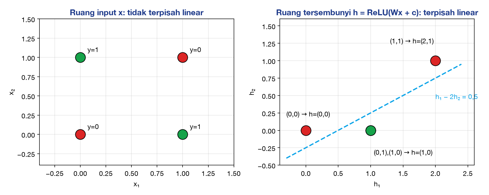
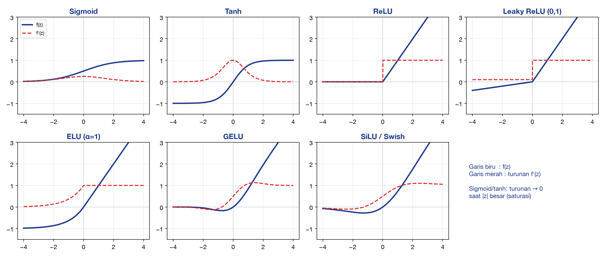

<!-- _class: lead -->
<!-- _paginate: false -->
<!-- _header: '' -->

# Nonlinearitas
## Fungsi Aktivasi dalam Jaringan Saraf

### Minggu 0 — Deep Learning
**Sains Data ITERA · Ganjil 2026/2025**

---

# Capaian Pembelajaran & Agenda

> Mahasiswa mampu menjelaskan **mengapa** jaringan saraf membutuhkan fungsi nonlinear, menghitung secara manual nilai dan **turunan** fungsi aktivasi, serta memilih aktivasi yang sesuai.

1. Mengapa nonlinear? — bukti bahwa komposisi lapisan linear tetap linear
2. Contoh klasik: **XOR** diselesaikan dengan satu lapisan ReLU
3. Fungsi aktivasi: sigmoid, tanh, ReLU, Leaky ReLU, ELU, GELU, SiLU/Swish
4. Tabel nilai & turunan — hitung manual
5. Forward & backward satu neuron
6. Masalah: *vanishing gradient*, saturasi, *dead ReLU*
7. **Softmax** untuk lapisan keluaran
8. PyTorch, panduan memilih, latihan

---

# Mengingat Kembali: Lapisan Linear

Satu lapisan linear (*affine*):
$$\mathbf{h} = W\mathbf{x} + \mathbf{b}, \qquad W \in \mathbb{R}^{d_{out} \times d_{in}},\; \mathbf{b} \in \mathbb{R}^{d_{out}}$$

Jaringan saraf menumpuk lapisan dan menyisipkan **fungsi aktivasi** $\sigma(\cdot)$ yang diterapkan **elemen demi elemen**:
$$\mathbf{h}^{(1)} = \sigma\!\left(W^{(1)}\mathbf{x} + \mathbf{b}^{(1)}\right), \qquad \hat{\mathbf{y}} = W^{(2)}\mathbf{h}^{(1)} + \mathbf{b}^{(2)}$$

Notasi pada slide ini:
- $z$ = *pre-activation* (keluaran bagian linear), $a = \sigma(z)$ = *activation*
- $\sigma'(z) = \dfrac{d\sigma}{dz}$ = turunan, dipakai saat **backpropagation**

---

# Mengapa Harus Nonlinear? Bukti Aljabar

Tanpa aktivasi, dua lapisan linear:
$$\hat{\mathbf{y}} = W_2(W_1\mathbf{x} + \mathbf{b}_1) + \mathbf{b}_2 = \underbrace{(W_2W_1)}_{W'}\mathbf{x} + \underbrace{(W_2\mathbf{b}_1 + \mathbf{b}_2)}_{\mathbf{b}'}$$

→ **tetap satu lapisan linear**, berapa pun jumlah lapisannya.

**Contoh angka**: $W_1 = \begin{bmatrix}1&2\\0&1\end{bmatrix}$, $\mathbf{b}_1 = \begin{bmatrix}1\\0\end{bmatrix}$, $W_2 = \begin{bmatrix}1 & -1\end{bmatrix}$, $b_2 = 2$, $\mathbf{x} = \begin{bmatrix}1\\2\end{bmatrix}$

| Cara | Perhitungan | Hasil |
|---|---|---|
| Dua lapis | $\mathbf{h} = W_1\mathbf{x} + \mathbf{b}_1 = [1+4+1,\; 0+2+0]^\top = [6, 2]^\top$; $\hat y = 6 - 2 + 2$ | **6** |
| Satu lapis setara | $W' = W_2W_1 = [1, 1]$; $b' = W_2\mathbf{b}_1 + b_2 = 1 + 2 = 3$; $\hat y = 1 + 2 + 3$ | **6** |

> Kedalaman tidak berguna tanpa nonlinearitas. Fungsi aktivasi memberi jaringan kemampuan merepresentasikan fungsi **non-linear** (Goodfellow dkk., 2016, Bab 6).

---

# Contoh Klasik: XOR

| $x_1$ | $x_2$ | $y = x_1 \oplus x_2$ |
|---|---|---|
| 0 | 0 | 0 |
| 0 | 1 | 1 |
| 1 | 0 | 1 |
| 1 | 1 | 0 |

Tidak ada garis lurus $w_1x_1 + w_2x_2 + b = 0{,}5$ yang memisahkan $y = 1$ dan $y = 0$ → **model linear gagal**.

Solusi (Goodfellow dkk., 2016, §6.1) — satu lapisan tersembunyi ReLU:
$$\mathbf{h} = \text{ReLU}(W\mathbf{x} + \mathbf{c}), \quad W = \begin{bmatrix}1&1\\1&1\end{bmatrix},\; \mathbf{c} = \begin{bmatrix}0\\-1\end{bmatrix}; \qquad \hat y = \mathbf{w}^\top\mathbf{h},\; \mathbf{w} = \begin{bmatrix}1\\-2\end{bmatrix}$$

---

<!-- _class: small -->

# XOR: Hitung Manual

| $\mathbf{x}$ | $W\mathbf{x} + \mathbf{c}$ | $\mathbf{h} = \text{ReLU}(\cdot)$ | $\hat y = h_1 - 2h_2$ | Target |
|---|---|---|---|---|
| (0, 0) | (0, −1) | (0, 0) | 0 | 0 ✓ |
| (0, 1) | (1, 0) | (1, 0) | 1 | 1 ✓ |
| (1, 0) | (1, 0) | (1, 0) | 1 | 1 ✓ |
| (1, 1) | (2, 1) | (2, 1) | 2 − 2 = 0 | 0 ✓ |



ReLU "melipat" ruang input sehingga data menjadi **terpisah linear** di ruang tersembunyi.

---

# Katalog Fungsi Aktivasi

| Nama | $\sigma(z)$ | $\sigma'(z)$ | Rentang |
|---|---|---|---|
| **Sigmoid** | $\dfrac{1}{1 + e^{-z}}$ | $\sigma(z)(1 - \sigma(z))$ | $(0, 1)$ |
| **Tanh** | $\dfrac{e^z - e^{-z}}{e^z + e^{-z}}$ | $1 - \tanh^2(z)$ | $(-1, 1)$ |
| **ReLU** | $\max(0, z)$ | $1$ jika $z > 0$, $0$ jika $z < 0$ | $[0, \infty)$ |
| **Leaky ReLU** | $z$ jika $z > 0$, $\alpha z$ jika $z \le 0$ | $1$ atau $\alpha$ | $(-\infty, \infty)$ |
| **ELU** | $z$ jika $z > 0$, $\alpha(e^z - 1)$ jika $z \le 0$ | $1$ atau $\alpha e^z$ | $(-\alpha, \infty)$ |
| **GELU** | $z\,\Phi(z)$ | $\Phi(z) + z\,\phi(z)$ | $\approx(-0{,}17, \infty)$ |
| **SiLU / Swish** | $z\,\text{sigmoid}(z)$ | $s(z) + z\,s(z)(1 - s(z))$ | $\approx(-0{,}28, \infty)$ |

$\Phi$ = CDF normal standar, $\phi$ = PDF normal standar, $s$ = sigmoid. ReLU tidak terdiferensialkan di $z = 0$; dalam praktik dipakai turunan 0 (konvensi PyTorch).

---

# Bentuk Fungsi & Turunannya



---

<!-- _class: small -->

# Tabel Nilai — Hitung Manual

| $z$ | −2 | −1 | 0 | 1 | 2 |
|---|---|---|---|---|---|
| Sigmoid | 0,1192 | 0,2689 | 0,5000 | 0,7311 | 0,8808 |
| Tanh | −0,9640 | −0,7616 | 0 | 0,7616 | 0,9640 |
| ReLU | 0 | 0 | 0 | 1 | 2 |
| Leaky ReLU ($\alpha = 0{,}01$) | −0,02 | −0,01 | 0 | 1 | 2 |
| ELU ($\alpha = 1$) | −0,8647 | −0,6321 | 0 | 1 | 2 |
| GELU | −0,0455 | −0,1587 | 0 | 0,8413 | 1,9545 |
| SiLU | −0,2384 | −0,2689 | 0 | 0,7311 | 1,7616 |

**Contoh langkah** untuk $z = 1$:
- Sigmoid: $1/(1 + e^{-1}) = 1/(1 + 0{,}3679) = 0{,}7311$
- Tanh: $(e - e^{-1})/(e + e^{-1}) = (2{,}7183 - 0{,}3679)/(2{,}7183 + 0{,}3679) = 2{,}3504/3{,}0862 = 0{,}7616$
- ELU di $z = -1$: $e^{-1} - 1 = 0{,}3679 - 1 = -0{,}6321$
- GELU: $1 \times \Phi(1) = 0{,}8413$ (tabel normal standar)
- SiLU: $1 \times \text{sigmoid}(1) = 0{,}7311$; di $z = 2$: $2 \times 0{,}8808 = 1{,}7616$

---

<!-- _class: small -->

# Tabel Turunan — Hitung Manual

| $z$ | −2 | −1 | 0 | 1 | 2 |
|---|---|---|---|---|---|
| Sigmoid' | 0,1050 | 0,1966 | **0,2500** | 0,1966 | 0,1050 |
| Tanh' | 0,0707 | 0,4200 | **1,0000** | 0,4200 | 0,0707 |
| ReLU' | 0 | 0 | 0* | 1 | 1 |
| ELU' ($\alpha = 1$) | 0,1353 | 0,3679 | 1 | 1 | 1 |
| GELU' | −0,0852 | −0,0833 | 0,5000 | 1,0833 | 1,0852 |
| SiLU' | −0,0908 | 0,0723 | 0,5000 | 0,9277 | 1,0908 |

*konvensi di $z = 0$.

**Contoh langkah**:
- Sigmoid' di $z = 1$: $0{,}7311 \times (1 - 0{,}7311) = 0{,}7311 \times 0{,}2689 = 0{,}1966$
- Tanh' di $z = 1$: $1 - 0{,}7616^2 = 1 - 0{,}5800 = 0{,}4200$
- GELU' di $z = 1$: $\Phi(1) + 1 \cdot \phi(1) = 0{,}8413 + 0{,}2420 = 1{,}0833$

> Turunan sigmoid **maksimum hanya 0,25**; turunan tanh maksimum 1. Keduanya mendekati 0 saat $|z|$ besar (**saturasi**).

---

<!-- _class: two small -->

# Forward & Backward Satu Neuron (Sigmoid)

Data: $\mathbf{x} = [1, 2]$, $\mathbf{w} = [0{,}5;\, -0{,}2]$, $b = 0{,}1$, target $t = 1$, loss $L = \tfrac{1}{2}(a - t)^2$

### Forward

| Langkah | Perhitungan | Nilai |
|---|---|---|
| $z = \mathbf{w}^\top\mathbf{x} + b$ | $0{,}5(1) + (-0{,}2)(2) + 0{,}1$ | 0,2 |
| $a = \text{sigmoid}(z)$ | $1/(1 + e^{-0{,}2})$ | 0,5498 |
| $L$ | $\tfrac{1}{2}(0{,}5498 - 1)^2$ | 0,1013 |

Aturan rantai:
$$\frac{\partial L}{\partial w_i} = \frac{\partial L}{\partial a}\cdot\frac{\partial a}{\partial z}\cdot\frac{\partial z}{\partial w_i}$$

Update SGD ($\eta = 0{,}1$):
$$\mathbf{w} \leftarrow \mathbf{w} - \eta\,\frac{\partial L}{\partial \mathbf{w}} = [0{,}5111;\; -0{,}1777]$$

### Backward

| Turunan | Perhitungan | Nilai |
|---|---|---|
| $\partial L/\partial a = a - t$ | $0{,}5498 - 1$ | −0,4502 |
| $\partial a/\partial z = a(1 - a)$ | $0{,}5498 \times 0{,}4502$ | 0,2475 |
| $\partial L/\partial z$ | $-0{,}4502 \times 0{,}2475$ | −0,1114 |
| $\partial L/\partial \mathbf{w} = (\partial L/\partial z)\,\mathbf{x}$ | $-0{,}1114 \times [1, 2]$ | [−0,1114; −0,2228] |
| $\partial L/\partial b$ | $= \partial L/\partial z$ | −0,1114 |

---

# Neuron yang Sama dengan ReLU

$z = 0{,}2 > 0$ → $a = \text{ReLU}(0{,}2) = 0{,}2$, $\;L = \tfrac{1}{2}(0{,}2 - 1)^2 = 0{,}32$

| Turunan | Sigmoid | ReLU |
|---|---|---|
| $\partial L/\partial a$ | −0,4502 | $0{,}2 - 1 = -0{,}8$ |
| $\partial a/\partial z$ | 0,2475 | **1** |
| $\partial L/\partial z$ | −0,1114 | −0,8 |
| $\partial L/\partial \mathbf{w}$ | [−0,1114; −0,2228] | [−0,8; −1,6] |

> Pada daerah aktif, ReLU meneruskan gradien **tanpa pelemahan** ($\sigma' = 1$), sedangkan sigmoid mengalikan gradien dengan **≤ 0,25**. Inilah salah satu alasan ReLU mempercepat pelatihan jaringan dalam (Glorot, Bordes & Bengio, 2011; Krizhevsky dkk., 2012).

---

# Masalah 1: Vanishing Gradient

Pada jaringan $L$ lapis, gradien ke lapisan awal memuat **perkalian** turunan aktivasi:
$$\frac{\partial L}{\partial z^{(1)}} \propto \prod_{l=1}^{L} \sigma'\!\left(z^{(l)}\right) \cdot W^{(l+1)} \cdots$$

Dengan sigmoid, kasus **terbaik** $\sigma'(0) = 0{,}25$ (bobot diabaikan = 1):

| Jumlah lapis | 1 | 2 | 5 | 10 |
|---|---|---|---|---|
| $0{,}25^L$ | 0,25 | 0,0625 | 0,000977 | 0,00000095 |

→ Lapisan awal hampir tidak belajar. Solusi: **ReLU & variannya**, inisialisasi yang tepat (Glorot/He), **normalisasi**, **residual connection** (dibahas di topik berikutnya).

Kebalikannya, **exploding gradient** terjadi bila hasil kali > 1 berulang — diatasi dengan *gradient clipping* dan inisialisasi.

---

# Masalah 2: Dead ReLU & Masalah Lain

**Dead ReLU**: jika $z < 0$ untuk **semua** data (mis. bias menjadi sangat negatif setelah update besar), maka $\text{ReLU}'(z) = 0$ → gradien ke bobot neuron itu **selalu 0** → neuron tidak pernah pulih.

Contoh: neuron sebelumnya dengan $b = -3$: $z = 0{,}5 - 0{,}4 - 3 = -2{,}9$ → $a = 0$, $\partial L/\partial \mathbf{w} = \mathbf{0}$.

| Masalah | Fungsi terdampak | Mitigasi |
|---|---|---|
| Saturasi / vanishing | Sigmoid, tanh | ReLU-family di lapisan tersembunyi |
| Dead neuron | ReLU | Leaky ReLU, ELU, GELU; learning rate lebih kecil |
| Keluaran tidak *zero-centered* | Sigmoid, ReLU | Tanh, ELU, normalisasi |
| Biaya komputasi | GELU, SiLU, ELU (perlu exp/erf) | ReLU paling murah |

---

<!-- _class: small -->

# Varian Modern: GELU & SiLU/Swish

**GELU** (Hendrycks & Gimpel, 2016): $\text{GELU}(z) = z\,\Phi(z)$ — input "dilewatkan" dengan bobot sebesar peluangnya lebih besar dari variabel normal standar.

Aproksimasi tanh (dipakai BERT/GPT-2; di PyTorch `nn.GELU(approximate='tanh')`):
$$\text{GELU}(z) \approx 0{,}5\,z\left(1 + \tanh\!\left[\sqrt{2/\pi}\,(z + 0{,}044715\,z^3)\right]\right)$$

**SiLU / Swish** (Elfwing dkk., 2018; Ramachandran dkk., 2017): $z \cdot \text{sigmoid}(\beta z)$, dengan $\beta = 1$ disebut SiLU.

| Sifat | ReLU | GELU / SiLU |
|---|---|---|
| Mulus (*smooth*) | ✗ (patah di 0) | ✓ |
| Monoton | ✓ | ✗ (sedikit turun di $z < 0$) |
| Gradien untuk $z < 0$ | 0 | kecil, tidak nol |
| Dipakai di | CNN klasik (AlexNet, ResNet) | Transformer (BERT, GPT: GELU), EfficientNet (SiLU) |

---

# Softmax: Aktivasi Lapisan Keluaran (Multikelas)

$$\text{softmax}(\mathbf{z})_k = \frac{e^{z_k}}{\sum_{j=1}^{K} e^{z_j}}, \qquad \sum_k \text{softmax}(\mathbf{z})_k = 1$$

**Hitung manual**, $\mathbf{z} = [2;\; 1;\; 0{,}1]$:

| | $z_k$ | $e^{z_k}$ | $e^{z_k}/\sum$ |
|---|---|---|---|
| Kelas 1 | 2 | 7,3891 | **0,6590** |
| Kelas 2 | 1 | 2,7183 | 0,2424 |
| Kelas 3 | 0,1 | 1,1052 | 0,0986 |
| | | $\sum = 11{,}2125$ | 1,0000 |

**Stabilitas numerik**: $\text{softmax}(\mathbf{z}) = \text{softmax}(\mathbf{z} - \max_j z_j)$ → dengan $\mathbf{z} - 2 = [0, -1, -1{,}9]$ hasilnya **sama** tetapi bebas *overflow*.

Turunan (dengan *cross-entropy*): $\dfrac{\partial L}{\partial z_k} = p_k - y_k$ — sangat sederhana.

---

# Aktivasi untuk Lapisan Keluaran

| Tugas | Aktivasi keluaran | Loss pasangan |
|---|---|---|
| Regresi | Identitas (tanpa aktivasi) | MSE |
| Klasifikasi biner | Sigmoid | Binary cross-entropy |
| Klasifikasi multikelas | Softmax | Cross-entropy |
| Multilabel | Sigmoid per label | BCE per label |
| Nilai positif (mis. jumlah, varians) | Softplus $\log(1 + e^z)$ / exp | Sesuai distribusi |

> Di PyTorch, `nn.CrossEntropyLoss` **sudah** memuat log-softmax → berikan **logit mentah**, jangan memasang softmax lagi. Demikian pula `nn.BCEWithLogitsLoss` sudah memuat sigmoid.

---

<!-- _class: small -->

# Implementasi PyTorch

```python
import torch
import torch.nn as nn

z = torch.tensor([-2., -1., 0., 1., 2.])
print(torch.sigmoid(z))          # tensor([0.1192, 0.2689, 0.5000, 0.7311, 0.8808])
print(torch.tanh(z))             # tensor([-0.9640, -0.7616, 0.0000, 0.7616, 0.9640])
print(nn.ReLU()(z))              # tensor([0., 0., 0., 1., 2.])
print(nn.LeakyReLU(0.01)(z))     # tensor([-0.0200, -0.0100, 0.0000, 1.0000, 2.0000])
print(nn.ELU(alpha=1.0)(z))      # tensor([-0.8647, -0.6321, 0.0000, 1.0000, 2.0000])
print(nn.GELU()(z))              # tensor([-0.0455, -0.1587, 0.0000, 0.8413, 1.9545])
print(nn.SiLU()(z))              # tensor([-0.2384, -0.2689, 0.0000, 0.7311, 1.7616])
print(torch.softmax(torch.tensor([2., 1., 0.1]), dim=0))   # tensor([0.6590, 0.2424, 0.0986])

# Turunan otomatis = tabel turunan manual
z = torch.tensor([-2., -1., 0., 1., 2.], requires_grad=True)
torch.sigmoid(z).sum().backward()
print(z.grad)                    # tensor([0.1050, 0.1966, 0.2500, 0.1966, 0.1050])

# MLP dengan aktivasi di antara lapisan linear
model = nn.Sequential(nn.Linear(2, 16), nn.ReLU(), nn.Linear(16, 1))
```

---

# Panduan Memilih Aktivasi

| Situasi | Pilihan default |
|---|---|
| MLP / CNN umum | **ReLU** (cepat, sederhana) |
| Banyak neuron mati / data kecil | Leaky ReLU, ELU |
| Transformer / model bahasa | **GELU** |
| CNN modern (EfficientNet, dsb.) | **SiLU/Swish** |
| RNN/LSTM (gerbang & state) | Sigmoid (gerbang), tanh (state) |
| Lapisan keluaran | Sesuai tugas (identitas / sigmoid / softmax) |

**Pasangan dengan inisialisasi**:
- Sigmoid/tanh → **Xavier/Glorot** (Glorot & Bengio, 2010)
- ReLU-family → **He/Kaiming** (He dkk., 2015)

---

# Latihan

1. Tunjukkan bahwa tiga lapisan linear $W_3(W_2(W_1\mathbf{x} + \mathbf{b}_1) + \mathbf{b}_2) + \mathbf{b}_3$ setara dengan satu lapisan linear. Tuliskan $W'$ dan $\mathbf{b}'$.
2. Hitung sigmoid, tanh, ReLU, dan ELU ($\alpha = 1$) untuk $z = -0{,}5$ dan $z = 3$.
3. Hitung turunan sigmoid dan tanh di $z = 3$. Mana yang lebih rentan *vanishing*?
4. Neuron sigmoid: $\mathbf{x} = [2, -1]$, $\mathbf{w} = [0{,}3;\, 0{,}6]$, $b = 0$, $t = 0$, $L = \tfrac{1}{2}(a - t)^2$. Hitung $z$, $a$, $L$, $\partial L/\partial \mathbf{w}$.
5. Hitung softmax dari $\mathbf{z} = [1, 1, 3]$.
6. Pada contoh XOR, ubah $\mathbf{c}$ menjadi $[0, 0]$. Apakah jaringan masih menyelesaikan XOR? Jelaskan.

---

<!-- _class: small -->

# Kunci Jawaban

1. $W' = W_3W_2W_1$, $\mathbf{b}' = W_3W_2\mathbf{b}_1 + W_3\mathbf{b}_2 + \mathbf{b}_3$
2. $z = -0{,}5$: sigmoid 0,3775; tanh −0,4621; ReLU 0; ELU $e^{-0{,}5} - 1 = -0{,}3935$
   $z = 3$: sigmoid 0,9526; tanh 0,9951; ReLU 3; ELU 3
3. Sigmoid'(3) $= 0{,}9526 \times 0{,}0474 = 0{,}0452$; tanh'(3) $= 1 - 0{,}9951^2 = 0{,}0099$. Keduanya kecil (saturasi); pada $z = 3$ tanh bahkan lebih kecil, tetapi maksimum tanh' (1) jauh lebih besar dari sigmoid' (0,25) sehingga di sekitar 0 sigmoid lebih rentan.
4. $z = 0{,}6 - 0{,}6 + 0 = 0$; $a = 0{,}5$; $L = 0{,}125$; $\partial L/\partial z = (0{,}5 - 0)(0{,}25) = 0{,}125$; $\partial L/\partial \mathbf{w} = 0{,}125 \times [2, -1] = [0{,}25;\, -0{,}125]$
5. $e^1 = 2{,}7183$ (dua kali), $e^3 = 20{,}0855$, jumlah $= 25{,}5221$ → $[0{,}1065;\; 0{,}1065;\; 0{,}7870]$
6. Tidak. Dengan $\mathbf{c} = [0, 0]$, $h_1 = h_2 = x_1 + x_2$ sehingga $\hat y = -(x_1 + x_2)$: (0,1) → −1, (1,1) → −2. Bias $c_2 = -1$ yang membuat ReLU "memotong" dan membedakan (1,1).

---

# Ringkasan

1. Tanpa aktivasi nonlinear, jaringan sedalam apa pun **setara satu lapisan linear**.
2. Aktivasi diterapkan **elemen demi elemen** pada *pre-activation* $z$; turunannya dipakai di backpropagation.
3. **Sigmoid/tanh** jenuh → turunan kecil → **vanishing gradient**; turunan sigmoid maksimum 0,25.
4. **ReLU** murah dan meneruskan gradien 1 pada daerah aktif, tetapi rentan **dead ReLU** → Leaky ReLU/ELU.
5. **GELU & SiLU** mulus dan menjadi standar di Transformer dan CNN modern.
6. **Softmax** untuk keluaran multikelas; di PyTorch berikan logit ke `CrossEntropyLoss`.

---

<!-- _class: tiny -->

# Referensi

1. Goodfellow, I., Bengio, Y., & Courville, A. (2016). *Deep Learning*. MIT Press. Bab 6 (Deep Feedforward Networks; contoh XOR §6.1).
2. Prince, S. J. D. (2023). *Understanding Deep Learning*. MIT Press. Bab 3–4.
3. Zhang, A., Lipton, Z. C., Li, M., & Smola, A. J. (2023). *Dive into Deep Learning*. Cambridge University Press. §5.1 (Multilayer Perceptrons).
4. Nair, V., & Hinton, G. E. (2010). Rectified linear units improve restricted Boltzmann machines. *ICML*.
5. Glorot, X., & Bengio, Y. (2010). Understanding the difficulty of training deep feedforward neural networks. *AISTATS*.
6. Glorot, X., Bordes, A., & Bengio, Y. (2011). Deep sparse rectifier neural networks. *AISTATS*.
7. Krizhevsky, A., Sutskever, I., & Hinton, G. E. (2012). ImageNet classification with deep convolutional neural networks. *NeurIPS*.
8. Maas, A. L., Hannun, A. Y., & Ng, A. Y. (2013). Rectifier nonlinearities improve neural network acoustic models. *ICML Workshop on Deep Learning for Audio, Speech and Language Processing*.
9. He, K., Zhang, X., Ren, S., & Sun, J. (2015). Delving deep into rectifiers: Surpassing human-level performance on ImageNet classification. *ICCV*.
10. Clevert, D.-A., Unterthiner, T., & Hochreiter, S. (2016). Fast and accurate deep network learning by exponential linear units (ELUs). *ICLR*.
11. Hendrycks, D., & Gimpel, K. (2016). Gaussian error linear units (GELUs). *arXiv:1606.08415*.
12. Ramachandran, P., Zoph, B., & Le, Q. V. (2017). Searching for activation functions. *arXiv:1710.05941*.
13. Elfwing, S., Uchibe, E., & Doya, K. (2018). Sigmoid-weighted linear units for neural network function approximation in reinforcement learning. *Neural Networks*, 107, 3–11.

---

<!-- _class: lead -->
<!-- _paginate: false -->
<!-- _header: '' -->

# Terima Kasih

### Topik berikutnya: **Convolutional Layers**

Kerjakan latihan dan jalankan potongan kode PyTorch untuk memverifikasi hitungan manual Anda.
