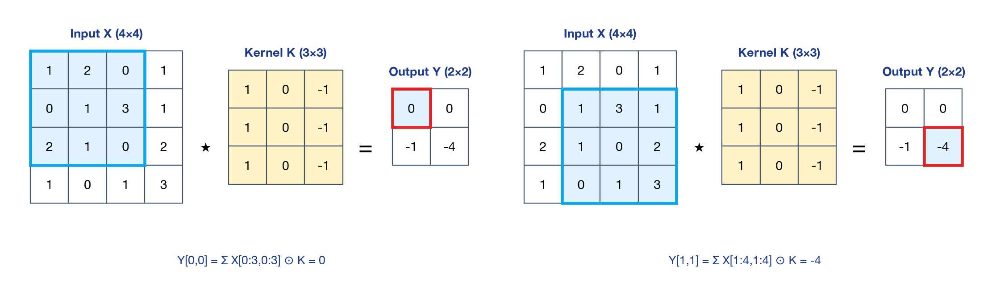

<!-- _class: lead -->
<!-- _paginate: false -->
<!-- _header: '' -->

# Convolutional Layers
## Konvolusi, Padding, Stride, dan Variannya

### Minggu 0 — Deep Learning
**Sains Data ITERA · Ganjil 2026/2025**

---

# Capaian Pembelajaran & Agenda

> Mahasiswa mampu menghitung secara manual keluaran lapisan konvolusi (termasuk padding, stride, dan multi-kanal), menghitung jumlah parameter, serta menjelaskan varian konvolusi modern.

1. Motivasi: mengapa lapisan linear tidak cocok untuk citra
2. Operasi konvolusi vs *cross-correlation*
3. Hitung manual konvolusi 2D
4. Padding, stride, dilation & **rumus ukuran keluaran**
5. Konvolusi multi-kanal & jumlah parameter
6. *Receptive field*, konvolusi 1×1, *dilated*, *depthwise-separable*
7. Backpropagation pada lapisan konvolusi
8. PyTorch, latihan

---

# Motivasi: Lapisan Linear pada Citra

Citra RGB 224×224 → vektor $3 \times 224 \times 224 = 150.528$ elemen.

| Lapisan | Keluaran | Jumlah parameter |
|---|---|---|
| `Linear(150528, 64)` | 64 angka | 150.528 × 64 + 64 = **9.633.856** |
| `Linear` dengan keluaran sebesar peta fitur 64×224×224 | 3.211.264 angka | ≈ **4,8 × 10¹¹** |
| `Conv2d(3, 64, kernel_size=3)` | 64×222×222 peta fitur | 64 × 3 × 3 × 3 + 64 = **1.792** |

Dua asumsi (*inductive bias*) yang membuat konvolusi efisien (Goodfellow dkk., 2016, Bab 9):
1. **Interaksi lokal** (*sparse interactions*): piksel terutama berhubungan dengan tetangganya.
2. **Parameter sharing**: detektor fitur (mis. tepi vertikal) yang sama berguna di seluruh posisi citra → **translation equivariance**.

---

# Konvolusi vs Cross-Correlation

**Konvolusi** (matematika) — kernel **dibalik**:
$$Y[i,j] = (X * K)[i,j] = \sum_{m}\sum_{n} X[i - m,\, j - n]\, K[m, n]$$

**Cross-correlation** — kernel **tidak** dibalik:
$$Y[i,j] = (X \star K)[i,j] = \sum_{m=0}^{k-1}\sum_{n=0}^{k-1} X[i + m,\, j + n]\, K[m, n]$$

- Hampir semua pustaka deep learning (PyTorch `nn.Conv2d`, TensorFlow/Keras) mengimplementasikan **cross-correlation**, tetapi tetap menyebutnya "konvolusi".
- Karena kernel **dipelajari**, perbedaan ini tidak penting: jaringan akan mempelajari versi terbalik dari kernel yang sama.
- Pada slide berikutnya, "konvolusi" = cross-correlation (konvensi deep learning).

---

<!-- _class: small -->

# Contoh: Detektor Tepi Vertikal

$$X = \begin{bmatrix}1&2&0&1\\0&1&3&1\\2&1&0&2\\1&0&1&3\end{bmatrix}, \qquad K = \begin{bmatrix}1&0&-1\\1&0&-1\\1&0&-1\end{bmatrix}$$

$K$ menghitung **(jumlah kolom kiri) − (jumlah kolom kanan)** dari jendela 3×3 → bernilai besar jika ada perubahan intensitas horizontal (tepi vertikal).

Ukuran keluaran tanpa padding, stride 1: $(4 - 3 + 1) \times (4 - 3 + 1) = 2 \times 2$.



---

# Hitung Manual: Keempat Posisi

| Posisi | Jendela $X$ (3×3) | Kolom kiri | Kolom kanan | $Y$ |
|---|---|---|---|---|
| (0,0) | $\begin{smallmatrix}1&2&0\\0&1&3\\2&1&0\end{smallmatrix}$ | 1 + 0 + 2 = 3 | 0 + 3 + 0 = 3 | **0** |
| (0,1) | $\begin{smallmatrix}2&0&1\\1&3&1\\1&0&2\end{smallmatrix}$ | 2 + 1 + 1 = 4 | 1 + 1 + 2 = 4 | **0** |
| (1,0) | $\begin{smallmatrix}0&1&3\\2&1&0\\1&0&1\end{smallmatrix}$ | 0 + 2 + 1 = 3 | 3 + 0 + 1 = 4 | **−1** |
| (1,1) | $\begin{smallmatrix}1&3&1\\1&0&2\\0&1&3\end{smallmatrix}$ | 1 + 1 + 0 = 2 | 1 + 2 + 3 = 6 | **−4** |

$$Y = X \star K = \begin{bmatrix}0 & 0\\ -1 & -4\end{bmatrix} \qquad \text{(konvolusi sejati } X * K = \begin{bmatrix}0&0\\1&4\end{bmatrix}\text{, karena } K \text{ dibalik)}$$

Nilai −4: di jendela kanan bawah, sisi kanan jauh lebih terang daripada sisi kiri.

---

# Padding

Tanpa padding, citra **menyusut** setiap lapisan dan piksel tepi jarang "dilihat". **Zero padding** $p$ menambah $p$ baris/kolom bernilai 0 di setiap sisi.

$p = 1$ (*same padding* untuk kernel 3×3): $X$ menjadi 6×6, keluaran **4×4**:

$$X_{pad} = \begin{bmatrix}0&0&0&0&0&0\\0&1&2&0&1&0\\0&0&1&3&1&0\\0&2&1&0&2&0\\0&1&0&1&3&0\\0&0&0&0&0&0\end{bmatrix} \quad\Rightarrow\quad X_{pad} \star K = \begin{bmatrix}-3&-2&1&3\\-4&0&0&3\\-2&-1&-4&4\\-1&2&-4&1\end{bmatrix}$$

Contoh $Y[0,0]$: jendela $\begin{smallmatrix}0&0&0\\0&1&2\\0&0&1\end{smallmatrix}$ → kiri $0 + 0 + 0 = 0$, kanan $0 + 2 + 1 = 3$ → $0 - 3 = -3$.

Perhatikan: $Y[1{:}3, 1{:}3]$ pada hasil padding = hasil tanpa padding $\begin{smallmatrix}0&0\\-1&-4\end{smallmatrix}$.

---

# Stride & Dilation

**Stride** $s$: kernel bergeser $s$ langkah → *downsampling*.
$X_{pad}$ (6×6) dengan $K$, $p = 1$, $s = 2$: posisi awal baris/kolom $\in \{0, 2\}$:
$$Y = \begin{bmatrix}-3 & 1\\ -2 & -4\end{bmatrix} \quad (\text{elemen } [0,0], [0,2], [2,0], [2,2] \text{ dari hasil stride 1})$$

**Dilation** $d$: elemen kernel diberi jarak $d - 1$ → *receptive field* lebih luas tanpa menambah parameter (Yu & Koltun, 2016).
$$k_{eff} = k + (k - 1)(d - 1), \qquad k = 3,\, d = 2 \Rightarrow k_{eff} = 5$$

---

# Rumus Ukuran Keluaran

Untuk input $n$, kernel $k$, padding $p$, stride $s$, dilation $d$ (Dumoulin & Visin, 2016):
$$\boxed{n_{out} = \left\lfloor \frac{n + 2p - d(k - 1) - 1}{s} \right\rfloor + 1}$$

| $n$ | $k$ | $p$ | $s$ | $d$ | Perhitungan | $n_{out}$ |
|---|---|---|---|---|---|---|
| 4 | 3 | 0 | 1 | 1 | $\lfloor(4 - 2 - 1)/1\rfloor + 1$ | 2 |
| 4 | 3 | 1 | 2 | 1 | $\lfloor(4 + 2 - 2 - 1)/2\rfloor + 1 = \lfloor 1{,}5\rfloor + 1$ | 2 |
| 32 | 3 | 1 | 1 | 1 | $\lfloor(32 + 2 - 3)/1\rfloor + 1$ | 32 (*same*) |
| 32 | 3 | 1 | 2 | 1 | $\lfloor 31/2\rfloor + 1$ | 16 |
| 224 | 7 | 3 | 2 | 1 | $\lfloor(224 + 6 - 6 - 1)/2\rfloor + 1 = 111 + 1$ | 112 (stem ResNet) |
| 7 | 3 | 0 | 1 | 2 | $\lfloor(7 - 4 - 1)/1\rfloor + 1$ | 3 |

Rumus ini sama dengan yang tertulis di dokumentasi PyTorch `nn.Conv2d`.

---

# Konvolusi Multi-Kanal

Input $C_{in}$ kanal → setiap filter berukuran $C_{in} \times k \times k$; hasil tiap kanal **dijumlahkan** + bias. $C_{out}$ filter → $C_{out}$ peta fitur.
$$Y_o = b_o + \sum_{c=1}^{C_{in}} X_c \star K_{o,c}$$

**Contoh** $C_{in} = 2$, $C_{out} = 1$, $k = 2$, $b = 1$:

| | Kanal 1 | Kanal 2 |
|---|---|---|
| Input | $X_1 = \begin{smallmatrix}1&0&2\\0&1&1\\2&1&0\end{smallmatrix}$ | $X_2 = \begin{smallmatrix}0&1&1\\1&0&2\\1&1&0\end{smallmatrix}$ |
| Kernel | $K_1 = \begin{smallmatrix}1&0\\0&1\end{smallmatrix}$ (diagonal) | $K_2 = \begin{smallmatrix}0&1\\1&0\end{smallmatrix}$ (anti-diagonal) |
| $X_c \star K_c$ | $\begin{smallmatrix}2&1\\1&1\end{smallmatrix}$ | $\begin{smallmatrix}2&1\\1&3\end{smallmatrix}$ |

$Y[0,0] = (1 + 1) + (1 + 1) + 1 = 5$ → $\;Y = \begin{bmatrix}2+2+1 & 1+1+1\\ 1+1+1 & 1+3+1\end{bmatrix} = \begin{bmatrix}5 & 3\\ 3 & 5\end{bmatrix}$

---

# Jumlah Parameter & Bentuk Tensor

$$\#\text{param} = C_{out} \times C_{in} \times k_h \times k_w + C_{out}\;(\text{bias})$$

| Lapisan | Perhitungan | Parameter |
|---|---|---|
| `Conv2d(3, 64, 3)` | $64 \cdot 3 \cdot 3 \cdot 3 + 64$ | 1.792 |
| `Conv2d(64, 128, 3)` | $128 \cdot 64 \cdot 9 + 128$ | 73.856 |
| `Conv2d(64, 64, 1)` | $64 \cdot 64 \cdot 1 + 64$ | 4.160 |

Bentuk tensor di PyTorch (format **NCHW**):
- Input: $(N, C_{in}, H, W)$; bobot: $(C_{out}, C_{in}, k_h, k_w)$; bias: $(C_{out})$
- Output: $(N, C_{out}, H_{out}, W_{out})$

> Jumlah parameter **tidak bergantung** pada ukuran citra $H \times W$ — berkat *parameter sharing*. Biaya komputasi (FLOPs) tetap sebanding dengan $H_{out} W_{out}$.

---

# Receptive Field: Menumpuk Kernel Kecil

*Receptive field* = wilayah input yang memengaruhi satu unit keluaran.

Menumpuk $L$ lapisan 3×3 (stride 1): receptive field $= 2L + 1$.

| Lapisan 3×3 | 1 | 2 | 3 |
|---|---|---|---|
| Receptive field | 3×3 | 5×5 | 7×7 |

Perbandingan untuk $C$ kanal masuk & keluar (tanpa bias), $C = 256$ (Simonyan & Zisserman, 2015):

| Desain | Parameter | $C = 256$ |
|---|---|---|
| Satu lapisan 7×7 | $49C^2$ | 3.211.264 |
| Tiga lapisan 3×3 | $3 \times 9C^2 = 27C^2$ | 1.769.472 |

→ Tiga lapisan 3×3 memberi receptive field yang sama dengan **45% lebih sedikit parameter** dan **tiga** nonlinearitas, bukan satu. Inilah ide di balik VGG.

---

# Konvolusi 1×1

Kernel 1×1 tidak melihat tetangga spasial — ia menggabungkan **kanal** pada setiap piksel (setara lapisan linear per piksel).

Contoh: 2 kanal masuk, 1 kanal keluar, bobot $[0{,}5;\; -1]$, tanpa bias:
$$Y = 0{,}5\begin{bmatrix}1&2\\3&4\end{bmatrix} - 1\begin{bmatrix}0&1\\1&0\end{bmatrix} = \begin{bmatrix}0{,}5 & 0\\ 0{,}5 & 2\end{bmatrix}$$

Kegunaan:
- **Mengubah jumlah kanal** dengan murah (mengurangi dimensi sebelum 3×3 — *bottleneck* di Inception dan ResNet)
- Menambah nonlinearitas tanpa mengubah resolusi (*Network in Network*, Lin dkk., 2014)

---

# Depthwise-Separable Convolution

Memecah konvolusi standar menjadi dua tahap (Chollet, 2017; Howard dkk., 2017):
1. **Depthwise**: satu kernel $k \times k$ **per kanal** (`groups = C_in`)
2. **Pointwise**: konvolusi 1×1 untuk menggabungkan kanal

| | Parameter (tanpa bias) | $C_{in} = 64$, $C_{out} = 128$, $k = 3$ |
|---|---|---|
| Konvolusi standar | $C_{in} C_{out} k^2$ | 73.728 |
| Depthwise + pointwise | $C_{in}k^2 + C_{in}C_{out}$ | 576 + 8.192 = **8.768** |
| Rasio | $\dfrac{1}{C_{out}} + \dfrac{1}{k^2}$ | $\dfrac{1}{128} + \dfrac{1}{9} = 0{,}119$ |

→ ±8,4× lebih hemat. Dipakai di **MobileNet**, **Xception**, **EfficientNet** — penting untuk perangkat seluler.

---

# Pooling (Ringkas)

Pooling merangkum jendela tanpa parameter (dibahas detail di topik *Pooling Layers*). Max & average pooling 2×2, stride 2 pada $X$:

$$X = \begin{bmatrix}1&2&0&1\\0&1&3&1\\2&1&0&2\\1&0&1&3\end{bmatrix} \;\xrightarrow{\text{max}}\; \begin{bmatrix}2&3\\2&3\end{bmatrix}, \qquad \xrightarrow{\text{avg}}\; \begin{bmatrix}1&1{,}25\\1&1{,}5\end{bmatrix}$$

Contoh blok kanan atas $\begin{smallmatrix}0&1\\3&1\end{smallmatrix}$: max = 3, rata-rata = 5/4 = 1,25.

Tren modern: *downsampling* sering memakai **konvolusi stride 2** sebagai ganti pooling.

---

<!-- _class: tiny -->

# Backpropagation pada Konvolusi

Untuk $Y = X \star K$ dan gradien dari lapisan atas $G = \partial L/\partial Y$:
$$\frac{\partial L}{\partial K} = X \star G \;\;(\text{cross-correlation input dengan gradien}), \qquad \frac{\partial L}{\partial X} = G \ast_{\text{full}} K \;\;(\text{konvolusi penuh dengan kernel})$$

Contoh: $X$ dan $K$ seperti sebelumnya, $G = \begin{bmatrix}1&0\\2&-1\end{bmatrix}$

$$\frac{\partial L}{\partial K} = \begin{bmatrix}0&1&5\\3&3&1\\4&0&-1\end{bmatrix}, \qquad \frac{\partial L}{\partial X} = \begin{bmatrix}1&0&-1&0\\3&-1&-3&1\\3&-1&-3&1\\2&-1&-2&1\end{bmatrix}$$

Satu elemen secara manual — $K[0,0]$ menyentuh $X[0,0], X[0,1], X[1,0], X[1,1]$ untuk keempat posisi keluaran:
$$\frac{\partial L}{\partial K[0,0]} = \sum_{i,j} G[i,j]\,X[i,j] = 1 \cdot 1 + 0 \cdot 2 + 2 \cdot 0 + (-1) \cdot 1 = 0$$
$$\frac{\partial L}{\partial K[0,2]} = \sum_{i,j} G[i,j]\,X[i,j+2] = 1 \cdot 0 + 0 \cdot 1 + 2 \cdot 3 + (-1) \cdot 1 = 5$$

Kedua matriks gradien di atas sudah dicek dengan *finite difference* numerik.

> Karena *parameter sharing*, gradien bobot adalah **jumlah** kontribusi dari semua posisi.

---

<!-- _class: small -->

# Implementasi PyTorch

```python
import torch
import torch.nn as nn
import torch.nn.functional as F

X = torch.tensor([[1., 2, 0, 1], [0, 1, 3, 1], [2, 1, 0, 2], [1, 0, 1, 3]]).reshape(1, 1, 4, 4)  # N,C,H,W
K = torch.tensor([[1., 0, -1], [1, 0, -1], [1, 0, -1]]).reshape(1, 1, 3, 3)                  # Cout,Cin,kH,kW

print(F.conv2d(X, K))                       # [[ 0.,  0.], [-1., -4.]]   (cross-correlation)
print(F.conv2d(X, K, padding=1))            # 4x4: [[-3,-2,1,3],[-4,0,0,3],[-2,-1,-4,4],[-1,2,-4,1]]
print(F.conv2d(X, K, padding=1, stride=2))  # [[-3.,  1.], [-2., -4.]]
print(F.max_pool2d(X, 2))                   # [[2., 3.], [2., 3.]]

conv = nn.Conv2d(in_channels=64, out_channels=128, kernel_size=3, padding=1)
print(sum(p.numel() for p in conv.parameters()))       # 73856

dw = nn.Conv2d(64, 64, 3, padding=1, groups=64, bias=False)   # depthwise: 576 parameter
pw = nn.Conv2d(64, 128, 1, bias=False)                         # pointwise: 8192 parameter

# Gradien: cocok dengan hitung manual di slide sebelumnya
K.requires_grad_(True)
G = torch.tensor([[1., 0], [2, -1]]).reshape(1, 1, 2, 2)
(F.conv2d(X, K) * G).sum().backward()
print(K.grad[0, 0])                         # [[0,1,5],[3,3,1],[4,0,-1]]
```

---

# Kesalahan Umum

| Kesalahan | Akibat / Solusi |
|---|---|
| Lupa format **NCHW** (PyTorch) vs NHWC (TensorFlow) | Error dimensi; gunakan `permute` |
| Salah menghitung ukuran keluaran sebelum `Linear` | `RuntimeError: shape mismatch` → pakai rumus atau `nn.LazyLinear` / `nn.Flatten` dan cek `x.shape` |
| Kernel genap (2×2, 4×4) dengan *same padding* | Padding asimetris; pilih kernel ganjil |
| Mengira konvolusi PyTorch membalik kernel | `nn.Conv2d` = cross-correlation |
| Menghitung parameter tanpa bias / lupa $C_{in}$ | Gunakan $C_{out} C_{in} k^2 + C_{out}$ |
| Stride besar terlalu awal | Informasi spasial hilang; turunkan resolusi bertahap |

---

# Latihan

1. Hitung $Y = X \star K$ (stride 1, tanpa padding) untuk
$$X = \begin{bmatrix}3&0&1&2\\1&1&0&0\\2&0&2&1\\0&1&1&0\end{bmatrix}, \qquad K = \begin{bmatrix}1&2\\0&-1\end{bmatrix}$$
2. Ulangi soal 1 dengan stride 2.
3. Hitung ukuran keluaran: (a) $n = 28$, $k = 5$, $p = 0$, $s = 1$; (b) $n = 28$, $k = 5$, $p = 2$, $s = 1$; (c) $n = 64$, $k = 3$, $p = 1$, $s = 2$; (d) $n = 100$, $k = 3$, $p = 0$, $s = 1$, $d = 3$.
4. Hitung jumlah parameter `Conv2d(64, 128, kernel_size=3)` (dengan bias) dan versi depthwise-separable-nya (tanpa bias).
5. Berapa receptive field empat lapisan konvolusi 3×3 stride 1 yang ditumpuk?

---

# Kunci Jawaban

1. Keluaran 3×3. Contoh $Y[0,0] = 3(1) + 0(2) + 1(0) + 1(-1) = 2$.
$$Y = \begin{bmatrix}2&2&5\\3&-1&-1\\1&3&4\end{bmatrix}$$
2. Stride 2 → posisi $\{0, 2\}$: $\;Y = \begin{bmatrix}2&5\\1&4\end{bmatrix}$
3. (a) $\lfloor(28 - 4 - 1)/1\rfloor + 1 = 24$; (b) 28; (c) $\lfloor(64 + 2 - 2 - 1)/2\rfloor + 1 = 32$; (d) $\lfloor(100 - 6 - 1)/1\rfloor + 1 = 94$
4. Standar: $128 \cdot 64 \cdot 9 + 128 = 73.856$. Depthwise-separable: $64 \cdot 9 + 64 \cdot 128 = 576 + 8.192 = 8.768$
5. $2 \times 4 + 1 = 9$ → receptive field 9×9

---

# Ringkasan

1. Konvolusi memanfaatkan **interaksi lokal** dan **parameter sharing** → parameter jauh lebih sedikit daripada lapisan linear.
2. Deep learning memakai **cross-correlation** (kernel tidak dibalik).
3. Ukuran keluaran: $\lfloor(n + 2p - d(k-1) - 1)/s\rfloor + 1$.
4. Multi-kanal: hasil per kanal **dijumlahkan**; parameter $= C_{out}C_{in}k^2 + C_{out}$.
5. Menumpuk 3×3 memperluas **receptive field** secara efisien; **1×1** mencampur kanal; **dilated** memperluas cakupan; **depthwise-separable** menghemat komputasi.
6. Gradien: $\partial L/\partial K = X \star G$, $\;\partial L/\partial X$ = konvolusi penuh $G$ dengan $K$.

---

<!-- _class: tiny -->

# Referensi

1. Goodfellow, I., Bengio, Y., & Courville, A. (2016). *Deep Learning*. MIT Press. Bab 9 (Convolutional Networks).
2. Zhang, A., Lipton, Z. C., Li, M., & Smola, A. J. (2023). *Dive into Deep Learning*. Cambridge University Press. Bab 7 (Convolutional Neural Networks).
3. Prince, S. J. D. (2023). *Understanding Deep Learning*. MIT Press. Bab 10 (Convolutional Networks).
4. LeCun, Y., Bottou, L., Bengio, Y., & Haffner, P. (1998). Gradient-based learning applied to document recognition. *Proceedings of the IEEE*, 86(11), 2278–2324.
5. Dumoulin, V., & Visin, F. (2016). A guide to convolution arithmetic for deep learning. *arXiv:1603.07285*.
6. Simonyan, K., & Zisserman, A. (2015). Very deep convolutional networks for large-scale image recognition. *ICLR*.
7. Lin, M., Chen, Q., & Yan, S. (2014). Network in network. *ICLR*.
8. Yu, F., & Koltun, V. (2016). Multi-scale context aggregation by dilated convolutions. *ICLR*.
9. Chollet, F. (2017). Xception: Deep learning with depthwise separable convolutions. *CVPR*.
10. Howard, A. G., dkk. (2017). MobileNets: Efficient convolutional neural networks for mobile vision applications. *arXiv:1704.04861*.
11. He, K., Zhang, X., Ren, S., & Sun, J. (2016). Deep residual learning for image recognition. *CVPR*.
12. PyTorch Documentation — `torch.nn.Conv2d`. https://pytorch.org/docs/stable/generated/torch.nn.Conv2d.html

---

<!-- _class: lead -->
<!-- _paginate: false -->
<!-- _header: '' -->

# Terima Kasih

### Topik berikutnya: **Residual (Skip) Connections**

Kerjakan latihan dan verifikasi hasilnya dengan `torch.nn.functional.conv2d`.
