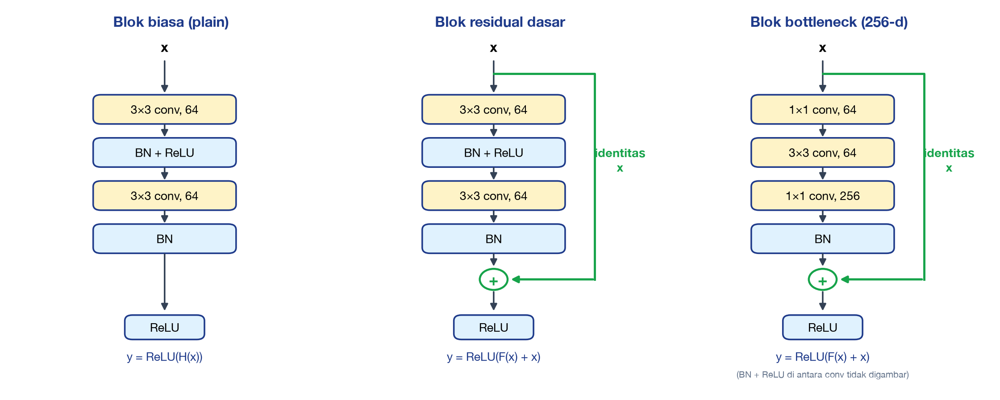

<!-- _class: lead -->
<!-- _paginate: false -->
<!-- _header: '' -->

# Residual (Skip) Connections
## Kunci Melatih Jaringan yang Sangat Dalam

### Minggu 0 — Deep Learning
**Sains Data ITERA · Ganjil 2026/2025**

---

# Capaian Pembelajaran & Agenda

> Mahasiswa mampu menjelaskan *degradation problem*, menurunkan mengapa residual connection memperlancar aliran gradien, serta menghitung secara manual forward, Jacobian, dan jumlah parameter blok residual.

1. Masalah: jaringan lebih dalam justru **lebih buruk** (*degradation*)
2. Ide residual learning: $\mathbf{y} = F(\mathbf{x}) + \mathbf{x}$
3. Hitung manual forward & Jacobian satu blok residual
4. Aliran gradien: penurunan $\partial \mathcal{L}/\partial \mathbf{x}_l$ & contoh angka
5. Shortcut identitas vs proyeksi, blok **bottleneck**
6. Varian: pre-activation ResNet, Highway, DenseNet
7. Residual di **Transformer**
8. PyTorch, latihan

---

# Masalah: Lebih Dalam ≠ Lebih Baik

Intuisi: jaringan dalam setidaknya bisa meniru jaringan dangkal (lapisan tambahan cukup menjadi **identitas**). Kenyataannya (He dkk., 2016a):

- Di CIFAR-10, jaringan *plain* 56 lapis memiliki **training error** dan test error **lebih tinggi** dari jaringan 20 lapis.
- Di ImageNet (top-1 error validasi, 10-crop):

| Kedalaman | Plain | ResNet |
|---|---|---|
| 18 lapis | 27,94% | 27,88% |
| 34 lapis | **28,54%** (lebih buruk) | **25,03%** (lebih baik) |

Karena **training error** ikut naik, ini **bukan overfitting** → disebut ***degradation problem***: solver (SGD) kesulitan mengoptimasi jaringan plain yang sangat dalam, bahkan sekadar mempelajari pemetaan identitas.

---

# Ide: Residual Learning

Alih-alih mempelajari pemetaan yang diinginkan $H(\mathbf{x})$ secara langsung, pelajari **residu**-nya:
$$F(\mathbf{x}) := H(\mathbf{x}) - \mathbf{x} \qquad\Rightarrow\qquad \mathbf{y} = F(\mathbf{x}, \{W_i\}) + \mathbf{x}$$

- Jika identitas sudah optimal, cukup dorong $F \to 0$ (bobot kecil) — **jauh lebih mudah** daripada membuat tumpukan lapisan nonlinear meniru identitas.
- *Shortcut* identitas **tanpa parameter** dan **tanpa biaya komputasi** tambahan (hanya penjumlahan elemen).
- Blok asli ResNet: $\mathbf{y} = \text{ReLU}\big(F(\mathbf{x}) + \mathbf{x}\big)$, dengan $F$ = conv–BN–ReLU–conv–BN.



---

# Hitung Manual: Forward Blok Residual

Blok sederhana (lapisan linear, tanpa bias): $F(\mathbf{x}) = W_2\,\text{ReLU}(W_1\mathbf{x})$, $\;\mathbf{y} = \mathbf{x} + F(\mathbf{x})$
$$\mathbf{x} = \begin{bmatrix}1\\2\end{bmatrix}, \quad W_1 = \begin{bmatrix}1 & -1\\ 0{,}5 & 0{,}5\end{bmatrix}, \quad W_2 = \begin{bmatrix}0{,}5 & 0\\ 0 & -1\end{bmatrix}$$

| Langkah | Perhitungan | Hasil |
|---|---|---|
| $\mathbf{z} = W_1\mathbf{x}$ | $[1 - 2;\; 0{,}5 + 1]$ | $[-1;\; 1{,}5]$ |
| $\mathbf{h} = \text{ReLU}(\mathbf{z})$ | $[\max(0,-1);\; \max(0, 1{,}5)]$ | $[0;\; 1{,}5]$ |
| $F = W_2\mathbf{h}$ | $[0{,}5 \cdot 0;\; -1 \cdot 1{,}5]$ | $[0;\; -1{,}5]$ |
| $\mathbf{y} = \mathbf{x} + F$ | $[1 + 0;\; 2 - 1{,}5]$ | $[1;\; 0{,}5]$ |

Syarat: $F(\mathbf{x})$ dan $\mathbf{x}$ harus **berdimensi sama** agar dapat dijumlahkan.

---

# Hitung Manual: Jacobian Blok Residual

$$\frac{\partial \mathbf{y}}{\partial \mathbf{x}} = I + \frac{\partial F}{\partial \mathbf{x}} = I + W_2\, D\, W_1, \qquad D = \text{diag}\big(\text{ReLU}'(\mathbf{z})\big) = \text{diag}(0, 1)$$

$$W_2 D W_1 = \begin{bmatrix}0{,}5&0\\0&-1\end{bmatrix}\begin{bmatrix}0&0\\0&1\end{bmatrix}\begin{bmatrix}1&-1\\0{,}5&0{,}5\end{bmatrix} = \begin{bmatrix}0 & 0\\ -0{,}5 & -0{,}5\end{bmatrix} \;\Rightarrow\; \frac{\partial \mathbf{y}}{\partial \mathbf{x}} = \begin{bmatrix}1 & 0\\ -0{,}5 & 0{,}5\end{bmatrix}$$

Backward dengan gradien dari atas $\mathbf{g} = \partial\mathcal{L}/\partial\mathbf{y} = [1;\, 1]$:

| | Rumus | Hasil |
|---|---|---|
| Dengan skip | $\left(I + W_2DW_1\right)^\top \mathbf{g}$ | $[0{,}5;\; 0{,}5]$ |
| Tanpa skip ($\mathbf{y} = F(\mathbf{x})$) | $\left(W_2DW_1\right)^\top \mathbf{g}$ | $[-0{,}5;\; -0{,}5]$ |

Suku $I$ memastikan gradien $\mathbf{g}$ selalu **diteruskan langsung**, meskipun cabang $F$ "mati" (mis. unit ReLU pertama, $z_1 = -1$, tidak meneruskan gradien).

---

# Aliran Gradien di Jaringan Residual (He dkk., 2016b)

Untuk blok tanpa aktivasi setelah penjumlahan, $\mathbf{x}_{l+1} = \mathbf{x}_l + F(\mathbf{x}_l)$. Diulang dari blok $l$ ke $L$:
$$\mathbf{x}_L = \mathbf{x}_l + \sum_{i=l}^{L-1} F(\mathbf{x}_i)$$

Turunan loss terhadap lapisan dangkal $\mathbf{x}_l$:
$$\frac{\partial \mathcal{L}}{\partial \mathbf{x}_l} = \frac{\partial \mathcal{L}}{\partial \mathbf{x}_L}\left(1 + \frac{\partial}{\partial \mathbf{x}_l}\sum_{i=l}^{L-1} F(\mathbf{x}_i)\right)$$

- Suku **1** → sinyal $\partial\mathcal{L}/\partial\mathbf{x}_L$ diteruskan **langsung** ke lapisan mana pun.
- Gradien tidak mudah hilang karena suku kedua umumnya tidak tepat $-1$ untuk semua sampel.
- Bandingkan jaringan plain: $\dfrac{\partial \mathcal{L}}{\partial \mathbf{x}_l} = \dfrac{\partial \mathcal{L}}{\partial \mathbf{x}_L}\displaystyle\prod_{i=l}^{L-1}\frac{\partial \mathbf{x}_{i+1}}{\partial \mathbf{x}_i}$ → **perkalian** berulang.

---

# Contoh Angka: Perkalian vs Penjumlahan

Model skalar: setiap blok cabang memiliki turunan $a$ (bobot kecil saat inisialisasi, mis. $a = 0{,}01$).

| | Turunan per lapis | Gradien ke lapis 1 setelah $L$ lapis | $L = 10$ | $L = 50$ |
|---|---|---|---|---|
| Plain: $x_{l+1} = a\,x_l$ | $a$ | $a^L$ | $10^{-20}$ | $10^{-100}$ |
| Residual: $x_{l+1} = x_l + a\,x_l$ | $1 + a$ | $(1 + a)^L$ | 1,105 | 1,645 |

**Ekspansi** produk residual (contoh 3 blok, $a_1 = 0{,}2$, $a_2 = -0{,}1$, $a_3 = 0{,}3$):
$$\prod_{l}(1 + a_l) = \underbrace{1}_{\text{jalur langsung}} + \underbrace{\textstyle\sum a_l}_{0{,}4} + \underbrace{\textstyle\sum_{l<m} a_l a_m}_{0{,}01} + \underbrace{a_1a_2a_3}_{-0{,}006} = 1{,}404$$

$1{,}2 \times 0{,}9 \times 1{,}3 = 1{,}404$ ✓. Ada $2^3 = 8$ jalur dengan panjang berbeda → jaringan residual berperilaku seperti **ansambel jaringan dangkal** (Veit dkk., 2016).

---

<!-- _class: small -->

# Shortcut Identitas vs Proyeksi

Jika dimensi berubah (jumlah kanal naik atau resolusi turun dengan stride 2), $\mathbf{x}$ tidak bisa langsung dijumlahkan:
$$\mathbf{y} = F(\mathbf{x}) + W_s\mathbf{x}$$

| Opsi (He dkk., 2016a) | Cara | Parameter tambahan |
|---|---|---|
| **A** | Identitas + *zero-padding* kanal tambahan, subsampling | 0 |
| **B** | Proyeksi (konvolusi 1×1, stride 2) **hanya** saat dimensi berubah | Sedikit |
| **C** | Semua shortcut berupa proyeksi | Lebih banyak; peningkatan marginal |

Contoh proyeksi 64 → 128 kanal: `Conv2d(64, 128, kernel_size=1, stride=2, bias=False)` → $128 \times 64 = 8.192$ parameter (+ BN).

> Kesimpulan paper: proyeksi **tidak esensial** untuk mengatasi degradation; identitas dipakai di mana pun memungkinkan karena **gratis**.

---

<!-- _class: small -->

# Blok Bottleneck: Hitung Parameter

Untuk ResNet-50/101/152, blok dua 3×3 diganti **1×1 → 3×3 → 1×1** (tanpa bias):

| Desain | Perhitungan | Parameter |
|---|---|---|
| Blok dasar, 64-d (dua 3×3, 64 → 64) | $2 \times 9 \times 64 \times 64$ | 73.728 |
| Blok **bottleneck**, 256-d | $256 \cdot 64 + 9 \cdot 64 \cdot 64 + 64 \cdot 256$ | 16.384 + 36.864 + 16.384 = **69.632** |
| Blok dasar, 256-d (dua 3×3, 256 → 256) | $2 \times 9 \times 256 \times 256$ | 1.179.648 |

- 1×1 pertama **mereduksi** 256 → 64 kanal; 3×3 bekerja di ruang kecil; 1×1 terakhir **mengembalikan** ke 256.
- Bottleneck 256-d memiliki kompleksitas **sebanding** dengan blok dasar 64-d, tetapi bekerja pada representasi 4× lebih lebar.
- Hasil: ResNet-152 mencapai top-5 error **4,49%** (single model) dan ansambelnya **3,57%** di ImageNet — juara ILSVRC 2015 klasifikasi.

---

# Pre-Activation ResNet (He dkk., 2016b)

Memindahkan BN dan ReLU **sebelum** konvolusi, dan **tidak ada aktivasi** setelah penjumlahan:

| | Original (2016a) | Pre-activation (2016b) |
|---|---|---|
| Urutan | conv → BN → ReLU → conv → BN → **(+)** → ReLU | BN → ReLU → conv → BN → ReLU → conv → **(+)** |
| Jalur shortcut | Melewati ReLU setelah penjumlahan | **Identitas murni** dari awal sampai akhir |
| Efek | ResNet-1202 di CIFAR-10 dapat dilatih, tetapi test error-nya lebih buruk dari ResNet-110 | ResNet-**1001** di CIFAR lebih mudah dilatih dan generalisasinya lebih baik |

Inilah bentuk yang membuat penurunan $\mathbf{x}_L = \mathbf{x}_l + \sum F(\mathbf{x}_i)$ berlaku **tepat**.

---

<!-- _class: small -->

# Varian & Kerabat Skip Connection

| Arsitektur | Rumus | Catatan |
|---|---|---|
| **Highway Network** (Srivastava dkk., 2015) | $\mathbf{y} = H(\mathbf{x}) \odot T(\mathbf{x}) + \mathbf{x} \odot (1 - T(\mathbf{x}))$ | Gerbang $T$ dipelajari (mirip LSTM); pendahulu ResNet |
| **ResNet** (He dkk., 2016a) | $\mathbf{y} = F(\mathbf{x}) + \mathbf{x}$ | Gerbang selalu "terbuka", tanpa parameter |
| **DenseNet** (Huang dkk., 2017) | $\mathbf{x}_l = H_l([\mathbf{x}_0, \mathbf{x}_1, \ldots, \mathbf{x}_{l-1}])$ | **Konkatenasi**, bukan penjumlahan |
| **U-Net** (Ronneberger dkk., 2015) | Konkatenasi fitur encoder ke decoder | Segmentasi; memulihkan detail spasial |

**DenseNet — hitung kanal**: dengan *growth rate* $k$ dan $k_0$ kanal awal, lapisan ke-$l$ menerima $k_0 + k(l - 1)$ kanal.
Contoh $k_0 = 64$, $k = 32$, lapisan ke-4: $64 + 32 \times 3 = 160$ kanal.

| | Penjumlahan (ResNet) | Konkatenasi (DenseNet) |
|---|---|---|
| Dimensi | Tetap | Bertambah setiap lapis |
| Reuse fitur | Implisit | Eksplisit — semua fitur sebelumnya tersedia |

---

# Residual Connection di Transformer

Setiap sub-lapisan (self-attention, feed-forward) dibungkus residual + LayerNorm:

| Varian | Rumus | Dipakai di |
|---|---|---|
| **Post-LN** (Vaswani dkk., 2017) | $\mathbf{x} \leftarrow \text{LN}\big(\mathbf{x} + \text{Sublayer}(\mathbf{x})\big)$ | Transformer asli, BERT |
| **Pre-LN** (Xiong dkk., 2020) | $\mathbf{x} \leftarrow \mathbf{x} + \text{Sublayer}\big(\text{LN}(\mathbf{x})\big)$ | GPT-2 dan sebagian besar LLM modern |

- Pre-LN mempertahankan **jalur identitas murni** (seperti pre-activation ResNet) → pelatihan lebih stabil, tidak terlalu bergantung pada *learning-rate warm-up* (Xiong dkk., 2020).
- Aliran residual sering disebut ***residual stream***: setiap lapisan "membaca" dan "menambahkan" informasi ke vektor yang sama.

> Tanpa residual connection, Transformer puluhan hingga ratusan lapis praktis tidak dapat dilatih.

---

# Mengapa Residual Berhasil? Ringkasan Penjelasan

| Sudut pandang | Penjelasan | Rujukan |
|---|---|---|
| Optimisasi | Mempelajari $F \approx 0$ lebih mudah daripada $H \approx I$ | He dkk. (2016a) |
| Aliran gradien | Suku "1" meneruskan gradien langsung | He dkk. (2016b) |
| Ansambel | $2^n$ jalur dengan panjang bervariasi; jalur pendek dominan saat pelatihan | Veit dkk. (2016) |
| Lanskap loss | Skip connection membuat permukaan loss jauh **lebih mulus** | Li dkk. (2018) |

Trik praktis: inisialisasi $\gamma = 0$ pada BN terakhir setiap blok residual → setiap blok mulai sebagai **identitas** (Goyal dkk., 2017). Di PyTorch torchvision: `resnet50(zero_init_residual=True)`.

---

<!-- _class: small -->

# Implementasi PyTorch

```python
import torch
import torch.nn as nn

class BasicBlock(nn.Module):
    def __init__(self, c_in, c_out, stride=1):
        super().__init__()
        self.conv1 = nn.Conv2d(c_in, c_out, 3, stride, padding=1, bias=False)
        self.bn1 = nn.BatchNorm2d(c_out)
        self.conv2 = nn.Conv2d(c_out, c_out, 3, 1, padding=1, bias=False)
        self.bn2 = nn.BatchNorm2d(c_out)
        self.shortcut = nn.Identity()
        if stride != 1 or c_in != c_out:                       # opsi B: proyeksi 1x1
            self.shortcut = nn.Sequential(nn.Conv2d(c_in, c_out, 1, stride, bias=False),
                                          nn.BatchNorm2d(c_out))

    def forward(self, x):
        out = torch.relu(self.bn1(self.conv1(x)))
        out = self.bn2(self.conv2(out))
        return torch.relu(out + self.shortcut(x))              # y = ReLU(F(x) + x)

# Verifikasi hitung manual (blok linear sederhana)
W1 = torch.tensor([[1., -1.], [0.5, 0.5]]); W2 = torch.tensor([[0.5, 0.], [0., -1.]])
x = torch.tensor([1., 2.], requires_grad=True)
y = x + W2 @ torch.relu(W1 @ x)
print(y)                      # tensor([1.0000, 0.5000])
y.sum().backward()            # g = [1, 1]
print(x.grad)                 # tensor([0.5000, 0.5000])
```

---

# Kesalahan Umum

| Kesalahan | Akibat / Solusi |
|---|---|
| Dimensi $F(\mathbf{x})$ dan $\mathbf{x}$ berbeda | Error saat penjumlahan → gunakan shortcut proyeksi 1×1 |
| Memakai operasi *in-place* (`out += x`) pada tensor yang dibutuhkan autograd | Error backward → gunakan `out = out + x` |
| Menaruh ReLU di jalur shortcut | Merusak jalur identitas → aktivasi hanya di cabang $F$ |
| Menganggap skip connection = regularisasi | Fungsi utamanya mempermudah **optimisasi**, bukan mencegah overfitting |
| Lupa bahwa DenseNet menambah kanal | Memori meledak → gunakan *transition layer* / *compression* |

---

# Latihan

1. Blok residual $\mathbf{y} = \mathbf{x} + W_2\,\text{ReLU}(W_1\mathbf{x})$ dengan $\mathbf{x} = [2;\, -1]$, $W_1 = \begin{bmatrix}1&1\\-1&2\end{bmatrix}$, $W_2 = \begin{bmatrix}1&0\\0&1\end{bmatrix}$. Hitung $\mathbf{z}$, $\mathbf{h}$, $F(\mathbf{x})$, dan $\mathbf{y}$.
2. Untuk soal 1, hitung Jacobian $\partial\mathbf{y}/\partial\mathbf{x}$ dan $\partial\mathcal{L}/\partial\mathbf{x}$ jika $\partial\mathcal{L}/\partial\mathbf{y} = [1;\, 0]$.
3. Turunan cabang setiap blok $a = -0{,}05$. Hitung gradien ke blok pertama setelah 20 blok untuk jaringan plain ($a^{20}$, ambil nilai mutlak) dan residual ($(1 + a)^{20}$).
4. Hitung parameter (tanpa bias) blok bottleneck 512-d dengan reduksi ke 128 kanal (1×1 → 3×3 → 1×1).
5. DenseNet dengan $k_0 = 24$, $k = 12$: berapa kanal masukan lapisan ke-6?

---

<!-- _class: small -->

# Kunci Jawaban

1. $\mathbf{z} = W_1\mathbf{x} = [2 - 1;\; -2 - 2] = [1;\, -4]$; $\mathbf{h} = [1;\, 0]$; $F = W_2\mathbf{h} = [1;\, 0]$; $\mathbf{y} = [2 + 1;\; -1 + 0] = [3;\, -1]$
2. $D = \text{diag}(1, 0)$; $W_2DW_1 = \begin{bmatrix}1&1\\0&0\end{bmatrix}$; $\dfrac{\partial\mathbf{y}}{\partial\mathbf{x}} = \begin{bmatrix}2&1\\0&1\end{bmatrix}$; $\dfrac{\partial\mathcal{L}}{\partial\mathbf{x}} = \begin{bmatrix}2&1\\0&1\end{bmatrix}^{\!\top}\begin{bmatrix}1\\0\end{bmatrix} = [2;\, 1]$
3. Plain: $0{,}05^{20} \approx 9{,}5 \times 10^{-27}$; residual: $0{,}95^{20} \approx 0{,}358$
4. $512 \cdot 128 + 9 \cdot 128 \cdot 128 + 128 \cdot 512 = 65.536 + 147.456 + 65.536 = 278.528$
5. $24 + 12 \times 5 = 84$ kanal

---

# Ringkasan

1. Jaringan plain yang sangat dalam mengalami ***degradation*** — training error naik, bukan overfitting.
2. Residual learning: $\mathbf{y} = F(\mathbf{x}) + \mathbf{x}$ — cukup belajar $F \approx 0$ untuk identitas.
3. Jacobian $I + \partial F/\partial\mathbf{x}$ → gradien memiliki **jalur langsung**; perkalian berubah menjadi penjumlahan.
4. Shortcut **identitas** (gratis) atau **proyeksi 1×1** saat dimensi berubah; **bottleneck** menghemat parameter.
5. **Pre-activation** ResNet dan **Pre-LN** Transformer menjaga jalur identitas tetap murni.
6. DenseNet memakai **konkatenasi**; Highway memakai **gerbang**.

---

<!-- _class: tiny -->

# Referensi

1. He, K., Zhang, X., Ren, S., & Sun, J. (2016a). Deep residual learning for image recognition. *CVPR*.
2. He, K., Zhang, X., Ren, S., & Sun, J. (2016b). Identity mappings in deep residual networks. *ECCV*.
3. Srivastava, R. K., Greff, K., & Schmidhuber, J. (2015). Highway networks. *arXiv:1505.00387*.
4. Huang, G., Liu, Z., van der Maaten, L., & Weinberger, K. Q. (2017). Densely connected convolutional networks. *CVPR*.
5. Ronneberger, O., Fischer, P., & Brox, T. (2015). U-Net: Convolutional networks for biomedical image segmentation. *MICCAI*.
6. Veit, A., Wilber, M., & Belongie, S. (2016). Residual networks behave like ensembles of relatively shallow networks. *NeurIPS*.
7. Li, H., Xu, Z., Taylor, G., Studer, C., & Goldstein, T. (2018). Visualizing the loss landscape of neural nets. *NeurIPS*.
8. Goyal, P., dkk. (2017). Accurate, large minibatch SGD: Training ImageNet in 1 hour. *arXiv:1706.02677*.
9. Vaswani, A., dkk. (2017). Attention is all you need. *NeurIPS*.
10. Xiong, R., dkk. (2020). On layer normalization in the Transformer architecture. *ICML*.
11. Zhang, A., Lipton, Z. C., Li, M., & Smola, A. J. (2023). *Dive into Deep Learning*. Cambridge University Press. §8.6 (Residual Networks) & §8.7 (DenseNet).
12. Prince, S. J. D. (2023). *Understanding Deep Learning*. MIT Press. Bab 11 (Residual Networks).
13. Bishop, C. M., & Bishop, H. (2024). *Deep Learning: Foundations and Concepts*. Springer.

---

<!-- _class: lead -->
<!-- _paginate: false -->
<!-- _header: '' -->

# Terima Kasih

### Topik berikutnya: **Normalization Layers**

Kerjakan latihan dan verifikasi gradien dengan `torch.autograd`.
