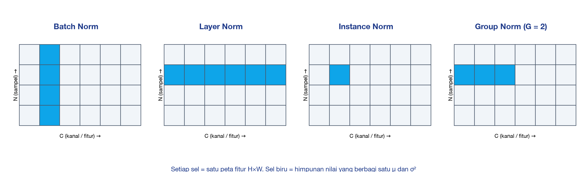

<!-- _class: lead -->
<!-- _paginate: false -->
<!-- _header: '' -->

# Normalization Layers
## BatchNorm · LayerNorm · InstanceNorm · GroupNorm · RMSNorm

### Minggu 0 — Deep Learning
**Sains Data ITERA · Ganjil 2026/2025**

---

# Capaian Pembelajaran & Agenda

> Mahasiswa mampu menghitung secara manual keluaran BatchNorm dan LayerNorm (termasuk γ, β, dan *running statistics*), membedakan sumbu normalisasi setiap varian, serta memilih normalisasi yang tepat.

1. Motivasi: mengapa aktivasi perlu dinormalisasi
2. Rumus umum normalisasi
3. **Batch Normalization** — hitung manual, train vs inference
4. **Layer Normalization** — hitung manual
5. Instance Norm, **Group Norm**, **RMSNorm**
6. Sumbu normalisasi pada tensor $(N, C, H, W)$
7. Mengapa normalisasi membantu? Pandangan terkini
8. PyTorch, panduan memilih, latihan

---

# Motivasi

Saat pelatihan, distribusi masukan setiap lapisan **berubah** karena parameter lapisan sebelumnya terus diperbarui.

Masalah yang muncul tanpa normalisasi:
- Skala aktivasi bisa membesar/mengecil dari lapisan ke lapisan → gradien tidak stabil
- Aktivasi sigmoid/tanh mudah **jenuh**
- Butuh *learning rate* kecil dan inisialisasi yang sangat hati-hati

Ioffe & Szegedy (2015) menyebut fenomena ini ***internal covariate shift*** dan mengusulkan **Batch Normalization**: dengan BN, Inception mencapai akurasi yang sama dengan **14× lebih sedikit langkah pelatihan**.

> Catatan: penelitian berikutnya (Santurkar dkk., 2018) menunjukkan manfaat BN lebih berkaitan dengan **lanskap loss yang lebih mulus** daripada berkurangnya internal covariate shift — dibahas di akhir.

---

# Rumus Umum Normalisasi

Semua varian memakai pola yang sama; yang berbeda hanyalah **himpunan nilai $\mathcal{S}$** tempat $\mu$ dan $\sigma^2$ dihitung:

$$\mu = \frac{1}{|\mathcal{S}|}\sum_{i \in \mathcal{S}} x_i, \qquad \sigma^2 = \frac{1}{|\mathcal{S}|}\sum_{i \in \mathcal{S}} (x_i - \mu)^2$$

$$\hat{x}_i = \frac{x_i - \mu}{\sqrt{\sigma^2 + \epsilon}}, \qquad y_i = \gamma\,\hat{x}_i + \beta$$

- $\epsilon$ kecil (PyTorch: $10^{-5}$) mencegah pembagian dengan nol.
- $\gamma$ (*scale*) dan $\beta$ (*shift*) adalah **parameter yang dipelajari**, per fitur/kanal.
- Dengan $\gamma = \sqrt{\sigma^2 + \epsilon}$ dan $\beta = \mu$, lapisan dapat mengembalikan nilai asli → normalisasi **tidak mengurangi** kapasitas representasi.
- Varians yang dipakai untuk normalisasi adalah varians **bias** (dibagi $|\mathcal{S}|$, bukan $|\mathcal{S}| - 1$).

---

<!-- _class: small -->

# Sumbu Normalisasi



| Metode | $\mathcal{S}$ untuk tensor $(N, C, H, W)$ | Jumlah $(\mu, \sigma^2)$ | Bergantung batch? |
|---|---|---|---|
| **BatchNorm** | $N \times H \times W$, per kanal | $C$ | Ya |
| **LayerNorm** | $C \times H \times W$, per sampel | $N$ | Tidak |
| **InstanceNorm** | $H \times W$, per sampel & kanal | $N \times C$ | Tidak |
| **GroupNorm** | $(C/G) \times H \times W$, per sampel & grup | $N \times G$ | Tidak |

---

<!-- _class: divider -->

# Batch Normalization

Ioffe & Szegedy (2015)

---

# Data Contoh: Mini-Batch $N = 4$, $D = 3$ Fitur

$$X = \begin{bmatrix}1 & 0 & 3\\ 5 & 0 & 1\\ 1 & 6 & 5\\ 5 & 6 & 3\end{bmatrix} \quad \leftarrow \text{baris = sampel, kolom = fitur}$$

Parameter BN: $\gamma = [1;\; 2;\; 0{,}5]$, $\beta = [0;\; 1;\; -1]$. Untuk hitung manual, $\epsilon$ diabaikan (efeknya < $10^{-4}$ di sini).

**Langkah 1 — statistik per fitur (per kolom, sepanjang batch):**

| | Fitur 1 | Fitur 2 | Fitur 3 |
|---|---|---|---|
| $\mu_B$ | $(1+5+1+5)/4 = 3$ | $(0+0+6+6)/4 = 3$ | $(3+1+5+3)/4 = 3$ |
| $\sigma_B^2$ | $(4+4+4+4)/4 = 4$ | $(9+9+9+9)/4 = 9$ | $(0+4+4+0)/4 = 2$ |
| $\sigma_B$ | 2 | 3 | $\sqrt{2} = 1{,}4142$ |

---

# BatchNorm: Normalisasi, Scale & Shift

**Langkah 2 — normalisasi** $\hat{x} = (x - \mu_B)/\sigma_B$:

$$\hat{X} = \begin{bmatrix}(1-3)/2 & (0-3)/3 & (3-3)/1{,}414\\ (5-3)/2 & (0-3)/3 & (1-3)/1{,}414\\ (1-3)/2 & (6-3)/3 & (5-3)/1{,}414\\ (5-3)/2 & (6-3)/3 & (3-3)/1{,}414\end{bmatrix} = \begin{bmatrix}-1 & -1 & 0\\ 1 & -1 & -1{,}4142\\ -1 & 1 & 1{,}4142\\ 1 & 1 & 0\end{bmatrix}$$

Setiap kolom kini ber-*mean* 0 dan varians 1.

**Langkah 3 — scale & shift** $y = \gamma\hat{x} + \beta$:

$$Y = \begin{bmatrix}1(-1) + 0 & 2(-1) + 1 & 0{,}5(0) - 1\\ 1(1) + 0 & 2(-1) + 1 & 0{,}5(-1{,}4142) - 1\\ 1(-1) + 0 & 2(1) + 1 & 0{,}5(1{,}4142) - 1\\ 1(1) + 0 & 2(1) + 1 & 0{,}5(0) - 1\end{bmatrix} = \begin{bmatrix}-1 & -1 & -1\\ 1 & -1 & -1{,}7071\\ -1 & 3 & -0{,}2929\\ 1 & 3 & -1\end{bmatrix}$$

Kolom ke-$j$ kini ber-*mean* $\beta_j$ dan simpangan baku $\gamma_j$.

---

<!-- _class: small -->

# BatchNorm: Train vs Inference

**Masalah**: saat inference, prediksi satu sampel tidak boleh bergantung pada sampel lain dalam batch (dan batch bisa berisi 1 sampel).

**Solusi**: selama pelatihan simpan ***running statistics*** (rata-rata bergerak eksponensial). Konvensi PyTorch (`momentum = 0.1`, inisialisasi `running_mean = 0`, `running_var = 1`):
$$\hat{\mu} \leftarrow (1 - m)\,\hat{\mu} + m\,\mu_B, \qquad \hat{\sigma}^2 \leftarrow (1 - m)\,\hat{\sigma}^2 + m\,\sigma^2_{B,\text{unbiased}}$$

PyTorch memakai varians **unbiased** ($\div (N-1)$) untuk `running_var`: $\sigma^2_{B,\text{unbiased}} = \sigma_B^2 \cdot \frac{4}{3} = [5{,}3333;\; 12;\; 2{,}6667]$

| Setelah 1 batch | Fitur 1 | Fitur 2 | Fitur 3 |
|---|---|---|---|
| `running_mean` $= 0{,}9(0) + 0{,}1(3)$ | 0,3 | 0,3 | 0,3 |
| `running_var` $= 0{,}9(1) + 0{,}1\,\sigma^2_{unb}$ | 1,4333 | 2,1 | 1,1667 |

**Inference** (`model.eval()`): $y = \gamma\,\dfrac{x - \hat{\mu}}{\sqrt{\hat{\sigma}^2 + \epsilon}} + \beta$ — konstanta tetap, sehingga BN menjadi transformasi **affine** yang bisa "dilebur" (*fused*) ke bobot konvolusi/linear sebelumnya.

---

# Contoh Inference & Kesalahan Klasik

Sampel baru $x = [3;\, 3;\, 3]$ dengan running statistics setelah 1 batch:

| Fitur | $\dfrac{x - \hat\mu}{\sqrt{\hat\sigma^2}}$ | $\gamma \cdot (\cdot) + \beta$ |
|---|---|---|
| 1 | $(3 - 0{,}3)/\sqrt{1{,}4333} = 2{,}2552$ | $2{,}2552$ |
| 2 | $(3 - 0{,}3)/\sqrt{2{,}1} = 1{,}8632$ | $2(1{,}8632) + 1 = 4{,}7263$ |
| 3 | $(3 - 0{,}3)/\sqrt{1{,}1667} = 2{,}4998$ | $0{,}5(2{,}4998) - 1 = 0{,}2499$ |

Padahal $x = [3, 3, 3]$ tepat sama dengan rata-rata batch — dengan statistik batch hasilnya $\hat x = 0$. Perbedaan ini muncul karena running statistics **baru diperbarui sekali**; setelah ratusan iterasi, nilainya mendekati statistik populasi.

> Kesalahan paling umum: **lupa `model.eval()`** saat evaluasi (BN memakai statistik batch uji), atau melatih dengan batch sangat kecil sehingga $\mu_B$, $\sigma^2_B$ sangat berisik.

---

<!-- _class: small -->

# Gradien BatchNorm (Ringkas)

Karena $\mu_B$ dan $\sigma_B^2$ bergantung pada **semua** sampel dalam batch, gradien satu sampel bergantung pada sampel lain (Ioffe & Szegedy, 2015):

$$\frac{\partial \mathcal{L}}{\partial \gamma} = \sum_{i=1}^{N} \frac{\partial \mathcal{L}}{\partial y_i}\,\hat{x}_i, \qquad \frac{\partial \mathcal{L}}{\partial \beta} = \sum_{i=1}^{N}\frac{\partial \mathcal{L}}{\partial y_i}$$

$$\frac{\partial \mathcal{L}}{\partial x_i} = \frac{\gamma}{N\sqrt{\sigma_B^2 + \epsilon}}\left(N\frac{\partial \mathcal{L}}{\partial y_i} - \sum_{j=1}^{N}\frac{\partial \mathcal{L}}{\partial y_j} - \hat{x}_i\sum_{j=1}^{N}\frac{\partial \mathcal{L}}{\partial y_j}\hat{x}_j\right)$$

Contoh fitur 1 ($\hat{x} = [-1, 1, -1, 1]$, $\gamma = 1$, $\sigma_B = 2$) dengan $\partial\mathcal{L}/\partial y = [1, 0, 0, 0]$:
- $\partial\mathcal{L}/\partial\gamma = 1 \cdot (-1) = -1$; $\;\partial\mathcal{L}/\partial\beta = 1$
- $\sum_j g_j = 1$, $\;\sum_j g_j\hat{x}_j = -1$
- $\partial\mathcal{L}/\partial x_1 = \frac{1}{4 \cdot 2}\left(4 - 1 - (-1)(-1)\right) = \frac{2}{8} = 0{,}25$; $\;\partial\mathcal{L}/\partial x_2 = \frac{1}{8}(0 - 1 - (1)(-1)) = 0$
- $\partial\mathcal{L}/\partial x_3 = \frac{1}{8}(0 - 1 - (-1)(-1)) = -0{,}25$; $\;\partial\mathcal{L}/\partial x_4 = \frac{1}{8}(0 - 1 + 1) = 0$

Gradien sampel 3 tidak nol walaupun $\partial\mathcal{L}/\partial y_3 = 0$ → sampel dalam batch **saling terkait**.

---

<!-- _class: divider -->

# Layer Normalization & Varian Lain

---

# Layer Normalization (Ba, Kiros & Hinton, 2016)

Statistik dihitung **per sampel**, di sepanjang semua fitur → tidak bergantung ukuran batch, perilaku **train = inference**.

Data yang sama, $\gamma = 1$, $\beta = 0$ (LN di PyTorch: $\gamma, \beta$ berdimensi $D$):

| Sampel | $\mathbf{x}$ | $\mu$ | $\sigma^2$ | $\hat{\mathbf{x}}$ |
|---|---|---|---|---|
| 1 | [1, 0, 3] | 1,3333 | 1,5556 | [−0,2673; −1,0690; 1,3363] |
| 2 | [5, 0, 1] | 2 | 4,6667 | [1,3887; −0,9258; −0,4629] |
| 3 | [1, 6, 5] | 4 | 4,6667 | [−1,3887; 0,9258; 0,4629] |
| 4 | [5, 6, 3] | 4,6667 | 1,5556 | [0,2673; 1,0690; −1,3363] |

**Rinci sampel 2**: $\mu = (5 + 0 + 1)/3 = 2$; $\sigma^2 = (9 + 4 + 1)/3 = 4{,}6667$; $\sigma = 2{,}1602$
$\hat{\mathbf{x}} = [3/2{,}1602;\; -2/2{,}1602;\; -1/2{,}1602] = [1{,}3887;\; -0{,}9258;\; -0{,}4629]$

Dipakai di **RNN** dan **Transformer** (setiap token dinormalisasi sendiri di sepanjang dimensi model $d$).

---

<!-- _class: small -->

# Instance Norm & Group Norm — Hitung Manual

Satu sampel ($N = 1$) dengan $C = 4$ kanal, tiap kanal $H \times W = 1 \times 2$:
$$c_1 = [1, 3],\quad c_2 = [5, 7],\quad c_3 = [0, 2],\quad c_4 = [2, 4]$$

| Metode | Himpunan $\mathcal{S}$ | $\mu$, $\sigma^2$ | Hasil $\hat{x}$ |
|---|---|---|---|
| **InstanceNorm** (Ulyanov dkk., 2016) | tiap kanal sendiri | $c_1$: 2, 1; $c_2$: 6, 1; $c_3$: 1, 1; $c_4$: 3, 1 | setiap kanal → $[-1, 1]$ |
| **GroupNorm**, $G = 2$ (Wu & He, 2018) | $\{c_1, c_2\}$ dan $\{c_3, c_4\}$ | grup 1: 4, 5; grup 2: 2, 2 | $c_1 = [-1{,}3416; -0{,}4472]$, $c_2 = [0{,}4472; 1{,}3416]$, $c_3 = [-1{,}4142; 0]$, $c_4 = [0; 1{,}4142]$ |
| **LayerNorm** (= GN dengan $G = 1$) | semua 8 nilai | 3; 4,5 | $c_1 = [-0{,}9428; 0]$, $c_2 = [0{,}9428; 1{,}8856]$, … |

Rinci grup 1: nilai $\{1, 3, 5, 7\}$, $\mu = 4$, $\sigma^2 = (9 + 1 + 1 + 9)/4 = 5$, $\sigma = 2{,}2361$ → $(1 - 4)/2{,}2361 = -1{,}3416$.

- $G = 1$ → LayerNorm; $\;G = C$ → InstanceNorm.
- **InstanceNorm** menghapus kontras/gaya per citra → populer untuk ***style transfer***.
- **GroupNorm** stabil untuk **batch kecil** (deteksi objek, segmentasi, video) — di sana akurasi BN turun tajam (Wu & He, 2018).

---

# RMSNorm (Zhang & Sennrich, 2019)

LayerNorm **tanpa pengurangan mean** — hanya menskalakan dengan *root mean square*:
$$\text{RMS}(\mathbf{x}) = \sqrt{\frac{1}{d}\sum_{i=1}^{d} x_i^2 + \epsilon}, \qquad y_i = \frac{x_i}{\text{RMS}(\mathbf{x})}\,g_i$$

**Hitung manual** $\mathbf{x} = [1, 0, 3]$, $g = 1$:
$$\text{RMS} = \sqrt{(1 + 0 + 9)/3} = \sqrt{3{,}3333} = 1{,}8257 \;\Rightarrow\; \mathbf{y} = [0{,}5477;\; 0;\; 1{,}6432]$$

Bandingkan LayerNorm untuk vektor yang sama: $[-0{,}2673;\; -1{,}0690;\; 1{,}3363]$ (di-*center* dulu).

- Lebih murah (tanpa menghitung mean); paper melaporkan pengurangan waktu 7%–64% pada berbagai model dengan kinerja sebanding.
- Dipakai di banyak LLM modern (mis. keluarga LLaMA). PyTorch ≥ 2.4: `nn.RMSNorm`.

---

# Mengapa Normalisasi Membantu?

| Penjelasan | Isi | Rujukan |
|---|---|---|
| Internal covariate shift | Menstabilkan distribusi masukan tiap lapisan | Ioffe & Szegedy (2015) |
| **Lanskap loss lebih mulus** | BN membuat loss & gradien lebih *Lipschitz*-mulus → learning rate lebih besar aman; ICS ternyata bukan faktor utama | Santurkar dkk. (2018) |
| Invarian skala | Output tidak berubah jika bobot lapisan sebelumnya dikalikan konstanta | Ba dkk. (2016) |
| Efek regularisasi (BN) | Statistik batch berisik ≈ *noise* → sering mengurangi kebutuhan dropout | Ioffe & Szegedy (2015) |

Konsekuensi praktis:
- Learning rate lebih besar, konvergensi lebih cepat, kurang sensitif terhadap inisialisasi
- Bias pada lapisan sebelum BN **redundan** ($\beta$ sudah menggeser) → `Conv2d(..., bias=False)`

---

<!-- _class: small -->

# Implementasi PyTorch

```python
import torch
import torch.nn as nn

X = torch.tensor([[1., 0, 3], [5, 0, 1], [1, 6, 5], [5, 6, 3]])

bn = nn.BatchNorm1d(3)                       # eps=1e-5, momentum=0.1
with torch.no_grad():
    bn.weight.copy_(torch.tensor([1., 2., 0.5]))   # gamma
    bn.bias.copy_(torch.tensor([0., 1., -1.]))     # beta
bn.train()
print(bn(X))            # [[-1,-1,-1],[1,-1,-1.7071],[-1,3,-0.2929],[1,3,-1]]  (dibulatkan 4 desimal)
print(bn.running_mean)  # tensor([0.3000, 0.3000, 0.3000])
print(bn.running_var)   # tensor([1.4333, 2.1000, 1.1667])
bn.eval()
print(bn(torch.tensor([[3., 3, 3]])))   # ≈ [[2.2552, 4.7263, 0.2499]]

ln = nn.LayerNorm(3)                         # gamma=1, beta=0 saat inisialisasi
print(ln(X))            # baris 2: [1.3887, -0.9258, -0.4629]

gn = nn.GroupNorm(num_groups=2, num_channels=4)
T = torch.tensor([[1., 3], [5, 7], [0, 2], [2, 4]]).reshape(1, 4, 1, 2)
print(gn(T).flatten())  # [-1.3416,-0.4472,0.4472,1.3416,-1.4142,0,0,1.4142]

# Pola umum CNN:  Conv2d(bias=False) -> BatchNorm2d -> ReLU
block = nn.Sequential(nn.Conv2d(64, 64, 3, padding=1, bias=False), nn.BatchNorm2d(64), nn.ReLU())
```

---

# Panduan Memilih Normalisasi

| Situasi | Pilihan |
|---|---|
| CNN klasifikasi citra, batch cukup besar (≥ 16–32) | **BatchNorm** |
| Batch kecil (deteksi, segmentasi, video, 3D medis) | **GroupNorm** (mis. $G = 32$) |
| RNN, Transformer, data sekuensial | **LayerNorm** |
| LLM skala besar | **RMSNorm** |
| Style transfer, generasi citra | **InstanceNorm** |
| Batch berbeda ukuran antara train & inference, *online learning* | Normalisasi bebas batch (LN/GN) |

Posisi umum:
- CNN: `Conv → BN → ReLU`
- Transformer Pre-LN: `x + Sublayer(LN(x))`

---

# Kesalahan Umum

| Kesalahan | Akibat / Solusi |
|---|---|
| Lupa `model.eval()` saat validasi/inference | Prediksi berubah tergantung isi batch → selalu `eval()` |
| BN dengan batch size 1 saat training | Varians 0 / error → gunakan GN/LN atau perbesar batch |
| Memakai varians unbiased saat menghitung manual normalisasi | Hasil sedikit berbeda → normalisasi memakai varians **bias** |
| Bias pada Conv/Linear sebelum BN | Parameter mubazir → `bias=False` |
| Fine-tuning dengan batch kecil tetapi BN tetap di-*update* | Running stats rusak → bekukan BN (`eval()` pada lapisan BN) |
| Menyamakan sumbu BN dan LN | Periksa tensor $(N, C, H, W)$: BN per kanal, LN per sampel |

---

# Latihan

Mini-batch $N = 4$, $D = 2$: $\;E = \begin{bmatrix}2 & 1\\ 4 & 1\\ 6 & 7\\ 8 & 3\end{bmatrix}$

1. Hitung $\mu_B$, $\sigma^2_B$ (bias), dan $\hat{E}$ hasil BatchNorm ($\gamma = 1$, $\beta = 0$, abaikan $\epsilon$).
2. Dengan $\gamma = [2;\, 1]$ dan $\beta = [1;\, 0]$, hitung keluaran BN untuk sampel pertama.
3. Hitung `running_mean` dan `running_var` setelah satu langkah (momentum 0,1; awal 0 dan 1; varians unbiased).
4. Hitung LayerNorm ($\gamma = 1$, $\beta = 0$) untuk sampel pertama $[2, 1]$.
5. Hitung RMSNorm ($g = 1$) untuk vektor $[3, 4]$.
6. Untuk tensor $(N, C, H, W) = (8, 32, 16, 16)$: berapa banyak pasangan $(\mu, \sigma^2)$ yang dihitung oleh BN, LN, IN, dan GN ($G = 8$)?

---

<!-- _class: small -->

# Kunci Jawaban

1. $\mu_B = [5;\, 3]$, $\sigma_B^2 = [(9+1+1+9)/4;\; (4+4+16+0)/4] = [5;\, 6]$
$$\hat{E} = \begin{bmatrix}-1{,}3416 & -0{,}8165\\ -0{,}4472 & -0{,}8165\\ 0{,}4472 & 1{,}6330\\ 1{,}3416 & 0\end{bmatrix}$$
2. $[2(-1{,}3416) + 1;\; 1(-0{,}8165) + 0] = [-1{,}6833;\; -0{,}8165]$
3. `running_mean` $= 0{,}1 \times [5, 3] = [0{,}5;\, 0{,}3]$; unbiased $= [6{,}6667;\, 8]$ → `running_var` $= 0{,}9 + 0{,}1 \times [6{,}6667;\, 8] = [1{,}5667;\, 1{,}7]$
4. $\mu = 1{,}5$, $\sigma^2 = 0{,}25$, $\sigma = 0{,}5$ → $[1;\, -1]$
5. $\text{RMS} = \sqrt{(9 + 16)/2} = 3{,}5355$ → $[0{,}8485;\; 1{,}1314]$
6. BN: $C = 32$; LN: $N = 8$; IN: $N \times C = 256$; GN: $N \times G = 64$

---

# Ringkasan

1. Semua normalisasi: $\hat{x} = (x - \mu)/\sqrt{\sigma^2 + \epsilon}$, lalu $y = \gamma\hat{x} + \beta$ — bedanya pada **himpunan** tempat $\mu, \sigma^2$ dihitung.
2. **BatchNorm**: per kanal sepanjang batch; perlu **running statistics** untuk inference; sensitif terhadap ukuran batch.
3. **LayerNorm**: per sampel; train = inference; standar di Transformer.
4. **InstanceNorm** ($G = C$) dan **GroupNorm** (di antara LN dan IN) cocok untuk batch kecil/tugas khusus.
5. **RMSNorm**: tanpa *centering*, lebih murah, dipakai di LLM.
6. Manfaat utama: pelatihan lebih stabil & cepat (lanskap loss lebih mulus), learning rate lebih besar.

---

<!-- _class: tiny -->

# Referensi

1. Ioffe, S., & Szegedy, C. (2015). Batch normalization: Accelerating deep network training by reducing internal covariate shift. *ICML*.
2. Ba, J. L., Kiros, J. R., & Hinton, G. E. (2016). Layer normalization. *arXiv:1607.06450*.
3. Ulyanov, D., Vedaldi, A., & Lempitsky, V. (2016). Instance normalization: The missing ingredient for fast stylization. *arXiv:1607.08022*.
4. Wu, Y., & He, K. (2018). Group normalization. *ECCV*.
5. Zhang, B., & Sennrich, R. (2019). Root mean square layer normalization. *NeurIPS*.
6. Santurkar, S., Tsipras, D., Ilyas, A., & Mądry, A. (2018). How does batch normalization help optimization? *NeurIPS*.
7. Xiong, R., dkk. (2020). On layer normalization in the Transformer architecture. *ICML*.
8. Goodfellow, I., Bengio, Y., & Courville, A. (2016). *Deep Learning*. MIT Press. §8.7.1 (Batch Normalization).
9. Zhang, A., Lipton, Z. C., Li, M., & Smola, A. J. (2023). *Dive into Deep Learning*. Cambridge University Press. §8.5 (Batch Normalization).
10. Prince, S. J. D. (2023). *Understanding Deep Learning*. MIT Press. Bab 11 (subbab Batch normalization).
11. PyTorch Documentation — `torch.nn.BatchNorm1d`, `torch.nn.LayerNorm`, `torch.nn.GroupNorm`, `torch.nn.RMSNorm`. https://pytorch.org/docs/stable/nn.html#normalization-layers

---

<!-- _class: lead -->
<!-- _paginate: false -->
<!-- _header: '' -->

# Terima Kasih

### Topik berikutnya: **Dropout Layers**

Kerjakan latihan dan cocokkan hasilnya dengan `nn.BatchNorm1d` serta `nn.LayerNorm`.
