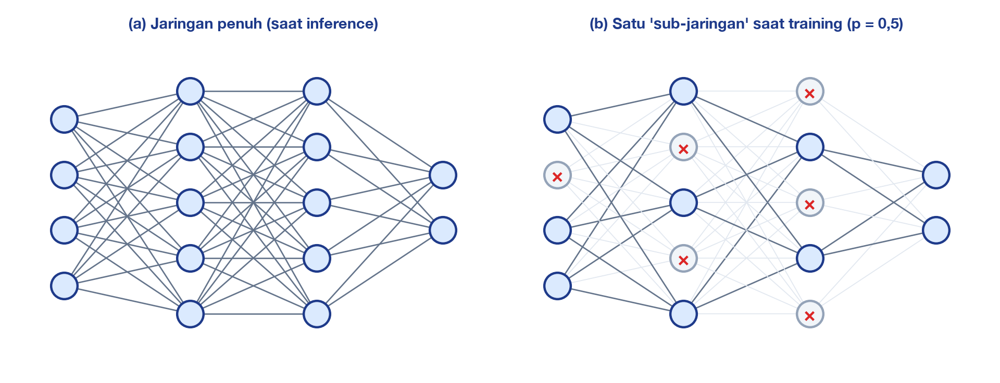

<!-- _class: lead -->
<!-- _paginate: false -->
<!-- _header: '' -->

# Dropout Layers
## Regularisasi dengan "Mematikan" Neuron Secara Acak

### Minggu 0 — Deep Learning
**Sains Data ITERA · Ganjil 2026/2025**

---

# Capaian Pembelajaran & Agenda

> Mahasiswa mampu menjelaskan cara kerja **dropout**, menghitung secara manual *forward* dan *backward* dropout (termasuk *inverted scaling*), membedakan perilaku saat **training** dan **inference**, serta memilih varian dropout yang tepat.

1. Motivasi: *overfitting* & *co-adaptation*
2. Definisi formal: mask Bernoulli & **inverted dropout**
3. Hitung manual: forward, ekspektasi, variansi, backward
4. Training vs inference · interpretasi **ensemble**
5. Varian: DropConnect, Spatial Dropout, Stochastic Depth/DropPath, **MC Dropout**
6. Penempatan & nilai $p$ yang umum · implementasi PyTorch
7. Kesalahan umum · latihan

---

# Motivasi: Overfitting & Co-adaptation

- Jaringan besar dengan jutaan parameter mudah **menghafal** data latih → *training loss* turun, *validation loss* naik.
- Hinton dkk. (2012) dan Srivastava dkk. (2014) mengamati **co-adaptation**: sebuah neuron hanya berguna bersama neuron tertentu lainnya → fitur rapuh, tidak *general*.

**Ide dropout**: pada setiap langkah training, **matikan setiap unit secara acak** dengan peluang $p$.

- Neuron tidak bisa bergantung pada kehadiran neuron tertentu → dipaksa mempelajari fitur yang **berguna secara mandiri**.
- Setiap *mini-batch* melatih **sub-jaringan** yang berbeda (berbagi bobot) → mirip melatih **ensemble** banyak model sekaligus.

> Dropout dipakai pada AlexNet (Krizhevsky dkk., 2012) di dua *fully-connected layer* pertama dengan peluang 0,5, dan pada Transformer (Vaswani dkk., 2017) dengan $P_{drop} = 0{,}1$.

---

# Ilustrasi: Jaringan Penuh vs Sub-jaringan



Dengan $n$ unit yang dapat di-*drop*, terdapat $2^n$ kemungkinan sub-jaringan. Untuk 10 unit saja: $2^{10} = 1024$ sub-jaringan yang **berbagi bobot yang sama**.

---

# Definisi Formal (Inverted Dropout)

Untuk vektor aktivasi $\mathbf{x} \in \mathbb{R}^d$ dan peluang drop $p$:

$$m_i \sim \text{Bernoulli}(1-p), \qquad y_i = \frac{m_i \, x_i}{1-p} \quad \text{(training)}$$

$$y_i = x_i \quad \text{(inference)}$$

| Simbol | Arti |
|---|---|
| $p$ | Peluang sebuah unit **di-nol-kan** (konvensi PyTorch `nn.Dropout(p)`) |
| $1-p$ | Peluang unit **dipertahankan** (*keep probability*) |
| $m_i \in \{0,1\}$ | Mask acak, diambil ulang **setiap forward pass** |
| $\frac{1}{1-p}$ | Faktor skala agar **ekspektasi** keluaran tetap sama |

> Perhatian notasi: pada paper Srivastava dkk. (2014), simbol $p$ berarti peluang **dipertahankan** (*retain*), bukan di-drop. Selalu cek konvensi yang dipakai!

---

# Hitung Manual: Forward Pass

$\mathbf{x} = [2{,}0;\; 1{,}0;\; 4{,}0;\; 3{,}0;\; 0{,}5]$, $p = 0{,}5$ → faktor skala $\frac{1}{1-p} = \frac{1}{0{,}5} = 2$

Misal mask yang terambil: $\mathbf{m} = [1, 0, 1, 1, 0]$

| $i$ | $x_i$ | $m_i$ | $m_i x_i$ | $y_i = m_i x_i / 0{,}5$ |
|---|---|---|---|---|
| 1 | 2,0 | 1 | 2,0 | **4,0** |
| 2 | 1,0 | 0 | 0 | **0** |
| 3 | 4,0 | 1 | 4,0 | **8,0** |
| 4 | 3,0 | 1 | 3,0 | **6,0** |
| 5 | 0,5 | 0 | 0 | **0** |

Dengan $p = 0{,}25$ (skala $1/0{,}75 = 1{,}333$) dan mask $[1,1,0,1,1]$: $\mathbf{y} = [2{,}667;\; 1{,}333;\; 0;\; 4{,}0;\; 0{,}667]$.

---

# Mengapa Dibagi $(1-p)$? Bukti Ekspektasi

$$\mathbb{E}[y_i] = \mathbb{E}\!\left[\frac{m_i x_i}{1-p}\right] = \frac{x_i}{1-p}\,\mathbb{E}[m_i] = \frac{x_i}{1-p}(1-p) = x_i$$

Contoh $x_3 = 4$, $p = 0{,}5$: $y_3 \in \{0, 8\}$ masing-masing berpeluang 0,5 → $\mathbb{E}[y_3] = 0{,}5(0) + 0{,}5(8) = 4 = x_3$ ✓

**Variansi** yang ditambahkan (sumber efek regularisasi):
$$\text{Var}[y_i] = \frac{x_i^2}{(1-p)^2}\,\text{Var}[m_i] = \frac{x_i^2\, p(1-p)}{(1-p)^2} = x_i^2\,\frac{p}{1-p}$$

Contoh $x_3 = 4$, $p = 0{,}5$: $\text{Var}[y_3] = 16 \cdot 1 = 16$; cek: $\mathbb{E}[y_3^2] - 4^2 = 0{,}5 \cdot 64 - 16 = 16$ ✓

Simulasi 100.000 mask ($p = 0{,}5$) memberi rata-rata $[1{,}990;\, 0{,}996;\, 4{,}007;\, 3{,}009;\, 0{,}501] \approx \mathbf{x}$.

> Karena skala sudah dilakukan saat training, **inference cukup memakai jaringan apa adanya** tanpa perubahan apa pun.

---

<!-- _class: small -->

# Hitung Manual: Backward Pass

Dropout adalah perkalian elemen dengan konstanta $c_i = m_i/(1-p)$ (mask tetap selama satu langkah):
$$\frac{\partial \mathcal{L}}{\partial x_i} = \frac{\partial \mathcal{L}}{\partial y_i}\cdot\frac{\partial y_i}{\partial x_i} = \frac{\partial \mathcal{L}}{\partial y_i}\cdot\frac{m_i}{1-p}$$

Lanjutan contoh ($p = 0{,}5$, $\mathbf{m} = [1,0,1,1,0]$), gradien dari layer atas $\partial\mathcal{L}/\partial\mathbf{y} = [0{,}1;\; 0{,}2;\; 0{,}3;\; 0{,}4;\; 0{,}5]$:

| $i$ | $\partial\mathcal{L}/\partial y_i$ | $m_i/(1-p)$ | $\partial\mathcal{L}/\partial x_i$ |
|---|---|---|---|
| 1 | 0,1 | 2 | **0,2** |
| 2 | 0,2 | 0 | **0** |
| 3 | 0,3 | 2 | **0,6** |
| 4 | 0,4 | 2 | **0,8** |
| 5 | 0,5 | 0 | **0** |

- Unit yang di-drop **tidak menerima gradien** → bobot yang masuk ke unit itu tidak diperbarui pada langkah ini.
- Mask yang **sama** dengan forward pass harus disimpan untuk backward.

---

# Training vs Inference

| | Training (`model.train()`) | Inference (`model.eval()`) |
|---|---|---|
| Mask | Acak, baru setiap forward | Tidak ada (semua unit aktif) |
| Skala | $\times \frac{1}{1-p}$ pada unit yang hidup | Tidak ada (inverted dropout) |
| Keluaran | **Stokastik** | **Deterministik** |

**Dropout "klasik"** (Srivastava dkk., 2014) — tanpa skala saat training, tetapi **bobot dikalikan** peluang retain saat inference (*weight scaling inference rule*). Hasil ekspektasinya sama; **inverted dropout** lebih praktis karena inference tidak perlu diubah.

**Interpretasi ensemble** (Goodfellow dkk., 2016, §7.12): inference dengan jaringan penuh ≈ **rata-rata** prediksi $2^n$ sub-jaringan. Untuk jaringan linear, pendekatan ini eksak; untuk jaringan nonlinear merupakan aproksimasi yang bekerja baik secara empiris.

---

# Varian Dropout

| Varian | Apa yang di-drop | Kegunaan | Rujukan |
|---|---|---|---|
| **Dropout** standar | Unit/aktivasi individual | MLP, layer FC, Transformer | Srivastava dkk. (2014) |
| **DropConnect** | **Bobot** individual $W_{ij}$ | Generalisasi dropout ke koneksi | Wan dkk. (2013) |
| **Spatial Dropout** (`nn.Dropout2d`) | **Seluruh channel** feature map | CNN: piksel bertetangga berkorelasi, drop per piksel kurang efektif | Tompson dkk. (2015) |
| **Stochastic Depth / DropPath** | **Seluruh blok residual** | Jaringan sangat dalam (ResNet, ViT) | Huang dkk. (2016); Larsson dkk. (2017) |
| **MC Dropout** | Unit (dropout tetap aktif saat inference) | Estimasi **ketidakpastian** prediksi | Gal & Ghahramani (2016) |

---

# Spatial Dropout & Stochastic Depth

**Spatial Dropout** — feature map $C \times H \times W$; mask berukuran $C$ (satu bilangan per channel):
$$Y_{c,h,w} = \frac{m_c}{1-p} X_{c,h,w}, \qquad m_c \sim \text{Bernoulli}(1-p)$$
Contoh: 3 channel, mask $[1, 0, 1]$, $p = 0{,}5$ → channel 1 dan 3 dikali 2, channel 2 menjadi **nol seluruhnya**.

**Stochastic Depth** — untuk blok residual $\mathbf{x}_{l+1} = \mathbf{x}_l + f_l(\mathbf{x}_l)$:
$$\mathbf{x}_{l+1} = \mathbf{x}_l + b_l\, f_l(\mathbf{x}_l), \qquad b_l \sim \text{Bernoulli}(1-p_l)$$
Jika $b_l = 0$, blok ke-$l$ **dilompati** (jaringan menjadi lebih dangkal pada langkah itu). Pada implementasi gaya inverted (*DropPath*), keluaran blok dibagi $(1-p_l)$ saat training.

---

<!-- _class: small -->

# MC Dropout: Dropout untuk Ketidakpastian

Gal & Ghahramani (2016): dropout yang **tetap aktif saat inference** ≈ inferensi Bayesian aproksimatif. Jalankan $T$ forward pass, lalu hitung rata-rata & simpangan baku.

**Contoh manual**: $\mathbf{h} = \text{ReLU}(W_1\mathbf{x}) = [0{,}1;\, 1{,}9;\, 0{,}8;\, 0{,}9]$, $\mathbf{w}_2 = [1{,}0;\, -0{,}5;\, 0{,}8;\, 0{,}6]$, $p = 0{,}5$
Prediksi deterministik: $\mathbf{w}_2^\top\mathbf{h} = 0{,}1 - 0{,}95 + 0{,}64 + 0{,}54 = 0{,}33$

| Pass $t$ | Mask | $\hat{y}_t = \mathbf{w}_2^\top(\mathbf{h}\odot\mathbf{m}/0{,}5)$ |
|---|---|---|
| 1 | [1, 1, 0, 1] | $2(0{,}1 - 0{,}95 + 0{,}54) = -0{,}62$ |
| 2 | [0, 0, 1, 0] | $2(0{,}64) = 1{,}28$ |
| 3 | [1, 0, 1, 1] | $2(0{,}1 + 0{,}64 + 0{,}54) = 2{,}56$ |
| 4 | [0, 1, 0, 0] | $2(-0{,}95) = -1{,}90$ |
| 5 | [0, 0, 0, 0] | $0$ |

$\bar{y} = (-0{,}62 + 1{,}28 + 2{,}56 - 1{,}90 + 0)/5 = 0{,}264$, simpangan baku ≈ **1,539** → prediksi sangat **tidak pasti**. Dalam praktik dipakai $T$ = puluhan hingga ratusan pass.

---

# Di Mana Menempatkan Dropout & Berapa Nilai $p$?

| Arsitektur | Praktik umum |
|---|---|
| MLP / layer FC | Setelah aktivasi, $p \approx 0{,}5$ di hidden layer; input layer lebih kecil (Srivastava dkk. menyarankan retain 0,8 → $p = 0{,}2$) |
| CNN | Sebelum classifier FC; dalam blok konvolusi lebih sering memakai **Dropout2d** atau tidak sama sekali (mengandalkan BatchNorm & augmentasi) |
| RNN/LSTM | Pada koneksi antar-layer (bukan antar-waktu); varian *variational dropout* memakai mask sama untuk semua langkah waktu (Gal & Ghahramani, 2016b) |
| Transformer | Setelah attention & feed-forward sebelum residual, pada bobot attention, dan embedding; $p = 0{,}1$ (Vaswani dkk., 2017) |
| ViT/ResNet sangat dalam | **Stochastic depth / DropPath** |

> Data sedikit → $p$ lebih besar. Data sangat banyak (mis. pretraining LLM berskala besar) → dropout sering dikecilkan atau dihapus.

---

<!-- _class: small -->

# Implementasi PyTorch

```python
import torch
import torch.nn as nn

x = torch.tensor([2.0, 1.0, 4.0, 3.0, 0.5])

# Reproduksi hitung manual dengan mask tetap
m = torch.tensor([1., 0., 1., 1., 0.]); p = 0.5
print(x * m / (1 - p))            # tensor([4., 0., 8., 6., 0.])

# Layer dropout bawaan (mask acak)
drop = nn.Dropout(p=0.5)          # p = peluang di-nol-kan
drop.train(); print(drop(x))      # elemen 0 atau 2*x_i, acak setiap pemanggilan
drop.eval();  print(drop(x))      # tensor([2.0, 1.0, 4.0, 3.0, 0.5])  -> identitas

model = nn.Sequential(
    nn.Linear(784, 256), nn.ReLU(), nn.Dropout(0.5),
    nn.Linear(256, 10),
)
model.train()   # dropout aktif  (training loop)
model.eval()    # dropout nonaktif (validasi / inference)
```

Spatial: `nn.Dropout2d(p)` (input $N \times C \times H \times W$, nol-kan seluruh channel). MC Dropout: panggil `model.eval()` lalu aktifkan kembali modul dropout saja dengan `m.train()` untuk setiap `nn.Dropout`.

---

# Kesalahan Umum

| Kesalahan | Akibat | Solusi |
|---|---|---|
| Lupa `model.eval()` saat validasi/inference | Prediksi acak, metrik validasi berfluktuasi & lebih buruk | Selalu `model.eval()` + `torch.no_grad()` |
| Lupa kembali ke `model.train()` | Dropout mati saat training → regularisasi hilang | Panggil `model.train()` di awal setiap epoch |
| Salah tafsir $p$ (drop vs retain) | Dropout 0,8 bisa berarti 80% unit dimatikan! | Cek dokumentasi framework |
| Dropout sebelum BatchNorm | *Variance shift* antara train & test (Li dkk., 2019) | Taruh dropout setelah BN / hanya di akhir jaringan |
| Dropout pada layer output | Menghapus logit kelas | Jangan pasang dropout setelah layer terakhir |
| Dropout terlalu besar pada model kecil | *Underfitting* | Mulai dari $p$ kecil, pantau kurva train vs val |

---

# Latihan

1. $\mathbf{x} = [1{,}0;\; -2{,}0;\; 3{,}0;\; 0{,}5]$, $p = 0{,}2$, mask $\mathbf{m} = [1, 1, 0, 1]$. Hitung keluaran inverted dropout.
2. Jika gradien dari atas $\partial\mathcal{L}/\partial\mathbf{y} = [1, 1, 1, 1]$, hitung $\partial\mathcal{L}/\partial\mathbf{x}$.
3. Untuk $x = 3$ dan $p = 0{,}2$: tuliskan nilai-nilai yang mungkin dari $y$ beserta peluangnya, lalu buktikan $\mathbb{E}[y] = 3$ dan hitung $\text{Var}[y]$.
4. Berapa banyak sub-jaringan berbeda jika dropout diterapkan pada 10 unit?
5. Apa yang terjadi pada keluaran jika model lupa di-set ke `eval()` saat inference? Jelaskan dengan contoh no. 1.
6. Feature map 4 channel, `Dropout2d(p=0,5)`, mask channel $[0, 1, 1, 0]$. Channel mana yang menjadi nol dan berapa faktor skala channel lainnya?

---

# Kunci Jawaban

1. Skala $1/(1-0{,}2) = 1{,}25$ → $\mathbf{y} = [1{,}25;\; -2{,}5;\; 0;\; 0{,}625]$
2. $\partial\mathcal{L}/\partial\mathbf{x} = [1{,}25;\; 1{,}25;\; 0;\; 1{,}25]$
3. $y = 3/0{,}8 = 3{,}75$ dengan peluang 0,8 dan $y = 0$ dengan peluang 0,2 → $\mathbb{E}[y] = 0{,}8 \times 3{,}75 = 3$ ✓; $\text{Var}[y] = 3^2 \cdot \frac{0{,}2}{0{,}8} = 2{,}25$ (cek: $0{,}8 \times 3{,}75^2 - 9 = 11{,}25 - 9 = 2{,}25$ ✓)
4. $2^{10} = 1024$
5. Keluaran tetap acak (mask berubah tiap pemanggilan) — input yang sama dapat memberi prediksi berbeda; nilai yang lolos juga diperbesar 1,25 kali
6. Channel 1 dan 4 menjadi nol seluruhnya; channel 2 dan 3 dikali $1/(1-0{,}5) = 2$

---

# Ringkasan

1. Dropout menonaktifkan unit secara acak dengan peluang $p$ → mencegah *co-adaptation* dan *overfitting*.
2. **Inverted dropout**: $y_i = m_i x_i/(1-p)$ saat training → $\mathbb{E}[y_i] = x_i$, sehingga inference cukup identitas.
3. Variansi tambahan $x_i^2\,p/(1-p)$ adalah sumber efek regularisasi.
4. Backward: gradien dikali mask yang sama, $\partial\mathcal{L}/\partial x_i = \partial\mathcal{L}/\partial y_i \cdot m_i/(1-p)$.
5. Dapat dipandang sebagai **ensemble** $2^n$ sub-jaringan berbagi bobot.
6. Varian: **DropConnect** (bobot), **Dropout2d** (channel), **DropPath** (blok), **MC Dropout** (ketidakpastian).
7. Jangan lupa `model.train()` / `model.eval()`.

---

<!-- _class: tiny -->

# Referensi

1. Srivastava, N., Hinton, G., Krizhevsky, A., Sutskever, I., & Salakhutdinov, R. (2014). Dropout: A simple way to prevent neural networks from overfitting. *Journal of Machine Learning Research*, 15, 1929–1958.
2. Hinton, G. E., Srivastava, N., Krizhevsky, A., Sutskever, I., & Salakhutdinov, R. R. (2012). Improving neural networks by preventing co-adaptation of feature detectors. *arXiv:1207.0580*.
3. Wan, L., Zeiler, M., Zhang, S., LeCun, Y., & Fergus, R. (2013). Regularization of neural networks using DropConnect. *ICML*.
4. Tompson, J., Goroshin, R., Jain, A., LeCun, Y., & Bregler, C. (2015). Efficient object localization using convolutional networks. *CVPR*.
5. Huang, G., Sun, Y., Liu, Z., Sedra, D., & Weinberger, K. Q. (2016). Deep networks with stochastic depth. *ECCV*.
6. Larsson, G., Maire, M., & Shakhnarovich, G. (2017). FractalNet: Ultra-deep neural networks without residuals. *ICLR*.
7. Gal, Y., & Ghahramani, Z. (2016). Dropout as a Bayesian approximation: Representing model uncertainty in deep learning. *ICML*.
8. Gal, Y., & Ghahramani, Z. (2016b). A theoretically grounded application of dropout in recurrent neural networks. *NeurIPS*.
9. Li, X., Chen, S., Hu, X., & Yang, J. (2019). Understanding the disharmony between dropout and batch normalization by variance shift. *CVPR*.
10. Krizhevsky, A., Sutskever, I., & Hinton, G. E. (2012). ImageNet classification with deep convolutional neural networks. *NeurIPS*.
11. Vaswani, A., dkk. (2017). Attention is all you need. *NeurIPS*.
12. Goodfellow, I., Bengio, Y., & Courville, A. (2016). *Deep Learning*, Bab 7.12 (Dropout). MIT Press.
13. Zhang, A., Lipton, Z. C., Li, M., & Smola, A. J. (2023). *Dive into Deep Learning*, Bab 5.6 (Dropout). Cambridge University Press.

---

<!-- _class: lead -->
<!-- _paginate: false -->
<!-- _header: '' -->

# Terima Kasih

### Topik berikutnya: **Adaptive Bias Layers**
