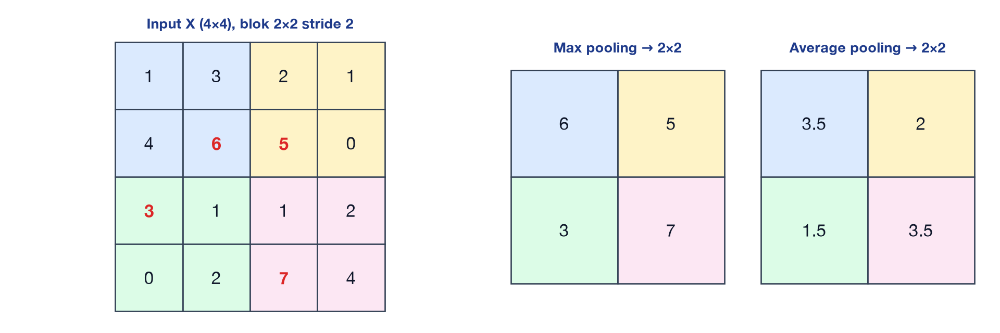
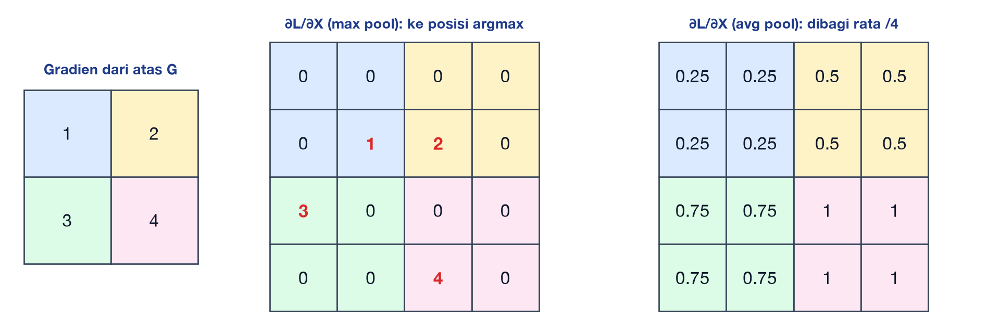

<!-- _class: lead -->
<!-- _paginate: false -->
<!-- _header: '' -->

# Pooling Layers
## Meringkas Informasi Spasial: Max, Average, Global, Adaptive

### Minggu 0 — Deep Learning
**Sains Data ITERA · Ganjil 2026/2025**

---

# Capaian Pembelajaran & Agenda

> Mahasiswa mampu menjelaskan fungsi **pooling layer**, menghitung secara manual keluaran dan ukuran keluaran max/average/global pooling, menurunkan **gradien** pooling pada backward pass, serta menilai kapan pooling digantikan alternatif lain.

1. Motivasi: mengapa perlu meringkas feature map?
2. Definisi formal & **rumus ukuran keluaran**
3. Hitung manual **max** & **average pooling** (forward)
4. Hitung manual **backward**: *gradient routing* & distribusi rata
5. Invariansi translasi (aproksimatif)
6. **Global Average Pooling**, **adaptive pooling**, pooling pada sekuens
7. Alternatif: *strided convolution* · PyTorch · latihan

---

# Motivasi

Setelah konvolusi, feature map masih **besar** dan **redundan**. Pooling:

| Tujuan | Penjelasan |
|---|---|
| **Mengurangi ukuran spasial** | $H \times W \to H/2 \times W/2$ → komputasi & memori layer berikutnya turun ±4× |
| **Memperbesar receptive field** | Neuron di layer lebih dalam "melihat" area input yang lebih luas |
| **Invariansi lokal** | Pergeseran kecil fitur di dalam jendela tidak mengubah keluaran (terutama max pooling) |
| **Tanpa parameter** | Pooling tidak memiliki bobot yang dipelajari → **0 parameter** |

Dipakai sejak LeNet (*subsampling*, LeCun dkk., 1998), AlexNet (max pooling 3×3 stride 2, Krizhevsky dkk., 2012), VGG (max pooling 2×2 stride 2, Simonyan & Zisserman, 2015).

---

# Definisi Formal

Untuk satu channel input $X \in \mathbb{R}^{H \times W}$, jendela $K \times K$, stride $S$, padding $P$:

$$\text{Max: } Y_{ij} = \max_{(a,b) \in \mathcal{R}_{ij}} X_{ab} \qquad\qquad \text{Average: } Y_{ij} = \frac{1}{K^2}\sum_{(a,b) \in \mathcal{R}_{ij}} X_{ab}$$

$\mathcal{R}_{ij}$ = jendela (region) ke-$(i,j)$: baris $iS \ldots iS+K-1$, kolom $jS \ldots jS+K-1$.

**Ukuran keluaran:**
$$H_{out} = \left\lfloor \frac{H + 2P - K}{S} \right\rfloor + 1$$

- Pooling diterapkan **per channel secara independen** → jumlah channel **tidak berubah**: $C \times H \times W \to C \times H_{out} \times W_{out}$.
- PyTorch `nn.MaxPool2d(kernel_size, stride=None)`: jika `stride` tidak diisi, **stride = kernel_size**.

---

# Hitung Manual: Ukuran Keluaran

| Input $H$ | $K$ | $S$ | $P$ | Perhitungan | $H_{out}$ |
|---|---|---|---|---|---|
| 4 | 2 | 2 | 0 | $\lfloor(4 - 2)/2\rfloor + 1$ | **2** |
| 224 | 2 | 2 | 0 | $\lfloor(224 - 2)/2\rfloor + 1$ | **112** (VGG) |
| 55 | 3 | 2 | 0 | $\lfloor(55 - 3)/2\rfloor + 1$ | **27** (AlexNet, *overlapping*) |
| 7 | 2 | 2 | 0 | $\lfloor(7 - 2)/2\rfloor + 1 = \lfloor 2{,}5\rfloor + 1$ | **3** (baris/kolom terakhir terbuang) |
| 32 | 3 | 2 | 1 | $\lfloor(32 + 2 - 3)/2\rfloor + 1$ | **16** |
| 4 | 3 | 1 | 0 | $\lfloor(4 - 3)/1\rfloor + 1$ | **2** |

- Jika $K > S$ → jendela **tumpang tindih** (*overlapping pooling*).
- `ceil_mode=True` di PyTorch memakai $\lceil\cdot\rceil$ sehingga sisa tepi tidak dibuang.

---

<!-- _class: small -->

# Hitung Manual: Forward Max & Average Pooling (2×2, stride 2)



| Blok | Isi | Max | Average |
|---|---|---|---|
| Kiri atas | 1, 3, 4, 6 | **6** | (1+3+4+6)/4 = **3,5** |
| Kanan atas | 2, 1, 5, 0 | **5** | 8/4 = **2** |
| Kiri bawah | 3, 1, 0, 2 | **3** | 6/4 = **1,5** |
| Kanan bawah | 1, 2, 7, 4 | **7** | 14/4 = **3,5** |

---

<!-- _class: small -->

# Hitung Manual: Jendela Tumpang Tindih

$$X = \begin{bmatrix} 1 & 3 & 2 & 1 \\ 4 & 6 & 5 & 0 \\ 3 & 1 & 1 & 2 \\ 0 & 2 & 7 & 4 \end{bmatrix}$$

**Max pooling 3×3, stride 1** → $\lfloor(4-3)/1\rfloor + 1 = 2$:
$$Y = \begin{bmatrix} \max(1,3,2,4,6,5,3,1,1) & \max(3,2,1,6,5,0,1,1,2) \\ \max(4,6,5,3,1,1,0,2,7) & \max(6,5,0,1,1,2,2,7,4) \end{bmatrix} = \begin{bmatrix} 6 & 6 \\ 7 & 7 \end{bmatrix}$$

**Average pooling 3×3, stride 1**: jumlah tiap jendela dibagi 9
$$Y = \begin{bmatrix} 26/9 & 21/9 \\ 29/9 & 28/9 \end{bmatrix} = \begin{bmatrix} 2{,}889 & 2{,}333 \\ 3{,}222 & 3{,}111 \end{bmatrix}$$

**Max pooling 2×2, stride 1** → $3 \times 3$: $\begin{bmatrix} 6 & 6 & 5 \\ 6 & 6 & 5 \\ 3 & 7 & 7 \end{bmatrix}$ — nilai 6 muncul di 4 posisi karena jendela berbagi elemen.

---

# Backward Pass: Turunan Pooling

**Max pooling** — hanya elemen terbesar yang memengaruhi keluaran:
$$\frac{\partial Y_{ij}}{\partial X_{ab}} = \begin{cases} 1 & (a,b) = \arg\max_{\mathcal{R}_{ij}} X \\ 0 & \text{lainnya} \end{cases} \;\Rightarrow\; \frac{\partial \mathcal{L}}{\partial X_{ab}} = \sum_{(i,j):\, (a,b) = \arg\max \mathcal{R}_{ij}} \frac{\partial \mathcal{L}}{\partial Y_{ij}}$$
→ gradien **dirutekan** (*routed*) ke posisi argmax; posisi lain mendapat **0**. Indeks argmax disimpan saat forward.

**Average pooling** — setiap elemen jendela berkontribusi $1/K^2$:
$$\frac{\partial \mathcal{L}}{\partial X_{ab}} = \sum_{(i,j):\, (a,b) \in \mathcal{R}_{ij}} \frac{1}{K^2}\,\frac{\partial \mathcal{L}}{\partial Y_{ij}}$$
→ gradien **dibagi rata**. Pada jendela tumpang tindih, kontribusi dari beberapa jendela **dijumlahkan**.

---

<!-- _class: small -->

# Hitung Manual: Backward (2×2, stride 2)

Gradien dari layer atas $G = \partial\mathcal{L}/\partial Y = \begin{bmatrix} 1 & 2 \\ 3 & 4 \end{bmatrix}$



- **Max**: argmax tiap blok = 6 (baris 2, kolom 2), 5 (baris 2, kolom 3), 3 (baris 3, kolom 1), 7 (baris 4, kolom 3) → menerima 1, 2, 3, 4.
- **Average**: $1/4 = 0{,}25$, $2/4 = 0{,}5$, $3/4 = 0{,}75$, $4/4 = 1$ disebar ke 4 elemen bloknya.
- Jumlah gradien tetap: max → $1+2+3+4 = 10$; average → $4(0{,}25 + 0{,}5 + 0{,}75 + 1) = 10$.

---

# Invariansi Translasi (Hanya Aproksimatif)

Geser $X$ satu piksel ke kanan (kolom kiri diisi 0), lalu max pooling 2×2 stride 2:

$$X' = \begin{bmatrix} 0 & 1 & 3 & 2 \\ 0 & 4 & 6 & 5 \\ 0 & 3 & 1 & 1 \\ 0 & 0 & 2 & 7 \end{bmatrix} \;\Rightarrow\; Y' = \begin{bmatrix} 4 & 6 \\ 3 & 7 \end{bmatrix} \quad \text{vs} \quad Y = \begin{bmatrix} 6 & 5 \\ 3 & 7 \end{bmatrix}$$

- Hanya **2 dari 4** nilai yang tetap sama → pooling memberi invariansi terhadap pergeseran **kecil di dalam jendela**, bukan invariansi penuh.
- Zhang (2019) menunjukkan CNN modern **tidak** sepenuhnya *shift-invariant* akibat *downsampling* (aliasing); solusinya **anti-aliased pooling** (BlurPool): *blur* sebelum *subsampling*.

> Pooling memberi **inductive bias**: "keberadaan fitur lebih penting daripada lokasi persisnya". Bias ini cocok untuk klasifikasi, tetapi kurang cocok untuk tugas yang butuh lokasi presisi (segmentasi, deteksi).

---

# Max vs Average Pooling

| Aspek | Max pooling | Average pooling |
|---|---|---|
| Menangkap | Fitur paling **kuat**/menonjol | **Rata-rata** respons di area |
| Gradien | Jarang (*sparse*): hanya 1 elemen per jendela | Padat: semua elemen dapat |
| Sensitif *noise* | Bisa terpengaruh *outlier* tunggal | Lebih halus |
| Pemakaian umum | Di tengah CNN (VGG, AlexNet, ResNet stem) | Di akhir jaringan (**global** average pooling) |

Varian lain: **$L^p$ pooling** $\left(\frac{1}{K^2}\sum X_{ab}^p\right)^{1/p}$ — $p = 1$ (input non-negatif) = average, $p \to \infty$ = max (Goodfellow dkk., 2016, §9.3).

---

# Global Average Pooling (Lin dkk., 2014)

Rata-rata **seluruh** dimensi spasial setiap channel: $C \times H \times W \to C$
$$g_c = \frac{1}{HW}\sum_{h,w} X_{c,h,w}$$

**Hitung manual** (3 channel, 2×2):

| Channel | Nilai | GAP | Global Max |
|---|---|---|---|
| 1 | 1, 2, 3, 4 | **2,5** | 4 |
| 2 | 0, 0, 8, 0 | **2,0** | 8 |
| 3 | 5, 5, 5, 5 | **5,0** | 5 |

- Diusulkan pada **Network in Network** untuk menggantikan layer FC besar di akhir CNN → parameter jauh berkurang, lebih tahan *overfitting*.
- Dipakai GoogLeNet, ResNet, EfficientNet: `AdaptiveAvgPool2d(1)` lalu satu layer linear.
- Menerima **ukuran gambar berapa pun** (keluaran selalu $C$).

---

# Adaptive Pooling & Pooling pada Sekuens

**Adaptive pooling** (`nn.AdaptiveAvgPool2d(output_size)`): tentukan **ukuran keluaran**, framework menghitung jendela sendiri. Contoh: input 7×7 atau 9×9 → selalu 1×1 (GAP) atau 7×7 (dipakai torchvision VGG sebelum classifier).

**Pooling pada data sekuens/teks** (keluaran Transformer $n \times d$ → satu vektor $d$):

| Strategi | Rumus / cara | Contoh pemakaian |
|---|---|---|
| Token khusus | Ambil vektor token `[CLS]` | BERT (klasifikasi kalimat) |
| **Mean pooling** | $\frac{1}{n}\sum_t \mathbf{h}_t$ (abaikan token *padding*) | Sentence-BERT (Reimers & Gurevych, 2019) |
| Max pooling | $\max_t h_{t,k}$ per dimensi | Encoder kalimat berbasis CNN/RNN |
| Attention pooling | $\sum_t \alpha_t \mathbf{h}_t$, $\alpha = \text{softmax}(\mathbf{w}^\top\mathbf{h}_t)$ | Bobot dipelajari (lihat topik Attention) |

> Mean pooling pada batch dengan *padding* wajib memakai **mask**; jika tidak, token padding ikut dirata-rata.

---

# Alternatif: Strided Convolution

Springenberg dkk. (2015), *"Striving for Simplicity: The All Convolutional Net"*: mengganti max pooling dengan **konvolusi stride 2** memberi akurasi setara atau lebih baik pada CIFAR-10/100.

| | Pooling | Strided convolution |
|---|---|---|
| Parameter | **0** | $K^2 C_{in} C_{out}$ (+ bias) |
| Downsampling | Aturan tetap (max/mean) | **Dipelajari** |
| Arsitektur modern | ResNet stem, VGG | ResNet (downsampling di dalam blok), sebagian besar ViT (*patchify* = conv stride = ukuran patch) |

Contoh hemat: input $64 \times 56 \times 56$ → $64 \times 28 \times 28$
- MaxPool 2×2: **0** parameter
- Conv 3×3 stride 2, 64→64: $3 \cdot 3 \cdot 64 \cdot 64 + 64 = 36.928$ parameter

---

<!-- _class: small -->

# Implementasi PyTorch

```python
import torch
import torch.nn as nn
import torch.nn.functional as F

X = torch.tensor([[1., 3., 2., 1.],
                  [4., 6., 5., 0.],
                  [3., 1., 1., 2.],
                  [0., 2., 7., 4.]]).reshape(1, 1, 4, 4)     # (N, C, H, W)

print(F.max_pool2d(X, kernel_size=2))          # [[6, 5], [3, 7]]
print(F.avg_pool2d(X, kernel_size=2))          # [[3.5, 2.0], [1.5, 3.5]]
print(F.max_pool2d(X, kernel_size=3, stride=1))# [[6, 6], [7, 7]]

# Backward max pooling: gradien diarahkan ke argmax
X.requires_grad_(True)
Y = F.max_pool2d(X, 2)
Y.backward(torch.tensor([[1., 2.], [3., 4.]]).reshape(1, 1, 2, 2))
print(X.grad)   # [[0,0,0,0],[0,1,2,0],[3,0,0,0],[0,0,4,0]]

gap = nn.AdaptiveAvgPool2d(1)                  # global average pooling
print(sum(p.numel() for p in nn.MaxPool2d(2).parameters()))   # 0 parameter
```

---

# Kesalahan Umum

| Kesalahan | Akibat | Solusi |
|---|---|---|
| Lupa bahwa stride default = kernel_size | Ukuran keluaran tidak sesuai harapan | Tulis `stride` secara eksplisit |
| Ukuran ganjil dengan floor | Baris/kolom tepi terbuang diam-diam | Padding atau `ceil_mode=True` |
| Pooling terlalu agresif di awal jaringan | Detail spasial hilang permanen | Pooling bertahap; skip connection (U-Net) untuk segmentasi |
| Mean pooling tanpa mask padding | Embedding kalimat bias ke token padding | Rata-rata hanya token valid |
| Mengira pooling memberi invariansi penuh | Model gagal pada pergeseran lebih besar | Augmentasi; anti-aliased pooling |
| Menghitung pooling lintas channel | Konsep salah | Pooling standar **per channel** |

---

# Latihan

$$Z = \begin{bmatrix} 2 & 0 & 1 & 3 \\ 5 & 1 & 4 & 2 \\ 0 & 6 & 1 & 1 \\ 3 & 2 & 0 & 8 \end{bmatrix}$$

1. Hitung max pooling dan average pooling 2×2 stride 2.
2. Hitung max pooling 3×3 stride 1.
3. Gradien dari atas untuk soal 1 adalah $\begin{bmatrix} 0{,}5 & -1 \\ 2 & 1 \end{bmatrix}$. Tentukan $\partial\mathcal{L}/\partial Z$ untuk max pooling dan average pooling.
4. Berapa ukuran keluaran pooling $K = 3$, $S = 2$, $P = 1$ pada input $56 \times 56$? Dan $K = 2$, $S = 2$ pada input $15 \times 15$?
5. Feature map $512 \times 7 \times 7$ di-*flatten* lalu masuk FC 1000 kelas vs GAP lalu FC 1000 kelas. Berapa parameter (tanpa bias) masing-masing?

---

<!-- _class: small -->

# Kunci Jawaban

1. Blok: {2,0,5,1}, {1,3,4,2}, {0,6,3,2}, {1,1,0,8} → Max $\begin{bmatrix} 5 & 4 \\ 6 & 8 \end{bmatrix}$; Average $\begin{bmatrix} 2 & 2{,}5 \\ 2{,}75 & 2{,}5 \end{bmatrix}$
2. $\begin{bmatrix} \max(2,0,1,5,1,4,0,6,1) & \max(0,1,3,1,4,2,6,1,1) \\ \max(5,1,4,0,6,1,3,2,0) & \max(1,4,2,6,1,1,2,0,8) \end{bmatrix} = \begin{bmatrix} 6 & 6 \\ 6 & 8 \end{bmatrix}$
3. Max: argmax = 5 (baris 2, kolom 1), 4 (baris 2, kolom 3), 6 (baris 3, kolom 2), 8 (baris 4, kolom 4) →
$\begin{bmatrix} 0 & 0 & 0 & 0 \\ 0{,}5 & 0 & -1 & 0 \\ 0 & 2 & 0 & 0 \\ 0 & 0 & 0 & 1 \end{bmatrix}$; Average: $\begin{bmatrix} 0{,}125 & 0{,}125 & -0{,}25 & -0{,}25 \\ 0{,}125 & 0{,}125 & -0{,}25 & -0{,}25 \\ 0{,}5 & 0{,}5 & 0{,}25 & 0{,}25 \\ 0{,}5 & 0{,}5 & 0{,}25 & 0{,}25 \end{bmatrix}$
4. $\lfloor(56 + 2 - 3)/2\rfloor + 1 = 27 + 1 = 28$; $\lfloor(15 - 2)/2\rfloor + 1 = 6 + 1 = 7$
5. Flatten: $512 \cdot 7 \cdot 7 \cdot 1000 = 25.088.000$; GAP: $512 \cdot 1000 = 512.000$ (49× lebih sedikit)

---

# Ringkasan

1. Pooling meringkas feature map **per channel**, tanpa parameter: max (fitur terkuat) atau average (rata-rata).
2. Ukuran keluaran: $\lfloor (H + 2P - K)/S \rfloor + 1$; stride default PyTorch = kernel.
3. Backward: max → gradien ke **argmax**; average → gradien **dibagi rata** $1/K^2$.
4. Invariansi translasi hanya **aproksimatif** (pergeseran kecil di dalam jendela).
5. **Global Average Pooling** menggantikan FC besar; **adaptive pooling** menetapkan ukuran keluaran.
6. Pada sekuens: [CLS], mean pooling (dengan mask), max, attention pooling.
7. Alternatif modern: **strided convolution** (downsampling yang dipelajari).

---

<!-- _class: small -->

# Referensi

1. LeCun, Y., Bottou, L., Bengio, Y., & Haffner, P. (1998). Gradient-based learning applied to document recognition. *Proceedings of the IEEE*, 86(11), 2278–2324.
2. Krizhevsky, A., Sutskever, I., & Hinton, G. E. (2012). ImageNet classification with deep convolutional neural networks. *NeurIPS*.
3. Simonyan, K., & Zisserman, A. (2015). Very deep convolutional networks for large-scale image recognition. *ICLR*.
4. Lin, M., Chen, Q., & Yan, S. (2014). Network in network. *ICLR*.
5. Springenberg, J. T., Dosovitskiy, A., Brox, T., & Riedmiller, M. (2015). Striving for simplicity: The all convolutional net. *ICLR (Workshop Track)*.
6. Zhang, R. (2019). Making convolutional networks shift-invariant again. *ICML*.
7. He, K., Zhang, X., Ren, S., & Sun, J. (2016). Deep residual learning for image recognition. *CVPR*.
8. Reimers, N., & Gurevych, I. (2019). Sentence-BERT: Sentence embeddings using Siamese BERT-networks. *EMNLP*.
9. Goodfellow, I., Bengio, Y., & Courville, A. (2016). *Deep Learning*, Bab 9.3 (Pooling). MIT Press.
10. Zhang, A., Lipton, Z. C., Li, M., & Smola, A. J. (2023). *Dive into Deep Learning*, Bab 7.5 (Pooling). Cambridge University Press.
11. Dokumentasi PyTorch: `torch.nn.MaxPool2d`, `torch.nn.AdaptiveAvgPool2d`. https://pytorch.org/docs/stable/nn.html

---

<!-- _class: lead -->
<!-- _paginate: false -->
<!-- _header: '' -->

# Terima Kasih

### Topik berikutnya: **Attention Layers**
