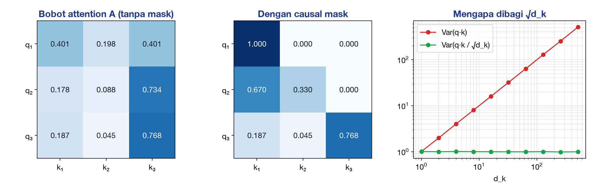

<!-- _class: lead -->
<!-- _paginate: false -->
<!-- _header: '' -->

# Attention Layers
## Query, Key, Value: Rata-rata Berbobot yang Dipelajari

### Minggu 0 — Deep Learning
**Sains Data ITERA · Ganjil 2026/2025**

---

# Capaian Pembelajaran & Agenda

> Mahasiswa mampu menjelaskan mekanisme **attention** sebagai *soft lookup*, menghitung secara manual **scaled dot-product attention** (termasuk *masking*), memahami alasan pembagian $\sqrt{d_k}$, serta menjelaskan **multi-head**, *self* vs *cross attention*, dan kompleksitasnya.

1. Intuisi: dari *lookup* kamus ke *soft lookup*
2. Sejarah singkat: **additive attention** (Bahdanau dkk., 2015)
3. **Scaled dot-product attention** — definisi & hitung manual lengkap
4. Mengapa dibagi $\sqrt{d_k}$?
5. **Causal mask** — hitung manual
6. **Multi-head attention** · self vs cross attention
7. Kompleksitas, posisi, varian efisien · PyTorch · latihan

> Arsitektur **Transformer** lengkap dibahas di **Minggu 12**; di sini fokus pada *attention layer* sebagai blok bangunan.

---

# Intuisi: Lookup Kamus vs Soft Lookup

**Kamus (hard lookup)**: query "kucing" → cocokkan **tepat** dengan satu key → kembalikan value-nya.

**Attention (soft lookup)**: bandingkan query dengan **semua** key, beri **bobot** sesuai kemiripan, kembalikan **rata-rata berbobot** semua value:

$$\text{Attention}(\mathbf{q}, \{(\mathbf{k}_j, \mathbf{v}_j)\}) = \sum_{j=1}^{n} \alpha_j\,\mathbf{v}_j, \qquad \alpha_j = \frac{\exp(s(\mathbf{q}, \mathbf{k}_j))}{\sum_{l}\exp(s(\mathbf{q}, \mathbf{k}_l))}$$

| Komponen | Peran | Analogi pencarian |
|---|---|---|
| **Query** $\mathbf{q}$ | Apa yang sedang dicari | Kata kunci pencarian |
| **Key** $\mathbf{k}_j$ | Penanda/indeks tiap item | Judul dokumen |
| **Value** $\mathbf{v}_j$ | Isi yang diambil | Isi dokumen |
| **Skor** $s(\mathbf{q}, \mathbf{k})$ | Kemiripan | Relevansi |

Bobot $\alpha_j \ge 0$ dan $\sum_j \alpha_j = 1$ → keluaran ada di dalam *convex hull* value. Semua operasi **terdiferensialkan** → dapat dilatih dengan backpropagation.

---

# Fungsi Skor (Kemiripan)

| Nama | $s(\mathbf{q}, \mathbf{k})$ | Rujukan |
|---|---|---|
| **Additive** | $\mathbf{w}_v^\top \tanh(W_q\mathbf{q} + W_k\mathbf{k})$ | Bahdanau dkk. (2015) |
| Dot product | $\mathbf{q}^\top\mathbf{k}$ | Luong dkk. (2015) |
| General (bilinear) | $\mathbf{q}^\top W \mathbf{k}$ | Luong dkk. (2015) |
| **Scaled dot product** | $\dfrac{\mathbf{q}^\top\mathbf{k}}{\sqrt{d_k}}$ | Vaswani dkk. (2017) |

**Bahdanau (2015)**: pada penerjemahan mesin encoder–decoder RNN, decoder di langkah $i$ memakai state $\mathbf{s}_{i-1}$ sebagai query terhadap semua state encoder $\mathbf{h}_j$:
$$e_{ij} = \mathbf{v}^\top \tanh(W\mathbf{s}_{i-1} + U\mathbf{h}_j), \quad \alpha_{ij} = \text{softmax}_j(e_{ij}), \quad \mathbf{c}_i = \sum_j \alpha_{ij}\mathbf{h}_j$$
→ mengatasi *bottleneck* vektor konteks tunggal pada seq2seq dan menghasilkan **alignment** antar-kata.

---

<!-- _class: small -->

# Hitung Manual: Additive Attention (Bahdanau)

$\mathbf{s} = [1{,}0;\; 0{,}5]$ (query), state encoder $\mathbf{h}_1 = [1, 0]$, $\mathbf{h}_2 = [0, 1]$, $\mathbf{h}_3 = [1, 1]$
$W = I$, $U = 0{,}5\,I$, $\mathbf{v} = [1, 1]$

| $j$ | $W\mathbf{s} + U\mathbf{h}_j$ | $\tanh(\cdot)$ | $e_j = \mathbf{v}^\top\tanh(\cdot)$ |
|---|---|---|---|
| 1 | $[1{,}5;\; 0{,}5]$ | $[0{,}905;\; 0{,}462]$ | **1,367** |
| 2 | $[1{,}0;\; 1{,}0]$ | $[0{,}762;\; 0{,}762]$ | **1,523** |
| 3 | $[1{,}5;\; 1{,}0]$ | $[0{,}905;\; 0{,}762]$ | **1,667** |

$$\boldsymbol{\alpha} = \text{softmax}([1{,}367;\; 1{,}523;\; 1{,}667]) = [0{,}284;\; 0{,}332;\; 0{,}384]$$
$$\mathbf{c} = 0{,}284\,[1,0] + 0{,}332\,[0,1] + 0{,}384\,[1,1] = [0{,}668;\; 0{,}716]$$

Additive attention butuh MLP kecil per pasangan $(\mathbf{q}, \mathbf{k})$; **dot product** dapat dihitung sekaligus sebagai **perkalian matriks** → jauh lebih efisien di GPU.

---

# Scaled Dot-Product Attention (Vaswani dkk., 2017)

Untuk $n$ token dengan representasi $X \in \mathbb{R}^{n \times d_{model}}$:
$$Q = XW_Q, \quad K = XW_K, \quad V = XW_V \qquad (W_Q, W_K \in \mathbb{R}^{d_{model} \times d_k},\; W_V \in \mathbb{R}^{d_{model} \times d_v})$$

$$\boxed{\text{Attention}(Q, K, V) = \text{softmax}\!\left(\frac{QK^\top}{\sqrt{d_k}}\right)V}$$

| Langkah | Operasi | Ukuran |
|---|---|---|
| 1. Skor | $S = QK^\top$ | $n \times n$ |
| 2. Skala | $S / \sqrt{d_k}$ | $n \times n$ |
| 3. (Opsional) mask | $S + M$, $M_{ij} \in \{0, -\infty\}$ | $n \times n$ |
| 4. Normalisasi | $A = \text{softmax}$ **per baris** | $n \times n$, tiap baris jumlahnya 1 |
| 5. Agregasi | $O = AV$ | $n \times d_v$ |

Satu-satunya parameter: $W_Q, W_K, W_V$ (dan $W_O$ pada multi-head).

---

<!-- _class: small -->

# Hitung Manual (1): Proyeksi Q, K, V

3 token, $d_{model} = d_k = d_v = 2$:
$$X = \begin{bmatrix} 1 & 0 \\ 0 & 1 \\ 1 & 1 \end{bmatrix},\quad W_Q = \begin{bmatrix} 1 & 0 \\ 1 & 2 \end{bmatrix},\quad W_K = \begin{bmatrix} 1 & 1 \\ 0 & 1 \end{bmatrix},\quad W_V = \begin{bmatrix} 1 & 0 \\ 0 & 2 \end{bmatrix}$$

$$Q = XW_Q = \begin{bmatrix} 1 & 0 \\ 1 & 2 \\ 2 & 2 \end{bmatrix},\qquad K = XW_K = \begin{bmatrix} 1 & 1 \\ 0 & 1 \\ 1 & 2 \end{bmatrix},\qquad V = XW_V = \begin{bmatrix} 1 & 0 \\ 0 & 2 \\ 1 & 2 \end{bmatrix}$$

Contoh baris ke-2 $Q$: $[0, 1]\begin{bmatrix} 1 & 0 \\ 1 & 2 \end{bmatrix} = [0 \cdot 1 + 1 \cdot 1,\; 0 \cdot 0 + 1 \cdot 2] = [1, 2]$

Baris ke-3 $K$: $[1, 1]\begin{bmatrix} 1 & 1 \\ 0 & 1 \end{bmatrix} = [1 + 0,\; 1 + 1] = [1, 2]$

> Token yang sama menghasilkan **tiga peran berbeda** (query, key, value) melalui tiga proyeksi yang dipelajari.

---

<!-- _class: small -->

# Hitung Manual (2): Skor & Skala

$$S = QK^\top = \begin{bmatrix} 1 & 0 \\ 1 & 2 \\ 2 & 2 \end{bmatrix}\begin{bmatrix} 1 & 0 & 1 \\ 1 & 1 & 2 \end{bmatrix} = \begin{bmatrix} 1 & 0 & 1 \\ 3 & 2 & 5 \\ 4 & 2 & 6 \end{bmatrix}$$

Contoh $S_{23} = \mathbf{q}_2 \cdot \mathbf{k}_3 = 1 \cdot 1 + 2 \cdot 2 = 5$; $S_{31} = 2 \cdot 1 + 2 \cdot 1 = 4$.

Skala dengan $\sqrt{d_k} = \sqrt{2} = 1{,}4142$:
$$\frac{S}{\sqrt{2}} = \begin{bmatrix} 0{,}7071 & 0 & 0{,}7071 \\ 2{,}1213 & 1{,}4142 & 3{,}5355 \\ 2{,}8284 & 1{,}4142 & 4{,}2426 \end{bmatrix}$$

**Eksponen** setiap elemen:
$$\exp\!\left(\frac{S}{\sqrt{2}}\right) = \begin{bmatrix} 2{,}0281 & 1{,}0000 & 2{,}0281 \\ 8{,}3421 & 4{,}1133 & 34{,}3133 \\ 16{,}9188 & 4{,}1133 & 69{,}5914 \end{bmatrix} \quad \text{jumlah baris: } \begin{bmatrix} 5{,}0562 \\ 46{,}7687 \\ 90{,}6235 \end{bmatrix}$$

---

<!-- _class: small -->

# Hitung Manual (3): Softmax per Baris & Keluaran

$$A = \begin{bmatrix} 2{,}0281/5{,}0562 & 1/5{,}0562 & 2{,}0281/5{,}0562 \\ 8{,}3421/46{,}7687 & 4{,}1133/46{,}7687 & 34{,}3133/46{,}7687 \\ 16{,}9188/90{,}6235 & 4{,}1133/90{,}6235 & 69{,}5914/90{,}6235 \end{bmatrix} = \begin{bmatrix} 0{,}4011 & 0{,}1978 & 0{,}4011 \\ 0{,}1784 & 0{,}0879 & 0{,}7337 \\ 0{,}1867 & 0{,}0454 & 0{,}7679 \end{bmatrix}$$

$$O = AV = A\begin{bmatrix} 1 & 0 \\ 0 & 2 \\ 1 & 2 \end{bmatrix} = \begin{bmatrix} 0{,}8022 & 1{,}1978 \\ 0{,}9121 & 1{,}6433 \\ 0{,}9546 & 1{,}6266 \end{bmatrix}$$

Contoh baris 1: $\mathbf{o}_1 = 0{,}4011[1, 0] + 0{,}1978[0, 2] + 0{,}4011[1, 2] = [0{,}8022;\; 0{,}3956 + 0{,}8022] = [0{,}8022;\; 1{,}1978]$

> Setiap keluaran $\mathbf{o}_i$ adalah **campuran kontekstual** dari value seluruh token. Token 2 dan 3 paling "memperhatikan" token 3.

---

# Visualisasi Bobot Attention



Kiri: matriks $A$ tanpa mask. Tengah: dengan **causal mask** (slide berikut). Kanan: variansi skor $\mathbf{q}\cdot\mathbf{k}$ naik linear terhadap $d_k$, sedangkan setelah dibagi $\sqrt{d_k}$ tetap ≈ 1 (simulasi 20.000 pasangan vektor acak).

---

# Mengapa Dibagi $\sqrt{d_k}$?

Asumsikan komponen $q_l, k_l$ independen dengan rata-rata 0 dan variansi 1:
$$\mathbf{q}^\top\mathbf{k} = \sum_{l=1}^{d_k} q_l k_l, \qquad \mathbb{E}[q_l k_l] = 0, \quad \text{Var}[q_l k_l] = \mathbb{E}[q_l^2]\,\mathbb{E}[k_l^2] = 1$$
$$\Rightarrow \text{Var}[\mathbf{q}^\top\mathbf{k}] = d_k, \qquad \text{Var}\!\left[\frac{\mathbf{q}^\top\mathbf{k}}{\sqrt{d_k}}\right] = 1$$

Simulasi: $d_k = 64$ → $\text{Var} \approx 64{,}7$ (std ≈ 8); setelah diskala ≈ 1,01.

**Dampak pada softmax** (skor besar → softmax "jenuh"):

| Skor | softmax |
|---|---|
| $[8, 0, -8]$ (tanpa skala, std ≈ 8) | $[0{,}9997;\; 0{,}0003;\; 0{,}0000]$ — hampir *one-hot*, gradien ≈ 0 |
| $[1, 0, -1]$ (dibagi $\sqrt{64} = 8$) | $[0{,}665;\; 0{,}245;\; 0{,}090]$ — gradien sehat |

---

<!-- _class: small -->

# Causal Mask: Hitung Manual

Pada model **autoregresif** (mis. GPT), token ke-$i$ tidak boleh melihat token **masa depan** $j > i$:
$$M = \begin{bmatrix} 0 & -\infty & -\infty \\ 0 & 0 & -\infty \\ 0 & 0 & 0 \end{bmatrix}, \qquad A = \text{softmax}\!\left(\frac{QK^\top}{\sqrt{d_k}} + M\right)$$

Karena $e^{-\infty} = 0$:

| Baris | Skor yang tersisa | Perhitungan | $A$ |
|---|---|---|---|
| 1 | $[0{,}7071]$ | $2{,}0281/2{,}0281$ | $[1;\; 0;\; 0]$ |
| 2 | $[2{,}1213;\; 1{,}4142]$ | $8{,}3421/(8{,}3421 + 4{,}1133) = 8{,}3421/12{,}4554$ | $[0{,}6698;\; 0{,}3302;\; 0]$ |
| 3 | semua (tidak ada yang dimask) | sama seperti sebelumnya | $[0{,}1867;\; 0{,}0454;\; 0{,}7679]$ |

$$O_{mask} = \begin{bmatrix} 1 & 0 \\ 0{,}6698 & 0{,}6605 \\ 0{,}9546 & 1{,}6266 \end{bmatrix}$$

Mask juga dipakai untuk **padding**: token `[PAD]` diberi $-\infty$ di kolomnya agar tidak mendapat bobot. Dalam implementasi, $-\infty$ biasanya diganti bilangan negatif sangat besar.

---

<!-- _class: small -->

# Multi-Head Attention

Satu head hanya dapat menangkap satu "jenis" relasi. **Multi-head**: jalankan $h$ attention paralel pada subruang berdimensi $d_k = d_{model}/h$:
$$\text{head}_i = \text{Attention}(XW_Q^{(i)}, XW_K^{(i)}, XW_V^{(i)}), \qquad \text{MHA}(X) = \text{Concat}(\text{head}_1, \ldots, \text{head}_h)\,W_O$$

**Bentuk tensor** (Transformer *base*: $d_{model} = 512$, $h = 8$, $d_k = d_v = 64$), batch $B$, panjang $n$:

| Tahap | Ukuran |
|---|---|
| Input $X$ | $B \times n \times 512$ |
| $Q, K, V$ lalu *reshape* per head | $B \times 8 \times n \times 64$ |
| Skor $QK^\top$ per head | $B \times 8 \times n \times n$ |
| Keluaran per head | $B \times 8 \times n \times 64$ |
| Concat → $W_O$ | $B \times n \times 512$ |

**Parameter**: $W_Q, W_K, W_V, W_O$ masing-masing $512 \times 512$ + bias → $4 \cdot 512^2 + 4 \cdot 512 = 1.050.624$ — **sama** dengan satu head berdimensi 512.

---

# Self-Attention vs Cross-Attention

| Aspek | Self-attention | Cross-attention |
|---|---|---|
| Sumber Q | Sekuens $X$ | Sekuens $X$ (mis. decoder) |
| Sumber K, V | Sekuens yang **sama** $X$ | Sekuens **lain** $Z$ (mis. encoder, gambar) |
| Ukuran $A$ | $n \times n$ | $n_X \times n_Z$ |
| Contoh | Encoder BERT, decoder GPT (causal) | Decoder penerjemah melihat kalimat sumber; teks ke gambar (Stable Diffusion) |

**Attention bersifat permutation-equivariant**: jika urutan token diacak, keluaran ikut teracak dengan cara yang sama — attention **tidak tahu urutan**. Karena itu perlu **informasi posisi**:
- *Positional encoding* sinusoidal / dipelajari ditambahkan ke $X$ (Vaswani dkk., 2017)
- Posisi relatif / bias pada skor (lihat topik *Adaptive Bias*: T5, ALiBi)

---

# Kompleksitas & Varian Efisien

| Layer | Kompleksitas per layer | Operasi sekuensial | Jarak jalur maksimum |
|---|---|---|---|
| **Self-attention** | $O(n^2 d)$ | $O(1)$ | $O(1)$ |
| Recurrent | $O(n d^2)$ | $O(n)$ | $O(n)$ |
| Konvolusi (kernel $k$) | $O(k\, n\, d^2)$ | $O(1)$ | $O(\log_k n)$ |

(Tabel 1, Vaswani dkk., 2017)

- Kekuatan: setiap token terhubung langsung ke semua token (**jalur 1 langkah**), mudah diparalelkan.
- Kelemahan: matriks $n \times n$ → memori **kuadratik**; $n = 8.192$ token sudah 67 juta skor per head.
- **FlashAttention** (Dao dkk., 2022): attention **eksak** yang *IO-aware* (memproses blok di SRAM GPU, tidak menyimpan matriks $n \times n$ penuh) → memori linear terhadap $n$ dan lebih cepat.
- Alternatif aproksimatif: *sparse/local attention*, *linear attention* — bertukar akurasi dengan efisiensi.

---

<!-- _class: small -->

# Implementasi PyTorch

```python
import torch, torch.nn as nn, torch.nn.functional as F, math

X  = torch.tensor([[1., 0.], [0., 1.], [1., 1.]])
WQ = torch.tensor([[1., 0.], [1., 2.]]); WK = torch.tensor([[1., 1.], [0., 1.]])
WV = torch.tensor([[1., 0.], [0., 2.]])
Q, K, V = X @ WQ, X @ WK, X @ WV

def attention(Q, K, V, mask=None):
    S = Q @ K.transpose(-2, -1) / math.sqrt(Q.size(-1))
    if mask is not None:
        S = S.masked_fill(mask, float("-inf"))
    A = S.softmax(dim=-1)
    return A @ V, A

O, A = attention(Q, K, V)
print(A)   # [[0.4011,0.1978,0.4011],[0.1784,0.0879,0.7337],[0.1867,0.0454,0.7679]]
print(O)   # [[0.8022,1.1978],[0.9121,1.6433],[0.9546,1.6266]]

causal = torch.triu(torch.ones(3, 3, dtype=torch.bool), diagonal=1)
print(attention(Q, K, V, causal)[0])            # [[1,0],[0.6698,0.6605],[0.9546,1.6266]]
print(F.scaled_dot_product_attention(Q, K, V, is_causal=True))   # PyTorch >= 2.0, hasil sama

mha = nn.MultiheadAttention(embed_dim=512, num_heads=8, batch_first=True)  # default batch_first=False
print(sum(p.numel() for p in mha.parameters()))  # 1050624
```

---

# Kesalahan Umum

| Kesalahan | Akibat | Solusi |
|---|---|---|
| Softmax pada dimensi yang salah | Bobot tidak jumlah 1 per query | `softmax(dim=-1)` (sepanjang key) |
| Lupa membagi $\sqrt{d_k}$ | Softmax jenuh, training lambat/tidak stabil | Skala $1/\sqrt{d_k}$ |
| Lupa causal mask pada model generatif | *Information leakage* dari token masa depan → loss training rendah palsu | `is_causal=True` / mask segitiga atas |
| Padding tidak dimask | Token `[PAD]` mendapat bobot | *Key padding mask* |
| Salah urutan dimensi (`batch_first`) | Bentuk tensor tertukar tanpa error yang jelas | Cek dokumentasi; default `nn.MultiheadAttention` adalah `(n, B, d)` |
| Seluruh baris dimask ($-\infty$ semua) | Softmax menghasilkan NaN | Pastikan setiap query punya ≥ 1 key valid |
| Mengira attention memahami urutan | Model "bag of tokens" | Tambahkan informasi posisi |

---

# Latihan

$$Q = \begin{bmatrix} 1 & 1 \\ 0 & 2 \end{bmatrix}, \qquad K = \begin{bmatrix} 1 & 0 \\ 1 & 1 \end{bmatrix}, \qquad V = \begin{bmatrix} 2 & 0 \\ 0 & 4 \end{bmatrix}, \qquad d_k = 2$$

1. Hitung $S = QK^\top$ dan $S/\sqrt{d_k}$.
2. Hitung matriks bobot $A$ (softmax per baris) dan keluaran $O = AV$.
3. Ulangi dengan **causal mask**.
4. Jika $d_k = 256$ dan komponen $\mathbf{q}, \mathbf{k}$ berdistribusi $N(0,1)$, berapa simpangan baku $\mathbf{q}^\top\mathbf{k}$ sebelum dan sesudah diskala?
5. Untuk $d_{model} = 768$ dan $h = 12$: berapa $d_k$ per head dan berapa parameter `nn.MultiheadAttention` (dengan bias)?
6. Sebutkan satu perbedaan self-attention dan cross-attention dari sisi ukuran matriks $A$.

---

<!-- _class: small -->

# Kunci Jawaban

1. $S = \begin{bmatrix} 1 \cdot 1 + 1 \cdot 0 & 1 \cdot 1 + 1 \cdot 1 \\ 0 + 0 & 0 + 2 \end{bmatrix} = \begin{bmatrix} 1 & 2 \\ 0 & 2 \end{bmatrix}$, $S/\sqrt{2} = \begin{bmatrix} 0{,}7071 & 1{,}4142 \\ 0 & 1{,}4142 \end{bmatrix}$
2. Baris 1: $e^{0{,}7071} = 2{,}0281$, $e^{1{,}4142} = 4{,}1133$ → $[0{,}3302;\; 0{,}6698]$. Baris 2: $e^{0} = 1$, $e^{1{,}4142} = 4{,}1133$ → $[0{,}1956;\; 0{,}8044]$
$O = \begin{bmatrix} 0{,}3302 \cdot 2 & 0{,}6698 \cdot 4 \\ 0{,}1956 \cdot 2 & 0{,}8044 \cdot 4 \end{bmatrix} = \begin{bmatrix} 0{,}6605 & 2{,}6790 \\ 0{,}3911 & 3{,}2177 \end{bmatrix}$
3. $A = \begin{bmatrix} 1 & 0 \\ 0{,}1956 & 0{,}8044 \end{bmatrix}$ → $O = \begin{bmatrix} 2 & 0 \\ 0{,}3911 & 3{,}2177 \end{bmatrix}$
4. Sebelum: $\sqrt{256} = 16$; sesudah: $16/\sqrt{256} = 1$
5. $d_k = 768/12 = 64$; parameter $= 4 \cdot 768^2 + 4 \cdot 768 = 2.362.368$
6. Self: $n \times n$ (sekuens yang sama); cross: $n_X \times n_Z$ (query dari $X$, key/value dari $Z$)

---

# Ringkasan

1. Attention = **soft lookup**: rata-rata berbobot value, bobot = softmax kemiripan query–key.
2. **Additive** (Bahdanau, 2015) → **scaled dot-product** (Vaswani, 2017): $\text{softmax}(QK^\top/\sqrt{d_k})V$.
3. Pembagian $\sqrt{d_k}$ menjaga variansi skor ≈ 1 → softmax tidak jenuh.
4. **Mask**: causal (tidak melihat masa depan) & padding; $-\infty$ → bobot 0.
5. **Multi-head**: $h$ subruang paralel, parameter sama dengan satu head penuh: $4d^2 + 4d$.
6. Self vs cross attention; attention butuh **informasi posisi**.
7. Kompleksitas $O(n^2 d)$; **FlashAttention** membuat attention eksak lebih hemat memori.

---

<!-- _class: small -->

# Referensi

1. Bahdanau, D., Cho, K., & Bengio, Y. (2015). Neural machine translation by jointly learning to align and translate. *ICLR*.
2. Luong, M.-T., Pham, H., & Manning, C. D. (2015). Effective approaches to attention-based neural machine translation. *EMNLP*.
3. Vaswani, A., Shazeer, N., Parmar, N., Uszkoreit, J., Jones, L., Gomez, A. N., Kaiser, Ł., & Polosukhin, I. (2017). Attention is all you need. *NeurIPS*.
4. Dao, T., Fu, D. Y., Ermon, S., Rudra, A., & Ré, C. (2022). FlashAttention: Fast and memory-efficient exact attention with IO-awareness. *NeurIPS*.
5. Zhang, A., Lipton, Z. C., Li, M., & Smola, A. J. (2023). *Dive into Deep Learning*, Bab 11 (Attention Mechanisms and Transformers). Cambridge University Press.
6. Prince, S. J. D. (2023). *Understanding Deep Learning*, Bab 12 (Transformers). MIT Press.
7. Bishop, C. M., & Bishop, H. (2024). *Deep Learning: Foundations and Concepts*, Bab 12 (Transformers). Springer.
8. Dokumentasi PyTorch: `torch.nn.MultiheadAttention`, `torch.nn.functional.scaled_dot_product_attention`. https://pytorch.org/docs/stable/

---

<!-- _class: lead -->
<!-- _paginate: false -->
<!-- _header: '' -->

# Terima Kasih

### Topik berikutnya: **Recurrent Layers**
