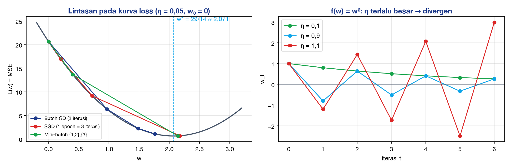
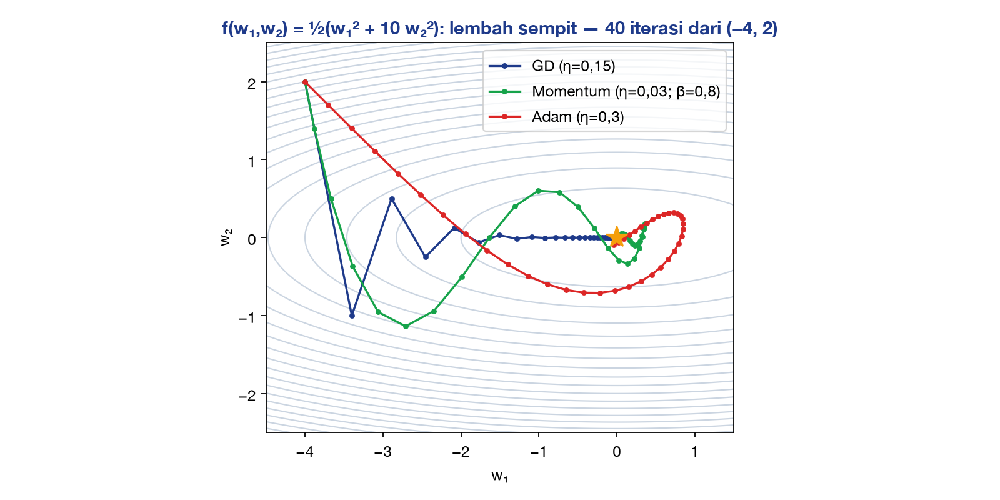

<!-- _class: lead -->
<!-- _paginate: false -->
<!-- _header: '' -->

# Gradient Descent
## Batch vs Stochastic vs Mini-batch · Momentum · Adam

### Minggu 0 — Deep Learning
**Sains Data ITERA · Ganjil 2026/2025**

---

# Capaian Pembelajaran & Agenda

> Mahasiswa mampu menjelaskan dan menghitung secara manual pembaruan parameter dengan **Batch GD**, **Stochastic GD (SGD)**, dan **Mini-batch GD**, memahami peran *learning rate*, serta mengenal optimizer modern (Momentum, AdaGrad, RMSProp, Adam, AdamW).

1. Training = optimasi: fungsi loss & *loss landscape*
2. Aturan pembaruan gradient descent
3. **Batch GD vs SGD vs Mini-batch GD** — hitung manual
4. *Learning rate*: terlalu kecil, pas, terlalu besar
5. Momentum & Nesterov
6. Learning rate adaptif: AdaGrad, RMSProp, **Adam** (hitung manual), AdamW
7. *Learning rate schedule*: step, cosine, warmup
8. PyTorch · jebakan umum · latihan

---

# Catatan Judul Topik

Silabus menulis **"Gradient Descent vs Gradient Descent"**. Pada slide ini topik tersebut dimaknai sebagai perbandingan **varian** gradient descent:

| Varian | Data per pembaruan | Nama lain |
|---|---|---|
| **Batch GD** | Seluruh $N$ data | *Full-batch*, *vanilla* GD |
| **Stochastic GD** | 1 data | SGD, *online* GD |
| **Mini-batch GD** | $B$ data ($1 < B < N$) | Dalam praktik deep learning juga disebut "SGD" |

> Dalam pustaka deep learning (mis. `torch.optim.SGD`), istilah "SGD" hampir selalu berarti **mini-batch** SGD (Goodfellow dkk., 2016, §8.3.1).

---

# Training Neural Network = Masalah Optimasi

Diberikan data $\{(x_i, y_i)\}_{i=1}^{N}$ dan model $f(x; \theta)$, cari parameter yang meminimalkan **risiko empiris**:

$$\theta^* = \arg\min_\theta \; L(\theta) = \frac{1}{N}\sum_{i=1}^{N} \ell\big(f(x_i;\theta),\, y_i\big)$$

- $\ell$ = loss per contoh (MSE untuk regresi, cross-entropy untuk klasifikasi)
- Jaringan saraf memiliki jutaan–miliaran parameter → **tidak ada solusi bentuk tertutup**; loss **non-konveks**
- Solusi praktis: perbaiki $\theta$ sedikit demi sedikit ke arah yang menurunkan loss

**Gradien** $\nabla_\theta L = \left(\frac{\partial L}{\partial \theta_1}, \ldots, \frac{\partial L}{\partial \theta_p}\right)$ menunjuk ke arah kenaikan **tercuram**; maka bergeraklah ke arah **sebaliknya**.

---

# Aturan Pembaruan Gradient Descent

$$\boxed{\theta_{t+1} = \theta_t - \eta \, \nabla_\theta L(\theta_t)}$$

| Simbol | Arti |
|---|---|
| $\theta_t$ | Parameter pada iterasi $t$ |
| $\eta$ | *Learning rate* (ukuran langkah), hiperparameter |
| $\nabla_\theta L(\theta_t)$ | Gradien loss (dihitung dengan **backpropagation**) |

**Mengapa arah negatif gradien?** Ekspansi Taylor orde satu:
$$L(\theta - \eta g) \approx L(\theta) - \eta\, g^\top g = L(\theta) - \eta \lVert g \rVert^2 \;<\; L(\theta) \quad \text{untuk } \eta \text{ kecil}, \; g \neq 0$$

Berhenti jika $\lVert g \rVert \approx 0$ (titik stasioner: minimum lokal, *saddle point*, atau maksimum).

---

# Contoh Kasus untuk Hitung Manual

Regresi linear **tanpa bias**: $\hat{y} = w\,x$, loss **MSE**.

| $i$ | $x_i$ | $y_i$ |
|---|---|---|
| 1 | 1 | 2 |
| 2 | 2 | 3 |
| 3 | 3 | 7 |

$$L(w) = \frac{1}{N}\sum_{i}(w x_i - y_i)^2, \qquad \frac{\partial L}{\partial w} = \frac{2}{N}\sum_{i}(w x_i - y_i)\,x_i$$

Solusi eksak (untuk pembanding): $w^* = \dfrac{\sum x_i y_i}{\sum x_i^2} = \dfrac{2 + 6 + 21}{1 + 4 + 9} = \dfrac{29}{14} \approx 2{,}071$, dengan $L(w^*) \approx 0{,}643$.

Pengaturan: $w_0 = 0$, $\eta = 0{,}05$. Loss awal $L(0) = (4 + 9 + 49)/3 = 20{,}667$.

---

<!-- _class: small -->

# Batch GD: Hitung Manual (3 Iterasi)

Setiap iterasi memakai **ketiga** data: $g = \frac{2}{3}\sum_i (w x_i - y_i)x_i$

| $t$ | $w_t$ | Galat $e_i = w x_i - y_i$ | $\sum e_i x_i$ | $g$ | $w_{t+1} = w_t - 0{,}05\,g$ | $L(w_{t+1})$ |
|---|---|---|---|---|---|---|
| 0 | 0 | −2; −3; −7 | −2 − 6 − 21 = −29 | −19,333 | 0 + 0,9667 = **0,9667** | 6,339 |
| 1 | 0,9667 | −1,033; −1,067; −4,100 | −15,467 | −10,311 | **1,4822** | 2,263 |
| 2 | 1,4822 | −0,518; −0,036; −2,553 | −8,249 | −5,499 | **1,7572** | 1,104 |

- Loss turun **monoton**: 20,667 → 6,339 → 2,263 → 1,104
- Langkah makin kecil karena $\lvert g \rvert$ mengecil saat mendekati minimum
- Biaya: **3 iterasi = 3 epoch** = 9 evaluasi gradien per contoh

---

<!-- _class: small -->

# SGD & Mini-batch GD: Hitung Manual (1 Epoch)

**SGD** — satu contoh per iterasi, urutan 1 → 2 → 3: $g_i = 2(w x_i - y_i)x_i$

| Iterasi | Data | $w$ | $\hat{y}$ | $e$ | $g_i$ | $w_\text{baru}$ | $L(w_\text{baru})$ |
|---|---|---|---|---|---|---|---|
| 1 | (1, 2) | 0 | 0 | −2 | 2(−2)(1) = −4 | **0,2** | 16,987 |
| 2 | (2, 3) | 0,2 | 0,4 | −2,6 | 2(−2,6)(2) = −10,4 | **0,72** | 9,166 |
| 3 | (3, 7) | 0,72 | 2,16 | −4,84 | 2(−4,84)(3) = −29,04 | **2,172** | 0,690 |

**Mini-batch GD** ($B = 2$): batch $\{1, 2\}$ lalu $\{3\}$: $g = \frac{2}{\lvert B \rvert}\sum_{i \in B} e_i x_i$

| Iterasi | Batch | $w$ | $g$ | $w_\text{baru}$ | $L(w_\text{baru})$ |
|---|---|---|---|---|---|
| 1 | {1, 2} | 0 | ½[2(−2)(1) + 2(−3)(2)] = −8 | **0,4** | 13,680 |
| 2 | {3} | 0,4 | 2(1,2 − 7)(3) = −34,8 | **2,14** | 0,665 |

> Dengan **satu kali melihat data** (1 epoch), SGD dan mini-batch sudah mendekati $w^* = 2{,}071$, sedangkan batch GD baru di 0,967. Imbalannya: lintasannya lebih **berisik** (*noisy*) karena gradien hanya diestimasi dari sebagian data.

---

# Visualisasi Lintasan & Efek Learning Rate



Kiri: angka-angka pada dua slide sebelumnya. Kanan: dibahas pada slide *learning rate*.

---

# Batch vs Stochastic vs Mini-batch

| Aspek | Batch GD | SGD ($B = 1$) | Mini-batch ($B$ = 32–512) |
|---|---|---|---|
| Gradien | Eksak (untuk data latih) | Estimasi tak bias, variansi tinggi | Estimasi, variansi $\propto 1/B$ |
| Pembaruan per epoch | 1 | $N$ | $N/B$ |
| Memori | Seluruh data | 1 contoh | $B$ contoh |
| Paralelisme GPU | Tinggi tetapi sering tidak muat | Buruk | **Baik** (operasi matriks) |
| Lintasan | Halus | Sangat berisik | Cukup halus |
| Dipakai di DL? | Jarang | Jarang | **Standar** |

**Istilah**: *iterasi/step* = satu kali pembaruan parameter; *epoch* = seluruh data dilihat sekali. Contoh: $N = 50.000$, $B = 100$ → 500 iterasi per epoch.

Galat standar estimasi gradien turun sebesar $\sigma/\sqrt{B}$: menaikkan $B$ 100× hanya mengurangi noise 10× (Goodfellow dkk., 2016, §8.1.3).

---

# Learning Rate: Hitung Manual pada $f(w) = w^2$

$f'(w) = 2w \;\Rightarrow\; w_{t+1} = w_t - \eta \cdot 2w_t = (1 - 2\eta)\,w_t$, dengan $w_0 = 1$.

| $\eta$ | $1 - 2\eta$ | $w_1$ | $w_2$ | $w_3$ | $w_4$ | Perilaku |
|---|---|---|---|---|---|---|
| 0,1 | 0,8 | 0,8 | 0,64 | 0,512 | 0,4096 | Konvergen pelan |
| 0,5 | 0 | 0 | 0 | 0 | 0 | Langsung ke minimum |
| 0,9 | −0,8 | −0,8 | 0,64 | −0,512 | 0,4096 | Berosilasi, konvergen |
| 1,1 | −1,2 | −1,2 | 1,44 | −1,728 | 2,0736 | **Divergen** |

Konvergen jika $\lvert 1 - 2\eta \rvert < 1 \iff 0 < \eta < 1$. Secara umum untuk fungsi kuadrat dengan kelengkungan (eigenvalue Hessian) terbesar $\lambda_{\max}$: GD stabil jika $\eta < 2/\lambda_{\max}$.

> Di deep learning, $\eta$ sering menjadi **hiperparameter terpenting**. Gejala $\eta$ terlalu besar: loss naik/NaN; terlalu kecil: loss turun sangat lambat.

---

<!-- _class: small -->

# Masalah Gradient Descent Biasa

1. **Lembah sempit (*ill-conditioning*)**: kelengkungan berbeda jauh antar-arah → GD berosilasi di arah curam dan lambat di arah landai.
2. **Saddle point & plateau**: gradien ≈ 0 padahal bukan minimum; umum pada dimensi tinggi (Dauphin dkk., 2014).
3. **Satu learning rate untuk semua parameter**, padahal skala gradien tiap parameter bisa sangat berbeda.
4. **Noise** dari SGD/mini-batch.



---

# Momentum (Polyak, 1964)

Ide: akumulasikan "kecepatan" seperti bola menggelinding — arah konsisten dipercepat, osilasi diredam.

$$v_{t+1} = \beta\, v_t + \nabla L(\theta_t), \qquad \theta_{t+1} = \theta_t - \eta\, v_{t+1}$$

(bentuk yang dipakai `torch.optim.SGD(momentum=β)`; $\beta$ umumnya 0,9)

**Hitung manual** $f(w) = w^2$, $w_0 = 1$, $\eta = 0{,}1$, $\beta = 0{,}9$, $v_0 = 0$:

| $t$ | $g = 2w_t$ | $v_{t+1} = 0{,}9 v_t + g$ | $w_{t+1} = w_t - 0{,}1\, v_{t+1}$ | GD biasa ($\eta = 0{,}1$) |
|---|---|---|---|---|
| 0 | 2 | 2 | 1 − 0,2 = **0,8** | 0,8 |
| 1 | 1,6 | 1,8 + 1,6 = 3,4 | 0,8 − 0,34 = **0,46** | 0,64 |
| 2 | 0,92 | 3,06 + 0,92 = 3,98 | 0,46 − 0,398 = **0,062** | 0,512 |

**Nesterov momentum** (Sutskever dkk., 2013): gradien dihitung pada posisi "lihat ke depan" $\theta_t - \eta\beta v_t$ → koreksi lebih awal sebelum melewati minimum.

---

# Learning Rate Adaptif per Parameter

Ide: parameter dengan gradien besar/sering diberi langkah lebih kecil, dan sebaliknya. Semua operasi **per elemen**.

| Optimizer | Akumulator | Pembaruan |
|---|---|---|
| **AdaGrad** (Duchi dkk., 2011) | $s_t = s_{t-1} + g_t^2$ | $\theta \leftarrow \theta - \dfrac{\eta}{\sqrt{s_t} + \epsilon}\, g_t$ |
| **RMSProp** (Tieleman & Hinton, 2012) | $s_t = \rho\, s_{t-1} + (1-\rho)\, g_t^2$ | $\theta \leftarrow \theta - \dfrac{\eta}{\sqrt{s_t} + \epsilon}\, g_t$ |
| **Adam** (Kingma & Ba, 2015) | momentum $m_t$ + RMSProp $v_t$ + koreksi bias | slide berikutnya |

- **AdaGrad**: $s_t$ terus membesar → learning rate efektif terus mengecil (baik untuk fitur jarang/*sparse*, tetapi bisa berhenti terlalu dini)
- **RMSProp**: rata-rata bergerak eksponensial "melupakan" gradien lama → tidak mati di training panjang

---

# Adam: Adaptive Moment Estimation

$$m_t = \beta_1 m_{t-1} + (1-\beta_1)\,g_t \qquad v_t = \beta_2 v_{t-1} + (1-\beta_2)\,g_t^2$$
$$\hat{m}_t = \frac{m_t}{1-\beta_1^t} \qquad \hat{v}_t = \frac{v_t}{1-\beta_2^t} \qquad \theta_t = \theta_{t-1} - \eta\,\frac{\hat{m}_t}{\sqrt{\hat{v}_t} + \epsilon}$$

- $m_t$: rata-rata gradien (momen ke-1); $v_t$: rata-rata kuadrat gradien (momen ke-2)
- **Koreksi bias**: $m_0 = v_0 = 0$ membuat estimasi awal bias ke nol; dibagi $(1-\beta^t)$
- Default di paper & `torch.optim.Adam`: $\eta = 10^{-3}$, $\beta_1 = 0{,}9$, $\beta_2 = 0{,}999$, $\epsilon = 10^{-8}$

**AdamW** (Loshchilov & Hutter, 2019): *weight decay* dipisahkan dari gradien:
$$\theta_t = \theta_{t-1} - \eta\left(\frac{\hat{m}_t}{\sqrt{\hat{v}_t} + \epsilon} + \lambda\,\theta_{t-1}\right)$$
Pada Adam biasa, L2 ($\lambda\theta$ ditambahkan ke $g$) ikut diskalakan oleh $\sqrt{\hat v}$ sehingga tidak setara dengan weight decay. AdamW menjadi default untuk Transformer.

---

<!-- _class: small -->

# Adam: Hitung Manual (2 Iterasi)

Kasus regresi yang sama, *full batch*, $w_0 = 0$, $\eta = 0{,}1$, $\beta_1 = 0{,}9$, $\beta_2 = 0{,}999$.

| Besaran | $t = 1$ | $t = 2$ |
|---|---|---|
| $w_{t-1}$ | 0 | 0,1 |
| $g_t = \frac{2}{3}\sum (w x_i - y_i)x_i$ | −19,3333 | $\frac{2}{3}(-1{,}9 - 5{,}6 - 20{,}1) = -18{,}4$ |
| $m_t = 0{,}9\,m_{t-1} + 0{,}1\,g_t$ | −1,9333 | −1,74 − 1,84 = −3,58 |
| $v_t = 0{,}999\,v_{t-1} + 0{,}001\,g_t^2$ | 0,373778 | 0,373404 + 0,338560 = 0,711964 |
| $\hat{m}_t = m_t/(1 - 0{,}9^t)$ | −1,9333/0,1 = −19,3333 | −3,58/0,19 = −18,8421 |
| $\hat{v}_t = v_t/(1 - 0{,}999^t)$ | 0,373778/0,001 = 373,778 | 0,711964/0,001999 = 356,160 |
| $\hat{m}_t / \sqrt{\hat{v}_t}$ | −19,3333/19,3333 = −1 | −18,8421/18,8722 = −0,9984 |
| $w_t = w_{t-1} - 0{,}1 \times (\cdot)$ | **0,1** | **0,1998** |

> Langkah pertama Adam besarnya tepat $\approx \eta$ apa pun skala gradiennya — Adam **tidak peka terhadap skala gradien**. Tanpa koreksi bias, $m_1/\sqrt{v_1} = -1{,}9333/0{,}6114 = -3{,}162$, sehingga langkah pertama menjadi $\approx 3{,}16\,\eta$ karena $(1-\beta_1)/\sqrt{1-\beta_2} = 0{,}1/0{,}0316$.

---

# Learning Rate Schedule

Learning rate besar di awal untuk eksplorasi cepat, kecil di akhir untuk konvergen halus.

| Jadwal | Rumus | Contoh ($\eta_0 = 0{,}1$) |
|---|---|---|
| **Step decay** | $\eta_t = \eta_0 \cdot \gamma^{\lfloor t / s \rfloor}$ | $\gamma = 0{,}1$, $s = 30$: 0,1 → 0,01 (epoch 30) → 0,001 (epoch 60) |
| **Cosine** (Loshchilov & Hutter, 2017) | $\eta_t = \eta_{\min} + \tfrac{1}{2}(\eta_0 - \eta_{\min})\big(1 + \cos\tfrac{\pi t}{T}\big)$ | $T = 100$, $\eta_{\min} = 0$: $t = 25 \to 0{,}0854$; $t = 50 \to 0{,}05$ |
| **Linear warmup** | $\eta_t = \eta_0 \cdot t / t_w$ untuk $t \le t_w$ | Umum pada Transformer & batch besar (Goyal dkk., 2017) |

Syarat konvergensi klasik SGD (Robbins & Monro, 1951): $\sum_t \eta_t = \infty$ dan $\sum_t \eta_t^2 < \infty$ — learning rate harus **mengecil**, tetapi tidak terlalu cepat.

Contoh perhitungan cosine $t = 25$: $\tfrac{1}{2}(0{,}1)(1 + \cos 45^\circ) = 0{,}05 \times 1{,}7071 = 0{,}0854$.

---

<!-- _class: small -->

# Implementasi PyTorch

```python
import torch

x = torch.tensor([1., 2., 3.]); y = torch.tensor([2., 3., 7.])
w = torch.zeros(1, requires_grad=True)
opt = torch.optim.SGD([w], lr=0.05)            # batch GD: semua data per langkah

for t in range(3):
    opt.zero_grad()                            # 1. nolkan gradien lama
    loss = ((w * x - y) ** 2).mean()           # 2. forward
    loss.backward()                            # 3. backward -> w.grad
    opt.step()                                 # 4. w <- w - lr * w.grad
    print(t, round(w.item(), 4))               # 0.9667, 1.4822, 1.7572  (sama dengan hitung manual)
```

Mini-batch dengan `DataLoader` dan optimizer lain:

```python
loader = torch.utils.data.DataLoader(dataset, batch_size=64, shuffle=True)
opt = torch.optim.SGD(model.parameters(), lr=0.1, momentum=0.9, nesterov=True)
opt = torch.optim.AdamW(model.parameters(), lr=1e-3, weight_decay=0.01)
sched = torch.optim.lr_scheduler.CosineAnnealingLR(opt, T_max=100)
for epoch in range(100):
    for xb, yb in loader:
        opt.zero_grad(); loss_fn(model(xb), yb).backward(); opt.step()
    sched.step()
```

---

# Jebakan Umum

| Jebakan | Akibat | Solusi |
|---|---|---|
| Lupa `zero_grad()` | Gradien terakumulasi antar-iterasi | Panggil di awal setiap iterasi |
| Learning rate terlalu besar | Loss naik / NaN | Turunkan 3–10×; *LR range test* |
| Data tidak diacak (`shuffle=False`) | Mini-batch bias, gradien tidak representatif | `shuffle=True` untuk data latih |
| Fitur tidak dinormalisasi | Lembah sempit → konvergensi lambat | Standardisasi input |
| Mengganti batch size tanpa menyesuaikan lr | Hasil berubah | Aturan skala linear + warmup (Goyal dkk., 2017) |
| Membandingkan optimizer tanpa tuning lr masing-masing | Kesimpulan tidak adil | Tuning lr untuk setiap optimizer |

---

# Latihan

Gunakan data $(x, y)$: $(1, 1), (2, 5)$, model $\hat{y} = w x$, MSE, $w_0 = 0$, $\eta = 0{,}1$.

1. Hitung $w^*$ dan $L(w_0)$.
2. Lakukan **2 iterasi batch GD**. Tuliskan $g$ dan $w$ setiap iterasi.
3. Lakukan **1 epoch SGD** dengan urutan data (1, 1) lalu (2, 5).
4. Pada $f(w) = 3w^2$, berapa batas $\eta$ agar GD konvergen?
5. Hitung **satu langkah Adam** pada soal no. 2 ($\beta_1 = 0{,}9$, $\beta_2 = 0{,}999$, $\eta = 0{,}1$). Berapa $w_1$?
6. Hitung $\eta$ cosine schedule pada $t = 75$ dengan $\eta_0 = 0{,}1$, $\eta_{\min} = 0$, $T = 100$.

---

<!-- _class: small -->

# Kunci Jawaban Latihan

1. $w^* = \frac{1 \cdot 1 + 2 \cdot 5}{1 + 4} = \frac{11}{5} = 2{,}2$; $L(0) = \frac{1 + 25}{2} = 13$
2. $g = \frac{2}{2}\sum (w x_i - y_i)x_i = \sum (w x_i - y_i)x_i$
   - $t = 0$: $g = (0 - 1)(1) + (0 - 5)(2) = -11$ → $w_1 = 0 + 1{,}1 = \mathbf{1{,}1}$
   - $t = 1$: $g = (1{,}1 - 1)(1) + (2{,}2 - 5)(2) = 0{,}1 - 5{,}6 = -5{,}5$ → $w_2 = 1{,}1 + 0{,}55 = \mathbf{1{,}65}$
3. SGD, $g_i = 2(w x_i - y_i)x_i$:
   - Data 1: $g = 2(0 - 1)(1) = -2$ → $w = 0{,}2$
   - Data 2: $g = 2(0{,}4 - 5)(2) = -18{,}4$ → $w = 0{,}2 + 1{,}84 = \mathbf{2{,}04}$
4. $f'(w) = 6w$ → $w_{t+1} = (1 - 6\eta) w_t$; konvergen jika $\lvert 1 - 6\eta \rvert < 1 \iff \mathbf{0 < \eta < 1/3}$
5. $g_1 = -11$; $m_1 = -1{,}1$, $v_1 = 0{,}121$; $\hat{m}_1 = -11$, $\hat{v}_1 = 121$; $\hat m/\sqrt{\hat v} = -1$ → $w_1 = \mathbf{0{,}1}$
6. $\eta_{75} = \tfrac{1}{2}(0{,}1)(1 + \cos 135^\circ) = 0{,}05 \times (1 - 0{,}7071) = \mathbf{0{,}0146}$

---

# Ringkasan

1. Training = meminimalkan loss; GD memperbarui $\theta \leftarrow \theta - \eta \nabla L$.
2. **Batch GD**: gradien eksak, mahal per langkah. **SGD**: murah, berisik. **Mini-batch**: kompromi dan standar di deep learning.
3. Untuk jumlah komputasi yang sama (1 epoch), SGD/mini-batch melakukan **lebih banyak pembaruan** sehingga sering maju lebih cepat.
4. **Learning rate** menentukan stabilitas: pada kuadrat, $\eta < 2/\lambda_{\max}$.
5. **Momentum** meredam osilasi; **AdaGrad/RMSProp** menskalakan langkah per parameter; **Adam** = keduanya + koreksi bias; **AdamW** memisahkan weight decay.
6. **Schedule** (step, cosine, warmup) membantu konvergensi akhir.

---

<!-- _class: tiny -->

# Referensi

1. Bottou, L., Curtis, F. E., & Nocedal, J. (2018). Optimization methods for large-scale machine learning. *SIAM Review*, 60(2), 223–311.
2. Dauphin, Y., Pascanu, R., Gulcehre, C., Cho, K., Ganguli, S., & Bengio, Y. (2014). Identifying and attacking the saddle point problem in high-dimensional non-convex optimization. *NeurIPS*.
3. Duchi, J., Hazan, E., & Singer, Y. (2011). Adaptive subgradient methods for online learning and stochastic optimization. *JMLR*, 12, 2121–2159.
4. Goodfellow, I., Bengio, Y., & Courville, A. (2016). *Deep Learning*, Bab 8. MIT Press.
5. Goyal, P., dkk. (2017). Accurate, large minibatch SGD: Training ImageNet in 1 hour. *arXiv:1706.02677*.
6. Kingma, D. P., & Ba, J. (2015). Adam: A method for stochastic optimization. *ICLR*.
7. Loshchilov, I., & Hutter, F. (2017). SGDR: Stochastic gradient descent with warm restarts. *ICLR*.
8. Loshchilov, I., & Hutter, F. (2019). Decoupled weight decay regularization. *ICLR*.
9. Polyak, B. T. (1964). Some methods of speeding up the convergence of iteration methods. *USSR Computational Mathematics and Mathematical Physics*, 4(5), 1–17.
10. Prince, S. J. D. (2023). *Understanding Deep Learning*, Bab 6. MIT Press.
11. Robbins, H., & Monro, S. (1951). A stochastic approximation method. *Annals of Mathematical Statistics*, 22(3), 400–407.
12. Sutskever, I., Martens, J., Dahl, G., & Hinton, G. (2013). On the importance of initialization and momentum in deep learning. *ICML*.
13. Tieleman, T., & Hinton, G. (2012). Lecture 6.5 — RMSProp. *COURSERA: Neural Networks for Machine Learning*.
14. Zhang, A., Lipton, Z. C., Li, M., & Smola, A. J. (2023). *Dive into Deep Learning*, Bab 12. Cambridge University Press.

---

<!-- _class: lead -->
<!-- _paginate: false -->
<!-- _header: '' -->

# Terima Kasih

### Berikutnya: **Backpropagation** — bagaimana $\nabla_\theta L$ dihitung

Kerjakan latihan dan cocokkan dengan PyTorch
