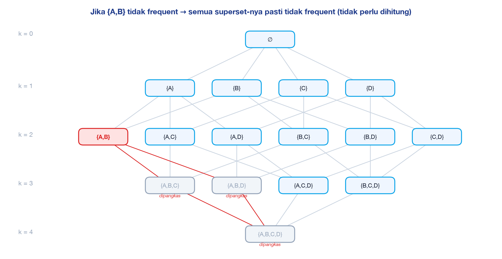
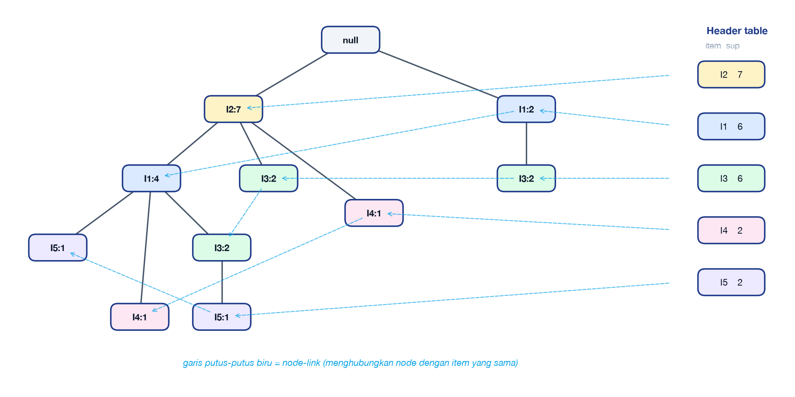
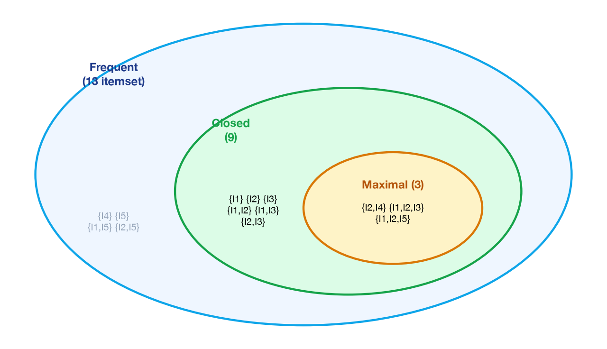

<!-- _class: lead -->
<!-- _paginate: false -->
<!-- _header: '' -->

# Pattern Mining (Analisis Asosiasi)
## Itemset Mining: Apriori · FP-Growth

### Pertemuan 11 — Data Mining
**Sains Data ITERA · Ganjil 2026/2025**

---

# Capaian Pembelajaran & Agenda

> Mahasiswa mampu memahami konsep dasar **itemset mining** dan **analisis asosiasi**, serta mampu menganalisis dan menghitung secara manual *frequent itemset* dan *association rule*.

1. Motivasi & aplikasi — *market basket analysis*
2. Definisi formal: itemset, support, confidence, aturan asosiasi
3. Kompleksitas & **prinsip Apriori**
4. **Algoritma Apriori** — perhitungan manual langkah demi langkah
5. Pembangkitan aturan & ukuran *interestingness* (lift, leverage, conviction)
6. **Algoritma FP-Growth** — FP-tree & *conditional pattern base*
7. Implementasi Python · **studi kasus jurnal** · latihan

---

# Motivasi: Apa yang Sering Dibeli Konsumen Secara Bersamaan?

Setiap transaksi kasir = **keranjang belanja** (himpunan item). Dari jutaan keranjang ingin ditemukan pola seperti:

$$\{\text{Roti}, \text{Susu}\} \Rightarrow \{\text{Mentega}\}$$

| Bidang | Contoh pemanfaatan pola asosiasi |
|---|---|
| Ritel | Penataan rak, *bundling*, promo *cross-selling* |
| E-commerce | "Sering dibeli bersama" / rekomendasi produk |
| Kesehatan | Kombinasi gejala/faktor risiko yang sering muncul bersama penyakit |
| Pendidikan | Pola mata kuliah yang diambil/tidak lulus bersamaan |
| Web mining | Halaman yang dikunjungi dalam satu sesi |
| Keamanan | Kombinasi *event* log yang mendahului serangan |

<br/>

Diperkenalkan oleh **Agrawal, Imieliński & Swami (1993)** untuk data transaksi supermarket.

---

# Definisi Formal

- $I = \{i_1, i_2, \dots, i_d\}$ : himpunan semua **item**
- $D = \{t_1, t_2, \dots, t_N\}$ : basis data **transaksi**, tiap $t_j \subseteq I$ memiliki ID (TID)
- **Itemset** $X \subseteq I$; jika $|X| = k$ disebut **k-itemset** — contoh $\{\text{Roti},\text{Susu}\}$ adalah 2-itemset
- **Support count** — banyaknya transaksi yang memuat $X$:

$$\sigma(X) = \big|\{\, t_j \in D \;:\; X \subseteq t_j \,\}\big|$$

- **Support** (relatif):

$$s(X) = \frac{\sigma(X)}{N}$$

- $X$ disebut **frequent itemset** jika $s(X) \ge \textit{minsup}$ (atau $\sigma(X) \ge$ *min support count*)

---

<!-- _class: two -->

# Contoh: Menghitung Support

| TID | Item |
|---|---|
| 1 | Roti, Susu |
| 2 | Roti, Popok, Bir, Telur |
| 3 | Susu, Popok, Bir, Cola |
| 4 | Roti, Susu, Popok, Bir |
| 5 | Roti, Susu, Popok, Cola |

*Contoh klasik Tan, Steinbach & Kumar (2019)*

**Itemset** $X = \{\text{Susu}, \text{Popok}, \text{Bir}\}$

Transaksi yang memuat ketiganya: **TID 3 dan 4**

$$\sigma(X) = 2$$
$$s(X) = \frac{2}{5} = 0{,}4 = 40\%$$

Dengan *minsup* = 30%, $X$ **frequent**.
Dengan *minsup* = 50%, $X$ **tidak frequent**.

---

# Association Rule

Aturan berbentuk $X \Rightarrow Y$ dengan $X, Y \subseteq I$ dan $X \cap Y = \emptyset$
($X$ = *antecedent / LHS*, $Y$ = *consequent / RHS*)

$$\text{support}(X \Rightarrow Y) = s(X \cup Y) = \frac{\sigma(X \cup Y)}{N} \qquad \text{→ seberapa sering rule berlaku}$$

$$\text{confidence}(X \Rightarrow Y) = \frac{\sigma(X \cup Y)}{\sigma(X)} = P(Y \mid X) \qquad \text{→ seberapa dapat dipercaya}$$

**Contoh** (data slide sebelumnya): $\{\text{Susu}, \text{Popok}\} \Rightarrow \{\text{Bir}\}$

$$s = \frac{\sigma(\text{Susu},\text{Popok},\text{Bir})}{N} = \frac{2}{5} = 0{,}4 \qquad c = \frac{\sigma(\text{Susu},\text{Popok},\text{Bir})}{\sigma(\text{Susu},\text{Popok})} = \frac{2}{3} = 0{,}67$$

> **Strong rule**: jika $s \ge \textit{minsup}$ **dan** $c \ge \textit{minconf}$.
> Asosiasi ≠ kausalitas: rule hanya menyatakan *co-occurrence* (Kebersamaan muncul).

---

# Masalah Association Rule Mining

**Diberikan** $D$ (basis data transaksi), *minsup*, *minconf* → **temukan semua** rule dengan $s \ge \textit{minsup}$ dan $c \ge \textit{minconf}$.

### Pendekatan dua tahap
1. **Frequent itemset generation** — cari semua itemset dengan $s \ge \textit{minsup}$ *(costly)*
2. **Rule generation** — dari setiap frequent itemset $L$, bentuk rule $A \Rightarrow L \setminus A$ dengan confidence tinggi

Mengapa dua tahap? Semua rule dari itemset yang sama memiliki **support yang sama**:

$$\{\text{Susu},\text{Popok}\}\Rightarrow\{\text{Bir}\},\;\; \{\text{Bir}\}\Rightarrow\{\text{Susu},\text{Popok}\},\;\; \{\text{Popok},\text{Bir}\}\Rightarrow\{\text{Susu}\},\;\dots \quad s = 0{,}4$$

→ cukup periksa **support itemset**-nya sekali
→ confidence dihitung berikutnya

---

# Kompleksitas: Brute Force ?

Dengan $d$ item: $\text{jumlah itemset kandidat} = 2^d - 1 ;  \text{jumlah rule } R = 3^d - 2^{d+1} + 1$

| $d$ | Itemset | Rule |
|---|---|---|
| 6 | 63 | 602 |
| 20 | ≈ 1 juta | ≈ 3,5 × 10⁹ |
| 100 | ≈ 1,27 × 10³⁰ | ≈ 5 × 10⁴⁷ |

<br/>

**Brute force**: cocokkan setiap kandidat ($M = 2^d$) dengan setiap transaksi ($N$, lebar rata-rata $w$) → $O(N \cdot M \cdot w)$ — **eksponensial**.

### Strategi pengurangan
- Kurangi **jumlah kandidat** $M$ → *pruning* dengan prinsip Apriori
- Kurangi **jumlah perbandingan** $NM$ → struktur data efisien (hash tree, FP-tree, tidset)
- Kurangi **jumlah transaksi/scan** $N$ → FP-Growth, transaction reduction

---

# Itemset Lattice & Prinsip Apriori



> **Prinsip Apriori**: jika sebuah itemset frequent, maka **semua subset-nya pasti frequent**. Sebaliknya, jika sebuah itemset **tidak** frequent, **semua superset-nya pasti tidak frequent**.

---

# Sifat Anti-Monoton Support

$$\forall X, Y : \; X \subseteq Y \;\Rightarrow\; s(X) \ge s(Y)$$

**Bukti.** Ambil sembarang transaksi $t$ yang memuat $Y$ ($Y \subseteq t$).
Karena $X \subseteq Y$, maka $X \subseteq Y \subseteq t$ → $t$ juga memuat $X$.

Jadi $\{t : Y \subseteq t\} \subseteq \{t : X \subseteq t\}$ sehingga $\sigma(Y) \le \sigma(X)$. ∎

### Konsekuensi untuk pruning
Jika $\sigma(\{A,B\}) < \textit{minsup}$, maka untuk setiap $Y \supseteq \{A,B\}$:

$$\sigma(Y) \le \sigma(\{A,B\}) < \textit{minsup}$$

→ $\{A,B,C\}$, $\{A,B,D\}$, $\{A,B,C,D\}$
→ **tidak perlu dihitung** sama sekali.

---

<!-- _class: two small -->

# Pembuktian Manual: Rantai Superset

Dataset contoh (Tan et al.):

| TID | Item |
|---|---|
| 1 | Roti, Susu |
| 2 | Roti, Popok, Bir, Telur |
| 3 | Susu, Popok, Bir, Cola |
| 4 | Roti, Susu, Popok, Bir |
| 5 | Roti, Susu, Popok, Cola |

<br/>

Ambil rantai itemset yang terus **diperbesar**:

$$\{\text{Popok}\} \subset \{\text{Popok},\text{Bir}\} \subset \{\text{Susu},\text{Popok},\text{Bir}\} \subset \{\text{Roti},\text{Susu},\text{Popok},\text{Bir}\}$$

| Itemset $X$ | TID yang memuat $X$ | $\sigma(X)$ | $s(X)$ |
|---|---|---|---|
| {Popok} | {2, 3, 4, 5} | 4 | 80% |
| {Popok, Bir} | {2, 3, 4} | 3 | 60% |
| {Susu, Popok, Bir} | {3, 4} | 2 | 40% |
| {Roti, Susu, Popok, Bir} | {4} | 1 | 20% |

<br/>

Himpunan TID **menyusut** di setiap langkah:

$$\{4\} \subseteq \{3,4\} \subseteq \{2,3,4\} \subseteq \{2,3,4,5\}$$

sehingga $\;1 \le 2 \le 3 \le 4\;$ ✓ — persis langkah bukti: setiap transaksi yang memuat superset **pasti** memuat subset-nya, tetapi tidak sebaliknya.

---

<!-- _class: small -->

# Pembuktian Manual: Pruning & Batasannya

Gunakan *min support count* = **3** (60%) pada dataset yang sama.

### 1. Itemset tidak frequent → semua superset tidak frequent
$\sigma(\{\text{Susu},\text{Bir}\}) = |\{3,4\}| = 2 < 3$ → **tidak frequent**. Periksa superset-nya:

| Superset dari {Susu, Bir} | TID | σ | Batas atas dari prinsip Apriori | Frequent? |
|---|---|---|---|---|
| {Susu, Popok, Bir} | {3, 4} | 2 | ≤ 2 | ✗ |
| {Roti, Susu, Bir} | {4} | 1 | ≤ 2 | ✗ |
| {Susu, Bir, Cola} | {3} | 1 | ≤ 2 | ✗ |
| {Susu, Popok, Bir, Cola} | {3} | 1 | ≤ 2 | ✗ |

<br/>

Tanpa menghitung pun sudah pasti: $\sigma(\text{superset}) \le 2 < 3$ → semuanya **dipangkas**.

### 2. Kebalikannya TIDAK berlaku
$\sigma(\{\text{Roti}\}) = 4$ ✓ dan $\sigma(\{\text{Bir}\}) = 3$ ✓, tetapi $\sigma(\{\text{Roti},\text{Bir}\}) = |\{2,4\}| = 2$ ✗

> Semua subset frequent adalah **syarat perlu**, bukan **syarat cukup**. Karena itu Apriori tetap harus **menghitung** support kandidat yang lolos prune.

---

<!-- _class: divider -->

# Bagian 1 — Algoritma Apriori
Agrawal & Srikant (1994) · *level-wise, generate-and-test*

---

# Algoritma Apriori — Pseudocode

```text
Input : D (transaksi), minsup
Output: L = semua frequent itemset

1:  L1 ← { 1-itemset dengan σ ≥ minsup }            // scan D ke-1
2:  for (k = 2; L(k-1) ≠ ∅; k++) do
3:      Ck ← apriori_gen(L(k-1))                     // JOIN + PRUNE
4:      for each transaksi t ∈ D do                   // scan D ke-k
5:          for each kandidat c ∈ Ck, c ⊆ t do  
              c.count++
6:      Lk ← { c ∈ Ck | c.count ≥ minsup }
7:  return L = ∪k Lk

apriori_gen(L(k-1)):
    // JOIN: gabungkan dua (k-1)-itemset yang k-2 item pertamanya sama (item terurut)
    for p, q ∈ L(k-1) with p[1..k-2] = q[1..k-2] and p[k-1] < q[k-1]:
        c ← p ∪ {q[k-1]}
        // PRUNE: buang c jika ada (k-1)-subset yang tidak ada di L(k-1)
        if every (k-1)-subset s of c ∈ L(k-1):  add c to Ck
```

**Ciri**: banyak scan basis data (sebanyak panjang itemset terpanjang + 1), tetapi kandidat dipangkas sebelum dihitung.

---

<!-- _class: two -->

# Studi Hitung Manual: Dataset

| TID | Item |
|---|---|
| T100 | I1, I2, I5 |
| T200 | I2, I4 |
| T300 | I2, I3 |
| T400 | I1, I2, I4 |
| T500 | I1, I3 |
| T600 | I2, I3 |
| T700 | I1, I3 |
| T800 | I1, I2, I3, I5 |
| T900 | I1, I2, I3 |

**Sumber**: Han, Kamber & Pei (2012), Tabel 6.1 — *AllElectronics*

**Parameter**
- $N = 9$ transaksi, $d = 5$ item
- *min support count* = **2** → $\textit{minsup} = 2/9 \approx 22\%$
- *minconf* = **70%**

Bayangkan item sebagai produk, misalnya I1 = Roti, I2 = Susu, I3 = Mentega, I4 = Kopi, I5 = Selai.

**Ruang pencarian brute force**: $2^5 - 1 = 31$ itemset.

---

<!-- _class: small -->

# Iterasi k = 1: $C_1 \rightarrow L_1$

**Scan 1** — hitung support count setiap item:

| Itemset | Transaksi yang memuat | σ | ≥ 2 ? |
|---|---|---|---|
| {I1} | T100, T400, T500, T700, T800, T900 | **6** | ✓ |
| {I2} | T100, T200, T300, T400, T600, T800, T900 | **7** | ✓ |
| {I3} | T300, T500, T600, T700, T800, T900 | **6** | ✓ |
| {I4} | T200, T400 | **2** | ✓ |
| {I5} | T100, T800 | **2** | ✓ |

<br/>

$$L_1 = \{\{I1\}{:}6,\; \{I2\}{:}7,\; \{I3\}{:}6,\; \{I4\}{:}2,\; \{I5\}{:}2\}$$

Semua item lolos → tidak ada pruning pada level ini.

---

<!-- _class: small -->

# Iterasi k = 2: $C_2 \rightarrow L_2$

**JOIN** $L_1 \bowtie L_1$ → $\binom{5}{2} = 10$ kandidat. **PRUNE**: semua 1-subset ada di $L_1$ → tidak ada yang dibuang. **Scan 2** — hitung support:

| Kandidat | Transaksi | σ | | Kandidat | Transaksi | σ |
|---|---|---|---|---|---|---|
| {I1,I2} | T100, T400, T800, T900 | **4** ✓ | | {I2,I4} | T200, T400 | **2** ✓ |
| {I1,I3} | T500, T700, T800, T900 | **4** ✓ | | {I2,I5} | T100, T800 | **2** ✓ |
| {I1,I4} | T400 | 1 ✗ | | {I3,I4} | – | 0 ✗ |
| {I1,I5} | T100, T800 | **2** ✓ | | {I3,I5} | T800 | 1 ✗ |
| {I2,I3} | T300, T600, T800, T900 | **4** ✓ | | {I4,I5} | – | 0 ✗ |

<br/>

$$L_2 = \{\{I1,I2\}{:}4,\ \{I1,I3\}{:}4,\ \{I1,I5\}{:}2,\ \{I2,I3\}{:}4,\ \{I2,I4\}{:}2,\ \{I2,I5\}{:}2\}$$
<br/>
4 kandidat tidak digunakan: {I1,I4}, {I3,I4}, {I3,I5}, {I4,I5}.

> Kandidat yang tidak digunakan di sini akan dipakai untuk **memangkas** kandidat level 3 — tanpa perlu menghitungnya.

---

<!-- _class: small -->

# Iterasi k = 3: JOIN & PRUNE (tanpa scan!)

**JOIN** — pasangkan anggota $L_2$ yang item pertamanya sama:
- prefiks I1: {I1,I2}, {I1,I3}, {I1,I5} → {I1,I2,I3}, {I1,I2,I5}, {I1,I3,I5}
- prefiks I2: {I2,I3}, {I2,I4}, {I2,I5} → {I2,I3,I4}, {I2,I3,I5}, {I2,I4,I5}

**PRUNE** — periksa setiap 2-subset terhadap $L_2$:

| Kandidat | 2-subset | Semua di $L_2$? | Keputusan |
|---|---|---|---|
| {I1,I2,I3} | {I1,I2} ✓ {I1,I3} ✓ {I2,I3} ✓ | ya | **dipertahankan** |
| {I1,I2,I5} | {I1,I2} ✓ {I1,I5} ✓ {I2,I5} ✓ | ya | **dipertahankan** |
| {I1,I3,I5} | {I3,I5} ✗ | tidak | dipangkas |
| {I2,I3,I4} | {I3,I4} ✗ | tidak | dipangkas |
| {I2,I3,I5} | {I3,I5} ✗ | tidak | dipangkas |
| {I2,I4,I5} | {I4,I5} ✗ | tidak | dipangkas |

<br/>

→ dari 6 kandidat hasil join hanya **2** yang perlu dihitung di scan berikutnya.

---

# Iterasi k = 3 & 4: Hasil Akhir

**Scan 3**:

| Kandidat | Transaksi | σ | Status |
|---|---|---|---|
| {I1,I2,I3} | T800, T900 | **2** | ✓ frequent |
| {I1,I2,I5} | T100, T800 | **2** | ✓ frequent |

<br/>

$$L_3 = \{\{I1,I2,I3\}{:}2,\ \{I1,I2,I5\}{:}2\}$$

**k = 4**: JOIN {I1,I2,I3} ⋈ {I1,I2,I5} → {I1,I2,I3,I5}
PRUNE: subset {I1,I3,I5} ∉ $L_3$ (juga {I2,I3,I5}) → **dipangkas** → $C_4 = \emptyset$ → **berhenti**.

### Ringkasan
| | Level 1 | Level 2 | Level 3 | Total |
|---|---|---|---|---|
| Kandidat dihitung | 5 | 10 | 2 | **17** (bandingkan brute force: 31) |
| Frequent | 5 | 6 | 2 | **13 frequent itemset** |

---

<!-- _class: divider -->

# Bagian 2 — Pembangkitan Rule
Dari frequent itemset ke *strong association rules*

---

# Algoritma Pembangkitan Rule

Untuk setiap frequent itemset $L$ dan setiap subset tak-kosong $A \subset L$:

$$A \Rightarrow (L \setminus A) \quad\text{jika}, \quad \text{conf} = \frac{\sigma(L)}{\sigma(A)} \ge \textit{minconf}$$

- Itemset berukuran $k$ menghasilkan $2^k - 2$ kandidat aturan
- **Tidak perlu scan ulang** — semua $\sigma$ sudah diketahui dari tahap Apriori

### Pruning berdasarkan confidence
Untuk itemset $L$ yang sama, memindahkan item dari LHS ke RHS **tidak menaikkan** confidence:

$$\text{conf}(\{I1,I2\}\Rightarrow\{I5\}) \;\ge\; \text{conf}(\{I1\}\Rightarrow\{I2,I5\})$$

karena pembilang sama ($\sigma(L)$) dan $\sigma(\{I1,I2\}) \le \sigma(\{I1\})$.
→ Jika $A \Rightarrow L\setminus A$ gagal, semua aturan dengan LHS $\subset A$ juga gagal.

---

# Datasets

| TID | Item |
|---|---|
| T100 | I1, I2, I5 |
| T200 | I2, I4 |
| T300 | I2, I3 |
| T400 | I1, I2, I4 |
| T500 | I1, I3 |
| T600 | I2, I3 |
| T700 | I1, I3 |
| T800 | I1, I2, I3, I5 |
| T900 | I1, I2, I3 |

<br/>

**Sumber**: Han, Kamber & Pei (2012), Tabel 6.1 — *AllElectronics*

---
# Aturan dari $L = \{I1, I2, I5\}$ — σ(L) = 2

| Aturan | Perhitungan confidence | conf | ≥ 70%? |
|---|---|---|---|
| {I1, I2} ⇒ {I5} | σ(I1,I2,I5) / σ(I1,I2) = 2/4 | 50% | ✗ |
| {I1, I5} ⇒ {I2} | 2 / σ(I1,I5) = 2/2 | **100%** | ✓ |
| {I2, I5} ⇒ {I1} | 2 / σ(I2,I5) = 2/2 | **100%** | ✓ |
| {I1} ⇒ {I2, I5} | 2 / σ(I1) = 2/6 | 33% | ✗ |
| {I2} ⇒ {I1, I5} | 2 / σ(I2) = 2/7 | 29% | ✗ |
| {I5} ⇒ {I1, I2} | 2 / σ(I5) = 2/2 | **100%** | ✓ |

<br/>

Semua aturan ini memiliki support $= 2/9 = 22{,}2\%$.

> Interpretasi: **setiap** pelanggan yang membeli I5 juga membeli I1 dan I2.
> Namun hanya 2 transaksi yang mendukung → perlu hati-hati (lihat ukuran lain).

---

# Aturan dari $L = \{I1, I2, I3\}$ — σ(L) = 2

| Aturan | Perhitungan | conf |
|---|---|---|
| {I1, I2} ⇒ {I3} | 2 / 4 | 50% ✗ |
| {I1, I3} ⇒ {I2} | 2 / 4 | 50% ✗ |
| {I2, I3} ⇒ {I1} | 2 / 4 | 50% ✗ |
| {I1} ⇒ {I2, I3} | 2 / 6 | 33% ✗ |
| {I2} ⇒ {I1, I3} | 2 / 7 | 29% ✗ |
| {I3} ⇒ {I1, I2} | 2 / 6 | 33% ✗ |

<br/>

Tidak ada aturan kuat. Itemset ini **frequent tetapi tidak menghasilkan aturan yang dapat dipercaya**.

> Frequent itemset ≠ aturan yang kuat: support tinggi tidak menjamin confidence tinggi.

---

# Seluruh Strong Rules

Strong rules (*minconf* 70%) dari 13 frequent itemset

| Aturan | sup | conf | | Aturan | sup | conf |
|---|---|---|---|---|---|---|
| {I5} ⇒ {I1,I2} | 22% | 100% | | {I4} ⇒ {I2} | 22% | 100% |
| {I5} ⇒ {I1} | 22% | 100% | | {I5} ⇒ {I2} | 22% | 100% |
| {I2,I5} ⇒ {I1} | 22% | 100% | | {I1,I5} ⇒ {I2} | 22% | 100% |

<br/>

Dari 13 frequent itemset (8 itemset berukuran ≥ 2) diperiksa **24 kandidat aturan** (6 × 2 + 2 × 6); hanya **6** yang lolos *minconf* 70%.

> Perhatikan: 5 dari 6 rule melibatkan I5 atau I4 — item yang **jarang** (σ = 2). Confidence 100% di sini didukung hanya oleh 2 transaksi → butuh ukuran tambahan untuk menilai apakah pola ini menarik.

---

<!-- _class: small -->

# Confidence Bisa Menyesatkan

**Contoh** (Han et al., 2012): 10.000 transaksi; 6.000 membeli *game*, 7.500 membeli *video*, 4.000 membeli keduanya.

$$\{\text{game}\} \Rightarrow \{\text{video}\}: \quad s = \frac{4000}{10000} = 40\%, \qquad c = \frac{4000}{6000} = 66{,}7\%$$

Tampak kuat… tetapi peluang **siapa pun** membeli video adalah $P(\text{video}) = 75\% > 66{,}7\%$.

→ membeli *game* justru **menurunkan** peluang membeli video. Confidence mengabaikan support RHS.

### Solusi: ukuran korelasi — **Lift**

$$\text{lift}(X \Rightarrow Y) = \frac{\text{conf}(X\Rightarrow Y)}{s(Y)} = \frac{s(X \cup Y)}{s(X)\,s(Y)} = \frac{0{,}40}{0{,}60 \times 0{,}75} = 0{,}89$$

**lift > 1** korelasi positif · **lift = 1** independen · **lift < 1** korelasi negatif

---

<!-- _class: small -->

# Ukuran Interestingness Lain

| Ukuran | Rumus | Rentang | Makna |
|---|---|---|---|
| **Lift** | $\dfrac{s(X\cup Y)}{s(X)s(Y)}$ | $[0, \infty)$ | rasio terhadap independensi |
| **Leverage** | $s(X\cup Y) - s(X)s(Y)$ | $[-0{,}25, 0{,}25]$ | selisih terhadap independensi |
| **Conviction** | $\dfrac{1 - s(Y)}{1 - \text{conf}(X\Rightarrow Y)}$ | $[0, \infty]$ | > 1: aturan lebih jarang "salah" daripada kebetulan |
| **Kulczynski** | $\frac{1}{2}\left(\text{conf}(X{\Rightarrow}Y) + \text{conf}(Y{\Rightarrow}X)\right)$ | $[0, 1]$ | *null-invariant* (tidak dipengaruhi transaksi yang tidak memuat X maupun Y) |

### Hitung manual pada data Han
- $\{I5\}\Rightarrow\{I1,I2\}$: lift $= \dfrac{2/9}{(2/9)(4/9)} = \dfrac{9}{4} = \mathbf{2{,}25}$; leverage $= \tfrac{2}{9} - \tfrac{2}{9}\cdot\tfrac{4}{9} = \mathbf{0{,}123}$; conviction $= \dfrac{1 - 4/9}{1 - 1} = \mathbf{\infty}$
- $\{I1,I2\}\Rightarrow\{I3\}$: lift $= \dfrac{2/9}{(4/9)(6/9)} = \mathbf{0{,}75}$ → frequent tetapi **berkorelasi negatif**
- $\{I1\}\Rightarrow\{I2\}$: conf $= 4/6$; conviction $= \dfrac{1 - 7/9}{1 - 4/6} = \mathbf{0{,}67} < 1$

---

# Kelemahan Apriori & Perbaikannya

Bottleneck:
1. **Kandidat sangat banyak** — $10^4$ frequent 1-itemset → $\binom{10^4}{2} \approx 5 \times 10^7$ kandidat 2-itemset
2. **Scan basis data berulang** — untuk pola sepanjang 100 item: $2^{100} \approx 10^{30}$ kandidat & 100+ scan
3. Mencocokkan kandidat dengan transaksi mahal

Teknik peningkatan efisiensi:
| Teknik | Ide |
|---|---|
| Hash-based (DHP) | Hash 2-itemset ke *bucket* saat scan 1; bucket < minsup → kandidat dibuang |
| Transaction reduction | Transaksi tanpa frequent k-itemset tidak dipakai di scan berikutnya |
| Partitioning | Bagi D menjadi partisi; itemset frequent global pasti frequent di ≥ 1 partisi → 2 scan |
| Sampling | Mining pada sampel dengan minsup lebih rendah, verifikasi di D |
| DIC (Brin et al., 1997) | Tambah kandidat baru di tengah scan |

---

<!-- _class: divider -->

# Bagian 3 — Algoritma FP-Growth
Han, Pei & Yin (2000) · *pattern growth tanpa candidate generation*

---

<!-- _class: small -->

# Ide FP-Growth

> Kompres basis data menjadi **FP-tree** (Frequent-Pattern tree) lalu gali pola secara rekursif dengan **divide-and-conquer** — **tanpa membangkitkan kandidat**.

### Tiga langkah
1. **Scan 1** — hitung support tiap item, buang yang tidak frequent, urutkan **menurun** berdasarkan support → daftar $L$
2. **Scan 2** — sisipkan setiap transaksi (item diurutkan sesuai $L$) ke dalam pohon; prefiks yang sama **berbagi node** dan count-nya ditambah
3. **Mining** — untuk setiap item (dari yang paling jarang): bentuk *conditional pattern base* → *conditional FP-tree* → rekursi

### Mengapa urutan menurun?
Item yang paling sering berada dekat root → lebih banyak prefiks yang dapat dibagi → pohon **lebih kompak**.

Basis data hanya di-scan **2 kali**, berapa pun panjang polanya.

---

<!-- _class: two small -->

# Langkah 1: Urutkan Item

Dari scan 1 (sama dengan $C_1$ Apriori), min support count = 2:

$$L = \langle I2{:}7,\; I1{:}6,\; I3{:}6,\; I4{:}2,\; I5{:}2 \rangle$$

(I1 dan I3 sama-sama 6 → urutan *tie* bebas, asal konsisten.)

Setiap transaksi **diurutkan ulang** sesuai $L$:

| TID | Asli | Terurut |
|---|---|---|
| T100 | I1, I2, I5 | **I2, I1, I5** |
| T200 | I2, I4 | I2, I4 |
| T300 | I2, I3 | I2, I3 |
| T400 | I1, I2, I4 | **I2, I1, I4** |
| T500 | I1, I3 | I1, I3 |
| T600 | I2, I3 | I2, I3 |
| T700 | I1, I3 | I1, I3 |
| T800 | I1, I2, I3, I5 | **I2, I1, I3, I5** |
| T900 | I1, I2, I3 | **I2, I1, I3** |

### Langkah 2: sisipkan ke pohon (scan 2)

| Sisip | Perubahan pada pohon |
|---|---|
| T100 | null→**I2:1**→**I1:1**→**I5:1** (cabang baru) |
| T200 | I2:**2**, buat anak **I4:1** |
| T300 | I2:**3**, buat anak **I3:1** |
| T400 | I2:**4**→I1:**2**, buat anak **I4:1** |
| T500 | prefiks berbeda → cabang baru null→**I1:1**→**I3:1** |
| T600 | I2:**5**→I3:**2** |
| T700 | I1:**2**→I3:**2** (cabang kanan) |
| T800 | I2:**6**→I1:**3**, buat **I3:1**→**I5:1** |
| T900 | I2:**7**→I1:**4**→I3:**2** |

---

<!-- _class: small -->

# Langkah 2: FP-tree Hasil



9 transaksi (23 kemunculan item) dipadatkan menjadi **10 node** + header table.
Jumlah count pada node-link suatu item = support item tersebut (contoh I3: 2 + 2 + 2 = 6 ✓).

---

# Langkah 3: Conditional Pattern Base

Proses item **dari bawah** header table (support terkecil): I5, I4, I3, I1.
*Conditional pattern base* item $x$ = kumpulan **prefix path** menuju node $x$, dengan count = count node $x$.

| Item | Conditional pattern base | Conditional FP-tree (σ ≥ 2) | Frequent pattern yang dihasilkan |
|---|---|---|---|
| **I5** | {I2, I1: 1}, {I2, I1, I3: 1} | ⟨I2:2, I1:2⟩ *(I3:1 dibuang)* | {I2,I5}:2, {I1,I5}:2, {I2,I1,I5}:2 |
| **I4** | {I2, I1: 1}, {I2: 1} | ⟨I2:2⟩ *(I1:1 dibuang)* | {I2,I4}:2 |
| **I3** | {I2, I1: 2}, {I2: 2}, {I1: 2} | ⟨I2:4, I1:2⟩, ⟨I1:2⟩ | {I2,I3}:4, {I1,I3}:4, {I2,I1,I3}:2 |
| **I1** | {I2: 4} | ⟨I2:4⟩ | {I2,I1}:4 |

Ditambah 5 frequent 1-itemset → **13 frequent itemset**, **identik** dengan hasil Apriori ✓

---

<!-- _class: two small -->

# Detail Rekursi: Item I5 dan I3

### Item I5
1. Telusuri node-link I5: dua node
   - I2:7 → I1:4 → **I5:1** ⇒ prefix {I2, I1} count **1**
   - I2:7 → I1:4 → I3:2 → **I5:1** ⇒ prefix {I2, I1, I3} count **1**
2. Hitung support di dalam base: I2 = 1+1 = **2** ✓, I1 = **2** ✓, I3 = **1** ✗
3. Conditional FP-tree (satu jalur): ⟨I2:2, I1:2⟩
4. Jalur tunggal → **semua kombinasi** item jalur + suffix I5:
   {I2,I5}:2, {I1,I5}:2, {I2,I1,I5}:2

### Item I3
1. Prefix path: {I2,I1}:2, {I2}:2, {I1}:2
2. Support: I2 = 2+2 = **4**, I1 = 2+2 = **4**
3. Conditional tree **bercabang**: null → I2:4 → I1:2 dan null → I1:2
4. Pola langsung: {I2,I3}:4, {I1,I3}:4
5. **Rekursi** pada tree kondisional I3 untuk suffix {I1,I3}:
   base = {I2: 2} → σ(I2) = 2 ✓ → **{I2,I1,I3}:2**

> **Inti FP-Growth**: masalah "cari pola berakhiran $x$" direduksi menjadi mining pada basis data kondisional yang jauh lebih kecil.

---

# Apriori vs FP-Growth

| Aspek | Apriori | FP-Growth |
|---|---|---|
| Strategi | *Breadth-first*, generate-and-test | *Depth-first*, pattern growth (divide & conquer) |
| Kandidat | Dibangkitkan eksplisit (bisa sangat banyak) | **Tidak ada** candidate generation |
| Scan basis data | $k_{max} + 1$ kali | **2 kali** |
| Memori | Menyimpan kandidat per level | Menyimpan FP-tree (bisa besar jika data *sparse*) |
| Kinerja | Lambat pada minsup rendah / pola panjang | Umumnya jauh lebih cepat, terutama data padat |
| Implementasi | Sederhana, mudah dijelaskan | Lebih kompleks (pointer, rekursi) |
| Hasil | **Sama persis** (algoritma *exact*) | **Sama persis** |

Han et al. (2000) melaporkan FP-Growth sekitar **satu orde besaran lebih cepat** daripada Apriori pada dataset uji mereka.

---

<!-- _class: divider -->

# Bagian 4 — Eclat & Representasi Ringkas
Format data vertikal · Closed & Maximal itemset

---

<!-- _class: two small -->

# Eclat: Format Data Vertikal (Zaki, 2000)

Ubah format **horizontal** (TID → item) menjadi **vertikal** (item → *TID-set*):

| Item | TID-set | σ |
|---|---|---|
| I1 | {T100, T400, T500, T700, T800, T900} | 6 |
| I2 | {T100, T200, T300, T400, T600, T800, T900} | 7 |
| I3 | {T300, T500, T600, T700, T800, T900} | 6 |
| I4 | {T200, T400} | 2 |
| I5 | {T100, T800} | 2 |

**Kunci**: $t(X \cup Y) = t(X) \cap t(Y)$ dan $\sigma(X) = |t(X)|$
→ support dihitung dengan **irisan himpunan**, tanpa scan ulang basis data.

**Contoh 2-itemset**
- $t(I1) \cap t(I2)$ = {T100, T400, T800, T900} → σ = **4** ✓
- $t(I1) \cap t(I5)$ = {T100, T800} → σ = **2** ✓
- $t(I3) \cap t(I5)$ = {T800} → σ = 1 ✗

**Contoh 3-itemset**
- $t(I1,I2) \cap t(I1,I3)$ = {T800, T900} → {I1,I2,I3}: σ = **2** ✓
- $t(I1,I2) \cap t(I1,I5)$ = {T100, T800} → {I1,I2,I5}: σ = **2** ✓

**Diffset** (dEclat): simpan selisih $t(X) \setminus t(XY)$ agar memori lebih hemat pada data padat.

---

<!-- _class: small -->

# Closed & Maximal Frequent Itemset

Jumlah frequent itemset bisa meledak (pola sepanjang 100 → $2^{100}$ subset frequent). Diperlukan representasi ringkas.

- **Closed**: $X$ frequent dan **tidak ada superset** $Y \supset X$ dengan $\sigma(Y) = \sigma(X)$ → *lossless*, support semua frequent itemset dapat dipulihkan
- **Maximal**: $X$ frequent dan **tidak ada superset** yang frequent → paling ringkas, tetapi informasi support hilang



Contoh: {I5}:2 **tidak closed** karena {I1,I2,I5}:2 memiliki support yang sama. {I1,I2}:4 **closed** tetapi tidak maximal ({I1,I2,I3} frequent).

---

<!-- _class: divider -->

# Bagian 5 — Implementasi & Studi Kasus

---

<!-- _class: two small -->

# Implementasi Python (mlxtend)

```python
import pandas as pd
from mlxtend.preprocessing import TransactionEncoder
from mlxtend.frequent_patterns import (
    apriori, fpgrowth, association_rules)

transaksi = [["I1","I2","I5"], ["I2","I4"],
  ["I2","I3"], ["I1","I2","I4"], ["I1","I3"],
  ["I2","I3"], ["I1","I3"],
  ["I1","I2","I3","I5"], ["I1","I2","I3"]]

te = TransactionEncoder()          # one-hot
df = pd.DataFrame(
    te.fit(transaksi).transform(transaksi),
    columns=te.columns_)

fi = apriori(df, min_support=2/9,
             use_colnames=True)    # atau fpgrowth(...)
rules = association_rules(
    fi, num_itemsets=len(df),
    metric="confidence", min_threshold=0.7)
print(rules[["antecedents", "consequents",
  "support", "confidence", "lift"]])
```

**Output** (diuji dengan mlxtend 0.25.0):

```text
antecedents  consequents  support  conf   lift
{I5}         {I1, I2}       0.222   1.0  2.250
{I5}         {I1}           0.222   1.0  1.500
{I5, I2}     {I1}           0.222   1.0  1.500
{I4}         {I2}           0.222   1.0  1.286
{I5, I1}     {I2}           0.222   1.0  1.286
{I5}         {I2}           0.222   1.0  1.286
```

✓ 13 frequent itemset & 6 strong rules — sama dengan hitungan manual.
✓ `apriori` dan `fpgrowth` menghasilkan himpunan itemset yang identik.

Kode lengkap: `dm/p11_itemset_mining_demo.py`

---

<!-- _class: small -->

# Alur Kerja Market Basket Analysis

| Tahap | Kegiatan |
|---|---|
| 1. Data transaksi | Data POS / e-commerce: TID, item, waktu, jumlah |
| 2. Pra-pemrosesan | Hapus retur/batal, gabung baris per invoice, normalisasi nama produk, agregasi ke kategori bila item terlalu banyak |
| 3. Encoding | One-hot: matriks *basket × item* (True/False) |
| 4. Mining | Apriori / FP-Growth dengan *minsup*, lalu bangkitkan aturan dengan *minconf* |
| 5. Evaluasi | Saring dengan lift > 1, urutkan, diskusikan dengan pakar domain |
| 6. Aksi bisnis | *Bundling*, tata letak rak, rekomendasi produk, promo silang |

### Memilih ambang batas
- *minsup* terlalu tinggi → hanya pola "jelas" (roti–susu); item mahal tapi jarang hilang (**rare item problem**)
- *minsup* terlalu rendah → ledakan jumlah itemset & aturan
- Praktik: mulai dari *minsup* 1–5% (data ritel *sparse*), *minconf* 30–70%, lalu **saring dengan lift > 1**
- Validasi aturan dengan pakar domain & uji A/B sebelum diterapkan

---

# Studi Kasus 1 — Keputusan Assortment Produk Ritel

**Brijs, Swinnen, Vanhoof & Wets (1999).** *Using Association Rules for Product Assortment Decisions: A Case Study.* Proc. KDD-99, ACM, pp. 254–260.

| | |
|---|---|
| Data | Transaksi kasir supermarket di Belgia |
| Masalah | Produk mana yang layak dipertahankan di rak terbatas? Menilai produk hanya dari profit individual mengabaikan efek *cross-selling* |
| Metode | Frequent itemset → model optimasi **PROFSET** yang memperhitungkan profit dari itemset yang dibeli bersama |
| Temuan | Produk dengan profit sendiri rendah bisa tetap penting karena "menarik" pembelian produk lain |

> Pelajaran: frequent itemset bukan tujuan akhir — ia menjadi **masukan** model keputusan bisnis.

---

# Studi Kasus 2 — Kesehatan: Prediksi Penyakit Jantung

**Ordonez, C. (2006).** *Association Rule Discovery with the Train and Test Approach for Heart Disease Prediction.* IEEE Transactions on Information Technology in Biomedicine, 10(2), 334–343.

| | |
|---|---|
| Data | Rekam medis pasien (faktor risiko, hasil pemeriksaan, kondisi pembuluh darah jantung) |
| Masalah | Jumlah aturan yang dihasilkan sangat besar dan banyak yang tidak relevan secara medis |
| Metode | Aturan asosiasi dengan **batasan** (misalnya hanya atribut diagnosis di RHS, panjang aturan dibatasi) + validasi **train–test** |
| Pelajaran | Aturan harus diuji pada data yang tidak dipakai saat mining agar tidak sekadar *overfitting* pola kebetulan |

> Pola asosiasi dapat dipakai untuk **pendukung keputusan klinis**, bukan pengganti diagnosis dokter.

---

# Studi Kasus 3 — Penelitian di Indonesia

| Studi | Data & metode | Hasil yang dilaporkan |
|---|---|---|
| Toko aksesori skuter, Denpasar — *JAIC* (Politeknik Negeri Batam), 2025 | 23.381 transaksi (Jan–Ags 2024), **FP-Growth** | 16 aturan pada *minsup* 1%, *minconf* 50% → desain promo *bundling* |
| Minimarket Darvina Mart — *JINSENG* (ITK) | Transaksi pelanggan, **FP-Growth** (RapidMiner) | 14 aturan dengan lift > 1 |
| Grosir sembako — *JATI* (ITN Malang), 2026 | **Apriori** + kerangka CRISP-DM, Python | Rekomendasi strategi promosi produk |
| Implementasi Apriori berbasis R — *ELTIKOM*, 2018 | Data penjualan contoh, **Apriori** | Hasil terbaik pada support 0,1; confidence 0,8; lift > 1 |

**Dataset latihan publik**: *Online Retail* (UCI ML Repository) — ±540 ribu baris transaksi ritel online Inggris 2010–2011 (Chen, Sain & Guo, 2012).

> Tugas mandiri: baca salah satu artikel di atas, lalu identifikasi parameter (*minsup*, *minconf*), jumlah aturan, dan bagaimana lift dipakai.

---

<!-- _class: two small -->

# Latihan Hitung Manual

| TID | Item |
|---|---|
| 1 | Roti, Susu, Telur |
| 2 | Roti, Susu |
| 3 | Susu, Kopi |
| 4 | Roti, Telur |
| 5 | Roti, Susu, Kopi, Telur |
| 6 | Susu, Telur |

*min support count* = **3** (50%) · *minconf* = **60%**

### Kerjakan
1. Jalankan Apriori: tuliskan $C_1, L_1, C_2, L_2, C_3$ beserta langkah *prune*
2. Mengapa {Roti, Susu, Telur} **tidak** dipangkas pada tahap prune, tetapi tetap tidak frequent?
3. Bangun FP-tree (urutkan item sesuai support)
4. Bangkitkan semua strong rules dan hitung lift masing-masing
5. Aturan mana yang paling layak dipakai untuk promosi? Jelaskan dengan lift.

---

<!-- _class: two small -->

# Kunci Jawaban Latihan

**$C_1$**: Roti 4, Susu 5, Telur 4, Kopi 2 ✗
$L_1$ = {Roti, Susu, Telur}

**$C_2$**: {Roti,Susu} 3 ✓, {Roti,Telur} 3 ✓, {Susu,Telur} 3 ✓
$L_2$ = ketiganya

**$C_3$**: join → {Roti,Susu,Telur}; semua 2-subset ada di $L_2$ → **lolos prune**, tetapi σ = 2 (TID 1, 5) < 3 → **tidak frequent**.
*Prune hanya syarat perlu, bukan syarat cukup.*

**Urutan FP-tree**: Susu:5, Roti:4, Telur:4

**Aturan** (semua support 50%):

| Aturan | conf | lift |
|---|---|---|
| Roti ⇒ Susu | 3/4 = 75% | 0,90 |
| Susu ⇒ Roti | 3/5 = 60% | 0,90 |
| Roti ⇒ Telur | 3/4 = 75% | **1,125** |
| Telur ⇒ Roti | 3/4 = 75% | **1,125** |
| Susu ⇒ Telur | 3/5 = 60% | 0,90 |
| Telur ⇒ Susu | 3/4 = 75% | 0,90 |

Hanya **Roti dan Telur** yang berkorelasi positif (lift > 1). Aturan dengan Susu: confidence tinggi karena Susu memang dibeli 83% pelanggan, bukan karena asosiasi.

---

# Ringkasan

- **Itemset mining** mencari himpunan item yang sering muncul bersama; **aturan asosiasi** $X \Rightarrow Y$ diukur dengan support & confidence
- Ruang pencarian eksponensial ($2^d - 1$); kuncinya adalah **sifat anti-monoton support** (prinsip Apriori)
- **Apriori**: level-wise, *join + prune*, banyak scan; mudah dipahami
- **FP-Growth**: kompres ke FP-tree, 2 scan, rekursi *conditional pattern base*, tanpa kandidat
- **Eclat**: format vertikal, support = ukuran irisan TID-set
- Semua algoritma *exact* → **hasil sama**; yang berbeda adalah efisiensi
- Confidence saja bisa menyesatkan → gunakan **lift**, leverage, conviction, ukuran *null-invariant*
- **Closed** (lossless) dan **maximal** (paling ringkas) untuk merangkum pola
- Studi kasus: frequent pattern adalah **masukan** keputusan (assortment, promosi, klinis) dan perlu validasi

**Pertemuan berikutnya**: Graph Mining (*Community Detection*)

---

<!-- _class: tiny -->

# Referensi

1. Agrawal, R., Imieliński, T., & Swami, A. (1993). Mining association rules between sets of items in large databases. *Proc. ACM SIGMOD*, 207–216.
2. Agrawal, R., & Srikant, R. (1994). Fast algorithms for mining association rules. *Proc. 20th VLDB*, 487–499.
3. Han, J., Pei, J., & Yin, Y. (2000). Mining frequent patterns without candidate generation. *Proc. ACM SIGMOD*, 1–12.
4. Zaki, M. J. (2000). Scalable algorithms for association mining. *IEEE Trans. Knowledge and Data Engineering*, 12(3), 372–390.
5. Brin, S., Motwani, R., Ullman, J. D., & Tsur, S. (1997). Dynamic itemset counting and implication rules for market basket data. *Proc. ACM SIGMOD*, 255–264.
6. Han, J., Kamber, M., & Pei, J. (2012). *Data Mining: Concepts and Techniques* (3rd ed.), Bab 6. Morgan Kaufmann.
7. Tan, P.-N., Steinbach, M., Karpatne, A., & Kumar, V. (2019). *Introduction to Data Mining* (2nd ed.), Bab 5. Pearson.
8. Fournier-Viger, P., Lin, J. C.-W., Vo, B., Chi, T. T., Zhang, J., & Le, H. B. (2017). A survey of itemset mining. *WIREs Data Mining and Knowledge Discovery*, 7(4), e1207.
9. Brijs, T., Swinnen, G., Vanhoof, K., & Wets, G. (1999). Using association rules for product assortment decisions: A case study. *Proc. KDD-99*, 254–260.
10. Ordonez, C. (2006). Association rule discovery with the train and test approach for heart disease prediction. *IEEE Trans. Inf. Technol. Biomed.*, 10(2), 334–343.
11. Chen, D., Sain, S. L., & Guo, K. (2012). Data mining for the online retail industry: A case study of RFM model-based customer segmentation. *J. Database Marketing & Customer Strategy Management*, 19, 197–208.
12. Khadka, G. *Mining Frequent Pattern and Association*. Medium. https://khadkagopal.medium.com/mining-frequent-pattern-and-association-dffead065ca5
13. Studi kasus Indonesia: jurnal.polibatam.ac.id/index.php/JAIC · journal.itk.ac.id/index.php/jinseng/article/view/897 · ejournal.itn.ac.id/jati/article/download/18177/9517 · core.ac.uk/download/200949667.pdf
