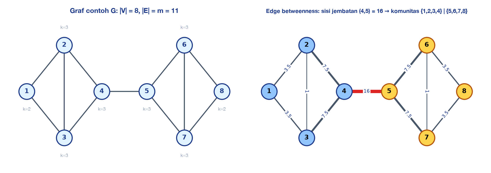
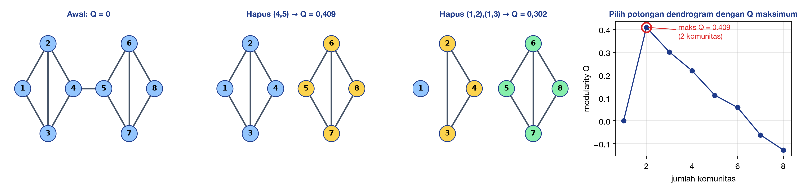
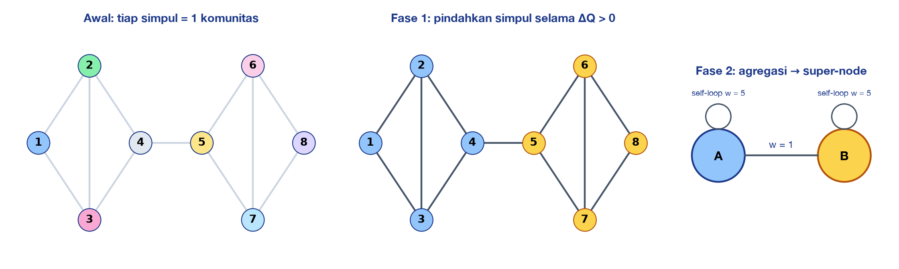
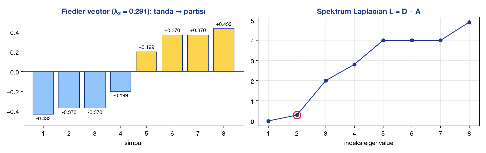
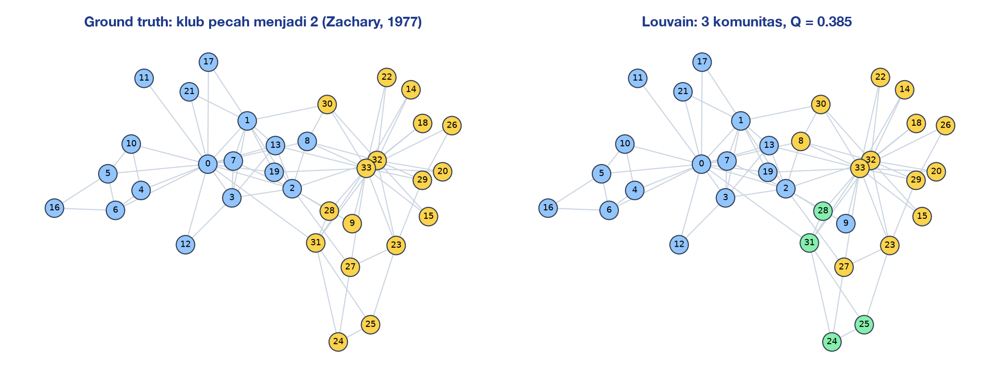

<!-- _class: lead -->
<!-- _paginate: false -->
<!-- _header: '' -->

# Graph Mining
## Community Detection: Konsep Dasar hingga Perkembangan Terbaru

### Pertemuan 12 — Data Mining
**Sains Data ITERA · Ganjil 2026/2025**

---

# Capaian Pembelajaran & Agenda

> Mahasiswa mampu memahami konsep **graph mining** dan **community detection**, menghitung secara manual ukuran-ukuran kunci (modularity, edge betweenness, ΔQ), serta mengenali perkembangan metode terbaru.

1. Motivasi: data berbentuk **graf** & ragam tugas graph mining
2. Dasar graf: representasi, derajat, densitas, *clustering coefficient*
3. Apa itu **komunitas**? Jenis & taksonomi metode
4. **Modularity** — definisi & hitung manual
5. Algoritma klasik: **Girvan–Newman**, **Louvain**, **Leiden**, *Label Propagation*, **Spectral**, Infomap
6. Komunitas *overlapping*: **Clique Percolation**
7. Evaluasi: Q, *conductance*, NMI, ARI · studi kasus **Karate Club**
8. **Perkembangan terbaru**: embedding, GNN, komunitas dinamis, GraphRAG
9. Implementasi Python · latihan

---

<!-- _class: divider -->

# Bagian 0 — Graph Mining

Mengapa data perlu dipandang sebagai graf?

---

# Data Berbentuk Graf Ada di Mana-Mana

| Domain | Simpul (*node*) | Sisi (*edge*) | Pertanyaan |
|---|---|---|---|
| Media sosial | Pengguna | Follow, mention, retweet | Kelompok opini? akun *buzzer* terkoordinasi? |
| Biologi | Protein | Interaksi protein–protein | Kompleks protein / modul fungsional? |
| Akademik | Paper / penulis | Sitasi / ko-autor | Bidang riset & kelompok kolaborasi? |
| Keuangan | Rekening | Transfer dana | Cincin *fraud* / pencucian uang? |
| E-commerce | Pengguna & produk | Pembelian / klik | Segmen pelanggan, rekomendasi |
| Transportasi | Halte / kota | Rute | Wilayah dengan mobilitas tinggi |
| Web | Halaman | Hyperlink | Topik & situs sejenis |

> Pada data tabular, baris dianggap **independen**. Pada graf, informasi utama justru ada pada **relasi antar-objek**.

---

# Ragam Tugas Graph Mining

| Tugas | Pertanyaan | Contoh metode |
|---|---|---|
| **Frequent subgraph mining** | Subgraf apa yang sering muncul? | gSpan, FSG |
| **Centrality / ranking** | Simpul mana yang paling penting? | Degree, betweenness, PageRank |
| **Community detection** | Kelompok simpul mana yang saling terhubung rapat? | Louvain, Leiden, Girvan–Newman |
| **Link prediction** | Relasi apa yang akan muncul? | Common neighbors, Adamic–Adar, GNN |
| **Node classification** | Label simpul yang belum diketahui? | Label propagation, GCN |
| **Graph anomaly detection** | Simpul/subgraf yang menyimpang? | OddBall, GNN-based |

> Community detection adalah analog **clustering** pada graf: *unsupervised*, tanpa label, mencari struktur kelompok.

---

<!-- _class: divider -->

# Bagian 1 — Dasar Graf

Representasi & ukuran dasar

---

# Definisi & Representasi Graf

Graf $G = (V, E)$ dengan $n = |V|$ simpul dan $m = |E|$ sisi.

| Jenis | Keterangan |
|---|---|
| Tak berarah / berarah | $\{u,v\}$ vs $(u \rightarrow v)$, mis. follow di media sosial |
| Berbobot | $w_{uv}$ = kekuatan relasi (jumlah transaksi, frekuensi interaksi) |
| Bipartit | Dua jenis simpul, mis. pengguna–produk |
| Atribut | Simpul punya fitur (umur, teks profil) → *attributed graph* |

**Matriks ketetanggaan** (*adjacency matrix*) $A$:
$$A_{ij} = \begin{cases} 1 & \text{jika } \{i,j\} \in E \\ 0 & \text{lainnya} \end{cases} \qquad k_i = \sum_j A_{ij} \;\;(\text{derajat}), \qquad \sum_i k_i = 2m$$

> Untuk graf besar dan *sparse* (jutaan simpul), gunakan **adjacency list** — matriks $n \times n$ terlalu boros memori.

---

# Graf Contoh untuk Hitung Manual



$E = \{(1,2),(1,3),(2,3),(2,4),(3,4),(4,5),(5,6),(5,7),(6,7),(6,8),(7,8)\}$ → $n = 8$, $m = 11$. Graf ini dipakai di seluruh perhitungan manual hari ini.

---

<!-- _class: two small -->

# Matriks Ketetanggaan & Derajat

### Matriks $A$

| | 1 | 2 | 3 | 4 | 5 | 6 | 7 | 8 |
|---|---|---|---|---|---|---|---|---|
| **1** | 0 | 1 | 1 | 0 | 0 | 0 | 0 | 0 |
| **2** | 1 | 0 | 1 | 1 | 0 | 0 | 0 | 0 |
| **3** | 1 | 1 | 0 | 1 | 0 | 0 | 0 | 0 |
| **4** | 0 | 1 | 1 | 0 | 1 | 0 | 0 | 0 |
| **5** | 0 | 0 | 0 | 1 | 0 | 1 | 1 | 0 |
| **6** | 0 | 0 | 0 | 0 | 1 | 0 | 1 | 1 |
| **7** | 0 | 0 | 0 | 0 | 1 | 1 | 0 | 1 |
| **8** | 0 | 0 | 0 | 0 | 0 | 1 | 1 | 0 |

Simetris karena graf tak berarah.

### Derajat (jumlah baris $A$)

| Simpul | 1 | 2 | 3 | 4 | 5 | 6 | 7 | 8 |
|---|---|---|---|---|---|---|---|---|
| $k_i$ | 2 | 3 | 3 | 3 | 3 | 3 | 3 | 2 |

$$\sum_i k_i = 2+3+3+3+3+3+3+2 = 22 = 2m \;\checkmark$$

**Densitas** (proporsi sisi yang ada dari semua kemungkinan):
$$\rho = \frac{2m}{n(n-1)} = \frac{22}{8 \cdot 7} = \frac{22}{56} = 0{,}393$$

Graf nyata umumnya sangat *sparse* ($\rho \ll 0{,}01$).

---

# Clustering Coefficient: "Teman dari Temanku adalah Temanku"

$$C_i = \frac{\text{jumlah sisi di antara tetangga } i}{\binom{k_i}{2}} = \frac{2\,T_i}{k_i(k_i-1)}$$

| Simpul | Tetangga | Sisi antar-tetangga | $\binom{k_i}{2}$ | $C_i$ |
|---|---|---|---|---|
| 1 | {2, 3} | (2,3) | 1 | **1,000** |
| 2 | {1, 3, 4} | (1,3), (3,4) | 3 | **0,667** |
| 4 | {2, 3, 5} | (2,3) | 3 | **0,333** |
| 5 | {4, 6, 7} | (6,7) | 3 | **0,333** |
| 8 | {6, 7} | (6,7) | 1 | **1,000** |

Simetris: $C_3 = C_6 = C_7 = 0{,}667$. Rata-rata $\bar{C} = (1 + 4 \times 0{,}667 + 2 \times 0{,}333 + 1)/8 = 0{,}667$.

> Simpul **4 dan 5** (penghubung kedua kelompok) memiliki $C_i$ terendah — indikasi awal adanya **batas komunitas**.

---

<!-- _class: divider -->

# Bagian 2 — Komunitas

Definisi, jenis, dan taksonomi metode

---

# Apa Itu Komunitas?

**Komunitas** = himpunan simpul yang **rapat terhubung di dalam** dan **jarang terhubung ke luar**.

Untuk subset $S \subseteq V$:

| Ukuran | Rumus | Komunitas yang baik |
|---|---|---|
| Sisi internal | $m_S = \lvert\{(u,v) \in E : u,v \in S\}\rvert$ | besar |
| Sisi potong (*cut*) | $c_S = \lvert\{(u,v) \in E : u \in S, v \notin S\}\rvert$ | kecil |
| Volume | $\text{vol}(S) = \sum_{i \in S} k_i$ | — |
| **Conductance** | $\phi(S) = \dfrac{c_S}{\min(\text{vol}(S), \text{vol}(V \setminus S))}$ | kecil |

**Contoh** $S = \{1,2,3,4\}$: $m_S = 5$, $c_S = 1$ (sisi 4–5), $\text{vol}(S) = 2+3+3+3 = 11$, $\text{vol}(V\setminus S)=11$
$$\phi(S) = \frac{1}{\min(11, 11)} = 0{,}091 \quad \Rightarrow \text{komunitas yang sangat baik}$$

> Tidak ada **satu** definisi formal komunitas yang disepakati semua peneliti (Fortunato, 2010) — setiap algoritma membawa definisinya sendiri.

---

# Jenis Struktur Komunitas

| Jenis | Ciri | Contoh |
|---|---|---|
| **Disjoint (partisi)** | Setiap simpul tepat di satu komunitas | Departemen dalam perusahaan |
| **Overlapping** | Simpul boleh di beberapa komunitas | Seseorang anggota keluarga, kantor, dan klub olahraga |
| **Hierarkis** | Komunitas bersarang di dalam komunitas | Fakultas → program studi → angkatan |
| **Dinamis** | Komunitas lahir, tumbuh, bergabung, membelah, mati seiring waktu | Grup diskusi isu politik menjelang pemilu |
| **Attributed** | Memakai struktur **dan** atribut simpul | Pengguna dengan relasi + teks unggahan |

---

<!-- _class: small -->

# Taksonomi Metode Community Detection

| Pendekatan | Ide utama | Algoritma | Tahun |
|---|---|---|---|
| **Graph partitioning** | Potong graf menjadi $k$ bagian dengan cut minimum | Kernighan–Lin, METIS | 1970, 1998 |
| **Divisive hierarkis** | Hapus sisi "jembatan" secara bertahap | **Girvan–Newman** | 2002 |
| **Optimasi modularity** | Cari partisi dengan $Q$ maksimum | Greedy (CNM), **Louvain**, **Leiden** | 2004, 2008, 2019 |
| **Spectral** | Eigenvector matriks Laplacian | **Spectral clustering** | 1973→2007 |
| **Dinamika / propagasi** | Label menyebar ke tetangga | **Label Propagation** (LPA) | 2007 |
| **Information-theoretic** | Kompresi jejak *random walk* | **Infomap** | 2008 |
| **Inferensi statistik** | Model generatif graf | Stochastic Block Model (SBM) | 1983, 2011 |
| **Overlapping** | Klik bertetangga / keanggotaan *soft* | **Clique Percolation**, BigCLAM | 2005, 2013 |
| **Deep learning** | Embedding / GNN lalu clustering | DeepWalk, node2vec, **DMoN** | 2014–2023 |

---

<!-- _class: divider -->

# Bagian 3 — Modularity

Ukuran kualitas partisi yang paling populer

---

# Modularity (Newman & Girvan, 2004)

Ide: komunitas yang baik memiliki **sisi internal lebih banyak daripada yang diharapkan secara acak** (*null model*: graf acak dengan derajat yang sama).

$$Q = \frac{1}{2m}\sum_{i,j}\left[A_{ij} - \frac{k_i k_j}{2m}\right]\delta(c_i, c_j)$$

- $A_{ij}$ = sisi nyata; $\dfrac{k_i k_j}{2m}$ = peluang sisi $i$–$j$ pada graf acak (*configuration model*)
- $\delta(c_i,c_j) = 1$ jika $i$ dan $j$ satu komunitas

Bentuk per komunitas (lebih mudah dihitung manual):
$$\boxed{Q = \sum_{c}\left[\frac{L_c}{m} - \left(\frac{d_c}{2m}\right)^2\right]}$$

$L_c$ = jumlah sisi di dalam komunitas $c$; $d_c$ = jumlah derajat simpul di $c$.

> $Q \in [-\tfrac{1}{2}, 1)$. Dalam praktik, $Q > 0{,}3$ sering dianggap menandakan struktur komunitas yang jelas.

---

# Hitung Manual: Partisi Baik vs Partisi Buruk

**Partisi A** = $\{1,2,3,4\} \,|\, \{5,6,7,8\}$ ($m = 11$, $2m = 22$)

| Komunitas | Sisi internal | $L_c$ | $d_c$ | $L_c/m$ | $(d_c/2m)^2$ | Kontribusi |
|---|---|---|---|---|---|---|
| {1,2,3,4} | 12, 13, 23, 24, 34 | 5 | 2+3+3+3 = 11 | 0,4545 | 0,2500 | 0,2045 |
| {5,6,7,8} | 56, 57, 67, 68, 78 | 5 | 3+3+3+2 = 11 | 0,4545 | 0,2500 | 0,2045 |
| | | | | | **Q** | **0,4091** |

**Partisi B** = $\{1,2,5,6\} \,|\, \{3,4,7,8\}$

| Komunitas | Sisi internal | $L_c$ | $d_c$ | $L_c/m$ | $(d_c/2m)^2$ | Kontribusi |
|---|---|---|---|---|---|---|
| {1,2,5,6} | 12, 56 | 2 | 2+3+3+3 = 11 | 0,1818 | 0,2500 | −0,0682 |
| {3,4,7,8} | 34, 78 | 2 | 3+3+3+2 = 11 | 0,1818 | 0,2500 | −0,0682 |
| | | | | | **Q** | **−0,1364** |

> Semua simpul dalam satu komunitas → $Q = 11/11 - (22/22)^2 = 0$. Partisi yang lebih buruk dari acak → $Q < 0$.

---

# Satu Partisi Lagi: Tiga Komunitas

**Partisi C** = $\{1,2,3\} \,|\, \{4,5\} \,|\, \{6,7,8\}$

| Komunitas | Sisi internal | $L_c$ | $d_c$ | $L_c/m$ | $(d_c/2m)^2$ | Kontribusi |
|---|---|---|---|---|---|---|
| {1,2,3} | 12, 13, 23 | 3 | 2+3+3 = 8 | 0,2727 | 0,1322 | 0,1405 |
| {4,5} | 45 | 1 | 3+3 = 6 | 0,0909 | 0,0744 | 0,0165 |
| {6,7,8} | 67, 68, 78 | 3 | 3+3+2 = 8 | 0,2727 | 0,1322 | 0,1405 |
| | | | | | **Q** | **0,2975** |

| Partisi | Q |
|---|---|
| A: {1,2,3,4} \| {5,6,7,8} | **0,409** ← terbaik |
| C: {1,2,3} \| {4,5} \| {6,7,8} | 0,298 |
| Satu komunitas | 0,000 |
| B: {1,2,5,6} \| {3,4,7,8} | −0,136 |

> Mencari partisi dengan Q maksimum adalah masalah **NP-hard** (Brandes dkk., 2008) → diperlukan **heuristik** seperti Louvain.

---

# Keterbatasan Modularity

1. **Resolution limit** (Fortunato & Barthélemy, 2007): komunitas kecil yang jelas bisa **tergabung** jika ukurannya di bawah $\sim\sqrt{2m}$. Pada graf besar, Q cenderung menggabungkan kelompok kecil.
2. **Degenerasi**: banyak partisi berbeda memiliki Q hampir sama → hasil tidak stabil antar-*run*.
3. **Q tinggi pada graf acak**: graf acak pun dapat memiliki Q ≈ 0,3 karena fluktuasi.

**Solusi praktis — parameter resolusi** $\gamma$:
$$Q_\gamma = \sum_c\left[\frac{L_c}{m} - \gamma\left(\frac{d_c}{2m}\right)^2\right]$$

- $\gamma > 1$ → komunitas **lebih banyak & kecil**
- $\gamma < 1$ → komunitas **lebih sedikit & besar**

Alternatif: **CPM** (*Constant Potts Model*) yang dipakai Leiden, bebas dari *resolution limit*.

---

<!-- _class: divider -->

# Bagian 4 — Algoritma Klasik

Girvan–Newman · Louvain · Leiden · LPA · Spectral · Infomap

---

# Girvan–Newman (2002): Hapus Jembatannya

**Edge betweenness** sisi $e$ = jumlah lintasan terpendek antar-semua pasangan simpul yang melewati $e$ (dibagi rata bila ada beberapa lintasan terpendek).

```text
GIRVAN-NEWMAN(G):
  ulangi sampai tidak ada sisi:
     1. hitung edge betweenness semua sisi
     2. hapus sisi dengan betweenness TERTINGGI
     3. catat komponen terhubung (= komunitas) dan modularity Q-nya
  kembalikan partisi dengan Q maksimum (potong dendrogram)
```

**Intuisi**: sisi antar-komunitas sedikit, sehingga **semua** lintasan antar-kelompok "terpaksa" lewat sisi tersebut → betweenness-nya tinggi.

**Kompleksitas**: $O(m^2 n)$ — terlalu mahal untuk graf > ~10 ribu simpul.

---

# Hitung Manual: Edge Betweenness Sisi Jembatan (4,5)

Setiap lintasan terpendek dari $\{1,2,3,4\}$ ke $\{5,6,7,8\}$ **wajib** melalui sisi (4,5):
$$\text{EB}(4,5) = |\{1,2,3,4\}| \times |\{5,6,7,8\}| = 4 \times 4 = \mathbf{16}$$

Sisi (2,3): hanya pasangan (2,3) yang lintasan terpendeknya memakai sisi ini (1–4 punya dua jalur via 2 atau 3 dengan panjang sama tetapi tidak memakai sisi 2–3) → $\text{EB}(2,3) = 1$.

| Sisi | (4,5) | (2,4), (3,4), (5,6), (5,7) | (1,2), (1,3), (6,8), (7,8) | (2,3), (6,7) |
|---|---|---|---|---|
| EB | **16** | 7,5 | 3,5 | 1 |

Contoh EB(2,4) = 7,5: pasangan $\{1,2,3\} \times \{4,\ldots,8\}$ yang lewat 2→4. Dari 2: 5 pasangan (×1). Dari 1: 5 pasangan, separuh lewat 2 (×0,5) = 2,5. Total = 5 + 2,5 = **7,5**.

> Iterasi 1: hapus (4,5) → dua komponen {1,2,3,4} dan {5,6,7,8}, **Q = 0,409**.

---

# Girvan–Newman: Dendrogram & Pemilihan Potongan



Setelah (4,5) dihapus, betweenness dihitung **ulang** (sisi 12, 13, 24, 34 = 1,5; sisi 23 = 1). Menghapus lebih banyak sisi justru **menurunkan Q** → potongan terbaik = **2 komunitas**.

---

# Louvain (Blondel dkk., 2008): Optimasi Q Secara Greedy

```text
LOUVAIN(G):
  setiap simpul = komunitasnya sendiri
  ulangi:
    FASE 1 (local moving):
      untuk setiap simpul i (urutan acak):
        hitung ΔQ jika i dipindah ke komunitas tetangganya
        pindahkan i ke komunitas dengan ΔQ terbesar (jika ΔQ > 0)
      ulangi sampai tidak ada perpindahan yang menaikkan Q
    FASE 2 (aggregation):
      setiap komunitas → satu super-node
      sisi antar-komunitas → sisi berbobot; sisi internal → self-loop
  sampai Q tidak naik lagi
```



---

# Hitung Manual: ΔQ Saat Memindahkan Simpul

Gain memasukkan simpul terisolasi $i$ ke komunitas $C$:
$$\Delta Q = \frac{k_{i,in}}{m} - \frac{\Sigma_{tot} \cdot k_i}{2m^2}$$
$k_{i,in}$ = sisi dari $i$ ke $C$; $\Sigma_{tot}$ = jumlah derajat simpul di $C$.

Keadaan: $\{1,2,3\}$, $\{4\}$, $\{5,6,7,8\}$ ($Q = 0{,}3264$). Simpul 4 ($k_4 = 3$) memilih:

| Tujuan | $k_{4,in}$ | $\Sigma_{tot}$ | $\dfrac{k_{4,in}}{m}$ | $\dfrac{\Sigma_{tot}k_4}{2m^2}$ | $\Delta Q$ |
|---|---|---|---|---|---|
| $\{1,2,3\}$ | 2 (ke 2, 3) | 8 | 2/11 = 0,1818 | 24/242 = 0,0992 | **+0,0826** |
| $\{5,6,7,8\}$ | 1 (ke 5) | 11 | 1/11 = 0,0909 | 33/242 = 0,1364 | **−0,0455** |

→ Simpul 4 bergabung ke $\{1,2,3\}$: $Q = 0{,}3264 + 0{,}0826 = 0{,}409$ ✓ (sama dengan hitungan langsung).

> Kecepatan Louvain berasal dari ΔQ yang dihitung **lokal** — cukup melihat tetangga. Kompleksitas mendekati $O(m)$ per iterasi; mampu memproses graf **ratusan juta** sisi.

---

# Leiden (Traag, Waltman & van Eck, 2019)

**Masalah Louvain**: dapat menghasilkan komunitas yang **tidak terhubung** secara internal (hingga ±25% komunitas buruk pada beberapa data), karena simpul "jembatan" dipindah keluar dan meninggalkan dua bagian terpisah.

**Leiden** menambah fase **refinement**:

| Fase | Louvain | Leiden |
|---|---|---|
| 1 | Local moving | **Fast local moving** (hanya simpul yang tetangganya berubah) |
| 2 | — | **Refinement**: pecah komunitas menjadi sub-komunitas yang dijamin terhubung |
| 3 | Aggregation | Aggregation berdasarkan partisi hasil refinement |

- **Garansi**: semua komunitas **terhubung**; pada konvergensi, *subpartition γ-dense*.
- Lebih **cepat** dari Louvain pada graf besar.
- Mendukung fungsi kualitas **modularity** maupun **CPM**.
- Kini menjadi **standar de facto** (igraph, `leidenalg`, Scanpy untuk *single-cell*, GraphRAG).

---

# Label Propagation (Raghavan dkk., 2007)

**Ide**: setiap simpul mengadopsi label **mayoritas tetangganya**; label yang rapat akan "menguasai" kelompoknya.

```text
1. beri label unik pada setiap simpul
2. ulangi (urutan simpul acak):
     label(i) ← label yang paling sering muncul di antara tetangga i (seri → pilih acak)
3. berhenti jika setiap simpul sudah memiliki label mayoritas tetangganya
```

**Ilustrasi** (setelah beberapa langkah, 1–3 berlabel **A**, 6–8 berlabel **B**):

| Simpul | Label tetangga | Label baru |
|---|---|---|
| 4 | 2:A, 3:A, 5:? | **A** (2 suara) |
| 5 | 4:A, 6:B, 7:B | **B** (2 suara) |

Hasil: {1,2,3,4} = A, {5,6,7,8} = B.

✓ Sangat cepat: hampir linear $O(m)$, tanpa parameter · ✗ Non-deterministik (hasil bisa berbeda tiap run), bisa jatuh ke satu label raksasa

---

# Spectral Clustering

**Laplacian** $L = D - A$, dengan $D = \text{diag}(k_1, \ldots, k_n)$. Untuk graf contoh:

$$L = \begin{bmatrix}
2&-1&-1&0&0&0&0&0\\ -1&3&-1&-1&0&0&0&0\\ -1&-1&3&-1&0&0&0&0\\ 0&-1&-1&3&-1&0&0&0\\
0&0&0&-1&3&-1&-1&0\\ 0&0&0&0&-1&3&-1&-1\\ 0&0&0&0&-1&-1&3&-1\\ 0&0&0&0&0&-1&-1&2
\end{bmatrix}$$

- Eigenvalue terkecil selalu $\lambda_1 = 0$ (vektor konstan); **jumlah eigenvalue 0 = jumlah komponen terhubung**.
- **Fiedler vector** (eigenvector $\lambda_2$) → minimisasi *ratio cut* yang direlaksasi; **tanda** komponennya membagi graf menjadi dua.
- Untuk $k$ komunitas: ambil $k$ eigenvector terkecil → baris = embedding simpul → **k-means** (von Luxburg, 2007).

---

# Spectral Clustering: Hasil pada Graf Contoh



$\lambda_2 = 0{,}291$ kecil → graf "hampir" terpisah menjadi dua. Komponen negatif = {1,2,3,4}, positif = {5,6,7,8}, sama dengan hasil Girvan–Newman dan Louvain. Kompleksitas eigendecomposition $O(n^3)$ → gunakan metode Lanczos untuk matriks *sparse*.

---

# Infomap (Rosvall & Bergstrom, 2008)

**Sudut pandang lain**: komunitas = wilayah di mana **random walker terjebak lama**.

- Jejak random walk dikodekan dengan **kode dua tingkat**: kode modul + kode simpul di dalam modul (seperti nama kota + nama jalan).
- Partisi terbaik = partisi yang menghasilkan **deskripsi terpendek** (*map equation*):

$$L(M) = q_{\curvearrowright} H(\mathcal{Q}) + \sum_{i=1}^{k} p^{i}_{\circlearrowright} H(\mathcal{P}^i)$$

$q_{\curvearrowright}$ = peluang berpindah antar-modul; $H$ = entropi kode.

| | Modularity (Louvain/Leiden) | Infomap |
|---|---|---|
| Pandangan | Struktur: sisi vs harapan acak | **Aliran** (*flow*) di jaringan |
| Graf berarah | Kurang alami | **Sangat cocok** (lalu lintas, sitasi, transaksi) |
| Resolution limit | Ada | Lebih kecil |

---

# Stochastic Block Model (SBM): Pendekatan Statistik

Model **generatif**: setiap simpul berada di blok $b_i$; peluang sisi hanya bergantung pada blok:
$$P(A_{ij} = 1) = \omega_{b_i b_j}$$

- Komunitas assortative: $\omega_{rr} \gg \omega_{rs}$ — tetapi SBM juga dapat menemukan struktur **disassortative** (mis. bipartit, inti–pinggiran).
- **Degree-corrected SBM** (Karrer & Newman, 2011) memperhitungkan heterogenitas derajat.
- Inferensi: maksimum *likelihood* / Bayesian (MCMC) → jumlah blok dapat dipilih otomatis dengan prinsip *minimum description length*.
- Kelebihan: memiliki dasar statistik; **tidak** menemukan komunitas palsu pada graf acak (berbeda dengan Q).
- Implementasi: `graph-tool` (Peixoto).

---

<!-- _class: divider -->

# Bagian 5 — Komunitas Overlapping

---

# Clique Percolation Method (Palla dkk., 2005)

**k-clique** = $k$ simpul yang saling terhubung semua. Dua k-clique **bertetangga** jika berbagi $k-1$ simpul. **Komunitas** = gabungan k-clique yang dapat dicapai melalui ketetanggaan.

**Hitung manual, k = 3** (segitiga) pada graf contoh:

| Segitiga | Bertetangga dengan (berbagi 2 simpul) |
|---|---|
| T1 = {1,2,3} | T2 (berbagi 2, 3) |
| T2 = {2,3,4} | T1 |
| T3 = {5,6,7} | T4 (berbagi 6, 7) |
| T4 = {6,7,8} | T3 |

Komunitas: T1 ∪ T2 = **{1,2,3,4}**, T3 ∪ T4 = **{5,6,7,8}**. Sisi (4,5) tidak berada di segitiga mana pun.

- Satu simpul dapat menjadi anggota **beberapa** komunitas → *overlapping* alami.
- Simpul yang tidak berada di k-clique mana pun **tidak** masuk komunitas.
- Alternatif skala besar: **BigCLAM** (Yang & Leskovec, 2013) — keanggotaan non-negatif lewat faktorisasi matriks.

---

<!-- _class: divider -->

# Bagian 6 — Evaluasi & Studi Kasus

---

# Mengevaluasi Hasil Community Detection

| Kondisi | Ukuran | Keterangan |
|---|---|---|
| **Tanpa ground truth** (internal) | Modularity $Q$ | Makin tinggi makin baik (dengan keterbatasan) |
| | Conductance $\phi$ | Makin kecil makin baik |
| | Coverage, density internal | Proporsi sisi di dalam komunitas |
| **Dengan ground truth** (eksternal) | **NMI** | $\dfrac{2\, I(X;Y)}{H(X) + H(Y)} \in [0, 1]$ |
| | **ARI** | Kesepakatan pasangan simpul, dikoreksi peluang; 0 = acak, 1 = sempurna |
| | F1 / Omega index | Untuk komunitas *overlapping* |

**Benchmark sintetis**: **LFR** (Lancichinetti, Fortunato & Radicchi, 2008) — distribusi derajat & ukuran komunitas *power-law*, dengan parameter *mixing* $\mu$ (proporsi sisi keluar komunitas). Makin besar $\mu$, makin sulit dideteksi.

> **Q tinggi ≠ sesuai ground truth.** Selalu laporkan beberapa ukuran dan interpretasikan dengan domain.

---

# Studi Kasus Klasik: Zachary's Karate Club (1977)

Jaringan pertemanan 34 anggota klub karate (78 relasi). Akibat konflik antara pelatih (simpul 0) dan ketua (simpul 33), klub **pecah menjadi dua** — ground truth alami.



---

# Hasil Berbagai Algoritma pada Karate Club

Output `p12_community_detection_demo.py` (graf tanpa bobot, `seed=42`):

| Algoritma | #Komunitas | Modularity Q | NMI | ARI |
|---|---|---|---|---|
| Girvan–Newman (level 1) | 2 | 0,360 | **0,732** | **0,772** |
| Greedy modularity (CNM) | 3 | 0,381 | 0,565 | 0,568 |
| Louvain | 3 | 0,385 | 0,576 | 0,612 |
| Label propagation | 4 | **0,403** | 0,506 | 0,459 |
| *Ground truth* | 2 | 0,358 | 1 | 1 |

**Pelajaran:**
1. Q tertinggi **tidak** menghasilkan kecocokan tertinggi dengan ground truth.
2. Q ground truth (0,358) lebih rendah dari Q Louvain — struktur sosial nyata tidak selalu "optimal" menurut modularity.
3. Algoritma berbasis Q cenderung memecah kelompok besar menjadi sub-kelompok yang lebih rapat.

---

<!-- _class: small -->

# Studi Kasus Aplikasi Nyata

| Domain | Graf | Temuan / manfaat | Rujukan |
|---|---|---|---|
| **Biologi** | Interaksi protein ragi | Komunitas *overlapping* ≈ kompleks protein & fungsi biologis | Palla dkk. (2005), *Nature* |
| **Sains jaringan** | Jaringan telepon seluler Belgia, 2,6 juta pengguna | Louvain menemukan komunitas yang terpisah berdasarkan **bahasa** (Prancis vs Belanda) | Blondel dkk. (2008) |
| **Ilmu pengetahuan** | Jaringan sitasi | Peta bidang ilmu & aliran pengetahuan (Infomap) | Rosvall & Bergstrom (2008), *PNAS* |
| **Single-cell genomics** | Graf k-NN antar-sel | Leiden menjadi metode standar untuk mengelompokkan tipe sel | Traag dkk. (2019) |
| **Fraud & keamanan** | Transaksi / akun | Kelompok akun terkoordinasi (cincin *fraud*, *bot/buzzer*) | Akoglu dkk. (2015), *DMKD* |
| **LLM / GraphRAG** | Graf entitas dari dokumen | Komunitas Leiden diringkas oleh LLM untuk menjawab pertanyaan global | Edge dkk. (2024) |

> Ide topik skripsi: komunitas akun pada percakapan isu publik di media sosial Indonesia, jaringan ko-autor dosen, jaringan transaksi UMKM, jaringan rute angkutan umum.

---

<!-- _class: divider -->

# Bagian 7 — Perkembangan Terbaru

Dari heuristik modularity menuju representation learning

---

<!-- _class: small -->

# Lini Masa Perkembangan Metode

| Era | Tonggak | Kontribusi |
|---|---|---|
| 1970-an | Kernighan–Lin; Fiedler (1973) | Partisi graf & teori spektral |
| 2002–2004 | Girvan–Newman; **modularity** | Lahirnya *community detection* modern |
| 2005–2008 | CPM, LPA, **Louvain**, **Infomap** | Overlapping, skalabilitas, sudut pandang *flow* |
| 2010–2016 | Survei Fortunato; benchmark LFR; DC-SBM | Evaluasi yang lebih ketat & inferensi statistik |
| 2014–2016 | **DeepWalk**, **node2vec** | Embedding simpul via random walk + Skip-gram |
| 2017–2020 | GCN, GAE, MinCutPool | *Graph Neural Network* untuk clustering |
| **2019** | **Leiden** | Komunitas terjamin terhubung; lebih cepat |
| 2022–2023 | Survei deep community detection; **DMoN** | GNN yang mengoptimalkan modularity secara langsung |
| **2024–kini** | **GraphRAG**; komunitas + LLM | Komunitas sebagai unit ringkasan pengetahuan bagi LLM |

---

# Tren 1: Embedding Simpul + Clustering

**DeepWalk** (Perozzi dkk., 2014) & **node2vec** (Grover & Leskovec, 2016):

1. Bangkitkan banyak **random walk** dari setiap simpul → diperlakukan sebagai "kalimat"
2. Latih **Skip-gram** (Word2Vec): simpul yang sering muncul berdekatan → vektor mirip
3. Jalankan **k-means / HDBSCAN** pada vektor simpul

node2vec memakai parameter $p$ (*return*) dan $q$ (*in-out*):
- $q > 1$ → walk mirip BFS → menangkap **peran struktural**
- $q < 1$ → walk mirip DFS → menangkap **homofili / komunitas**

✓ Representasi dapat dipakai ulang untuk tugas lain (klasifikasi, link prediction)
✗ Dua tahap (embedding lalu clustering) — embedding tidak dioptimalkan untuk komunitas

---

# Tren 2: Graph Neural Network untuk Komunitas

**GNN** menggabungkan **struktur graf** dan **atribut simpul**:
$$H^{(l+1)} = \sigma\!\left(\tilde{D}^{-1/2}\tilde{A}\tilde{D}^{-1/2} H^{(l)} W^{(l)}\right) \quad \text{(GCN, Kipf \& Welling, 2017)}$$

**DMoN — Deep Modularity Networks** (Tsitsulin dkk., 2023, *JMLR*):
- GCN menghasilkan matriks keanggotaan *soft* $C = \text{softmax}(\text{GCN}(A, X))$
- Loss = **−modularity terelaksasi** + regulasi kolaps:
$$\mathcal{L} = -\frac{1}{2m}\text{Tr}(C^\top B C) + \frac{\sqrt{k}}{n}\left\lVert \textstyle\sum_i C_i \right\rVert_F - 1, \qquad B = A - \frac{kk^\top}{2m}$$
- *End-to-end*: komunitas dipelajari langsung, memanfaatkan fitur simpul

Pendekatan lain: Graph Auto-Encoder, *contrastive learning* (DGI, GRACE), MinCutPool (Bianchi dkk., 2020). Survei: Su dkk. (2022, *IEEE TNNLS*); Jin dkk. (2023, *IEEE TKDE*).

---

<!-- _class: small -->

# Tren 3: Graf Dinamis, Multilayer & Attributed

| Arah riset | Masalah | Pendekatan |
|---|---|---|
| **Dinamis / temporal** | Komunitas berubah: lahir, tumbuh, menyusut, bergabung, membelah, mati | Deteksi per *snapshot* + pencocokan; *evolutionary clustering*; metode *streaming* (Rossetti & Cazabet, 2018) |
| **Multilayer / multiplex** | Satu set simpul dengan beberapa jenis relasi (follow, reply, retweet) | Multilayer modularity, Infomap multilayer |
| **Attributed** | Struktur + konten (teks, gambar) | GNN, SBM dengan atribut |
| **Heterogen** | Banyak jenis simpul (pengguna, produk, toko) | Meta-path, *heterogeneous GNN* |
| **Skala sangat besar** | Miliaran sisi | Leiden paralel, GPU (NVIDIA cuGraph), komputasi terdistribusi |
| **Fairness & privasi** | Komunitas bias / *differential privacy* | *Fair* clustering, DP community detection |

---

# Tren 4: Community Detection untuk LLM — GraphRAG

**GraphRAG** (Edge dkk., 2024, Microsoft Research):

1. LLM mengekstrak **entitas & relasi** dari kumpulan dokumen → *knowledge graph*
2. **Leiden hierarkis** membagi graf menjadi komunitas bertingkat
3. LLM membuat **ringkasan setiap komunitas**
4. Pertanyaan global ("Apa tema utama dari 1.000 dokumen ini?") dijawab dengan menggabungkan ringkasan komunitas (*map-reduce*)

| | RAG biasa (vektor) | GraphRAG |
|---|---|---|
| Pertanyaan lokal ("Siapa X?") | Baik | Baik |
| Pertanyaan **global / tematik** | Lemah | **Lebih baik** — berkat ringkasan komunitas |

> Community detection, metode "klasik" dari 2008–2019, kini menjadi **komponen kunci sistem AI generatif**.

---

<!-- _class: small -->

# Memilih Algoritma: Panduan Praktis

| Kebutuhan | Rekomendasi |
|---|---|
| Graf kecil (< ribuan simpul), butuh interpretasi hierarki | **Girvan–Newman** |
| Graf besar, partisi disjoint, standar | **Leiden** (lebih baik dari Louvain) |
| Sangat cepat, perkiraan kasar | **Label Propagation** |
| Graf berarah / berbasis aliran | **Infomap** |
| Ingin dasar statistik & uji struktur | **SBM** (graph-tool) |
| Simpul boleh di beberapa komunitas | **Clique Percolation**, BigCLAM |
| Ada fitur simpul yang kaya | **GNN** (DMoN) atau embedding + clustering |
| Graf berubah seiring waktu | Metode komunitas dinamis |

**Tips**: jalankan beberapa *seed*, periksa stabilitas hasil, coba beberapa nilai resolusi $\gamma$, dan **validasi dengan pengetahuan domain**.

---

<!-- _class: divider -->

# Bagian 8 — Implementasi Python

---

<!-- _class: small -->

# NetworkX: Dari Hitung Manual ke Kode

```python
import networkx as nx
from networkx.algorithms import community as nxc

G = nx.Graph([(1, 2), (1, 3), (2, 3), (2, 4), (3, 4), (4, 5),
              (5, 6), (5, 7), (6, 7), (6, 8), (7, 8)])

print(nx.density(G), nx.average_clustering(G))                 # 0.393  0.667
print(nxc.modularity(G, [{1, 2, 3, 4}, {5, 6, 7, 8}]))          # 0.4091
print(nx.edge_betweenness_centrality(G, normalized=False))      # (4,5): 16.0
print(next(nxc.girvan_newman(G)))                               # ({1,2,3,4}, {5,6,7,8})
print(nxc.louvain_communities(G, resolution=1.0, seed=42))      # [{1,2,3,4}, {5,6,7,8}]
print(list(nxc.label_propagation_communities(G)))
print(list(nxc.k_clique_communities(G, 3)))                     # clique percolation
```

Leiden (lebih direkomendasikan untuk graf besar):

```python
import igraph as ig                                  # pip install igraph
g = ig.Graph.from_networkx(G)
part = g.community_leiden(objective_function="modularity", resolution=1.0, n_iterations=-1)
print(part.membership, part.modularity)
```

Skrip lengkap: `p12_community_detection_demo.py` · gambar: `make_figures_p12.py`.

---

# Alur Kerja Analisis Komunitas

| Langkah | Kegiatan | Catatan |
|---|---|---|
| 1. Konstruksi graf | Tentukan simpul, sisi, arah, bobot, periode waktu | Keputusan paling berpengaruh! |
| 2. Pra-pemrosesan | Hapus *self-loop*/duplikat, filter bobot kecil, ambil komponen terbesar | Dokumentasikan ambang |
| 3. Eksplorasi | Distribusi derajat, densitas, clustering coefficient | Kenali karakter graf |
| 4. Deteksi | Jalankan ≥ 2 algoritma, beberapa seed & resolusi | Bandingkan stabilitas |
| 5. Evaluasi | Q, conductance; NMI/ARI jika ada ground truth | Jangan hanya Q |
| 6. Interpretasi | Profil tiap komunitas: anggota sentral, atribut dominan, topik | Libatkan pakar domain |
| 7. Visualisasi | Gephi, Cytoscape, `pyvis`, layout ForceAtlas2 | Warna = komunitas |

---

<!-- _class: divider -->

# Bagian 9 — Latihan

---

# Latihan Hitung Manual

Graf $H$ dengan 7 simpul dan 9 sisi:
$$E_H = \{(a,b),(a,c),(b,c),(c,d),(d,e),(e,f),(e,g),(f,g),(d,f)\}$$

1. Tentukan derajat setiap simpul dan periksa bahwa $\sum k_i = 2m$.
2. Hitung *clustering coefficient* simpul $c$, $d$, dan $e$.
3. Hitung **modularity** partisi $P_1 = \{a,b,c\} \,|\, \{d,e,f,g\}$ dan $P_2 = \{a,b,c,d\} \,|\, \{e,f,g\}$. Mana yang lebih baik?
4. Hitung **edge betweenness** sisi $(c,d)$. Sisi mana yang dihapus pertama kali oleh Girvan–Newman?
5. Mulai dari $\{a,b,c\}$, $\{d\}$, $\{e,f,g\}$: hitung **ΔQ** jika $d$ dipindah ke $\{a,b,c\}$ dan ke $\{e,f,g\}$.
6. Tentukan komunitas hasil **Clique Percolation** dengan $k = 3$.

---

<!-- _class: small -->

# Kunci Jawaban Latihan

1. $k$: a=2, b=2, c=3, d=3, e=3, f=3, g=2 → $\sum k = 18 = 2 \times 9$ ✓
2. $C_c$: tetangga {a,b,d}, sisi (a,b) → $1/3 = 0{,}333$; $C_d$: tetangga {c,e,f}, sisi (e,f) → $1/3 = 0{,}333$; $C_e$: tetangga {d,f,g}, sisi (d,f),(f,g) → $2/3 = 0{,}667$
3. $m = 9$, $2m = 18$.
   - $P_1$: $\{a,b,c\}$: $L = 3$, $d = 7$; $\{d,e,f,g\}$: $L = 5$, $d = 11$ → $Q = \tfrac{3}{9} - (\tfrac{7}{18})^2 + \tfrac{5}{9} - (\tfrac{11}{18})^2 = 0{,}3333 - 0{,}1512 + 0{,}5556 - 0{,}3735 = \mathbf{0{,}364}$
   - $P_2$: $\{a,b,c,d\}$: $L = 4$, $d = 10$; $\{e,f,g\}$: $L = 3$, $d = 8$ → $Q = 0{,}4444 - 0{,}3086 + 0{,}3333 - 0{,}1975 = \mathbf{0{,}272}$ → **$P_1$ lebih baik**
4. Semua lintasan dari {a,b,c} ke {d,e,f,g} melewati (c,d): $\text{EB}(c,d) = 3 \times 4 = \mathbf{12}$ (tertinggi) → dihapus pertama
5. $k_d = 3$. Ke $\{a,b,c\}$: $k_{d,in} = 1$, $\Sigma_{tot} = 7$ → $\Delta Q = 1/9 - 21/162 = 0{,}1111 - 0{,}1296 = \mathbf{-0{,}019}$. Ke $\{e,f,g\}$: $k_{d,in} = 2$, $\Sigma_{tot} = 8$ → $\Delta Q = 2/9 - 24/162 = 0{,}2222 - 0{,}1481 = \mathbf{+0{,}074}$ → $d$ masuk $\{e,f,g\}$ (konsisten dengan no. 3)
6. Segitiga: {a,b,c}, {d,e,f}, {e,f,g}; {d,e,f} & {e,f,g} berbagi {e,f} → komunitas **{a,b,c}** dan **{d,e,f,g}**

---

# Ringkasan

1. **Graph mining** menggali pola dari **relasi**; community detection = *clustering* pada graf.
2. Komunitas: **rapat di dalam, renggang ke luar** — diukur dengan conductance, modularity, dll.
3. **Modularity** $Q = \sum_c [L_c/m - (d_c/2m)^2]$ membandingkan sisi internal dengan harapan acak; memiliki *resolution limit*.
4. **Girvan–Newman** menghapus sisi ber-*betweenness* tertinggi; **Louvain/Leiden** mengoptimalkan Q secara greedy dengan ΔQ lokal; **LPA** sangat cepat; **spectral** memakai Fiedler vector; **Infomap** memakai aliran; **SBM** memakai inferensi statistik.
5. **Overlapping**: Clique Percolation, BigCLAM.
6. Evaluasi: Q, conductance (internal); NMI, ARI (eksternal) — **Q tinggi ≠ benar**.
7. Tren terbaru: **Leiden** sebagai standar, **embedding & GNN** (DMoN), komunitas **dinamis/multilayer**, dan **GraphRAG** untuk LLM.

---

<!-- _class: tiny -->

# Referensi (1)

1. Akoglu, L., Tong, H., & Koutra, D. (2015). Graph based anomaly detection and description: A survey. *Data Mining and Knowledge Discovery*, 29(3), 626–688.
2. Bianchi, F. M., Grattarola, D., & Alippi, C. (2020). Spectral clustering with graph neural networks for graph pooling. *ICML*.
3. Blondel, V. D., Guillaume, J.-L., Lambiotte, R., & Lefebvre, E. (2008). Fast unfolding of communities in large networks. *J. Stat. Mech.*, P10008.
4. Brandes, U., dkk. (2008). On modularity clustering. *IEEE TKDE*, 20(2), 172–188.
5. Edge, D., dkk. (2024). From local to global: A Graph RAG approach to query-focused summarization. *arXiv:2404.16130*.
6. Fortunato, S. (2010). Community detection in graphs. *Physics Reports*, 486(3–5), 75–174.
7. Fortunato, S., & Barthélemy, M. (2007). Resolution limit in community detection. *PNAS*, 104(1), 36–41.
8. Fortunato, S., & Hric, D. (2016). Community detection in networks: A user guide. *Physics Reports*, 659, 1–44.
9. Girvan, M., & Newman, M. E. J. (2002). Community structure in social and biological networks. *PNAS*, 99(12), 7821–7826.
10. Grover, A., & Leskovec, J. (2016). node2vec: Scalable feature learning for networks. *KDD*.
11. Jin, D., dkk. (2023). A survey of community detection approaches: From statistical modeling to deep learning. *IEEE TKDE*, 35(2), 1149–1170.
12. Karrer, B., & Newman, M. E. J. (2011). Stochastic blockmodels and community structure in networks. *Phys. Rev. E*, 83, 016107.
13. Kipf, T. N., & Welling, M. (2017). Semi-supervised classification with graph convolutional networks. *ICLR*.
14. Lancichinetti, A., Fortunato, S., & Radicchi, F. (2008). Benchmark graphs for testing community detection algorithms. *Phys. Rev. E*, 78, 046110.

---

<!-- _class: tiny -->

# Referensi (2)

15. Leskovec, J., Rajaraman, A., & Ullman, J. D. (2020). *Mining of Massive Datasets* (3rd ed.), Bab 10: Mining Social-Network Graphs. Cambridge University Press.
16. Newman, M. E. J., & Girvan, M. (2004). Finding and evaluating community structure in networks. *Phys. Rev. E*, 69, 026113.
17. Palla, G., Derényi, I., Farkas, I., & Vicsek, T. (2005). Uncovering the overlapping community structure of complex networks in nature and society. *Nature*, 435, 814–818.
18. Perozzi, B., Al-Rfou, R., & Skiena, S. (2014). DeepWalk: Online learning of social representations. *KDD*.
19. Raghavan, U. N., Albert, R., & Kumara, S. (2007). Near linear time algorithm to detect community structures in large-scale networks. *Phys. Rev. E*, 76, 036106.
20. Rosvall, M., & Bergstrom, C. T. (2008). Maps of random walks on complex networks reveal community structure. *PNAS*, 105(4), 1118–1123.
21. Rossetti, G., & Cazabet, R. (2018). Community discovery in dynamic networks: A survey. *ACM Computing Surveys*, 51(2).
22. Su, X., dkk. (2022). A comprehensive survey on community detection with deep learning. *IEEE TNNLS*.
23. Traag, V. A., Waltman, L., & van Eck, N. J. (2019). From Louvain to Leiden: Guaranteeing well-connected communities. *Scientific Reports*, 9, 5233.
24. Tsitsulin, A., Palowitch, J., Perozzi, B., & Müller, E. (2023). Graph clustering with graph neural networks. *JMLR*, 24(127), 1–21.
25. von Luxburg, U. (2007). A tutorial on spectral clustering. *Statistics and Computing*, 17(4), 395–416.
26. Zachary, W. W. (1977). An information flow model for conflict and fission in small groups. *J. Anthropological Research*, 33(4), 452–473.

---

<!-- _class: lead -->
<!-- _paginate: false -->
<!-- _header: '' -->

# Terima Kasih

### Pertemuan berikutnya: **Outlier Detection**

Kerjakan latihan hitung manual dan jalankan `p12_community_detection_demo.py`
