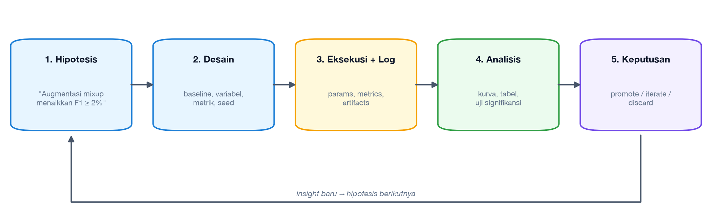
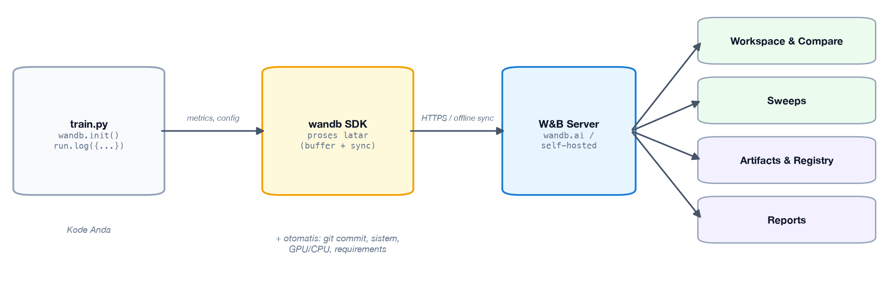
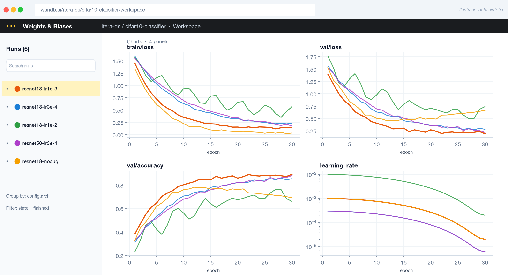
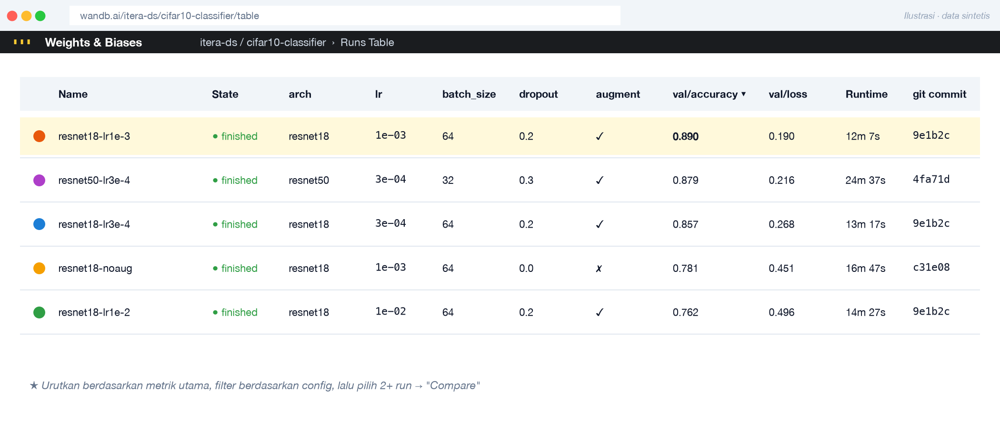
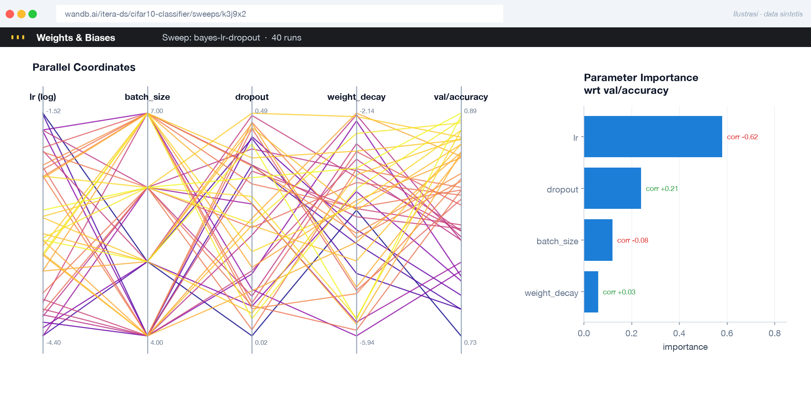
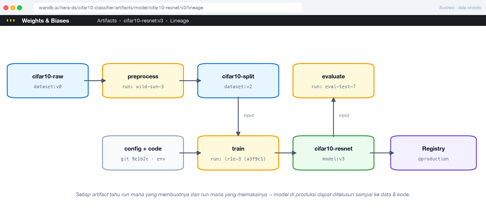

<!-- _class: lead -->
<!-- _paginate: false -->
<!-- _header: '' -->
<!-- _footer: '' -->

# Model Experimentation and Tracking in Machine Learning

## Dari "notebook yang berantakan" menuju eksperimen yang **reproducible** dan terukur — dengan **Weights & Biases**

Ahmad Luky Ramdani · Program Studi Sains Data · ITERA

---

# Agenda

| # | Topik |
|---|-------|
| 1 | **Motivasi** — mengapa ML butuh *experiment tracking* |
| 2 | Posisi experiment tracking dalam **MLOps** |
| 3 | **Anatomi eksperimen** — *run, params, metrics, artifacts* |
| 4 | Merancang eksperimen yang valid di **deep learning** |
| 5 | **Tracking metrics** — apa, kapan, dan bagaimana |
| 6 | **Versioning** — data, kode, dan model |
| 7 | Lanskap **tools** experiment tracking |
| 8 | **Hands-on Weights & Biases** — track, compare, sweep, version |

> Setelah sesi ini kita akan berdiskusi terkait dengan mencatat setiap eksperimen secara otomatis, **membandingkan** puluhan run dalam satu dashboard, dan **menelusuri** model terbaik sampai ke data & kodenya.

---

<!-- _class: divider -->

# 1. Motivasi

Mengapa kita butuh *experiment tracking*?

---

# ML Itu Eksperimental, Bukan Deterministik

Software tradisional: **requirement → kode → hasil yang dapat diprediksi**.
Machine learning: **hipotesis → eksperimen → evaluasi → ulangi** (puluhan hingga ribuan kali).

Satu proyek deep learning biasa melibatkan variasi pada:

- **Arsitektur**: ResNet-18 vs ResNet-50 vs ViT, jumlah layer, dropout
- **Hyperparameter**: learning rate, batch size, optimizer, scheduler, weight decay
- **Data**: versi dataset, split, augmentasi, preprocessing, sampling
- **Environment**: versi library, CUDA, GPU, random seed

> 5 learning rate × 3 batch size × 3 arsitektur × 2 augmentasi = **90 run**. Tanpa pencatatan sistematis, mustahil mengingat mana yang terbaik — apalagi *mengapa*.

---

# Gejala Tim Tanpa Experiment Tracking

- 📁 `model_final.pkl`, `model_final_v2.pkl`, `model_final_FIX_benar.pkl`
- 📓 Notebook dengan cell yang dijalankan tidak berurutan → hasil tidak bisa diulang
- 📊 Spreadsheet manual yang tidak sinkron dengan kode yang sebenarnya dijalankan
- ❓ "Akurasi 94% itu dari data versi mana? Hyperparameter-nya apa? Commit yang mana?"
- 🔁 Eksperimen yang sama diulang karena lupa sudah pernah dicoba
- 🚫 Model di produksi bermasalah, tetapi **tidak bisa ditelusuri asalnya** (*no lineage*)

> **Reproducibility crisis**: banyak hasil ML (riset maupun industri) tidak dapat direproduksi, bahkan oleh pembuatnya sendiri.

---

# Harga yang Dibayar Jika Tidak Melacak

| Masalah | Dampak |
|---------|--------|
| Hasil tidak reproducible | Tidak bisa memverifikasi klaim performa; *rework* |
| Tidak ada perbandingan objektif | Keputusan model berdasarkan "feeling" |
| Pengetahuan hilang saat anggota tim keluar | *Bus factor* = 1 |
| Tidak ada audit trail | Gagal memenuhi regulasi (mis. sektor keuangan, kesehatan, EU AI Act) |
| Eksperimen duplikat | Pemborosan GPU-hours dan biaya cloud |
| Debugging produksi sulit | Tidak tahu data/kode apa yang menghasilkan model |

---

<!-- _class: divider -->

# 2. Experiment Tracking dalam MLOps

---

# MLOps Principles (ml-ops.org)

| Prinsip | Kaitan dengan Experiment Tracking |
|---------|-----------------------------------|
| **Iterative-Incremental Development** | Eksperimen adalah unit iterasi dalam fase *Model Development* |
| **Automation** | Logging otomatis, hyperparameter search otomatis |
| **Continuous X** (CI/CD/CT/CM) | Continuous Training menghasilkan run baru yang harus terlacak |
| **Versioning** | Versi data, kode, dan model untuk setiap run |
| **Experiments Tracking** | Prinsip eksplisit: catat setiap eksperimen beserta konteksnya |
| **Testing** | Validasi model dan data sebelum dipromosikan |
| **Monitoring** | Bandingkan metrik produksi dengan metrik eksperimen |
| **Reproducibility** | Tujuan akhir: hasil identik dari input identik |

---

# Tiga Fase MLOps & Posisi Eksperimen

```
 ┌───────────────────┐    ┌─────────────────────────────┐    ┌───────────────────────┐
 │  1. DESIGN        │    │  2. MODEL DEVELOPMENT       │    │  3. OPERATIONS        │
 │                   │    │     (Experimentation)       │    │                       │
 │ • Requirement     │──> │ • Data engineering          │──> │ • CI/CD pipeline      │
 │ • Use-case        │    │ • ML model engineering      │    │ • Serving / Deploy    │
 │ • Data available? │    │ • Model testing & validasi  │    │ • Monitoring          │
 │                   │    │ >> EXPERIMENT TRACKING <<   │    │ • Triggering retrain  │
 └───────────────────┘    └─────────────────────────────┘    └───────────────────────┘
          ▲                              │                               │
          └──────────── feedback loop <──┴──────── drift / degradasi <──┘
```

Experiment tracking adalah **jembatan** antara *development* dan *operations*: model yang di-deploy harus dapat ditelusuri ke **run eksperimen** yang menghasilkannya.

---

# Mengapa ML Butuh Lebih dari Git?

Software tradisional: **Code** → versi cukup dengan Git.
Machine learning: **Code + Data + Model + Config + Environment**.

```
        Software 1.0                         Software 2.0 (ML)
   ┌──────────────────┐        ┌─────────────────────────────────────────┐
   │       CODE       │        │  CODE   ─┐                              │
   │         │        │        │  DATA   ─┼──>  TRAINING  ──>  MODEL     │
   │         ▼        │        │  PARAMS ─┤    (stokastik)               │
   │      PROGRAM     │        │  ENV    ─┘                              │
   └──────────────────┘        └─────────────────────────────────────────┘
    versi: git commit           versi: git + data hash + run id + model version
```

> Model adalah **fungsi dari data**. Mengubah satu baris data dapat mengubah model, meskipun kode tidak berubah sama sekali.

---

<!-- _class: divider -->

# 3. Anatomi Eksperimen

Istilah dan konsep dasar

---

# Terminologi Kunci

| Istilah | Definisi | Contoh | Di W&B |
|---------|----------|--------|--------|
| **Experiment** | Kumpulan run untuk satu tujuan | `cifar10-classifier` | *Project* |
| **Run** | Satu kali eksekusi kode training | `run_id = a3f9c1` | `wandb.init()` |
| **Parameters** | Input konfigurasi (statis per run) | `lr=0.001`, `batch_size=64` | `run.config` |
| **Metrics** | Hasil terukur, bisa per *step/epoch* | `val_loss`, `f1`, `auc` | `run.log()` |
| **Artifacts** | File keluaran / masukan berversi | model `.pt`, dataset, plot | `wandb.Artifact` |
| **Tags / Metadata** | Label bebas untuk pencarian | `baseline`, `git_commit` | `tags=`, `notes=` |
| **Lineage** | Jejak asal-usul model | data v3 + commit `9e1b` → run X → model v7 | *Lineage graph* |

---

# Apa yang Harus Dilacak? (The "Full Context")

| Kategori | Item | Mengapa penting |
|----------|------|-----------------|
| **Code** | Git commit hash, branch, *diff* yang belum di-commit | Kode yang tepat yang dijalankan |
| **Data** | Versi/hash dataset, split, skema, statistik | Model = f(data) |
| **Hyperparameters** | lr, epochs, optimizer, arsitektur, seed | Menjelaskan perbedaan hasil |
| **Environment** | `requirements.txt`, Docker image, versi CUDA/cuDNN | Library berbeda → hasil berbeda |
| **Metrics** | Training & validation curves, metrik test akhir | Dasar perbandingan |
| **Artifacts** | Bobot model, plot, prediksi, *feature importance* | Bukti & deliverable |
| **System** | GPU/CPU, memori, durasi, biaya | Efisiensi dan kapasitas |
| **Context** | Siapa, kapan, hipotesis, catatan | Pengetahuan tim |

> Mencatat **code, environment, dan system** secara otomatis — kita cukup menambahkan config, metrics, dan artifacts.

---

# Siklus Sebuah Eksperimen



> Eksperimen yang baik dimulai dari **hipotesis yang dapat diuji**, bukan dari "coba-coba saja".

---

<!-- _class: divider -->

# 4. Experimentation in Deep Learning

Merancang eksperimen yang valid

---

# Prinsip Desain Eksperimen

1. **Mulai dari baseline** — model sederhana (mis. logistic regression, ResNet-18 pretrained) sebagai titik acuan.
2. **Ubah satu hal pada satu waktu** — agar efek dapat diatribusikan (*controlled experiment*).
3. **Tetapkan metrik utama sebelum mulai** — hindari *metric shopping* setelah melihat hasil.
4. **Kunci data split** — train / validation / test tetap dan berversi; **test set hanya disentuh di akhir**.
5. **Kendalikan keacakan** — set seed; jalankan beberapa seed untuk mengukur variansi.
6. **Catat hipotesis & kesimpulan** — termasuk eksperimen yang **gagal** (*negative results* juga pengetahuan).

---

<!-- _class: small -->

# Sumber Non-Determinisme di Deep Learning

| Sumber | Contoh | Mitigasi |
|--------|--------|----------|
| Inisialisasi bobot | Random init | `torch.manual_seed(42)` |
| Data shuffling | `DataLoader(shuffle=True)` | Seed + `worker_init_fn`, `generator` |
| Augmentasi acak | RandomCrop, Mixup | Seed pada library augmentasi |
| Dropout | Mask acak | Seed global |
| Operasi GPU | cuDNN autotune, atomic add | `cudnn.deterministic=True`, `torch.use_deterministic_algorithms(True)` |
| Hardware/library | Versi CUDA berbeda | Lock environment (Docker) |

```python
import random, numpy as np, torch
def set_seed(seed: int = 42):
    random.seed(seed); np.random.seed(seed)
    torch.manual_seed(seed); torch.cuda.manual_seed_all(seed)
    torch.backends.cudnn.deterministic = True
    torch.backends.cudnn.benchmark = False
```

---

# Variansi: Satu Run Tidak Cukup

Dua konfigurasi, masing-masing 5 seed:

| Konfigurasi | Seed 1 | Seed 2 | Seed 3 | Seed 4 | Seed 5 | **Mean ± Std** |
|-------------|--------|--------|--------|--------|--------|----------------|
| A (lr=1e-3) | 91.2 | 90.4 | 92.0 | 90.8 | 91.5 | **91.18 ± 0.61** |
| B (lr=3e-4) | 92.1 | 89.7 | 91.0 | 92.4 | 90.3 | **91.10 ± 1.15** |

- Jika hanya melihat seed 4 → "B lebih baik". Ternyata **tidak berbeda signifikan**.
- Laporkan **mean ± std** atau *confidence interval*; gunakan uji statistik (t-test, bootstrap) untuk klaim perbaikan.
- Di W&B: beri `group="lr=1e-3"` pada `wandb.init()` → dashboard otomatis menampilkan **rata-rata ± rentang** per grup.

---

<!-- _class: small -->

# Strategi Hyperparameter Search

| Strategi | Cara kerja | Kelebihan | Kekurangan |
|----------|-----------|-----------|------------|
| **Manual** | Intuisi peneliti | Murah untuk awal | Bias, tidak sistematis |
| **Grid Search** | Semua kombinasi | Lengkap, sederhana | Eksponensial (*curse of dimensionality*) |
| **Random Search** | Sampel acak | Lebih efisien dari grid (Bergstra & Bengio, 2012) | Tidak belajar dari run sebelumnya |
| **Bayesian Opt.** (Optuna/TPE, W&B `bayes`) | Model surrogate memilih titik berikutnya | Efisien sampel | Lebih kompleks |
| **Early-stopping based** (Hyperband/ASHA) | Hentikan run yang jelek lebih awal | Hemat komputasi | Butuh metrik intermediate |

> Setiap trial = **satu run** di tracker. Di W&B, semua trial dikelompokkan otomatis dalam satu **Sweep**.

---

# Ablation Study

Tujuan: mengukur **kontribusi tiap komponen** dengan menghapusnya satu per satu.

| Run | Pretrained | Augmentasi | Label Smoothing | Scheduler | Val F1 |
|-----|:---------:|:----------:|:---------------:|:---------:|-------:|
| Full model | ✅ | ✅ | ✅ | ✅ | **0.884** |
| − Pretrained | ❌ | ✅ | ✅ | ✅ | 0.802 |
| − Augmentasi | ✅ | ❌ | ✅ | ✅ | 0.851 |
| − Label smoothing | ✅ | ✅ | ❌ | ✅ | 0.879 |
| − Scheduler | ✅ | ✅ | ✅ | ❌ | 0.866 |

**Insight**: pretrained weights paling berpengaruh (−8.2 poin); label smoothing hampir tidak berpengaruh → kandidat untuk disederhanakan.

> Tanpa tracker, tabel seperti ini harus dirakit manual dari log yang tercecer. Dengan tracker: cukup **filter + Runs Table**.

---

<!-- _class: divider -->

# 5. Tracking Metrics

Apa, kapan, dan bagaimana mengukur

---

# Jenis Metrik yang Dilacak

| Level | Contoh metrik | Granularitas |
|-------|---------------|--------------|
| **Training dynamics** | train/val loss, accuracy, learning rate, gradient norm | per step / epoch |
| **Model quality (offline)** | Accuracy, Precision, Recall, F1, ROC-AUC, RMSE, mAP, BLEU | per run (akhir) |
| **Per-segment / fairness** | F1 per kelas, per wilayah, per gender | per run |
| **Efisiensi** | Waktu training, latency inferensi, ukuran model, FLOPs | per run |
| **System** | GPU utilization, memori GPU, throughput (samples/s) | time-series |
| **Business (online)** | CTR, konversi, revenue — via A/B test | produksi |

> **Offline metric ≠ online metric.** Model dengan AUC tertinggi belum tentu memberi dampak bisnis terbesar; tracking harus menghubungkan keduanya.

---

# Membaca Learning Curves

```
 loss                                     loss
  │╲                                       │╲
  │ ╲   val                                │ ╲        ╱‾‾ val  ← divergen
  │  ╲___________                          │  ╲______╱
  │   ╲__________ train                    │   ╲________________ train
  │                                        │
  └──────────────────▶ epoch               └──────────────────▶ epoch
     ✅ Good fit                               ⚠️ Overfitting → early stopping /
                                                  regularisasi / data lebih banyak

 loss                                     loss
  │‾‾‾‾‾‾‾‾‾‾‾‾‾ val                       │ ╱╲  ╱╲ ╱╲
  │‾‾‾‾‾‾‾‾‾‾‾‾ train                      │╱  ╲╱  ╲╱  ╲╱  ← osilasi
  │                                        │
  └──────────────────▶ epoch               └──────────────────▶ epoch
     ⚠️ Underfitting → model lebih besar,      ⚠️ LR terlalu besar → turunkan lr,
        training lebih lama                       gunakan scheduler / warmup
```

> Logging **per step/epoch** (bukan hanya nilai akhir) memungkinkan diagnosis seperti ini — dan di tracker, kurva dari banyak run bisa **ditumpuk** untuk dibandingkan.

---

# Memilih Metrik yang Tepat

- **Satu metrik utama (*optimizing metric*)** untuk menentukan "terbaik", mis. `val_f1_macro`.
- **Metrik pembatas (*satisficing metrics*)** sebagai syarat minimum, mis. `latency_p95 < 100 ms`, `model_size < 50 MB`.
- Sesuaikan dengan masalah:
  - Data **imbalanced** → F1, PR-AUC, *balanced accuracy* (bukan accuracy).
  - Biaya FN ≫ FP (deteksi penyakit) → **Recall** / *sensitivity*.
  - Ranking/rekomendasi → NDCG, MAP@k.
- Selalu log **metrik pada data validasi**, dan metrik **test** hanya untuk kandidat final.

> "Kebocoran" test set via pemilihan model berulang = *overfitting to the test set*.

---

<!-- _class: small -->

# Pitfalls dalam Tracking Metrics

| Pitfall | Contoh | Solusi |
|---------|--------|--------|
| **Data leakage** | Normalisasi dihitung pada seluruh data sebelum split | Fit preprocessing hanya pada train; log pipeline sebagai artifact |
| **Cherry-picking** | Melaporkan seed/epoch terbaik saja | Log semua run; laporkan mean ± std |
| **Metrik tidak konsisten** | `f1` macro di run A, weighted di run B | Nama metrik eksplisit: `val/f1_macro` |
| **Split berbeda** | Random split ulang di tiap run | Version & hash data split |
| **Hanya log nilai akhir** | Tidak tahu kapan overfitting mulai | Log per step/epoch |
| **Lupa metrik sistem** | Model akurat tapi 10× lebih lambat | Log latency & resource |

---

<!-- _class: divider -->

# 6. Versioning

Data · Code · Model · Registry

---

# Tiga Pilar Versioning

| Pilar | Tools | Yang di-versi |
|-------|-------|---------------|
| **Code** | Git, GitHub/GitLab | Script training, preprocessing, konfigurasi |
| **Data** | DVC, LakeFS, Delta Lake, **W&B Artifacts** | Dataset mentah, fitur, split |
| **Model** | **W&B Artifacts + Registry**, MLflow Model Registry, DVC | Bobot, metadata, alias/stage |

**Run eksperimen** adalah simpul yang mengikat ketiganya:

```
  git commit 9e1b2c  ─┐
  data  md5:7fa3…    ─┼──>  run_id a3f9c1  ──>  model "fraud-detector" v7  ──>  production
  config.yaml        ─┘      (metrics, artifacts, env)
```

> Dengan *lineage* ini, setiap prediksi di produksi dapat ditelusuri kembali ke data dan kode asalnya.

---

<!-- _class: small -->

# Data Versioning dengan DVC

DVC menyimpan **pointer kecil** (`.dvc` file berisi hash) di Git; data aslinya di remote storage (S3, GCS, GDrive, dsb).

```bash
git init && dvc init
dvc remote add -d storage s3://my-bucket/dvc-store

dvc add data/train.csv              # buat data/train.csv.dvc (berisi md5 hash)
git add data/train.csv.dvc .gitignore
git commit -m "data: train v1"
dvc push                            # upload data ke remote

# ... data diperbarui ...
dvc add data/train.csv && git commit -am "data: train v2" && dvc push

git checkout <commit_v1> && dvc checkout   # kembali ke data v1 secara persis
```

Hubungkan ke experiment tracker: `wandb.init(config={"data_md5": md5, ...})` → setiap run tercatat memakai versi data yang mana. Alternatif tanpa DVC: **W&B Artifacts** (dibahas di bagian 8).

---

# Model Versioning & Model Registry

**Model Registry** = repositori terpusat untuk model dengan versi, metadata, dan status siklus hidup.

| Konsep | Penjelasan |
|--------|------------|
| **Registered model / collection** | Nama logis, mis. `fraud-detector` |
| **Version** | Bertambah otomatis: v0, v1, v2 … — tiap versi menunjuk ke satu run |
| **Alias** | Pointer yang dapat dipindah: `@production`, `@staging`, `@best` |
| **Lineage** | Run, dataset, commit, author |

```
 v5 (lama)    v6  <── @production (melayani produksi)
              v7  <── @staging    (shadow / A-B test)
              v8  (baru diregistrasi, menunggu validasi)
```

**Rollback** = memindahkan alias `@production` kembali ke versi sebelumnya — cepat dan aman.

---

# Semantic Versioning untuk Model (Opsional)

Konvensi yang sering dipakai tim:

| Perubahan | Contoh | Versi |
|-----------|--------|-------|
| **MAJOR** — skema input/output berubah (breaking) | Tambah fitur wajib baru | `2.0.0` |
| **MINOR** — retrain dengan data/arsitektur baru, API sama | Retrain bulanan, ganti backbone | `1.3.0` |
| **PATCH** — perbaikan kecil tanpa perubahan perilaku berarti | Ubah threshold, fix preprocessing bug | `1.3.1` |

Simpan versi semantik sebagai **alias/tag** di registry, berdampingan dengan versi numerik otomatis.

---

# Tingkat Reproducibility

| Level | Yang dijamin | Kebutuhan |
|-------|--------------|-----------|
| **L0 — Tidak ada** | "Works on my machine" | — |
| **L1 — Code** | Kode yang sama | Git commit |
| **L2 — Code + Config** | Hyperparameter sama | Tracker (params) |
| **L3 — + Data** | Data identik | DVC / W&B Artifacts / data hash |
| **L4 — + Environment** | Library & OS identik | Docker / conda lock |
| **L5 — Bit-exact** | Hasil numerik identik | Seed + deterministic ops + hardware sama |

> Target realistis kebanyakan tim: **L4**, dengan L5 untuk kebutuhan audit tertentu.

---

<!-- _class: divider -->

# 7. Tools for Experiment Tracking

---

# Evolusi Cara Tracking

| Generasi | Cara | Masalah |
|----------|------|---------|
| **1. Manual** | Catatan kertas, nama file, spreadsheet | Error-prone, tidak scalable, tidak sinkron dengan kode |
| **2. Logging lokal** | `print`, CSV, TensorBoard per folder | Sulit dibandingkan lintas run & lintas orang |
| **3. Experiment tracker** | MLflow, W&B, Neptune, Comet | Terpusat, dapat di-query, visual, kolaboratif |
| **4. Platform terintegrasi** | Tracker + registry + pipeline + monitoring (Vertex AI, SageMaker, Databricks, Snowflake ML) | Lebih kompleks, potensi *vendor lock-in* |

---

<!-- _class: small -->

# Lanskap Tools

| Tool | Lisensi / Hosting | Kekuatan | Catatan |
|------|-------------------|----------|---------|
| **Weights & Biases** | SaaS (gratis untuk personal/akademik), self-host enterprise | Visualisasi kaya, Sweeps, Artifacts, Registry, Reports | Data di cloud vendor (kecuali self-host) |
| **MLflow** | Open source (Apache 2.0), self-host / managed | Tracking + Models + Registry; framework-agnostic | UI lebih sederhana |
| **Neptune.ai** | SaaS | Metadata store fleksibel, skala besar | Komersial |
| **Comet ML** | SaaS / on-prem | Experiment + production monitoring | Komersial |
| **ClearML** | Open source + SaaS | Tracking + orchestration + data mgmt | Setup lebih berat |
| **DVC / DVC Experiments** | Open source | Git-native, versioning data & eksperimen | Visualisasi via VS Code / Studio |
| **TensorBoard** | Open source | Visualisasi training DL | Bukan tracker lengkap; tanpa registry |
| **Aim** | Open source | Ringan, UI cepat untuk banyak run | Ekosistem lebih kecil |

---

# Kriteria Memilih Tool

1. **Integrasi framework** — PyTorch, TensorFlow/Keras, scikit-learn, XGBoost, HuggingFace?
2. **Hosting & data governance** — boleh data/metadata keluar dari infrastruktur sendiri?
3. **Skalabilitas** — ribuan run, metrik per step, artifact besar?
4. **Kolaborasi** — multi-user, akses kontrol, reports/dashboard?
5. **Model registry & deployment** — terhubung ke CI/CD dan serving?
6. **Biaya & lisensi** — open source vs SaaS per-seat.
7. **API & query** — bisa mencari run secara programatik (mis. "run dengan F1 > 0.9")?

> Untuk belajar & tim kecil: **W&B (gratis, tanpa setup server)** atau **MLflow (self-host)** adalah titik awal yang baik. Hari ini kita praktik dengan **W&B**.

---

<!-- _class: wbdivider -->

# 8. Hands-on: Weights & Biases

Track and compare experiments with models

---

<!-- _class: wb -->

# Apa itu Weights & Biases (W&B)?

Platform *experiment tracking* & *model management*: cukup tambahkan beberapa baris ke skrip training, semua run tersimpan di **satu dashboard**.



**Experiments** (log & bandingkan run) · **Sweeps** (hyperparameter search) · **Artifacts & Registry** (versioning + lineage) · **Reports** (berbagi hasil)

---

<!-- _class: wb -->

# Setup dalam 3 Langkah

```bash
# 1. Install
pip install wandb

# 2. Login — buat akun gratis di https://wandb.ai, ambil API key di https://wandb.ai/authorize
wandb login

# 3. (Opsional) tanpa internet / tanpa akun: simpan lokal, sinkronkan nanti
export WANDB_MODE=offline          # Windows: set WANDB_MODE=offline
wandb sync wandb/offline-run-*     # upload saat sudah online
```

Di Google Colab / Kaggle:

```python
!pip install -q wandb
import wandb
wandb.login()        # akan meminta API key
```

> Konsep organisasi: **Entity** (user/tim) → **Project** (= experiment) → **Run**.

---

<!-- _class: wb small -->

# Run Pertama: 5 Baris yang Mengubah Segalanya

```python
import wandb

config = {"lr": 1e-3, "batch_size": 64, "epochs": 30, "arch": "resnet18", "dropout": 0.2}

run = wandb.init(                       # 1. mulai run baru
    project="cifar10-classifier",       #    = nama eksperimen
    config=config,                      # 2. catat hyperparameter
    tags=["baseline"], notes="ResNet-18 pretrained, augmentasi standar",
)

for epoch in range(run.config.epochs):
    train_loss = train_one_epoch(model, run.config.lr)
    val_loss, val_acc = evaluate(model)
    run.log({"epoch": epoch, "train/loss": train_loss,    # 3. log metrik per epoch
             "val/loss": val_loss, "val/accuracy": val_acc})

run.summary["best_val_accuracy"] = best_acc              # 4. ringkasan (kolom di tabel)
run.finish()                                             # 5. selesai
```

Yang **otomatis** tercatat: git commit & diff, `requirements.txt`, OS/Python, CPU/GPU/memori, durasi, console log.

---

<!-- _class: wb -->

# Workspace: Semua Run dalam Satu Layar



*Ilustrasi tampilan Workspace W&B (data sintetis). Setiap warna = satu run; grafik dibuat otomatis dari kunci di `run.log()`.*

---

<!-- _class: wb small -->

# Membaca Workspace: Apa yang Terlihat?

### Dari ilustrasi sebelumnya
- 🟠 `lr1e-3` — konvergen paling cepat, **val/accuracy tertinggi**
- 🟢 `lr1e-2` — kurva **berosilasi** → learning rate terlalu besar
- 🟡 `noaug` — train loss terendah, tetapi **val/loss naik** setelah epoch ~10 → *overfitting* tanpa augmentasi
- 🟣 `resnet50` — lebih lambat, hasil mirip → tidak sebanding dengan biaya 2× waktu

### Fitur yang sering dipakai
**Group by** `config.arch` (rata-rata ± rentang) · **Filter** `config.lr < 0.005` · **Smoothing** kurva berisik · **x-axis** bebas (step/epoch/waktu) · sembunyikan run · tab **System** (GPU, memori)

> Diagnosis yang tadi dibahas di slide *learning curves* kini bisa dilakukan untuk **puluhan run sekaligus**.

---

<!-- _class: wb -->

# Runs Table: Membandingkan Secara Tabular



*Ilustrasi Runs Table (data sintetis): setiap kolom berasal dari `config` dan `summary`. Urutkan, filter, lalu pilih beberapa run → panel perbandingan.*

---

<!-- _class: wb small -->

# Integrasi dengan Framework Populer

| Framework | Cara integrasi |
|-----------|----------------|
| **PyTorch** | `run.watch(model, log="all", log_freq=100)` + `run.log({...})` di loop training |
| **Keras / TensorFlow** | `model.fit(..., callbacks=[WandbMetricsLogger(), WandbModelCheckpoint("m.keras")])` |
| **HuggingFace Transformers** | `TrainingArguments(..., report_to="wandb", run_name="bert-lr2e-5")` |
| **PyTorch Lightning** | `Trainer(logger=WandbLogger(project="p", log_model=True))` |
| **XGBoost / LightGBM** | `wandb.integration.xgboost.WandbCallback()` / `wandb.integration.lightgbm.wandb_callback()` |
| **scikit-learn** | `run.log()` manual + `wandb.sklearn.plot_classifier(...)` |

```python
from wandb.integration.keras import WandbMetricsLogger, WandbModelCheckpoint
from lightning.pytorch.loggers import WandbLogger
```

> Integrasi bawaan berarti **tanpa mengubah loop training** — cukup tambahkan callback/logger.

---

<!-- _class: wb small -->

# Logging Lebih dari Angka

```python
# Confusion matrix interaktif
run.log({"val/confusion_matrix": wandb.plot.confusion_matrix(
    y_true=y_val, preds=y_pred, class_names=class_names)})

# Tabel prediksi — lihat contoh yang salah klasifikasi
table = wandb.Table(columns=["image", "label", "prediksi", "confidence"])
for img, y, p, c in wrong_samples:
    table.add_data(wandb.Image(img), y, p, c)
run.log({"val/salah_prediksi": table})

# Gambar, audio, histogram, plot matplotlib
run.log({"sample": wandb.Image(img, caption="epoch 5"),
         "weights": wandb.Histogram(model.fc.weight.detach().cpu()),
         "roc": wandb.plot.roc_curve(y_val, y_proba)})
```

> **Error analysis** jadi jauh lebih mudah: filter Table untuk `label != prediksi`, urutkan berdasarkan confidence, lalu cari pola kesalahan.

---

<!-- _class: wb small -->

# Sweeps: Hyperparameter Search Otomatis

```python
sweep_config = {
    "method": "bayes",                                  # grid | random | bayes
    "metric": {"name": "val/accuracy", "goal": "maximize"},
    "parameters": {
        "lr":         {"distribution": "log_uniform_values", "min": 1e-4, "max": 1e-1},
        "batch_size": {"values": [16, 32, 64, 128]},
        "dropout":    {"distribution": "uniform", "min": 0.0, "max": 0.5},
    },
    "early_terminate": {"type": "hyperband", "min_iter": 3},   # hentikan run yang jelek
}

def train():
    with wandb.init() as run:                 # config diisi otomatis oleh sweep controller
        model = build_model(run.config.dropout)
        for epoch in range(20):
            run.log({"val/accuracy": fit_one_epoch(model, run.config.lr, run.config.batch_size)})

sweep_id = wandb.sweep(sweep_config, project="cifar10-classifier")
wandb.agent(sweep_id, function=train, count=40)     # bisa dijalankan paralel di banyak mesin/GPU
```

---

<!-- _class: wb -->

# Hasil Sweep: Parallel Coordinates & Parameter Importance



*Ilustrasi (data sintetis). Kiri: setiap garis = satu run, warna = val/accuracy. Kanan: hyperparameter mana yang paling memengaruhi metrik.*

**Insight contoh**: `lr` paling berpengaruh (korelasi negatif → lr kecil lebih baik); `weight_decay` hampir tidak berpengaruh → tidak perlu di-tuning lagi.

---

<!-- _class: wb small -->

# Artifacts: Versioning Dataset & Model

```python
# --- Run 1: unggah dataset sebagai artifact ---
with wandb.init(project="cifar10-classifier", job_type="upload-data") as run:
    data = wandb.Artifact("cifar10-split", type="dataset",
                          metadata={"n_train": 40000, "n_val": 10000, "seed": 0})
    data.add_dir("data/processed/")
    run.log_artifact(data)                    # isi berubah → versi baru (v0, v1, ...)

# --- Run 2: training memakai dataset versi tertentu, simpan model ---
with wandb.init(project="cifar10-classifier", job_type="train", config=cfg) as run:
    data_dir = run.use_artifact("cifar10-split:v2").download()   # tercatat sebagai INPUT
    model = train(data_dir, run.config)
    torch.save(model.state_dict(), "model.pt")

    model_art = wandb.Artifact("cifar10-resnet", type="model",
                               metadata={"val_accuracy": 0.89, **dict(run.config)})
    model_art.add_file("model.pt")
    run.log_artifact(model_art, aliases=["best"])               # tercatat sebagai OUTPUT
```

W&B menyimpan **hash isi** (deduplikasi): file yang tidak berubah tidak diunggah ulang.

---

<!-- _class: wb -->

# Lineage: Dari Data Mentah Sampai Produksi



*Ilustrasi Lineage graph W&B (data sintetis). Terbentuk otomatis dari `use_artifact()` (input) dan `log_artifact()` (output).*

---

<!-- _class: wb small -->

# Registry: Promosi Model ke Produksi

```python
# Hubungkan versi model terbaik ke W&B Registry (koleksi "cifar10-classifier")
with wandb.init(project="cifar10-classifier", job_type="promote") as run:
    art = run.use_artifact("cifar10-resnet:best")
    run.link_artifact(art, target_path="wandb-registry-model/cifar10-classifier")
```

```python
# Di sisi serving / CI: selalu ambil model yang beralias @production
with wandb.init(project="cifar10-classifier", job_type="inference") as run:
    path = run.use_artifact(
        "wandb-registry-model/cifar10-classifier:production").download()
```

- Alias (`production`, `staging`) dipindah lewat UI atau API → **rollback** cukup memindah alias.
- **Automations**: picu CI/CD (webhook / GitHub Action) saat alias baru ditambahkan.
- Setiap versi di registry tetap terhubung ke **run, dataset, dan commit** asalnya.

---

<!-- _class: wb small -->

# Membandingkan Run Secara Programatik (Public API)

```python
import wandb
api = wandb.Api()

runs = api.runs(
    "itera-ds/cifar10-classifier",
    filters={"config.arch": "resnet18", "summary_metrics.val/accuracy": {"$gt": 0.85}},
    order="-summary_metrics.val/accuracy",
)

import pandas as pd
df = pd.DataFrame([{"name": r.name, **r.config,
                    "val_acc": r.summary.get("val/accuracy")} for r in runs])
print(df.head())

best = runs[0]
history = best.history(keys=["val/loss", "val/accuracy"])   # kurva lengkap sebagai DataFrame
```

Berguna untuk: analisis statistik (mean ± std antar seed), membuat tabel untuk laporan/paper, dan **quality gate** di CI ("tolak model jika val_acc < baseline").

---

<!-- _class: wb -->

# Reports: Berbagi Hasil Eksperimen

**Report** = dokumen interaktif yang menggabungkan teks, grafik live, dan tabel run.

- Tulis **hipotesis → setup → hasil → kesimpulan** di satu tempat
- Grafik di report terhubung ke run asli → bukan screenshot yang usang
- Bagikan via link ke dosen/tim, beri komentar, ekspor ke PDF/LaTeX
- Cocok untuk: **laporan tugas, log-book riset, lampiran skripsi**, *weekly sync* tim

> Kebiasaan baik: setiap eksperimen penting diakhiri dengan **satu report** — termasuk eksperimen yang gagal.

---

<!-- _class: wb small -->

# Praktik: `wandb_demo.py`

Skrip siap jalan (CPU, ~1 menit): dataset **digits** + `MLPClassifier`, lengkap dengan log per epoch, confusion matrix, tabel prediksi salah, artifact model, dan sweep.

```bash
pip install wandb scikit-learn
wandb login

python wandb_demo.py                          # run 1 (default: lr=1e-3, hidden=64)
python wandb_demo.py --lr 0.01                # run 2: lr lebih besar
python wandb_demo.py --hidden 16 --alpha 0.01 # run 3: model kecil + regularisasi kuat
python wandb_demo.py --sweep --count 15       # sweep Bayesian 15 trial
```

**Tugas mini** di dashboard `digits-experiment-tracking`:
1. Run mana dengan `best_val_accuracy` tertinggi? Apa konfigurasinya?
2. Adakah run yang *overfitting*? Tunjukkan dari kurva `train/loss` vs `val/loss`.
3. Dari sweep: hyperparameter mana yang paling penting (*Parameter Importance*)?
4. Angka berapa yang paling sering salah diprediksi (lihat tabel `val/salah_prediksi`)?

---

<!-- _class: small -->

# Best Practices Experiment Tracking

| ✅ Lakukan | ❌ Hindari |
|-----------|-----------|
| Satu **project** per pertanyaan/tujuan | Semua run dalam satu project "test" |
| Nama metrik konsisten & berprefiks: `train/loss`, `val/f1_macro` | `loss`, `loss2`, `acc_final` |
| **Semua** hyperparameter masuk `config` (termasuk seed & versi data) | Hardcode nilai di tengah kode |
| `tags`, `group`, `notes` berisi hipotesis | Run tanpa konteks |
| Commit kode sebelum menjalankan run | Menjalankan kode yang belum di-commit |
| Log dataset & model sebagai **Artifact** | `model_final_v2_fix.pkl` di Google Drive |
| Jalankan beberapa seed untuk klaim penting | Menyimpulkan dari satu run |
| Simpan API key di environment variable | API key di notebook yang di-push ke GitHub |

---

# Ringkasan

1. ML bersifat **eksperimental** → tanpa tracking, hasil tidak bisa dipercaya dan diulang.
2. Lacak **full context**: code, data, config, environment, metrics, artifacts.
3. Eksperimen yang valid: **baseline, ubah satu hal, kunci split, beberapa seed**.
4. Log metrik **per epoch** untuk mendiagnosis *overfitting*, *underfitting*, dan lr.
5. Versioning **data + kode + model** → *lineage* dari produksi sampai data mentah.
6. **Weights & Biases**: `init` → `config` → `log` → **compare** → **sweep** → **artifact** → **registry**.

> *"If you can't reproduce it, you can't trust it — and you can't ship it."*

---

<!-- _class: small -->

# Referensi

1. ml-ops.org — *MLOps Principles*. https://ml-ops.org/content/mlops-principles
2. Weights & Biases Documentation — *Experiments*. https://docs.wandb.ai/guides/track/
3. Weights & Biases Documentation — *Sweeps*. https://docs.wandb.ai/guides/sweeps/
4. Weights & Biases Documentation — *Artifacts* & *Registry*. https://docs.wandb.ai/guides/artifacts/ · https://docs.wandb.ai/guides/registry/
5. S. Soni — *A Practical Guide to Experiment Tracking in MLOps*, Medium. https://medium.com/@sachinsoni600517/a-practical-guide-to-experiment-tracking-in-mlops-14777cfc3724
6. Diametral — *MLOps: Why Data and Model Experiment Tracking is Important*. https://diametral.com/en/articles/mlops-why-data-and-model-experiment-tracking-is-important
7. Snowflake — *Experiment Tracking*. https://www.snowflake.com/en/artificial-intelligence/machine-learning/model-evaluation/experiment-tracking/
8. trail-ml — *First Steps in Experiment Tracking*. https://www.trail-ml.com/blog/first-steps-experiment-tracking
9. Google Cloud — *MLOps: Continuous delivery and automation pipelines in machine learning*.
10. Bergstra, J. & Bengio, Y. (2012). *Random Search for Hyper-Parameter Optimization*. JMLR 13.

---

<!-- _class: lead -->
<!-- _paginate: false -->
<!-- _header: '' -->
<!-- _footer: '' -->

# Terima Kasih

### Diskusi & Tanya Jawab

> *"If you can't reproduce it, you can't trust it — and you can't ship it."*

---

# Form Pengumpulan Tugas
### Link Google Form
https://forms.gle/CKYGBesLJgCbwjJt7
