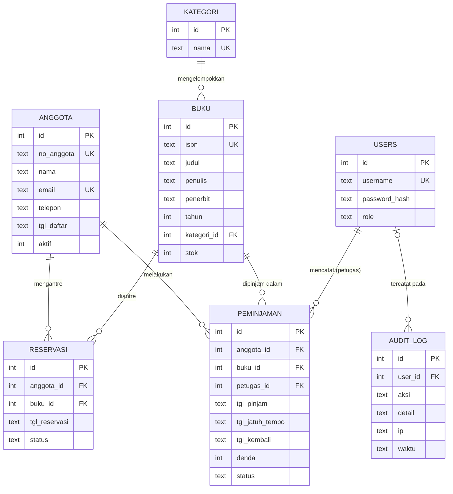

# Rancangan Entitas & Keterkaitan (ERD) — SIPERPUS

> Unit **J.620100.007.01** – Mengimplementasikan Rancangan Entitas dan Keterkaitan Antar Entitas
> Implementasi fisik: `app/migrations/001_skema_awal.sql`, `app/migrations/002_reservasi_dan_audit.sql`

## 1. Diagram

## 2. Kamus entitas & kardinalitas

| Relasi | Kardinalitas | Implementasi | Aturan referensial |
|---|---|---|---|
| kategori – buku | 1 : N | `buku.kategori_id → kategori.id` | `ON DELETE RESTRICT` (kategori yang masih dipakai tidak bisa dihapus) |
| anggota – buku (meminjam) | **M : N** | entitas asosiatif `peminjaman` | `ON DELETE RESTRICT` (riwayat transaksi dilindungi) |
| users – peminjaman | 1 : N | `peminjaman.petugas_id` | jejak siapa yang mencatat |
| anggota – buku (reservasi) | M : N | entitas asosiatif `reservasi` | `ON DELETE CASCADE` |
| users – audit_log | 1 : N (opsional) | `audit_log.user_id` | `ON DELETE SET NULL` (log tetap ada) |

## 3. Normalisasi

| Bentuk | Pemeriksaan pada SIPERPUS |
|---|---|
| **1NF** | Semua kolom atomik; tidak ada kolom berulang seperti `buku1, buku2` pada anggota — dipindah ke tabel `peminjaman`. |
| **2NF** | Setiap tabel memakai PK tunggal (surrogate key `id`), jadi tidak ada ketergantungan parsial. |
| **3NF** | Nama kategori tidak disimpan di `buku` (dipisah ke `kategori`); data anggota/buku tidak diduplikasi di `peminjaman`; nilai turunan seperti `hari_terlambat` dihitung di VIEW, tidak disimpan. |

Pengecualian yang disengaja: `peminjaman.denda` disimpan sebagai **snapshot** saat pengembalian, sehingga perubahan tarif denda di masa depan tidak mengubah histori.

## 4. Integritas data di level database

- `PRIMARY KEY`, `UNIQUE` (isbn, no_anggota, email, username)
- `CHECK` (stok ≥ 0, tahun 1900–2100, role, status, panjang ISBN = 13, jatuh tempo ≥ tanggal pinjam)
- `FOREIGN KEY` + `PRAGMA foreign_keys = ON` di setiap koneksi (`app/db.py`)
- Trigger `trg_cek_stok`, `trg_kurangi_stok`, `trg_tambah_stok` menjaga konsistensi stok
- Partial unique index `uq_reservasi_aktif`: satu reservasi aktif per anggota per buku
