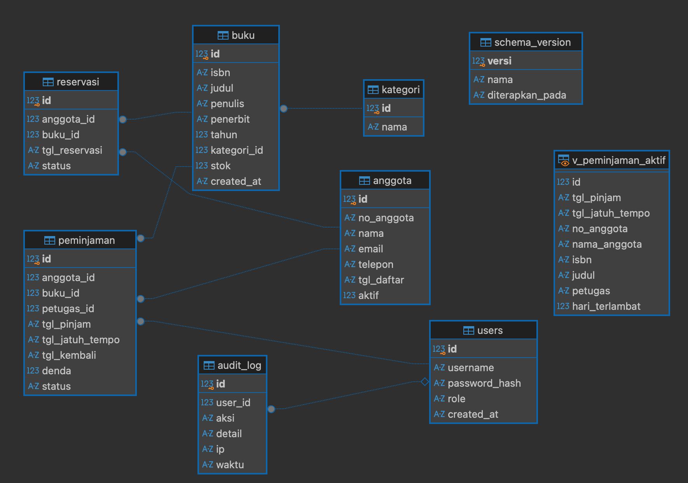

<!-- _class: lead -->
<!-- _paginate: false -->
<!-- _header: '' -->

# Sertifikasi Pemrograman Basis Data
## Sistem Informasi Perpustakaan berbasis Web
### Portofolio Uji Kompetensi — Database Programmer

**Ahmad Luky Ramdani**
Flask 3 · SQLite · Python 3.11 · 14 Unit Kompetensi

---

<!-- _class: two -->

# Agenda
1. Latar belakang & ruang lingkup
2. Arsitektur aplikasi
3. **Perencanaan** — Tools, Library
4. **Desain data** — ERD, SQL, Struktur Data
5. **Implementasi** — Akses DB, Algoritma
6. **Kualitas** — Debugging, Code Review
7. **Operasional** — Environment, Monitoring
8. **Perubahan** — Analisis Dampak, Pembaharuan
9. **Keamanan Informasi**
10. Demo & kesimpulan

---

# Latar Belakang & Ruang Lingkup

> Perpustakaan kampus masih mencatat peminjaman di buku besar → stok tidak akurat, denda dihitung manual, tidak ada laporan.

| Kebutuhan | Fitur SIPERPUS |
|---|---|
| Kelola koleksi | CRUD buku + validasi ISBN-13, kategori, pencarian |
| Sirkulasi | Pinjam / kembali, denda otomatis, batas 3 buku aktif |
| Stok habis | Reservasi dengan antrian FIFO |
| Pengambilan keputusan | Laporan buku populer, denda, tren bulanan |
| Akuntabilitas | Login berbasis role, audit log |
| Operasional | Monitor resource, health-check, migrasi berversi |

---

# Arsitektur Aplikasi

```
 Browser ──HTTP──▶ Nginx (HTTPS) ──▶ gunicorn ──▶ Flask app (create_app)
                                                   │
       ┌───────────────┬──────────────┬────────────┼──────────────┐
   security.py    monitoring.py   views/ (4 blueprint)      config.py
   auth·CSRF·      timing·         auth · katalog ·         dev/staging/
   headers·audit   slow query      sirkulasi · admin        prod/testing
                                         │
                              repository.py  ◀── algorithms.py
                              (semua SQL)        (struktur data & algoritma)
                                         │
                                     db.py  (koneksi · parameter binding · transaksi)
                                         │
                               SQLite ◀── migrate.py + migrations/NNN_*.sql
```

**Pemisahan lapisan**: view tidak menulis SQL;

---

# Peta Unit Kompetensi → Bukti

| No | Kode | Unit | Bukti di project |
|---|---|---|---|
| 1 | J.620100.001.01 | Menganalisis Tools | Tabel perbandingan tools |
| 2 | J.620100.003.01 | Identifikasi Library/Framework | `requirements.txt` |
| 3 | J.620100.004.02 | Menggunakan Struktur Data | `algorithms.py`, `monitoring.py` |
| 4 | J.620100.007.01 | Rancangan Entitas & Keterkaitan | `docs/ERD.md`, migrasi 001 |
| 5 | J.620100.020.02 | Menggunakan SQL | `migrations/`, `repository.py` |
| 6 | J.620100.021.02 | Menerapkan Akses Basis Data | `db.py` |
| 7 | J.620100.022.02 | Algoritma Pemrograman | `algorithms.py` + test |
| 8 | J.620100.025.02 | Melakukan Debugging | `docs/LOG_DEBUGGING.md` |
| 9 | J.620100.032.01 | Menerapkan Code Review | `docs/CODE_REVIEW.md` |
| 10 | J.620100.042.01 | Konfigurasi per Environment | `config.py`, `.env` |
| 11 | J.620100.043.01 | Analisis Dampak Perubahan | `docs/ANALISIS_DAMPAK.md` |
| 12 | J.620100.045.01 | Pemantauan Resource | `/admin/monitor`, `/health` |
| 13 | J.620100.047.01 | Pembaharuan Perangkat Lunak | `migrate.py`, `CHANGELOG.md` |
| 14 | J.62090.011.01 | Standar Keamanan Informasi | `security.py` |

---

<!-- _class: divider -->

# Bagian 1 — Perencanaan
Menganalisis Tools · Identifikasi Library & Framework

---

###### J.620100.001.01 · Menganalisis Tools

# Analisis & Pemilihan Tools

| Kebutuhan | Alternatif | Dipilih | Alasan |
|---|---|---|---|
| Framework web | Django · **Flask** · FastAPI | **Flask 3** | Ringan, SQL ditulis langsung (tidak terkunci ORM) |
| DBMS | **SQLite** · MySQL · PostgreSQL | **SQLite** | Tanpa server, FK/trigger/view/partial index, beban tulis rendah |
| DB client | DB Browser · DBeaver · CLI | `sqlite3` CLI + DBeaver | `EXPLAIN QUERY PLAN`, inspeksi skema |
| IDE | VS Code · PyCharm | VS Code | Debugger Flask terintegrasi |
| Test | unittest · **pytest** | pytest + cov | Fixture & parametrisasi |
| Server prod | flask run · **gunicorn** · uWSGI | gunicorn + Nginx | `flask run` bukan untuk production |
| VCS | Git | Git + PR | Basis code review |

> **Kriteria:** kesesuaian kebutuhan, tim, biaya (open-source), dukungan komunitas, kemudahan deployment.

---

<!-- _class: two small -->

###### J.620100.003.01 · Identifikasi Library, Komponen, Framework

# Library & Komponen
```text
# requirements.txt  (versi DIKUNCI)
Flask==3.0.3        # routing, session, Jinja2
Werkzeug==3.0.6     # WSGI + hash password
gunicorn==23.0.0    # WSGI server prod
psutil==6.1.0       # CPU & memori
pytest==8.3.3       # test
pytest-cov==5.0.0   # coverage
flake8==7.1.1       # lint / code review
pip-audit==2.7.3    # scan CVE
```
**Komponen standar Python**
- `sqlite3` — driver DB-API 2.0
- `collections.deque`, `heapq`, `dataclasses`
- `hmac`, `secrets` — CSRF
- `logging.handlers.RotatingFileHandler`

**Pertimbangan**
- Lisensi: BSD / MIT / Apache → aman komersial
- Kompatibilitas Python 3.11 ✅
- Kerentanan: `pip-audit` bersih
- `psutil` **opsional** → ada fallback

---

<!-- _class: divider -->

# Bagian 2 — Desain Data
Rancangan Entitas · SQL · Struktur Data

---

###### J.620100.007.01 · Mengimplementasikan Rancangan Entitas & Keterkaitan

# ERD SIPERPUS

```
  KATEGORI 1───N BUKU 1───N PEMINJAMAN N───1 ANGGOTA
                   │            │                │
                   │            N                │
                   │          USERS(petugas)     │
                   └──1───N  RESERVASI  N───1────┘
                            USERS 1───N AUDIT_LOG
```

| Relasi | Kardinalitas | Implementasi | Aturan |
|---|---|---|---|
| kategori – buku | 1 : N | FK `buku.kategori_id` | `ON DELETE RESTRICT` |
| anggota – buku | **M : N** | entitas asosiatif `peminjaman` | riwayat dilindungi |
| anggota – buku (antre) | M : N | entitas asosiatif `reservasi` | `ON DELETE CASCADE` |
| users – audit_log | 1 : N | FK opsional | `ON DELETE SET NULL` |

**Normalisasi 3NF**: kategori dipisah, tidak ada duplikasi data anggota/buku di transaksi, `hari_terlambat` dihitung di VIEW.

---
# ERD


---

###### J.620100.007.01 · J.620100.020.02 — DDL & Integritas

# Skema Fisik (DDL)

```sql
CREATE TABLE peminjaman (
    id              INTEGER PRIMARY KEY AUTOINCREMENT,
    anggota_id      INTEGER NOT NULL REFERENCES anggota(id) ON DELETE RESTRICT,
    buku_id         INTEGER NOT NULL REFERENCES buku(id)    ON DELETE RESTRICT,
    petugas_id      INTEGER NOT NULL REFERENCES users(id),
    tgl_pinjam      TEXT    NOT NULL DEFAULT (date('now')),
    tgl_jatuh_tempo TEXT    NOT NULL,
    denda           INTEGER NOT NULL DEFAULT 0 CHECK (denda >= 0),
    status          TEXT    NOT NULL DEFAULT 'dipinjam' CHECK (status IN ('dipinjam','kembali')),
    CHECK (tgl_jatuh_tempo >= tgl_pinjam)
);
CREATE INDEX idx_peminjaman_anggota ON peminjaman(anggota_id);

CREATE TRIGGER trg_cek_stok BEFORE INSERT ON peminjaman
BEGIN
    SELECT RAISE(ABORT, 'Stok buku habis')
    WHERE (SELECT stok FROM buku WHERE id = NEW.buku_id) < 1;
END;

-- satu reservasi aktif per anggota per buku (partial unique index)
CREATE UNIQUE INDEX uq_reservasi_aktif ON reservasi(anggota_id, buku_id) WHERE status = 'menunggu';
```

---

<!-- _class: two -->

###### J.620100.020.02 · Menggunakan SQL

# Query: JOIN, Agregat, Subquery, View
```sql
-- GROUP BY + HAVING
SELECT a.nama, COUNT(p.id) kali,
       SUM(p.denda) total_denda
FROM anggota a
JOIN peminjaman p ON p.anggota_id = a.id
WHERE p.denda > 0
GROUP BY a.id
HAVING SUM(p.denda) >= ?
ORDER BY total_denda DESC;

-- Subquery NOT EXISTS
SELECT isbn, judul FROM buku b
WHERE NOT EXISTS (
  SELECT 1 FROM peminjaman p
  WHERE p.buku_id = b.id);
```
```sql
-- VIEW: JOIN 4 tabel + fungsi tanggal
CREATE VIEW v_peminjaman_aktif AS
SELECT p.id, a.nama, b.judul,
  u.username AS petugas,
  CAST(julianday('now')
     - julianday(p.tgl_jatuh_tempo)
     AS INTEGER) AS hari_terlambat
FROM peminjaman p
JOIN anggota a ON a.id = p.anggota_id
JOIN buku    b ON b.id = p.buku_id
JOIN users   u ON u.id = p.petugas_id
WHERE p.status = 'dipinjam';

-- Tren bulanan
SELECT strftime('%Y-%m', tgl_pinjam) bulan,
       COUNT(*) FROM peminjaman
GROUP BY bulan;
```
**Optimasi**: `EXPLAIN QUERY PLAN` → `SEARCH peminjaman USING INDEX idx_peminjaman_anggota`

---

###### J.620100.004.02 · Menggunakan Struktur Data

# Struktur Data yang Dipakai

| Struktur | Di mana | Kenapa |
|---|---|---|
| `deque` FIFO | `AntrianReservasi` | enqueue / dequeue **O(1)** |
| `deque(maxlen=1000)` | metrik request & query | *ring buffer* — memori tetap |
| `dict` → `deque` | `_login_gagal[ip]` | sliding window rate limit |
| `dict` → `set` | `rekomendasi()` | irisan himpunan peminjam |
| Heap | `top_n()` (`heapq.nlargest`) | top-N **O(n log k)** |
| `list` terurut | `binary_search()` | cari **O(log n)** |
| `dict` lookup | `URUTAN_BUKU` | whitelist ORDER BY (keamanan) |
| `dataclass` | `AntrianReservasi` | struktur bertipe |
| `sqlite3.Row` | `db.py` | akses kolom `row["judul"]` |

```python
@dataclass
class AntrianReservasi:
    buku_id: int
    _antrian: deque = field(default_factory=deque)
    def tambah(self, anggota_id): self._antrian.append(anggota_id); return len(self._antrian)
    def layani(self):             return self._antrian.popleft() if self._antrian else None
```

---

<!-- _class: divider -->

# Bagian 3 — Implementasi
Akses Basis Data · Algoritma Pemrograman

---

<!-- _class: two -->

###### J.620100.021.02 · Menerapkan Akses Basis Data

# Lapisan Akses Basis Data — `app/db.py`
```python
def get_db():                 # 1 koneksi / request
    if "db" not in g:
        g.db = connect(cfg["DATABASE"])
    return g.db               # ditutup di teardown

def connect(path):
    conn = sqlite3.connect(path,
              isolation_level=None)
    conn.row_factory = sqlite3.Row
    conn.execute("PRAGMA foreign_keys = ON")
    return conn

@contextmanager
def transaction():
    conn = get_db()
    conn.execute("BEGIN IMMEDIATE")
    try:
        yield conn
        conn.execute("COMMIT")
    except Exception:
        conn.execute("ROLLBACK"); raise
```
```python
# Pemakaian: pinjam buku (atomik)
with transaction():
    n = query("""SELECT COUNT(*) n FROM peminjaman
                 WHERE anggota_id = ?
                 AND status='dipinjam'""",
              (anggota_id,), one=True)["n"]
    if n >= MAKS_PINJAM_AKTIF:
        raise AturanBisnisError(...)  # ROLLBACK
    try:
        execute("INSERT INTO peminjaman ...",
                (anggota_id, buku_id, ...))
    except sqlite3.IntegrityError:    # trigger
        raise AturanBisnisError("Stok habis")
```

✅ Parameter binding `?` / `:nama`
✅ Transaksi eksplisit + rollback
✅ Error DB → pesan bisnis

---

<!-- _class: two small -->

###### J.620100.022.02 · Mengimplementasikan Algoritma Pemrograman

# Algoritma & Kompleksitas
```python
def binary_search(data, target):
    """Invarian: jika target ada, indeksnya
       di [kiri, kanan].
       Varian: (kanan-kiri) mengecil -> berhenti."""
    kiri, kanan = 0, len(data) - 1
    while kiri <= kanan:
        tengah = (kiri + kanan) // 2
        if data[tengah] == target: return tengah
        if data[tengah] < target: kiri = tengah + 1
        else:                     kanan = tengah - 1
    return -1

def hitung_denda(tempo, kembali, tarif, maks):
    terlambat = (kembali - tempo).days
    if terlambat <= 0:
        return 0
    return min(terlambat * tarif, maks)
```
| Algoritma | Kompleksitas |
|---|---|
| Checksum ISBN-13 | O(n) |
| Hitung denda | O(1) |
| Binary search | O(log n) |
| Merge sort (stabil) | O(n log n) |
| Top-N heap | O(n log k) |
| Rekomendasi (irisan set) | O(m + b) |
| Antrian FIFO | O(1) |

**15 kasus uji** termasuk kasus batas: list kosong, ISBN 12 digit, ISBN huruf, denda > maksimum, tarif negatif.

---

<!-- _class: divider -->

# Bagian 4 — Kualitas Kode
Debugging · Code Review

---

<!-- _class: small -->

###### J.620100.025.02 · Melakukan Debugging

# Debugging: Problem → Base Problem → Perbaikan
| Bug | Problem | Base Problem | Perbaikan & verifikasi |
|---|---|---|---|
| **BUG-01** | Stok jadi `-1` | *Race condition* check-then-act di luar transaksi | Trigger `trg_cek_stok` + `CHECK(stok>=0)` + `BEGIN IMMEDIATE` · `test_stok_habis_ditolak_dan_rollback` |
| **BUG-02** | Login tanpa token CSRF berhasil | `compare_digest("", "")` → `True` | Token sesi wajib tidak kosong · `test_post_tanpa_csrf_ditolak` |
| **BUG-03** | Test lulus sendiri, gagal bersama | State global `_login_gagal` | Reset di fixture |
| **BUG-04** | Backup pada DB kosong | Tabel `schema_version` dibuat dulu | Backup hanya bila versi sudah ada |
```text
FAILED tests/test_app.py::test_post_tanpa_csrf_ditolak - assert 302 == 400      ← BUG-02 terdeteksi
...
33 passed in 8.27s                                                              ← setelah perbaikan
```

**Tools**: debug mode (dev), logging bertingkat + file berotasi, `breakpoint()`, pytest, `EXPLAIN QUERY PLAN`, slow-query log.

---

<!-- _class: two small -->

###### J.620100.032.01 · Menerapkan Code Review

# Code Review: Proses & Temuan
**Alur**: branch → PR → *gate otomatis* (`flake8`, `pytest`, `pip-audit`) → review checklist → perbaikan → approve → merge

**Checklist**: fungsionalitas · basis data (binding, transaksi, index) · keamanan · keterbacaan · kinerja (N+1) · test · konfigurasi

| # | Temuan | Tingkat |
|---|---|---|
| R1 | SQL injection di ORDER BY | Kritis |
| R2 | f-string di LIKE | Kritis |
| R3 | User enumeration | Tinggi |
| R4 | Open redirect `next` | Sedang |
| R5 | N+1 query | Sedang |
| R6 | Pinjam tidak atomik | Tinggi |
```python
# ❌ SEBELUM — ditolak reviewer
sql = f"""SELECT * FROM buku
  WHERE judul LIKE '%{q}%'
  ORDER BY {urut}"""

# ✅ SESUDAH — disetujui
URUTAN_BUKU = {
  "judul": "b.judul",
  "tahun": "b.tahun DESC", ...}
sql += " ORDER BY " + URUTAN_BUKU.get(
          urut, URUTAN_BUKU["judul"])
query(sql, {"kw": f"%{keyword}%"})
```

---

<!-- _class: divider -->

# Bagian 5 — Operasional
Konfigurasi Environment · Pemantauan Resource

---

<!-- _class: two small -->

###### J.620100.042.01 · Konfigurasi Sesuai Environment

# Development · Staging · Production
```python
class Config:                  # dasar
    SECRET_KEY = os.environ.get("SECRET_KEY", DEFAULT)
    SESSION_COOKIE_HTTPONLY = True
class DevelopmentConfig(Config):
    DEBUG = True;  LOG_LEVEL = "DEBUG"
class StagingConfig(Config):
    DATABASE = ".../perpus_staging.db"
class ProductionConfig(Config):
    LOG_LEVEL = "WARNING"
    SESSION_COOKIE_SECURE = True

# create_app(): fail-safe
if env == "production" and \
   SECRET_KEY == DEFAULT_SECRET:
    raise RuntimeError("SECRET_KEY wajib")
```
| | Dev | Staging | Prod |
|---|---|---|---|
| DEBUG | ✅ | ❌ | ❌ |
| Log | DEBUG | INFO | WARNING |
| DB | dev.db | staging.db | `DATABASE_PATH` |
| Cookie Secure/HSTS | ❌ | ❌ | ✅ |
| Server | flask run | gunicorn -w2 | gunicorn -w4 + Nginx |

Dipilih via `APP_ENV`; rahasia dari `.env` (di-*gitignore*, ada `.env.example`).
Diverifikasi: `test_production_menolak_secret_default`

---

<!-- _class: two small -->

###### J.620100.045.01 · Pemantauan Resource Aplikasi

# Monitoring — `/admin/monitor` & `/health`
| Resource | Cara pantau |
|---|---|
| Waktu respons (avg, **p95**) | hook `before/after_request` |
| Request lambat | log WARNING > 500 ms |
| Waktu query & **slow query** | `record_query()` di `db._timed` |
| Memori & CPU proses | `psutil` (fallback `resource`) |
| Ukuran DB & sisa disk | `getsize`, `disk_usage` |
| Error 5xx | dihitung dari status |
| Ketersediaan | `GET /health` → 200 / 503 |
| Versi skema | tabel `schema_version` |
```python
def _catat_request(resp):
    ms = (perf_counter() - g._t0) * 1000
    _requests.append((request.endpoint,
                      resp.status_code, ms))
    resp.headers["X-Response-Time-ms"] = f"{ms:.1f}"
    if ms > cfg["SLOW_REQUEST_MS"]:
        logger.warning("Request lambat ...")
    return resp
```

**Tindak lanjut**: query pinjam-aktif per anggota *full scan* → tambah `idx_peminjaman_anggota` → `SEARCH ... USING INDEX`

---

<!-- _class: divider -->

# Bagian 6 — Pengelolaan Perubahan
Analisis Dampak · Pembaharuan Perangkat Lunak

---

<!-- _class: small -->

###### J.620100.043.01 · Menganalisis Dampak Perubahan

# CR-002: Reservasi + Audit Log (v1.0.0 → v1.1.0)
| Lapisan | Komponen | Perubahan | Dampak |
|---|---|---|---|
| Database | `reservasi`, `audit_log`, 3 index | **Tambah** | Aditif → data lama aman |
| Repository | `pinjam_buku()` | Ubah | Regresi test pinjam |
| Repository | `kembalikan_buku()` | Return `int → (int, id\|None)` | **Pemanggil wajib disesuaikan** |
| Keamanan | `audit()` di semua view | Ubah | +1 INSERT/aksi |
| UI | detail buku, sirkulasi, audit | Ubah/Tambah | Menu baru (admin) |

| Aspek | Tingkat | | Risiko | Mitigasi |
|---|---|---|---|---|
| Fungsional | Sedang | | Migrasi gagal | Transaksi + backup otomatis |
| Data | **Rendah** | | Pemanggil lama rusak | `grep` + test regresi |
| Kinerja | Rendah | | Audit log membesar | Index + arsip bulanan |
| Downtime | ± 1 menit | | Perlu rollback | Restore backup + tag v1.0.0 |
> **Rekomendasi:** rilis sebagai *minor version* (backward compatible) → staging  → production.

---

<!-- _class: two small -->

###### J.620100.047.01 · Melakukan Pembaharuan Perangkat Lunak

# Migrasi Berversi & Prosedur Update
```python
def migrate(db_path):
    sudah   = versi_terpasang(conn)
    pending = [m for m in daftar_migrasi()
               if m.versi not in sudah]
    if not pending: return []      # idempoten
    if sudah: backup(db_path)      # *.backup-<ts>.db
    for versi, file in pending:
        conn.executescript("BEGIN;" + sql +
          "INSERT INTO schema_version ...;"
          "COMMIT;")               # gagal -> ROLLBACK
```
```text
migrations/
 ├─ 001_skema_awal.sql          v1.0.0
 └─ 002_reservasi_dan_audit.sql v1.1.0
```
**Prosedur production**
1. Baca `CHANGELOG.md` + analisis dampak
2. Uji di **staging**
3. `git checkout v1.1.0`
4. `pip install -r requirements.txt`
5. `flask --app run migrate` (auto-backup)
6. `systemctl restart siperpus`
7. Verifikasi `/health` & versi skema
8. **Rollback**: restore backup + tag v1.0.0

Versi semantik `1.1.0`, `CHANGELOG.md` (Keep a Changelog), dependensi diperbarui via `pip-audit`.

---

<!-- _class: divider -->

# Bagian 7 — Keamanan Informasi
OWASP Top 10 (2021) · ISO/IEC 27001:2022 · UU PDP No. 27/2022

---

<!-- _class: small -->

###### J.62090.011.01 · Menerapkan Standar Keamanan Informasi

# Kontrol Keamanan & Verifikasinya
| Standar / risiko | Penerapan di SIPERPUS | Bukti test |
|---|---|---|
| A01 Broken Access Control | `login_required`, `role_required("admin")` | `test_petugas_tidak_boleh_akses_monitor` |
| A02 Cryptographic Failures | Hash scrypt, cookie HttpOnly/SameSite/Secure, HSTS | `test_password_tersimpan_sebagai_hash` |
| A03 Injection | Parameter binding, whitelist ORDER BY, autoescape | `test_sql_injection_pada_pencarian` |
| A05 Misconfiguration | CSP, X-Frame-Options, nosniff, debug off, error generik | `test_security_headers` |
| A07 Auth Failures | Maks. 5× gagal/5 menit, `session.clear()`, timeout 30 mnt | `test_brute_force_diblokir` |
| A09 Logging (ISO A.8.15) | Tabel `audit_log` + halaman audit | — |
| CSRF | Token per sesi + `hmac.compare_digest` | `test_post_tanpa_csrf_ditolak` |
| Open redirect | `next` hanya path internal | — |
| Supply chain | Versi terkunci + `pip-audit` | — |

---

###### J.62090.011.01 · Contoh Implementasi

# Login Aman

```python
@bp.route("/login", methods=["GET", "POST"])
def login():
    if request.method == "POST":
        if terlalu_banyak_gagal(request.remote_addr):            # A07 rate limit
            audit("LOGIN_DIBLOKIR"); return render_template("login.html"), 429
        user = repo.get_user_by_username(username)              # query ber-parameter (A03)
        if user is None or not check_password_hash(user["password_hash"], password):  # A02
            catat_login_gagal(ip); audit("LOGIN_GAGAL", ...)      # A09
            flash("Username atau password salah")                # pesan generik: anti enumeration
            return render_template("login.html"), 401
        session.clear()                                          # anti session fixation
        session["user_id"] = user["id"]
        tujuan = request.args.get("next", "")
        if not tujuan.startswith("/") or tujuan.startswith("//"):   # anti open redirect
            tujuan = url_for("katalog.dashboard")
        return redirect(tujuan)
```

---

# Bukti Pengujian

```text
$ flask --app run init-db
Migrasi diterapkan: ['001_skema_awal.sql', '002_reservasi_dan_audit.sql']
Data contoh dimasukkan.

$ pytest -q --cov=app
.................................                                        [100%]
33 passed            TOTAL coverage ≈ 78%

$ flake8
(tidak ada pelanggaran)
```

| Kelompok test | Jumlah | Unit yang dibuktikan |
|---|---|---|
| Algoritma & struktur data | 15 | 004, 022 |
| Akses DB, SQL, transaksi, trigger | 6 | 007, 020, 021 |
| Keamanan | 8 | J.62090.011.01 |
| Konfigurasi, monitoring, migrasi | 4 | 042, 045, 047 |

---

# Skenario Demo

1. `flask --app run init-db` → migrasi 001 & 002 + data contoh
2. Login **petugas** → buka `/admin/monitor` → **403** (role)
3. Login **admin** → tambah buku dengan ISBN salah → ditolak (checksum)
4. Pinjamkan buku ke anggota yang sudah 3 pinjaman → ditolak (aturan bisnis + rollback)
5. Pinjam eksemplar terakhir → stok 0 → buat **reservasi** → posisi antrian
6. Kembalikan buku terlambat → **denda otomatis** + notifikasi antrian
7. Lihat **Laporan** (JOIN, HAVING, NOT EXISTS, top-N)
8. Lihat **Audit log** & **Monitor** (p95, slow query, versi skema)
9. Cari `' OR 1=1 --` → tidak ada kebocoran data

---

<!-- _class: lead -->
<!-- _header: '' -->

# Kesimpulan

**14 unit kompetensi** dibuktikan dalam satu aplikasi yang berjalan:

Perencanaan (tools, library) → Desain data (ERD, SQL, struktur data) → Implementasi (akses DB, algoritma) → Kualitas (debugging, code review) → Operasional (environment, monitoring) → Perubahan (analisis dampak, pembaharuan) → **Keamanan informasi**

### Terima kasih — siap untuk sesi tanya jawab
